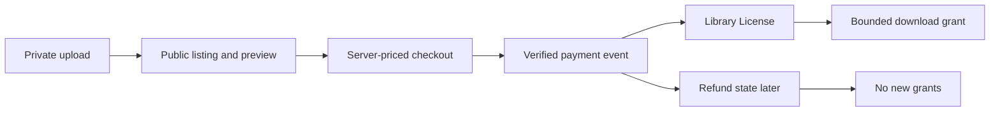

# Scope and the one-line flow

Write Midad's core journey on one line: a creator uploads a private file, publishes a Product with a public preview and license options, a buyer selects and pays, a verified event creates a License, the buyer opens a library and requests a short-lived download, and a verified refund stops new access. The order matters. An upload alone does not publish a Product. A browser payment redirect alone does not create access. A Product page alone does not expose the private original.

The diagram includes refund as a later branch, not as a way to delete the sale. A paid OrderLine remains evidence of what happened. A License can become revoked; DownloadGrants already issued remain in the audit trail. A signed URL may remain usable until expiry, and downloaded bytes cannot be removed from the buyer's device. This is a limitation to explain in policy copy, not a reason to avoid building the revocation check.

## What the core course includes

The project uses a Node and Express API, MongoDB models, a React client, private media storage, Stripe in test mode, Redis and a worker for delayed jobs. It includes creator and buyer accounts, studio-owned Products, public previews, private versioned ProductFiles, license options, one payment coordination path, per-creator Orders, durable Licenses, limited DownloadGrants, refund reconciliation, search, caching and a deployed HTTPS demo. Each module will build a portion of this path and test both a valid actor and a denied or stale case.

A Product can offer more than one license type, but this course keeps the policy small enough to explain. Personal and commercial terms have explicit version, price, seat and download limits. A buyer can read the terms before paying. The course does not attempt legal advice about every possible licensing dispute. The data model records which terms were offered and accepted, and the app enforces the bounded access rules it promises. Ask an instructor to review final wording before a real launch.

## What stays outside the core

There are no real money transfers to creators, tax calculation, royalty accounting, digital rights management that controls files after download, or promise to prevent every copy of a file. Stripe stays in test mode. The course does not build a marketplace for physical shipping, warehouse stock or carrier tracking. A creator may have a private upload process, but the project does not scan arbitrary files for every kind of malware or verify a font's legal ownership automatically. A production service would need operational and legal work beyond this teaching path.

Do not add an out-of-scope feature merely because a shared reference lesson contains it. A `stockQty` control on a font does not make sense. A shipping-address form for an ebook would collect data the product does not need. If a shared chapter mentions shelf units, translate the skill to Midad's actual record and note the replacement in your learning log. The full variant path should eventually be audited line by line; inherited language is not automatically safe simply because the server code compiles.

## A thin slice for each week

At the end of the first week, the API and client run, two Studios and two Buyers exist in the seed, and a Product can show a safe preview while its original remains private. The second week makes creator and buyer screens useful, including catalog browse and cart choices. The third week freezes server prices, verifies test payments and grants one License per paid line. The fourth week makes downloads, refund behavior, worker retries, deployment and capstone defense observable. These are demo targets, not permission to skip the intervening gates.

A thin slice includes its failure path. For the private-file slice, a public GET must omit the storage ID and an unauthenticated original URL request must fail. For fulfillment, a bad webhook signature creates no License and replay creates no duplicate. For downloads, an exhausted or revoked License grants no new URL. These tests belong with the feature; they are not optional polish after a screenshot.

## Write your own one-line contract

In your learning log, restate the flow in plain words for a creator and for a buyer. Mark the step where the server owns price, the step where the provider verifies payment, and the step where a buyer's current entitlement is checked. Then list two features that would be attractive but are outside this course. If you cannot tell which record backs a promise, circle the step and return to it in Module 5. The data-model chapter will turn this product flow into concrete relationships.

## Resolve a tempting shared lesson

A generic marketplace may have a `stockQty` field and a shipping-address page. In Midad, a font file does not have physical units to decrement. A license may have a seat or download limit, which is a different rule attached to a buyer's entitlement. A shipping address is unnecessary for instant digital delivery and would collect personal data without a purpose. When a shared lesson teaches a useful engineering skill through stock or shipping, adapt the underlying skill to License limits or file delivery rather than keeping the shelf-stock UI words.

The same care applies to order tracking. Midad does not show packed, shipped and delivered as courier states. It can show payment pending, fulfillment pending, license active, grant issued and revoked after refund. Those states have different evidence. A provider event changes payment state; a License record changes entitlement; a DownloadGrant records a delivery attempt. Do not rename a courier status to "downloaded" without defining what server event supports it. A URL issued is not proof that bytes reached the buyer's device.

## Mark responsibility at each transition

For upload to listing, the creator owns the decision to release a file, while the server validates the asset and keeps private storage separate from the preview. For cart to Checkout, the buyer chooses an option, while the server owns current price and currency. For Checkout to License, Stripe reports payment, while Midad verifies and writes entitlement. For License to grant, the buyer requests access, while the server checks limits and file version. For refund to revocation, a verified event and policy change current access. Write this actor/action map next to the flow diagram.

This map identifies tests. A client changing `priceMinor` should not change the provider amount. A creator using another Studio's Product ID should not release its file. A buyer using another buyer's License ID should not receive a grant. A duplicate webhook should not create a duplicate entitlement. These tests are within the scope because they protect promises made in the one-line flow. A recommendation engine, real creator payout and cross-device DRM are not needed to prove those promises.

## Explain the capstone boundary

The finished demo should show a creator publishing a safe preview, a buyer selecting distinct license terms, a test payment leading to one Library row, a time-limited download and a refund or limit denial. It should also show at least one failure that a user can understand, such as an exhausted download allowance with a clear message. A capstone that only shows the happy purchase path has not demonstrated Midad's hardest constraint: current access under payment, license and file policy.

Keep a separate list of stretch ideas. More complex team licensing, subscription billing, taxes, VAT, creator payouts and full rights enforcement are legitimate future products, but adding them now can obscure the core. Choose one after the core gates pass and an instructor agrees it improves the portfolio story. The next diagnostic checks whether the basic route, query, Git and arithmetic skills needed for this scope are ready.
