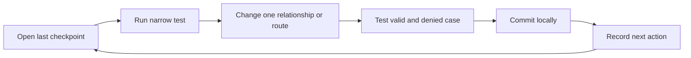

# Working rhythm on unreliable power

A power cut can happen halfway through a route, a file upload or a test run. Build Midad in steps that leave a recoverable record. At the start of a session, read the last learning-log entry and run the smallest passing test. At the end, commit a coherent slice and write the next action in one sentence. Local commits do not need internet. A later push can happen when the connection is available. This habit is part of engineering work, not a separate productivity ritual.

The diagram loops because returning after an interruption is normal. A useful checkpoint says "ProductFile model saved; cross-studio upload test still fails at line X" and includes the command to rerun. A vague "continue uploads" forces you to rediscover the state. Keep logs and commands in plain text so they can be read offline on a phone. If you capture screenshots, name what assertion they support; a raw response or test output is often smaller and clearer.

## Keep the seed lightweight

The course seed should create fictional Studios, Buyers, Products and small generated example files. It should not include a large copyrighted font archive or real buyer data. Small files upload quickly on a weak connection and make checksum tests repeatable. A seed run must be idempotent in a disposable development database so a power cut halfway through can be repaired by rerunning. Keep the database name and expected counts in the log; do not run reset scripts against production.

When a provider is unavailable, continue with local schema and pure-function tests that do not need the network. You can test price calculation, ISBN-like string validation in another variant, or License state transitions against a local database while an external storage service is down. For Midad, a local fake storage adapter can verify that the app never returns a private asset ID publicly, but the real provider integration still needs its later gate. Do not label a stub test as proof of a live private download.

## Separate secrets from evidence

Create `.env.example` with variable names and harmless placeholders. Keep real secrets only in an ignored local `.env` or deployment secret store. Before committing, inspect the diff for credentials, signed links, private asset IDs that should not be public, and real customer details. A signed URL may grant temporary access; pasting it into a learning log or issue is a data leak even if it expires later. Replace it with a redacted token and record only the expiry and status needed for the test.

For Stripe test mode, use test keys and test cards only. A webhook signature secret belongs on the server and should never be sent to React. If you need to share a failed webhook trace, include event type, local Checkout ID and redacted provider reference, not a full authorization header. Keeping evidence small and safe makes peer review possible without turning every debug note into a credential risk.

## Read errors before changing code

A 403, 409 and 500 describe different failures. A 403 on another buyer's License may be correct. A 409 when two checkouts claim one product offer may be an expected race. A 500 from a missing index build or provider call needs investigation. Record the raw status and server log correlation ID before editing a component. If the UI only says "Something went wrong," inspect the network response and database state to find which layer made the decision.

Change one cause at a time. If a download fails, first check authentication and License state, then selected ProductFile release, then provider URL issuance. Do not change all three layers together and celebrate when a test happens to pass. A narrow test for the current layer and one end-to-end replay later will give stronger evidence. The learning log is where you record that path so you can resume it after an interruption or explain it to a mentor.

## Work with a peer without losing ownership

A peer can review your ERD, try a wrong-buyer API request or challenge your refund explanation. They should not provide a completed capstone repository to copy. Share the smallest failing case and the decision you are uncertain about. Keep your own commits and be able to explain each one. At the capstone defense, you will need to describe why Midad separates paid OrderLines, current Licenses and short-lived grants; a codebase assembled without that reasoning will not help.

End today's session with one concrete checkpoint: last passing command, current failing command if any, and next file. The final chapter asks you to demonstrate this rhythm and say what the first week should produce. Save before moving on; the next module begins with the project skeleton, and a clean local starting point makes every later gate easier to interpret.

## Practice a restart during fulfillment

In a later test, the webhook handler may stop after creating one License for a two-line Checkout. On restart, processing the same verified event should find the existing License and create the missing one. The learning log should record both OrderLine IDs, the License count before and after retry, and the final state. Do not edit the database manually to make the demo look complete. A restart is an expected engineering condition and a valuable test of whether records carry enough identity to recover.

This exercise also changes how you write commits. Finish the unique index and the narrow fulfillment function before connecting it to a webhook route. Test the function with a fixture, commit it, then add provider verification. If power fails after the first commit, the local project still has a coherent tested unit. A giant commit that adds models, webhook, UI and worker at once is harder to resume or review.

## Use a low-bandwidth review packet

For a peer review, share the ERD as a small text or SVG file, a raw request transcript with redacted IDs, and the exact failing test command. A large video can be useful for the final demo but is a poor replacement for database and API evidence. If an instructor asks whether a different buyer can access Amina's License, a short 403 transcript and scoped query are easier to inspect than several minutes of clicking through screens. Keep screenshots for interface behavior that text cannot show.

Your local seed should also be small and repeatable. Two Studios, two Buyers, a handful of Products and tiny generated files are enough to prove ownership and entitlement. A large binary fixture slows upload, download and fresh setup, and may carry license terms you did not intend to redistribute. Use small assets you own for checksums and provider integration. Later, the product can set size limits for real creators; the course does not need huge files to test private delivery.

## Make a safe stopping point

Before turning off the laptop, check `git status`, write the last passing test in the learning log, and commit the current coherent change. If the current work is broken, state the failure and the next diagnostic step. Never save a real provider secret in a commit just to make a local test repeat. An `.env.example` with names and placeholders is enough for another learner to configure their own development instance.

When you return, read the note and run the narrow test before making another change. If it fails, investigate whether a service is down or the code changed rather than immediately editing the feature. This rhythm prevents a network outage from being mistaken for a schema bug and makes a long project possible on unreliable power.
