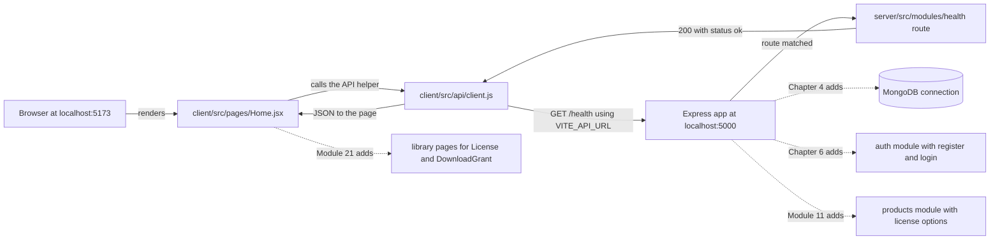

# 2.1 Set the scene

> **[Read]** · Chapter 02: Project skeleton · *What "standing the project on disk" means*

You cleared the introduction checklist. You know what you are building, how the course gates progress and what is in scope. **Nothing in your Midad repository exists yet**, or it should not, if you are starting clean.

<BigWordAlert term="Monorepo layout" plainEnglish="One Git repository that holds both the client app and the server app, usually in separate top-level folders." whyItMatters="Midad keeps `client/` and `server/` side by side so you can run, review and commit them together while keeping their concerns separate." />

This chapter is where that changes.

<ArticleBreak title="Before you write feature code: how Midad is wired" subtitle="A five-minute map of client, server and the first request" readMinutes={6}>

Midad runs as two applications: a Vite + React client and an Express + Node server. The client never talks to MongoDB directly. It calls HTTP routes on the server, and the server owns all data access.

This chapter exists for one narrow reason: to prove the wiring carries a request all the way through. The moment your Home page renders the payload that `GET /health` sent back, four separate facts are confirmed together: the Express process opened a port, the React app knows that address, the CORS rule let the browser keep the response, and JSON survived the trip out and back.

Every later chapter plugs into this same pattern. Authentication adds protected routes. The catalogue adds public read routes. Checkout adds payment routes. The skeleton is boring on purpose, because boring infrastructure is what lets exciting features ship safely.

</ArticleBreak>

<LearningObjectives objectives={["Explain how the React client talks to the Express API.", "Create a clear folder layout for client, server and shared code.", "Run both apps and prove the health check works."]} />

## Bridge from last chapter

Chapter 1 was about **clarity before code**. You named your product (or picked a working name), read what Midad is for, checked prerequisites, and learned how this course gates progress: finish one chapter's checklist before opening the next. You should have completed the Chapter 1 gate and learning log on the platform. None of that required a running app. It required you to understand *what* you are building and *how* the course expects you to work.

What carries forward: your product name, your learning log habit, and the discipline of not skipping gates. What does **not** carry forward yet: any folder structure in a repository you own. The introduction told you the story. This chapter makes the story **physical on disk**.

The role you take on now is **builder of the skeleton**. You are not designing the purchase record, wiring login, or choosing how a Product page looks. You are answering the boring questions every professional team answers on day one: where does the API live, where does the React app live, how do we know both halves are alive? When Chapter 4 adds MongoDB, it slots into folders you already understand. When Chapter 7 adds login pages, they land in the `client/src/pages/` folder you created here. This chapter is the floor everything else stands on.

<RealWorldEvent title="Shopify's modular commerce platform" when="2006-present" summary="Shopify grew from a single-product store builder into a platform with separate admin, storefront and API surfaces, all coordinated through clear project boundaries." lesson="Starting with a deliberate folder skeleton prevents painful renames later, when studio, catalogue and download code all need room to grow." />

## In plain English

| Term | Meaning |
|---|---|
| **Skeleton** | The empty but runnable shape of the app: folders, entry files, health check, before real features |
| **Monorepo** | One Git repository containing both `server/` and `client/` as separate apps |
| **Module folder** | A directory grouped by capability (auth, products, orders), not by technical type (all controllers together) |
| **Health check** | A simple API route that answers "is the server up?", your first proof the backend works |
| **Full stack** | Browser UI (client) talking to a Node API (server) over HTTP |
| **Scaffold** | Create folders and stub files so later chapters have named places to add code |
| **Gate** | Tickable outcomes at chapter end. You do not proceed until every box is checked |

## Think of it like...

**Opening a studio unit before the first Product goes on sale.** You rent the space, run power and network, hang the sign, and test the door lock while the room is still empty. The health check is that sign: it proves power and structure work before a single Product, ProductFile or license option exists. Later chapters are individual pieces of equipment moving in: the purchase record, the authentication module, the catalogue. If you skip the unit and start taking orders in a field, every delivery has nowhere to plug in.

<MustRead
  title="Introduction to client-side JavaScript frameworks"
  url="https://developer.mozilla.org/en-US/docs/Learn_web_development/Core/Frameworks_libraries/Introduction"
  source="MDN"
  description="Short MDN primer on why frameworks like React exist and what problems they solve. Helps you understand why the client is a separate app from Express."
  readMinutes={12}
/>

## Common questions

**Q: Why not start with MongoDB or login, the interesting parts?**
A: Because those features need *somewhere to live*. Without `server/src/modules/` and a running Express app, every later chapter would say "add this somewhere" and you would paste into random files you do not understand. Think of the studio unit again: you run the wiring and hang the sign before the equipment arrives. Get the skeleton right once, and every later feature (database, auth, catalogue) slots into a folder you already know.

**Q: Do I build inside the course folder (`multi-vendor-marketplace/`)?**
A: No. That folder is the textbook, and the course content lives there. Your app is a **separate Git repository** you create in sub-chapter 2.8, somewhere like `~/projects/midad-app/`. If you build inside the course folder, your app and the course materials get tangled, commits mix together, and instructions that say "create a file in your project root" become ambiguous. Keep the book on the shelf and your workspace separate, which is what real teams do too.

**Q: I have never used Express or Vite. Is this chapter too early?**
A: Not too early. This chapter introduces them **one small step at a time**. You install packages, create entry files, and verify with curl and the browser, so each concept appears the moment you need it. Unfamiliar errors will happen, and that is fine. Use the working rhythm from Chapter 1: read the message, search the docs, fix the smallest failing piece. By the end you will not be an Express expert. You will know enough to run a server and a client, which is precisely what the next chapter assumes.

**Q: Why two terminals, can one command run everything?**
A: Because the client and the server are **two separate programs** during development, and two terminals make it obvious which half broke. You run `npm run dev` in `server/` to start the API on port 5000, and `npm run dev` in `client/` to start the React app on port 5173. When something fails, the terminal that shows the error tells you exactly where to look. "Client works, API down" is a sentence you will say often. Running both from one command is possible later, but it hides the architecture you are here to learn.

**Q: What if I already have a MERN starter template?**
A: Unless it matches this course's **module-based** layout (`server/src/modules/...`), it will fight you. Every chapter names an exact path such as `modules/products/product.routes.js`, and if your repository has no `modules/` folder, you will translate every instruction for twenty chapters or drift away from the guide. Scaffolding fresh here takes an afternoon. Un-teaching someone else's boilerplate takes weeks. If you love your template, adapt it to the target tree in 2.3. Otherwise start clean and stay aligned.

**Q: What does the health check actually prove?**
A: The health check, `GET /health` returning `{ "status": "ok" }`, proves the wiring between Express and the browser works before you add anything complicated. When your React Home page fetches that endpoint and displays the result, you have confirmed the server boots and listens, the client renders, HTTP works across the two, and your folder conventions hold real files. It is the smallest possible proof that the full stack loop is alive. Skip it and you would debug connection problems later with database and authentication code mixed in, which is much harder.

## Where you are

| You have | You do not have yet |
|---|---|
| A name for your product (or a working name) | A Git repository with code |
| The course outline in your head | `server/` or `client/` folders |
| Chapter 1 gate cleared on the platform | A running API or React app |
| Prerequisites checked (Node, Git, editor) | MongoDB connected, which is Chapter 4 |

Chapter 1 was **mindset and product**. Chapter 2 is **the skeleton**: the physical shape of the application on disk, before the purchase record, authentication or catalogue logic.

## What "standing the project on disk" means

Professional teams do not start by writing a login handler. They start by answering four boring questions:

- Where does the API code live?
- Where does the React code live?
- How do we start each app with one command?
- How do we know both halves are alive?

**Standing the project on disk** is the phrase this course uses for one specific result. By the end of the chapter you open your own repository in an editor and recognise every folder you see, start each half with a single command in its own terminal, and put something on screen that a mentor can watch: the React Home page requesting health from Express and printing the JSON that comes back.

No users. No products. No MongoDB. Still a **working full stack skeleton**, and every future chapter attaches to it the way scaffolding attaches to a building.

## Read the diagram as one loop

The diagram draws the loop you will prove in sub-chapter 2.16, before either application exists. Solid arrows are the requests this chapter builds. Dotted arrows are the places later modules attach to the same skeleton. Nothing in the drawing reaches a database, because Chapter 4 has not happened yet.

Three things are worth noticing. The browser never reaches Express without passing through one helper file, so the base URL has a single home. Every later module is a new branch off the same server process, not a second server. The last two dotted arrows show that the client grows by adding pages to the same folder, which is why the folder names matter more than the files inside them today.

The takeaway is that the skeleton is one loop with four fixed points: a page, an API helper, a base URL and a route. Every later module extends that loop rather than inventing a second one. If you can name the four points from memory at the end of the chapter, the folder tree is doing its job.

## Why this chapter comes before MongoDB

Chapter 4 connects MongoDB. Chapter 5 builds the schemas. You might wonder why not start with the database.

Because the **app must exist before the app needs a database**. The health check in this chapter proves:

- Express boots and listens
- React boots and renders
- HTTP works between browser and server
- Your folder conventions hold real files

When Chapter 4 adds `MONGODB_URI`, it slots into `server/src/shared/`, a place you already created and understand. If you started with Mongoose before you had `app.js`, every chapter would say "add this somewhere" and you would paste into random files.

**Order matters:** skeleton, then config and database, then data model, then features.

## What this chapter is not

- **Not** the authentication chapter: no JWT, no passwords
- **Not** the data model: no User, Studio or Product schemas yet
- **Not** a UI design chapter: one plain Home page is enough
- **Not** deployment: localhost only

It **is** the chapter where you make the **one structural decision** the rest of the course assumes: **module-based folders** in `server/src/modules/`. Change that later and every subsequent chapter's file paths stop matching.

## The milestone you will feel

When this chapter's gate clears, you will say:

> *"I built the project skeleton."*

That means five things:

1. One Git repository with `server/` and `client/`
2. Module-based server layout committed
3. `GET /health` returns `{ "status": "ok" }` (or equivalent JSON)
4. The React Home page displays the health response from your API
5. You can draw the folder tree from memory

That is Week 1's **first demo brick**. The second brick is MongoDB plus seed data, in Chapters 4 and 5.

## How this chapter is organized

You will move through the usual arc:

**Open (2.1 to 2.3):** why structure matters, and a preview of the tree
**Learn (2.4 to 2.6):** layer versus module, client versus server, the mandatory read
**Build (2.8 to 2.16):** create the repository, server folders, health route, client, connection
**Wrap (2.17 to 2.19):** optional practice, recap, checklist gate

Sub-chapter **2.7** is a short project structure knowledge check. Use it to confirm the client and server boundary before the build begins.

Each **build** sub-chapter is one concrete action: create this folder, create this file, verify with this command. You write the logic. The course specifies behaviour and contracts.

## Continuity promise

Every build sub-chapter opens with **where the repository stands** after the previous step. You should never wonder "what file do I touch next?", only "how do I write this function?", which is yours to figure out from the spec.

Sub-chapter 2.8 leaves you holding a Git repository with a first commit in it.
By 2.11 the Express process answers requests on a port.
By 2.13 the React client renders its Home page in a browser tab.
By 2.15 that page has fetched real JSON from the API instead of a typed string.
Sub-chapter 2.16 turns the moment into your **first screenshot** for the portfolio.

## Before you continue

- [ ] Chapter 1 checklist cleared
- [ ] Node 18+ and Git verified (`node --version`, `git --version`)
- [ ] Empty directory chosen for your marketplace repository (outside the course content folder)
- [ ] Editor ready, because you will create many files this chapter

**Estimated time:** one full work day at medium pace. Faster if you have scaffolded a MERN app before, slower if Vite or Express are new, and that is fine.

## Time and tooling expectations

| Sub-chapter range | Focus | Rough time |
|---|---|---|
| 2.1 to 2.7 | Understand structure and the reads | 2 to 4 hours |
| 2.8 to 2.11 | Server repository and health API | 3 to 5 hours |
| 2.12 to 2.16 | Client and full stack connection | 3 to 5 hours |
| 2.17 to 2.19 | Stretch work, recap, gate | 1 to 2 hours |

If Express or Vite are new, expect the upper end, not because the steps are complex but because unfamiliar tooling generates searchable errors. That is normal. The working rhythm from Chapter 1 applies: read the error, check the docs, reduce to the smallest failing case.

## Two repositories, do not confuse them

You are reading course files in the **guides** repository (or folder) that contains the `multi-vendor-marketplace/` course content. You are **building** in a **separate Git repository** you create in 2.8. Never commit your app into the course textbook folder unless a mentor explicitly uses one monorepo for both. The default is a **separate app repository**.

## Key ideas

- Chapter 2 is the **skeleton on disk**, not features
- **Server and client** both exist before MongoDB
- **Module folders** are decided here
- The **end demo** is the browser showing API health
- Your app lives in a **separate repository** from the course materials

## Mentor checkpoint

Before sub-chapter 2.8, confirm four things: an empty directory chosen, Node 18 or newer, Git installed, and the Chapter 1 learning log written. Missing any of these is cheaper to fix now than after you have scaffolded the wrong folder.

Next: why folder structure is a real decision, not decoration.
