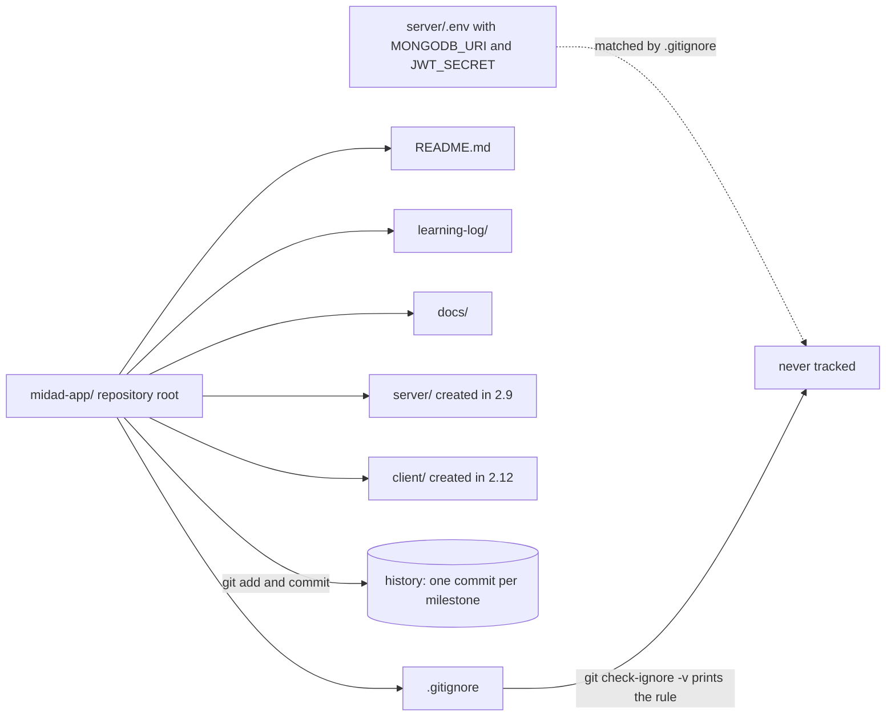

# 2.8 Create the repo

> **[Build]** · Chapter 02: Project skeleton · *Init Git, root `.gitignore`, `README.md` stub*

**Why this step matters:** Everything you build for Midad lives in a repository you own, not in the course guides folder. This step creates that root with Git, ignore rules and a learning log, so every later sub-chapter has a committed home and secrets stay out of history from day one.

<BigWordAlert term="Git repository" plainEnglish="A version-controlled project folder where every change is tracked and reversible." whyItMatters="Midad lives in one repository from day one, and commits mark chapter milestones you can demo or roll back." />

**Where the project is now:** You have no application repository, only the course materials you read. After this sub-chapter you have a Git root with ignore rules and a place for the learning log.

**After this step:** You own a Git repository with a root `.gitignore` that keeps secrets out, a README stub, and a `learning-log/` folder, the committed home every later sub-chapter builds inside.

## What you must do

Create a **new directory** for your marketplace application, **not** inside the course guides folder. Initialise Git in it, add a root `.gitignore`, and stub `README.md`.

Three decisions are bundled into this one step, and they are worth separating before you type anything. The first is ownership: the code belongs to a repository you control, so a mentor reviews your history rather than the course's. The second is shape: one repository with two application folders, so a milestone commit can contain a server change and the client change that proves it in the same review. The third is hygiene: ignore rules land before the first commit, because a file that reaches history stays in history.

Everything after this sub-chapter assumes those three decisions. Sub-chapter 2.9 creates `server/` inside this root. Sub-chapter 2.12 creates `client/` beside it. Chapters 3 to 8 write into `docs/`. Every gate reads `learning-log/`. If this root is wrong, twenty later steps are built on the wrong floor.

## Step 1: Create the project directory

Choose a name that matches your product, for example `midad-app`, `nour-type-foundry` or `licensed-work`. Keep it lowercase, use hyphens instead of spaces, and avoid a name you will want to change in week three. The directory name appears in your remote URL, in your mentor's instructions and in every path you copy from a terminal, so an awkward name is a small tax you pay all course.

```bash
mkdir midad-app
cd midad-app
```

This directory is the **monorepo root**. `server/` and `client/` are created inside it in the next sub-chapters, each with its own `package.json` and its own process. Do not create them in this step. The first commit should contain only the scaffolding decisions, so the history opens with a commit that is easy to read.

If the command fails on Windows because the shell is PowerShell, `mkdir` still works and `cd` still works. If a folder with that name already exists, `cd` into it and run `ls -a` before continuing, because you may be standing on an old attempt with a stale `.git` inside.

## Step 2: Initialise Git

```bash
git init
git branch --show-current
```

Newer Git versions print `main`, older ones print `master`. Either is fine, as long as you know which one you have, because the answer appears later when you push and the remote expects a branch name. If you prefer `main` and your Git created `master`, run `git branch -M main` now, while there is no history to rewrite.

Choose a commit identity before your first commit rather than after your tenth, so the history is attributable to you:

```bash
git config user.name "Your Name"
git config user.email "you@example.com"
```

Use the same email as your host account if you plan to push to a hosted remote. A mismatched email is a cosmetic problem, not a break, but it makes commit authorship confusing in a review.

Do not commit secrets in this or any future commit. That sentence is short and it is the whole reason the next step exists.

## Step 3: Root `.gitignore`

Create `.gitignore` at the **repository root** with at least these rules:

```gitignore
# Dependencies, reinstall from package.json
node_modules/

# Environment files, secrets never in Git
.env
.env.local
.env.*.local

# Logs
npm-debug.log*
*.log

# OS and editor files
.DS_Store
Thumbs.db
.idea/
.vscode/*
!.vscode/extensions.json

# Build output
dist/
build/

# Test coverage
coverage/
```

Write this file before the first commit, not after the first mistake. Git history is append-only: a file that is committed and later deleted is still present in that earlier commit, and anyone who clones the repository can read it. Removing it with `git rm --cached` stops tracking the file from now on, but it does not remove it from the commit you already made. Erasing it means rewriting history, force pushing and asking every collaborator to re-clone, which costs a morning and buys back a value you have already leaked.

For Midad specifically, three of these rules matter more than the rest. `node_modules/` matters because it holds tens of thousands of files and cannot be reviewed. `.env` matters because Chapter 4 puts `MONGODB_URI` there and Chapter 6 puts `JWT_SECRET` there, and either value in history compromises every deployment that reuses it. `dist/` matters because a build artefact in history makes every later build commit enormous.

**Do:** verify the ignore works *before* the first commit.

```bash
touch .env
git status
git check-ignore -v .env
rm .env
```

`git check-ignore -v` is the stronger check and it prints the exact file, line number and pattern that matched. That output is the evidence a gate asks for, because it answers the precise question "which rule keeps this file out". A file that fails to appear in `git status` is not proof of anything on its own: it may be ignored, or it may sit inside a directory that is ignored, or you may be running the command in the wrong folder.

**Do not:** run `git add -f .env` "just once". The `-f` flag exists to override the ignore file, which means it converts a protected value into a permanent part of your history in one keystroke.

## Step 4: Stub `README.md`

The README is the runbook for a person who has just cloned the repository. It needs three facts and no marketing: what the project is, where each application lives, and how to start each one. Write it now, before the code arrives, because the second reader of this repository is your future self in week two with no memory of which terminal starts what.

```markdown
# Midad

Multi-creator marketplace for licensed digital work. MERN stack.

## Structure

Two top-level folders, one per process, each with its own dependencies, config and lifecycle:

- server/ : Express API
- client/ : React app built with Vite

## Run locally

API:
cd server && npm install && npm run dev

Client:
cd client && npm install && npm run dev

The API listens on port 5000 and the client on port 5173.

## Author

Your name, course project
```

Replace **Midad** with your product name. If your product has no name yet, keep Midad and change it in one commit later, which is cheaper than blocking on branding.

Keep the two run commands even though the folders do not exist yet. They are the commands you will run in 2.16, and writing them now means the README is a plan you verify rather than a document you write from memory at the end. A reviewer reads this section first, and a README whose commands fail is worse than no README at all.

## Step 5: Learning log folder

```bash
mkdir -p learning-log
touch learning-log/notes.md
```

The learning log lives inside the repository rather than in a private notes app for one reason: the gates read it. Every chapter closes with questions that ask you to explain a decision, and your answers are the evidence that you understood the step rather than copied it. Committing the answers dates them, so a mentor can see what you believed at the end of Chapter 2 and compare it with what you can explain in Chapter 8.

Keep one file per chapter (`learning-log/chapter-02.md`) and append rather than rewrite. A log that is edited to look correct afterwards is not a log.

## Step 6: The `docs/` folder

```bash
mkdir -p docs
touch docs/README.md
```

Empty is fine for now. Chapter 3 puts the draft ERD here, Chapter 8 the authorization matrix, and later chapters add evidence notes a reviewer opens at the gate. Keeping these documents tracked means the reviewer finds them without asking you where they live, which is the difference between a review that takes ten minutes and one that takes an afternoon.

The `touch docs/README.md` exists for a Git reason: Git tracks files, not directories. An empty folder is invisible to `git add`, so a folder you created in this step would not appear in your first commit at all. Later lessons use `.gitkeep` files for the same purpose.

## Step 7: First commit

```bash
git add .
git status
git commit -m "chore: initialize repository with ignore rules and learning log"
```

The `git status` between `add` and `commit` is the review step, and it is not optional. Read the list of staged files before you commit. If you see `node_modules/`, the ignore file is in the wrong directory or it was written after a dependency install. If you see `.env`, stop and fix the ignore rules, because the commit that follows is the expensive kind. If you see a file you do not recognise, open it before staging rather than after.

Prefix commit messages with the kind of change: `chore` for scaffolding, `feat` for behaviour a buyer or creator can notice, `docs` for writing, `fix` for a correction. One milestone per commit, which in this chapter means one commit per sub-chapter. A reviewer who opens your history should be able to read the chapter order straight down the log, and a single commit called "progress" destroys that.

Do not commit the course folder, and do not commit a copy of these instructions. The repository is your application. If a file would not be needed by someone cloning your app, it does not belong in the commit.

## Read the diagram as what Git will see

The diagram shows the same root from Git's point of view. Solid arrows are things Git tracks and commits. The dotted arrow is the one path that must never reach history, and the check beside it is the command that proves the rule works.



Two things are worth noticing. The two application folders hang off the same root rather than existing as separate repositories, which is what lets one commit show a server route and the client call that uses it. And the ignored path is drawn outside the root on purpose: a secret is a value from your environment, not part of your source, and the ignore rule is the wall between them.

The takeaway is that the first commit is a decision about what your project is. Everything inside the root is reviewed by whoever clones it. Everything matched by the ignore file stays on your machine, and that is where connection strings and signing keys belong for the whole course.

## Failure modes you will actually meet

**Git initialised in the wrong directory.** `git status` lists thousands of files, or paths starting with `Desktop/` and `Downloads/`. You ran `git init` in your home directory. Confirm the root with `git rev-parse --show-toplevel`. If it points somewhere above your project, delete the stray `.git` at that level, `cd` into the project folder and initialise again inside it.

**A secret reached the first commit.** You see `.env` in `git log --all -- "**/.env"`. Rotate the value first, because the value is compromised whatever you do to the history. Then, before the first push, remove the file from history with an interactive rebase or by deleting `.git` and starting the commit again. In this chapter the file does not exist yet, which is exactly why the check is cheap today and expensive in Chapter 6.

**A nested repository.** Some generators create a `.git` folder inside the app they scaffold. A nested repository is a small island: the parent repository records a pointer instead of your files, and a clone of the parent gets an empty folder. Find them with `find . -name .git -maxdepth 2` and delete the inner one, then commit from the root.

**The default branch name.** Your local branch is `master` and the remote expects `main`, or the reverse. The mismatch appears at the push, not at the commit, so settle it in step 2 with `git branch --show-current` and `git branch -M main`.

**Windows line endings.** Every file shows as modified immediately after a clone, and you have changed nothing. That is `core.autocrlf` converting line endings. Set `git config core.autocrlf true` on Windows and commit a `.gitattributes` file if the noise continues.

**An empty folder that never appears in the commit.** Git cannot track a directory that contains no files. If `docs/` is missing from `git status`, it is not ignored, it is empty. The `touch` commands in steps 5 and 6 exist to prevent the confusion.

## Verify, then push

| Check | Expected |
|---|---|
| `git log --oneline` | exactly one commit |
| `git status` | clean working tree, nothing untracked |
| `git check-ignore -v .env` | prints the matching `.gitignore` line |
| `git log --all -- "**/.env"` | empty output |
| `README.md` | names the two folders and the two start commands |

Each row answers a different question, and together they are the evidence a gate expects. `git log` proves the commit exists. `git status` proves nothing was left behind. `git check-ignore` proves the rule matches rather than merely sitting in a file. The `git log` search for `.env` proves the rule was in force from the first commit, not added afterwards. The README row proves a second person could start the project.

Create an empty remote on your host, then connect and push:

```bash
git remote add origin https://github.com/your-handle/midad-app.git
git push -u origin main
```

A private repository is fine, but your mentor must be able to open it before you submit. Access is part of the gate, because a link that returns 404 reads as a missing repository rather than a private one.

```openquestion
prompt: Paste the GitHub repository URL for your Midad project and briefly confirm that the first commit is pushed and no secrets are tracked.
submissionMode: url_required
allowUrl: true
urlRequired: true
urlLabel: Midad repository
urlHint: Paste a public or mentor-accessible GitHub repository URL. If it is private, give your mentor access before submitting.
minWords: 0
required: true
```

## Do and do not

**Do:** commit after each major sub-chapter through Chapter 2, at 2.11, 2.15 and 2.16, so the history matches the milestones.

**Do:** keep `.gitignore` at the repository root even after you add a second copy inside `client/`. Two files covering overlapping patterns is harmless. A missing root file is not.

**Do not:** clone someone else's marketplace repository and erase their code. Start empty, because the course builds the structure with you and a half-erased repository keeps decisions nobody can explain.

**Do not:** put `server/` or `client/` outside this root. One product, one history.

## Hint

If `git status` shows a path above your project, or thousands of files you never created, you initialised Git in a parent folder. Run `git rev-parse --show-toplevel` to see which directory owns the repository, `cd` into the intended project folder only, remove the mistaken `.git` if needed, and initialise again **inside** `midad-app/`.

## What is next

**Sub-chapter 2.9:** create the `server/` folder skeleton, with `src/app.js`, `src/server.js`, `modules/` and `shared/`.

Continue when the first commit is pushed.
