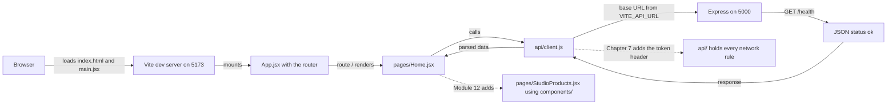

# 2.12 Scaffold client folders

> **[Build]** · Chapter 02: Project skeleton · *A Vite React app in `client/`, with `src/pages/`, `src/components/`, `src/api/` and `src/hooks/`*

**Why this step matters:** Midad is a product people see in a browser, not a headless API. Scaffolding Vite and React now establishes where login pages, catalogue screens and API helpers live for the rest of the course.

<BigWordAlert term="React single page app" plainEnglish="One HTML page whose JavaScript swaps screens in place, so a route change does not reload the whole document." whyItMatters="Midad's client starts as one page and one router. Catalogue, library and Studio screens plug into the same shell later." />

**Where the project is now:** The server runs, and `GET /health` returns 200 JSON when you call it with curl.

**After this step:** A Vite and React app exists in `client/`, with `pages/`, `components/`, `api/` and `hooks/` folders committed.

## What this step decides

The server step decided where behaviour lives. This step decides where the browser code lives, and the four folders you create are answers to four different questions. Where does a screen attached to a URL live? Where does a piece of interface that several screens share live? Where does a network call live? Where does state that several screens share live?

Those questions look cosmetic at the size of one Home page and stop being cosmetic by Chapter 15, when the product page, the license comparison and the library all show the same product title and the same DownloadGrant state. A client with no answer grows one folder called `components` that contains screens, helpers and fetch calls, and every later chapter adds to the pile.

The second decision in this step is the tool. Vite is the development server and bundler, and React is the view library. Vite serves the app in development with hot module replacement, and builds a static bundle in production. It is not a framework with opinions about routing or data, which is why the router arrives in the next sub-chapter as a separate and visible choice.

## Step 1: Create the Vite React app

Run this from the **repository root**, not from inside `server/`:

```bash
npm create vite@latest client -- --template react
```

When prompted for a variant, choose **JavaScript** rather than TypeScript. The reason is consistency rather than taste: every server file in this course is JavaScript, every code sample is JavaScript, and a beginner translating types in two languages at once spends attention on annotations instead of on the request path. If you already work in TypeScript daily, keep JavaScript for the course and add types in a personal branch afterwards.

The command creates `client/` with a `package.json`, an `index.html`, a Vite config and a `src/` folder containing `main.jsx` and `App.jsx`. Read those three files now, because they are the whole boot sequence:

```jsx
// client/src/main.jsx
import { StrictMode } from "react";
import { createRoot } from "react-dom/client";
import App from "./App.jsx";

createRoot(document.getElementById("root")).render(
  <StrictMode>
    <App />
  </StrictMode>,
);
```

`index.html` holds a single element with `id="root"`. `main.jsx` finds that element and mounts `App` inside it. Everything else you build is a child of `App`. That is why the router belongs in `App.jsx` in the next sub-chapter, and why the folder tree matters more than any individual file inside it.

```bash
cd client
npm install
```

The install reads `package.json` and writes `node_modules/` and a lock file. Commit the lock file. Ignore `node_modules/`, which your root `.gitignore` already handles.

## Step 2: The target client tree

This is the shape after this sub-chapter:

```
client/
├── index.html
├── package.json
├── vite.config.js
├── public/
└── src/
    ├── main.jsx
    ├── App.jsx
    ├── index.css
    ├── pages/
    │   └── .gitkeep
    ├── components/
    │   └── .gitkeep
    ├── api/
    │   └── .gitkeep
    └── hooks/
        └── .gitkeep
```

Compare it with the Vite default and note what changed: nothing was deleted except the demo assets you do not need, and four folders were added. The default `App.jsx` shows a counter and two logos. You will replace it in 2.13 with a router and one Home page. Leaving the demo content in place for one sub-chapter is fine and keeps the diff small.

## Step 3: Create the four folders

```bash
cd client/src
mkdir -p pages components api hooks
touch pages/.gitkeep components/.gitkeep api/.gitkeep hooks/.gitkeep
```

The `.gitkeep` files exist because Git tracks files rather than directories. Without them the four folders are invisible to `git add`, so your first client commit would contain none of the structure you just decided.

Here is the job of each folder, stated once so later chapters can point back at it:

`pages/` holds route level screens. A file in `pages/` is what a URL renders: `Home.jsx` for `/`, `Login.jsx` for `/login`, `StudioProducts.jsx` for the creator's product table. Pages compose components and call the API. They are allowed to know about routing.

`components/` holds interface pieces with no route of their own: a layout wrapper, a product card, a license option table, a status badge. The test for this folder is whether a second page could import the file without changing it.

`api/` holds the network boundary. One helper builds the base URL from the environment, attaches the JSON headers, and later attaches the access token. Components never call `fetch` directly, because a base URL spread across twenty files is twenty places to fix when the port changes.

`hooks/` holds reusable state logic. In Chapter 7 the authentication context lands here, and pages read `useAuth()` instead of repeating the token logic.

If you are ever unsure where a new file belongs, ask which of those four sentences it satisfies. A file that satisfies none of them usually belongs beside the server code where it is used.

## Step 4: Verify the dev server

```bash
cd client
npm run dev
```

**Expected:** the terminal prints a local URL, typically `http://localhost:5173`, and the browser shows the Vite and React demo page. Open the browser console and confirm it is empty of errors. Stop the server with Ctrl+C once you have seen the page.

Open the page with the server stopped and you get a browser error instead of a page, which is the correct behaviour: in development the Vite server serves the HTML. That surprises people who expect a static file to open from disk, and it explains why `client/index.html` alone is not the app.

## Step 5: Client `.gitignore`

The Vite template usually writes a `client/.gitignore`. Confirm it contains these four patterns:

```gitignore
node_modules
dist
.env
.env.local
```

Your root `.gitignore` already covers most of them, and duplicate patterns in a nested file are harmless. Keep both, because the nested file protects the folder if it is ever copied into another project, and the root file protects the repository if the nested one is deleted.

## Step 6: Commit

From the repository root:

```bash
git add client/
git commit -m "chore(client): scaffold vite react app with folder convention"
```

Check `git status` between the two commands, as in the previous sub-chapter. The staged list should contain the client source, the lock file and four `.gitkeep` files. It should not contain `node_modules/` or `dist/`. If `node_modules` appears, the ignore rule is not matching, and the fix belongs in the ignore file rather than in a `git reset` you will repeat tomorrow.

## Read the diagram as one request

The diagram follows a single page load from the browser to the health route and back. It is the same loop you will prove in 2.15, drawn at the level of folders. Solid arrows are the path a request takes today. The dotted arrow is the file that later grows an `Authorization` header.



Two things are worth noticing. The page never owns a URL or a port: it asks the helper, and the helper reads one environment variable. And `components/` appears only through the dotted arrow, because in this chapter the Home page is a single file. The folder is empty on purpose, waiting for the first piece of interface that two screens want to share.

The takeaway is that a client folder structure is a set of boundaries rather than a filing system. Screens may know routes, components may not. Network rules live in one helper, so a port or header change is one edit. When a later chapter asks you to add a screen, you should be able to name the file and its folder before you open the editor.

## Why not proxy the API through Vite

Vite can forward `/api` requests to another port, and for many teams that is the right default. This course does not use it, for a teaching reason: a proxy hides the browser's origin, so CORS the browser applies to cross origin requests. If the proxy is in place, Chapter 2's integration step proves less, and the CORS configuration in 2.15 becomes cargo cult rather than a decision you can explain.

The course keeps an explicit `VITE_API_URL` and a CORS rule on the server. You can see the origin, the request and the response in the Network tab without asking a tool to translate for you. If you choose a proxy anyway, document it in your learning log and say how you verified the origin rule, because a reviewer will ask.

## Failure modes you will actually meet

**`npm create vite` refuses to run.** The message usually names a Node version. Vite requires Node 18 or newer, and this course assumes LTS. Check with `node --version`, install the current LTS, and open a new terminal so the new binary is on the path.

**The scaffold lands in the wrong place.** You ran the command from inside `server/`, so you now have `server/client/`. Move the folder to the root with `mv server/client ./client`, or delete it and re-run from the root. Two applications in one folder makes every later path wrong.

**Port 5173 is already in use.** Vite prints a warning and picks the next free port, which is harmless but means your CORS origin from 2.15 may not match. Stop the other process, or note the new port and keep the allow list in step with it.

**The page is blank.** Open the browser console. A blank page with an error about `main.jsx` usually means the script path in `index.html` was edited. A blank page with no error usually means `App` renders nothing because you replaced it early. Restore from Git and make the change again in the right sub-chapter.

**The build fails but the dev server works.** These are different pipelines. `npm run build` type checks nothing but it does resolve every import, so a file that exists only on a case insensitive filesystem can fail. Rename the import to match the file name exactly.

**An environment variable is undefined.** Vite only exposes variables that start with `VITE_`, and only at build or server start. `VITE_API_URL` must be in `client/.env`, and you must restart the dev server after editing it.

**`dist/` appears in `git status` after a build.** The build output is not ignored. Add `dist/` to `client/.gitignore` and remove the folder from the index with `git rm -r --cached dist`.

## Verify, and what each check proves

| Check | Expected |
|---|---|
| `client/package.json` exists | yes |
| `npm run dev` in `client/` shows the React page | yes |
| `src/pages`, `src/components`, `src/api`, `src/hooks` exist | yes |
| Four `.gitkeep` files committed | yes |
| `git status` after the commit | clean |

Each row answers a different question. The `package.json` row proves dependencies are declared in the client rather than borrowed from the server. The dev server row proves the toolchain runs. The folder row proves the structure survived the commit, which is where empty directories usually disappear. The `.gitkeep` row proves Git actually holds the directories. The clean status row proves nothing was left uncommitted.

## npm scripts from the template

| Script | Purpose |
|---|---|
| `npm run dev` | Development server with hot module replacement |
| `npm run build` | Production bundle written to `dist/` |
| `npm run preview` | Serves the production build locally |

You will use `build` at deployment. `preview` is the cheapest way to catch a mistake that only appears in a production bundle, because a build can succeed while an import used only at runtime is missing.

## What each client folder holds later

| Folder | Chapter 2 | Later |
|---|---|---|
| `pages/` | `Home.jsx`, 2.13 to 2.15 | Login, register, catalogue, product page, Studio tables, library |
| `components/` | empty | Layout, product card, license option table, status badge |
| `api/` | `client.js`, 2.14 | Central fetch, base URL, access token header, refresh on 401 |
| `hooks/` | empty | `useAuth` in Chapter 7, shared loading and error state |

## Do and do not

**Do:** keep `client/` as a sibling of `server/`, not nested inside it, so two processes have two roots and one repository.

**Do:** run the client and server dev scripts in separate terminals from 2.15 onward, so an error in one is not buried under logs from the other.

**Do not:** put Express code inside `client/`, ever. The client code ships to the browser, and anything in it is readable by every visitor.

**Do not:** call `fetch` from a page while this chapter is still fresh. The helper in 2.14 exists so the base URL has exactly one home.

**Do not:** commit `dist/` or `node_modules/`. Both can be rebuilt from the lock file, and both make a review unreadable.

## Hint

If `npm create vite` fails, check `node --version` first. If it still fails, scaffold manually from the official Vite guide with the same template, then continue with step 2. The folder tree is what this step is graded on, and the tree does not care which command produced it.

## Next

**Sub-chapter 2.13:** the React Router shell and a `pages/Home.jsx` placeholder. Keep it minimal, because the health fetch arrives in 2.15.
