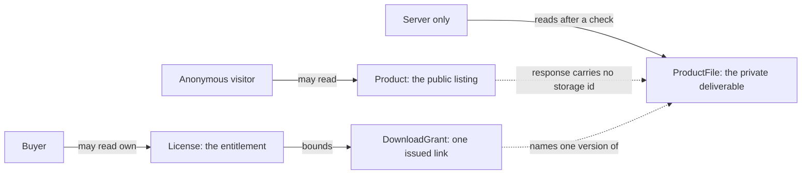

# A listing, a private file and a licence

Nour publishes a font family on Midad. The page shows one title, four preview images, a paragraph about the typeface, and two prices: a personal license at 1,200 minor units and a commercial license at 4,800. Everything a visitor needs in order to decide fits on one phone screen. Behind that screen sit three records that answer three different questions, and this module decides where each one lives.

The listing answers what a visitor may look at. The private file answers what the buyer is allowed to download. The license answers who earned that right, under which terms, with how many seats and how many downloads left. One database, three audiences, three lifetimes. A model that merges them feels tidy for a week and then blocks every feature the course builds after it.

## Where the project is now

Module 2 left you with two running processes. The API answers `GET /health` with 200, the client loads and reads its API base URL from an environment variable, and both can be started from one command. Restart the API and every record you create disappears, because nothing persists yet.

That is the right order to build in. You have a skeleton, a request path and a place to put code, and no schema to defend. Before you install a driver or connect a cluster, you decide what shape the data has to hold. Chapters 4 and 5 will then be short mechanical work, because the arguments about shape have already happened here.

## Three records, three readers

The **Product** is the public listing. It carries the title, the description, the file format, the category, the preview images and the two license options with their prices, seat limits, download limits and terms version. It is read by anonymous visitors, by the catalogue endpoint that caches it, and by search. It is written by one creator, a few times a week, and it never contains a storage identifier for the deliverable.

The **ProductFile** is the private deliverable. It records which version of which file sits in storage, its byte size, its SHA-256 checksum and when it was released. Only the server reads it, and only after the server has proven that the caller holds an active license for that product and that version. The catalogue serializer never selects it, and the browser never sees its storage identifier.

The **License** is the entitlement. It records the buyer, the paid order line it came from, the license key, the license type, the accepted terms version, the seat limit, the downloads remaining and a status that can become `revoked`. It is created by a verified payment event, changed when a download is issued or a seat is assigned, and taken away when a refund is confirmed. A license is the only record that can answer whether a particular person may download a particular file right now.

## The trap of one record

The tempting model is one Product document with a `fileUrl`, a `purchasedBy` email and a `downloadsLeft` number. It looks like it saves a join, and it breaks in four separate ways within the same week. The catalogue endpoint starts returning the URL. A second buyer overwrites the first buyer's email. A refund has no record to change, so it changes a counter that several buyers share. And the download limit becomes a global number that describes nobody in particular.

None of those is a crash. Each is a question the model cannot answer, discovered after a feature was promised. Ask the model whose purchase the boolean `purchased` describes when Amina buys the personal license and Kareem buys the commercial one from the same page. The honest answer is that it describes neither of them, and the field has to go.

The version is the second half of the same mistake. A creator will upload a corrected file, and an earlier buyer's receipt has to stay true to the version they bought. If the listing holds one `currentFile` pointer and the license holds no version at all, a replacement silently changes what every old buyer receives. Keeping the file as its own versioned record makes that decision explicit instead of accidental.

## What this module has to leave room for

Four more records arrive later in the course, and the draft you write this week has to be able to hold them without a redesign. A **Checkout** is one payment covering a cart that may hold products from two or three studios. An **Order** is the per-studio half of that payment: a buyer pays once, and each creator sees only their own order. The order holds **snapshot lines** that freeze the price, license type, seat limit, download limit and terms version the buyer accepted, so a later edit to the product cannot rewrite a receipt.

A **DownloadGrant** is the audit record of one issued link. It names the license, the buyer, the file version, the time it was issued and the time it stops working. It is not the permission itself, because a grant that has expired says nothing about whether the license is still active. Keeping the two apart lets a refund revoke the license while the history of what was issued stays readable.

A **Refund** is the record of money going back, scoped to one order and therefore to one creator. In a split payment the buyer may be refunded for one creator's order while the other creator's license keeps working. A model that only knows about a whole checkout cannot express that, which is why the order exists between the payment and the license.

Seats and terms deserve their own sentence. A commercial license allows a fixed number of named people to use the files, so a license needs a seat list with a known maximum. Terms change over time, so the license records the terms version the buyer accepted, not a pointer to whatever text the creator has edited since. Both of these are small numbers and short strings attached to one license, and both are read and written with that license rather than on their own.

## Read the diagram as three readers

The diagram shows the three records and who may reach each one. Solid arrows are reads by a person or by the server. Dotted arrows are the two relationships that are easy to get wrong: the catalogue has no path to the private file, and a download grant points at one version rather than at the product.

Three things are worth noticing. There is no arrow from the visitor to the file, so no serializer change can leak what it never selects. The buyer reads the license, not the file, which means every download request has a database check between the person and the bytes. And the grant points at a version, so a corrected upload does not change what an earlier buyer is entitled to.

## Why the file does not live in the database

MongoDB refuses a document larger than 16 MB. A font family, a template bundle or a short ebook can pass that limit on its own, and a product with several versions passes it quickly. Even below the limit, storing bytes in a document makes every backup larger, every read slower and every replication step more expensive, and it puts the file behind the same credentials as the catalogue.

The database stores facts about the file: which storage identifier it has, how many bytes it is, what its checksum is and which version it is. Storage stores the bytes. That split is what makes an expiring link possible, because the server can ask storage for a link that dies in five minutes instead of serving bytes through the API. Module 13 builds both sides, and it needs this boundary to be visible in the draft you commit now.

## What this module decides

Lesson 3.2 compares a table shape and a document shape for these records using the same six facts, and names the writes that must be atomic. Lesson 3.3 commits the decision for Midad with a decision table, an ERD and a failing test that shows one guarantee the database will not give you for free. Lesson 3.4 is the gate that asks you to defend the draft out loud.

The comparison is not a vote for a brand. It is a list of trades. One store refuses a license whose order line does not exist, and the other needs a service function and a test to do the same job. One store makes the order snapshot awkward, and the other makes it natural. You will be asked in the gate which trade you accepted and what would make you change your mind.

Keep one rule in front of you while you write: every field you add to the public listing is a field an anonymous caller can read. The preview image passes that test. The checksum, the storage identifier and the license key do not, and no amount of care in the React component changes that. If you can say which record answers each question and who is allowed to read it, the database choice becomes a short argument instead of a coin flip.

## The draft you will commit

`docs/erd-draft.md` is the deliverable of this module. It holds a decision paragraph, a decision table, one ERD, a short field list and a list of open questions you cannot answer yet. Do not wait for certainty. A draft that names its weak point is more useful to a reviewer than one that hides it, and the next three lessons give you the material to fill it.

Write the names of the three records at the top before anything else. Under each, list the two or three fields that decide who may read it. That small list is the seed of the ERD, and it is also the list a reviewer will use to test your later routes.
