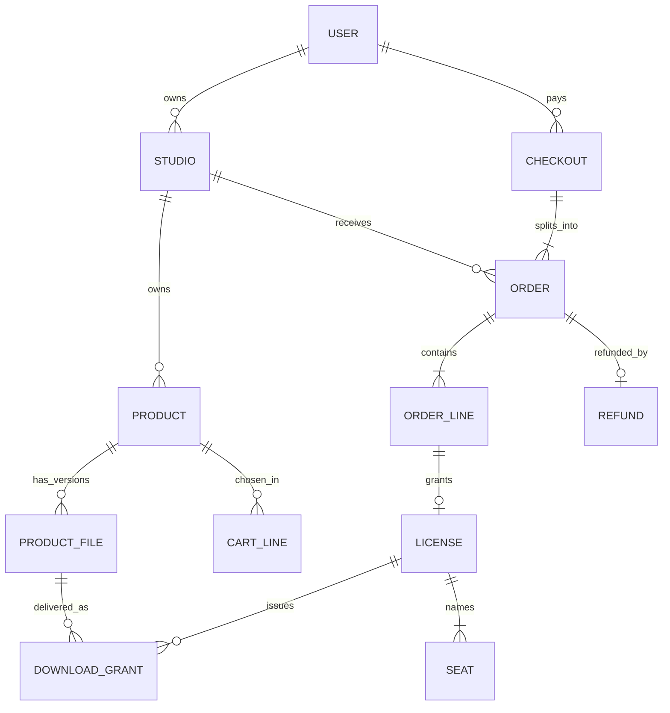

# The decision for Midad and the first ERD

You have seen where a relational store is stronger and where a document store fits the writes this course performs. A decision you cannot defend out loud is a preference, so this lesson writes the trade down in a form a reviewer can attack, then draws the ERD that the later modules extend. Nothing here is a final schema. Module 5 owns the Mongoose models and the seed, Module 20 owns the fulfilment write and Module 25 owns the concurrency proof.

What you commit is `docs/erd-draft.md`: a decision paragraph, a decision table, one ERD, a field list marked as draft, and two open questions you cannot answer yet. Keep the paragraph short enough that a reader cannot escape into detail, and keep the table long enough that the comparison is visible without reading prose.

## Write the decision as one paragraph

Start the file with four or five sentences and no heading. Say which store Midad uses, which records it must hold, which guarantees the database supplies and which two the application has to supply for itself. Then stop. A paragraph that runs for a page is a paragraph hiding a decision.

A usable version reads like this. Midad stores its catalogue and entitlements in MongoDB because one product page is read with its license options and previews in a single document, a library row is read with the license that governs it, and an order line freezes facts at the moment of sale that later edits must not touch. The cost is that MongoDB does not enforce a reference from a license to the order line that granted it, so every write path has to prove the line exists and paid, and the fulfilment service is the one place that does. The second cost is that a seat list longer than its seat limit and a negative download allowance are protected by an update filter and a schema validator, where PostgreSQL would refuse the row with a check constraint.

Notice what the paragraph does not do. It does not claim that documents are faster, and it does not claim that tables cannot model a font. It names a read pattern, a benefit and two costs, so a reviewer can disagree with one sentence rather than with the whole choice. If your paragraph says the choice was made because the stack is JavaScript, delete that sentence and write the real reason.

## Put every decision in the table

The table is the part a reviewer reads first, because it shows the comparison rather than the conclusion. Add a row only where the row changes a design choice, and name the cost you accepted in the last column. A row that says documents are flexible changes nothing and reads as filler.

| Decision | Midad shape | Relational alternative | Cost accepted |
|---|---|---|---|
| Product listing | One `products` document with previews embedded | `products` plus `previews` rows | Preview list must stay bounded |
| License options | Embedded `licenseOptions` array with a stable key | `license_options` table with a foreign key | Price bounds live in schema validation, not in a constraint |
| Deliverable file | Separate `productFiles` collection, one document per version | `product_files` rows with a foreign key | Version boundary is enforced in the service |
| Terms | `termsVersion` on the option, immutable text keyed by product and version | `terms` table with a version column | Application must refuse to rewrite an old version |
| Cart line | `(productId, licenseOptionKey)` with no quantity | `cart_lines` row with columns | Cart rules checked in the service |
| Checkout | One `checkouts` document per payment attempt | `checkouts` row | Payment reference must be reconciled by hand |
| Order | One document per studio, snapshot lines embedded | `orders` and `order_lines` rows | Reporting must unwind the array first |
| Order to license link | `orderLineId` on the license plus a unique index | Foreign key to the line, plus a unique index | Orphan licenses are only prevented by the fulfilment service |
| License limits | `downloadsRemaining` changed by a conditional update | Column updated with a `WHERE remaining > 0` clause | The filter is easy to forget in a new writer |
| Seats | Embedded bounded array on the license | `seats` table with a unique key on license and email | Seat uniqueness checked in the update filter |
| Download grant | Separate collection, one document per issued link | `download_grants` rows | Expiry sweep is a query rather than a constraint |
| Refund | One document per refund, scoped to one order | `refunds` row with a foreign key to the order | A partial refund needs an explicit amount rule |

Three rows will be challenged. The order to license link is the row where the relational store is clearly stronger and Midad accepts the weaker guarantee. The order snapshot is the row a reviewer trained on normal forms reads as duplicated data. The refund row is the one that decides whether a split payment can be undone for one creator only, so have the answer ready: the refund names an order, the order names one studio, and the licenses of that order are the ones revoked.

## Draw the first ERD

The ERD below has to fit on a phone screen, because a draft nobody can review in one sitting does not get reviewed. Insert it into `docs/erd-draft.md` as a Mermaid block so a later change is a diff rather than a new image. Draw the eleven records the course builds, and label each edge by meaning rather than by direction alone.



Label the arrows by what they mean. `USER owns STUDIO` and `STUDIO owns PRODUCT` are ownership, and they are the path every creator write is authorized through. `PRODUCT has_versions PRODUCT_FILE` is reference to private data with no public read path. `CHECKOUT splits_into ORDER` is one payment and one seller view per studio. `ORDER_LINE grants LICENSE` is history becoming access, and the cardinality is one line to at most one license. `PRODUCT_FILE delivered_as DOWNLOAD_GRANT` is the version boundary that stops a corrected upload from changing an old buyer's file.

Two details are easy to get wrong on the first attempt. Do not draw an ownership edge from a studio to a license, because the studio owns the product and the buyer owns the entitlement, and merging those two facts is how a creator dashboard starts showing another buyer's key. Do not draw the checkout as the parent of the license, because a refund is scoped to an order and a license must be traceable to the line that paid for it.

## List the fields that carry an argument

You do not need every field on day one, and you do need the fields a reviewer will check against later lessons. Keep the list short, mark it as draft, and let the argument live in the comments rather than in prose that will drift.

```ts
// Draft field list for docs/erd-draft.md. Types are indicative, not final.
interface ProductDraft {
  studioId: string;                 // ownership path
  title: string;
  slug: string;                     // unique per studio
  format: 'font' | 'template' | 'icons' | 'ebook';
  previews: Array<{ url: string; alt: string; order: number }>;
  licenseOptions: Array<{
    key: string;                    // stable, for example personal-v1
    type: 'personal' | 'commercial';
    priceMinor: number;             // integer minor units
    currency: 'USD' | 'EUR';
    seatLimit: number;              // 1 for personal
    downloadLimit: number;
    termsVersion: number;
  }>;
  status: 'draft' | 'published';
  currentFileVersionId?: string;    // reference, never a storage id
}

interface ProductFileDraft {
  productId: string;                // reference
  version: number;                  // 1, 2, 3 and never reused
  storageId: string;                // server only, never serialized
  bytes: number;
  sha256: string;
  releasedAt: Date;
}

interface LicenseDraft {
  orderLineId: string;              // unique index lives here
  buyerId: string;                  // holder
  productId: string;                // what was bought
  licenseKey: string;               // unique, shown to the holder
  licenseType: 'personal' | 'commercial';
  termsVersion: number;             // the version accepted at sale
  seatLimit: number;
  seats: Array<{ email: string; name: string; assignedAt: Date }>;
  downloadsRemaining: number;
  status: 'active' | 'revoked' | 'expired';
  grantedAt: Date;
}

interface DownloadGrantDraft {
  licenseId: string;
  buyerId: string;
  fileVersionId: string;            // the version sold, not the latest
  issuedAt: Date;
  expiresAt: Date;                  // five minutes in the core path
}
```

Read the shapes together and find the field that is missing. There is no price on `ProductFile`, no download counter on `Product`, and no license key on `Product`. The only number that goes down sits inside one license, and the only storage identifier sits inside one file version. If your draft still puts a price on the file or a purchase flag on the product, delete it and write one line saying which record owns that fact instead.

## Prove one rule with a failing test

A decision without a test is a sentence. Write the smallest test that shows the guarantee MongoDB declined to give you, run it, and keep the output. The test inserts a license that names an order line which was never created. PostgreSQL would refuse it because the foreign key is a declaration. MongoDB will accept it, and the test fails.

```js
// tests/model/orphan-license.test.js
import { describe, it, expect, beforeAll, afterAll } from 'vitest';
import { connect, disconnect, License } from '../../src/db.js';

beforeAll(connect);
afterAll(disconnect);

it('refuses a license whose orderLineId names no paid line', async () => {
  const orphan = {
    orderLineId: '66f0c1a2b3c4d5e6f7a8b9c9',   // never created
    buyerId: '66f0c1a2b3c4d5e6f7a8b9c0',
    productId: '66f0c1a2b3c4d5e6f7a8b9c1',
    licenseKey: 'MIDAD-7K4Q-2XPR-9WTD',
    licenseType: 'personal',
    termsVersion: 2,
    seatLimit: 1,
    seats: [],
    downloadsRemaining: 3,
    status: 'active',
    grantedAt: new Date('2026-03-02T09:00:00Z'),
  };
  await expect(License.create(orphan)).rejects.toThrow();
});
```

On a fresh database with the license model in place, the insert succeeds and the test fails. That failure is the point of the lesson, so read it rather than skipping past it.

```text
FAIL  tests/model/orphan-license.test.js
AssertionError: expected promise to reject but it resolved with
  { _id: ..., orderLineId: '66f0c1a2b3c4d5e6f7a8b9c9', status: 'active' }
```

Now write the rule where it actually belongs, and say so in the draft. The only writer allowed to create a license is `fulfilCheckout`, which receives a checkout id, loads the paid lines from the database, and creates one license per line. No route, script or admin tool inserts a license directly. Module 20 builds that function and its replay test.

Then write the test the database does keep, so the contrast is in the same file. Insert two licenses with the same `orderLineId` and watch the unique index refuse the second with error 11000. Two rules, two homes: one enforced by the store, one enforced by one function that every path must call. A reviewer accepts a gap with a named owner; a gap with a promise gets closed in review with a failing test attached.

## Where PostgreSQL would have won

The four strongest points belong in the draft as costs, in a short section of their own, because the gate asks you to defend them. A foreign key from `licenses.orderLineId` to the paid line would make the orphan impossible for every writer, including a future migration. A check constraint on `downloadsRemaining >= 0` would refuse a negative count without trusting the filter. A unique index on `(licenseId, lower(email))` would make a seat list duplicate safe at the index. And a single aggregate over one money table would answer revenue per creator without unwinding an array.

The answer for Midad is not that those points are small. It is that the writes this course performs are single-document writes, and the two guarantees that matter for access control are supplied by a unique index and one service function, both of which have tests. The condition that would change the answer is worth writing down: if the platform later had to post a double-entry ledger, or if a single sale had to debit a buyer balance, credit two creator balances and write a tax row in one transaction, the payments side would move to a relational store and the catalogue would stay where it is.

That mixed answer is a real engineering position rather than a compromise. A system may keep its catalogue in one store and its money in another, with the payment reference as the join. Midad does not build it because a course project with test payments does not need two databases, and the operational cost of a second store would be paid by a learner on a weak connection.

## Draft the file and commit it

Write `docs/erd-draft.md` with five sections in this order: the decision paragraph, the decision table, the ERD, the field list and the open questions. Fill one worked row so the draft stops being abstract. Take Nour's font, write the personal option at 1,200 with one seat and three downloads, the commercial option at 4,800 with five seats and ten downloads, and two product file versions. Then count the records: one product, two options inside it, two file versions, zero licenses until someone pays.

The open questions are not decoration. Write at least two that you cannot answer yet, such as where the download grant expiry sweep lives and whether a seat holder may see the license key. Module 21 answers the first, Module 25 answers the second, and both answers are easier to remember because you wrote the question first.

Commit the draft, both test outputs and nothing else. Do not commit a connection string, a storage credential or a real license key, even a test one, because a file in Git is a file in someone else's clone. The gate in the next lesson asks you to defend this draft, and a reviewer who can see one failed test beside one passing test will trust the rest of the file.

## Acceptance criteria

- [ ] `docs/erd-draft.md` opens with a decision paragraph that names one benefit and two costs.
- [ ] The decision table has a row for license options, the file version, the order snapshot, the order to license link, the seat list and the refund scope.
- [ ] The ERD shows studio to product to file as ownership and reference, checkout splitting into per-studio orders, and one order line granting at most one license.
- [ ] The field list contains no price and no download counter on the product, and no storage identifier in any public shape.
- [ ] The orphan-license test fails before the fulfilment function exists and passes once it is the only writer.
- [ ] The duplicate-license test fails with error 11000 from the unique index, not from application code.
- [ ] The section on relational strengths names four constraints and the condition that would move the payments side.
- [ ] The open questions section names at least two unsolved problems with a sentence each.

If the draft answers every question, it is hiding one. A model this young has at least two unknowns, and the honest version puts them where a reviewer can see them.
