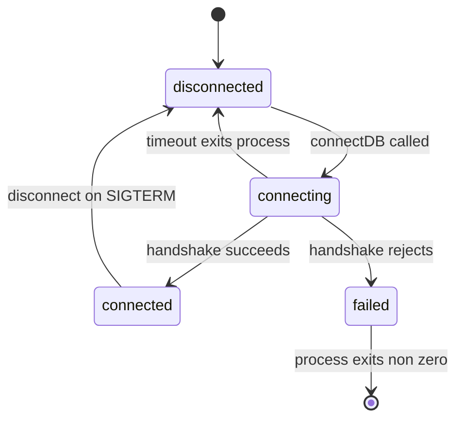

# 4.6 ,  Prime your thinking

> **[Learn]** · Chapter 04, Config & database · *Mandatory read: Mongoose connection docs*

Before you write `shared/db.js`, read how **Mongoose** expects connections to work in modern Node (async/await, connection events, disconnect). This sub-chapter is a **mandatory reading assignment**, not optional skimming.

<BigWordAlert term="Twelve-factor config" plainEnglish="Store config in the environment, not in code, so dev, staging, and production differ by env vars only." whyItMatters="Midad follows this pattern: one codebase, many deployments, secrets injected at runtime." />

You already decided *why* MongoDB (Chapter 3). This read covers *how* the driver connects, so your boot sequence in 4.11-4.12 matches official patterns.

A Midad server that answers on a port before the database handshake finishes is the most expensive kind of healthy. Every uptime check passes, every smoke test that only reads `/` passes, and the first buyer who opens a Studio page gets a stack trace from a model whose connection was never established. The order of three or four lines in `server.js` decides whether that failure is a refused request with a clear log line or a mystery that costs an evening.

```predict
prompt: "MongoDB is unavailable when Midad starts. Which boot sequence tells the truth?"
options:
  - id: listen-first
    label: "Start listening first, then connect in the background"
  - id: connect-first
    label: "Connect to the database first, then start listening"
correctOptionId: connect-first
explanation: "Connecting first prevents the API from accepting requests it cannot complete. A failed connection should stop startup with a clear error instead of exposing a misleading healthy process."
allowRetry: true
```

## Why this matters

Connection bugs feel mystical, "Mongoose buffering timed out" with no context. Twenty minutes on the Connections page tells you **await connect before listen**, what `readyState` means, and why `db.js` should be shared with the Chapter 5 seed script. You are not memorizing API surface; you are preventing the most common Week 1 backend stall.

There is also a design decision hiding inside the reading. A connection is not a boolean that becomes true and stays true. It is a live object with a state, a pool of sockets underneath it, and a lifecycle that includes dropping and reconnecting without your process restarting. Every health endpoint, every route guard and every shutdown handler you write for the rest of this course reads that state, so the earlier you learn its vocabulary the fewer contradictions you collect.

## The problem the boot sequence solves

Express accepts a request the moment `listen` returns, and it does not know or care whether your models can reach a database. A route handler therefore has two possible shapes of failure. If the connection is ready, a query goes out and the buyer gets their products. If the connection is not ready, the query either throws immediately or gets buffered by Mongoose and fails later, after the response has already promised something. Both outcomes are produced by the same boot order, and only one of them is debuggable.

The build cluster in 4.11 asks for the second shape on purpose: load environment variables, validate configuration, connect, and only then listen. The order is not a style preference. It converts a class of runtime errors that appear under load into one startup error that appears in the terminal, with a message that names the variable or the host that failed.

## The mechanism: one connect, one pool, one truth

`mongoose.connect(uri)` returns a promise, and the process keeps a single default connection that other parts of the app share. `shared/db.js` exists so that promise runs once. Import `connectDB()` from `server.js` at boot, from `scripts/seed.js` when you seed Products and license options, and from tests that need a database, and each of those entries waits for the same handshake instead of opening its own pool.

```javascript
// server/src/shared/db.js
import mongoose from "mongoose";
import { config } from "./config.js";

export async function connectDB() {
  mongoose.connection.on("disconnected", () => {
    console.warn("[db] disconnected");
  });
  await mongoose.connect(config.mongodbUri, {
    serverSelectionTimeoutMS: 5000,
  });
  return mongoose.connection;
}
```

Two details in that helper are worth reading twice. The event listener is attached before the connect call, so a disconnection that happens during the handshake is still logged. The server selection timeout is shortened from the default thirty seconds, so a wrong host fails in five seconds with a message about server selection instead of leaving a developer staring at a silent terminal. Neither line changes what the app does when everything is healthy, and both shorten the path between a mistake and its cause.

## A worked example: the Midad boot sequence

Trace the order for a single local start, with `MONGODB_URI` pointing at a database that is not running.

<TraceRequest title="Boot order when the database is down">
  <TraceStep actor="Server" label="loads .env and validates config" detail="A missing MONGODB_URI or JWT_SECRET throws here, before any port is opened" />
  <TraceStep actor="DB" label="calls connectDB() and waits" detail="serverSelectionTimeoutMS expires after 5 seconds and the promise rejects" />
  <TraceStep actor="Server" label="logs the failure and exits" detail="No listener was ever created, so nothing accepted a request it could not serve" />
  <TraceStep actor="API" label="restarts against a reachable database" detail="The same code now finishes the handshake and only then binds PORT" />
</TraceRequest>

The interesting step is the third one. The process ends with a non-zero exit code and a message naming the connection attempt. Nothing is half alive. Compare that with the reverse order: `listen` succeeds first, the process looks up, the platform keeps it in rotation, and the failure surfaces later as a 500 on a page a buyer already opened. The first version is a five minute fix, the second is a support conversation.

## Connection states as a small machine

Mongoose tracks where the connection is with `readyState`, and the health endpoint in 4.13 reads it rather than guessing.



Read the diagram as a promise about what your logs can say. A server in `connecting` has not earned the right to serve traffic, a server in `connected` has, and a server in `disconnected` after having been connected is the one case where a running process reports trouble about itself. That last transition is why the health route reads state instead of a boolean you flipped once during startup.

## Common questions

**Q: Can I copy the Mongoose docs sample server verbatim?**  
A: Don't copy it wholesale; adapt the pattern to your project's structure. The docs show a complete server with the connection inline, but your course layout already decided that config lives in `shared/config.js` and the connection helper is `connectDB()` in `shared/db.js`. What you *should* take from the docs is the concept: `await mongoose.connect(uri)` before you start listening, and how the connection events behave. Think of the docs as the recipe and your modules as your kitchen: same ingredients, arranged the way your project already does things.

**Q: Should health use `readyState` or a boolean I set?**  
A: Either is correct, as long as the health JSON always reflects the real connection state. `connection.readyState` is Mongoose's own answer, `0` disconnected, `1` connected, `2` connecting, `3` disconnecting, so reading it costs nothing and can't go stale. A boolean you set right after `connectDB()` succeeds is simpler, but it only captures the moment you connected; if the database dies later, that boolean still says "true." For a health check whose whole job is telling the truth, `readyState` is the more honest signal.

**Q: Why read disconnect if MVP never shuts down gracefully?**  
A: Because "my dev machine never restarts" is a lie you'll meet in production, and disconnect is the flip side of connect, so understanding it makes the whole connection model click. When a deploy platform restarts your server, it sends a shutdown signal; handling it with `mongoose.disconnect()` lets pending writes finish and closes the connection pool cleanly instead of dropping the database mid-request. It is optional for the gate, so don't stress, but skimming that section now means later you'll recognize what `SIGTERM` handlers and graceful shutdown are for.

**Q: What is "Mongoose buffering timed out" and why does it happen?**  
A: It is Mongoose's way of saying "your code asked me to touch the database before I ever connected." While a connection is being established, Mongoose *buffers* operations, so it queues them up and waits for the connection to complete. If the connection never succeeds, those queued operations time out with that error, and it usually means your app tried to run a query (or started `listen`) before `mongoose.connect()` finished. The fix is the ordering this chapter keeps repeating: load env, validate config, connect, listen. If `MONGODB_URI` is wrong or the database is down, fail at boot with a clear error instead of mystery timeouts later.

## Mandatory read

**Primary:** Mongoose, Connections  
https://mongoosejs.com/docs/connections.html

**Focus on these sections:**

1. **Connecting to MongoDB**: `mongoose.connect(uri)` basics  
2. **Connection states**: `readyState` values (disconnected, connected, etc.)  
3. **Error handling**: connection errors versus query errors  
4. **Disconnection**: `mongoose.disconnect()` for graceful shutdown  
5. **ESM note**: if using `"type": "module"`, import style matches your Chapter 2 setup  

**Secondary (skim):** Connection string format  
https://www.mongodb.com/docs/manual/reference/connection-string/

Enough to understand `mongodb://` versus `mongodb+srv://`; you already picked a URI in 4.5.

## What to extract for your implementation

While reading, note answers to these; you will implement them in 4.11:

| Question | Why it matters |
|---|---|
| Does `connect()` return a Promise? | `server.js` will `await connectDB()` |
| What happens if URI is invalid? | Fail-fast behaviour at boot |
| How do I know connection succeeded? | Log once; health check reads state |
| Should I pass options to `connect()`? | e.g. `serverSelectionTimeoutMS` for clearer failure in dev |
| Is one connection pool shared? | Yes, the default; one connect per process |

**Do not copy-paste** the docs' entire sample server into your repo; adapt it to your `config.js` and module structure.

## Failure modes worth naming

Four failures account for almost every boot bug in this chapter, and each has a signature in the terminal. A listener that starts before the handshake shows a healthy port and a 500 on the first Studio page. An empty `catch` around `connectDB()` produces a process that runs with no database at all and reports every query as "not connected". A second `connect()` call from a seed script or a test file opens a second pool, and later writes land in a database the request handler is not reading. And a logged URI prints the password to the terminal, where it survives in scrollback, screenshots and log storage long after the incident.

## Debugging path

When a Midad route fails with a database error, work outward in this order rather than changing code at random. Confirm `readyState` through the health route: a `0` means the boot order is the problem, while a `1` means the connection is fine and the query or the schema is next. Then read the startup log for the connect line and the timeout value, because a five second server selection failure and a buffering timeout describe different mistakes. Then check that the process reading the environment is the process you think it is, since a stale `.env` in a second terminal produces a URI that looks correct and points somewhere else. Only after those three checks is it worth reading the model or the query, and by then the error message usually names the field.

## Trade-off: fail fast versus stay up

Failing fast is the right default for the API, and it is a decision with a cost that should be stated. A deploy platform restarts a process that exits, so a database blip during a release becomes a restart loop instead of a degraded service. Midad accepts that trade because the alternative, a process that answers with errors while claiming to be healthy, hides the incident from the operator and doubles the debugging work. If a later chapter wants a degraded mode, it should be an explicit readiness flag on the health route, not a server that pretends a missing database is fine.

## Reflect, write in notebook or learning log draft

After reading, answer without opening the docs:

1. What is the difference between a **connection error at startup** and a **query error** after connected?  
2. Why should `connectDB()` live in `shared/db.js` instead of inline in `server.js`?  
3. What does `mongoose.disconnect()` do and when would you call it?  

If you can't answer #2, re-read the "Connections" page section on best practices.

## How this connects to Chapter 5

Chapter 5 creates **models** such as `User`, `Studio`, `Product` and `License`, and every model operation requires an **active connection** before `Model.create()` works. The same `connectDB()` helper will be imported by `scripts/seed.js`.

If `db.js` is wrong, every schema chapter fails for the same reason, so fix the connection once and everything downstream benefits.

## ✅ Do / ❌ Don't

**✅ Do:** Read the official Mongoose docs that match your `npm install mongoose` major version.

**✅ Do:** Keep the docs tab open while writing `db.js` in 4.11.

**❌ Don't:** Use deprecated callback-only patterns from old Stack Overflow answers.

**❌ Don't:** Skip reading because "I'll figure it out when it breaks"; boot bugs waste evenings.

## Next

**Sub-chapter 4.7:** Configuration and database knowledge check, complete it before **4.8** starts the build.

Reading done, hands on keyboard in the build cluster.
