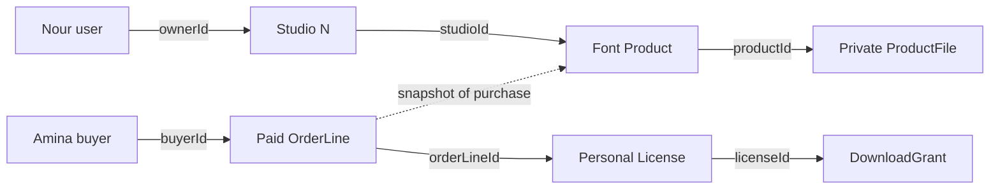

# Two chains

A product page answers what a buyer can choose. A library page answers what a particular buyer has already earned. They cannot use the same query. Draw two chains on paper before opening a schema file. In the first, User owns Studio, Studio owns Product, and Product has ProductFile versions. In the second, Buyer owns Checkout and Orders; a paid OrderLine yields one License, and a License authorizes bounded DownloadGrants. Draw a dotted line from OrderLine to Product to show what was purchased, but do not make an order's current display depend on a future edit to Product.

Follow one request in each chain. A creator changes a product description only after the route proves the creator owns its studio. A buyer asks for a download only after the route proves the license belongs to that buyer, is active, has a remaining allowance, and points to a currently deliverable file version. The first query cannot authorize the second operation. If you confuse these paths, a studio owner may accidentally see buyers' private library rows, or a buyer may gain a studio's source file merely by knowing a product ID.

The seed should include two studios and two buyers. This is a model test, not just attractive demo data: an isolation bug may be invisible with only one account. Write the two URLs you expect to exist, public catalogue and authenticated library, then list fields allowed in each response. Public catalogue can show title, preview, license option names and prices. Library can add the buyer's license status and a request-download action. Neither response needs a permanent private asset path.

A useful ownership query starts from the authenticated actor. A creator route first resolves Studio with `ownerId` equal to the session user, then resolves Product with `studioId` equal to that studio. A library route resolves License with `buyerId` equal to the session user. Merely comparing a client-supplied email is unsafe because the client can send another buyer's email. Write the predicate in `docs/erd.md` next to its relationship; an arrow without its authorization rule is too easy to misread later.

This module establishes shape, not payment behavior. Mark which writes can happen before payment, and which must wait for a verified provider event in Module 20. A draft ProductFile exists before a sale. A Cart exists before a sale. An OrderLine snapshot can be prepared during checkout. A usable License must not be created by the redirect page. If a teammate proposes a single `purchased: true` field on Product, ask whose purchase that one boolean would describe when Amina and Kareem buy different terms.

## Draw both routes with real identities

Give Nour the creator role and Studio N the owner record. Give Amina a buyer account and one paid OrderLine. On the ownership drawing, Nour reaches Product P through Studio N; Amina cannot follow that path because she does not own the studio. On the entitlement drawing, Amina reaches License L through her paid line; Nour does not gain access to Amina's library simply because Nour created the Product. Write the ID at each hop. This forces the diagram to describe stored relationships rather than vague role labels.

The dashed link is deliberately different: an OrderLine remembers what Product was purchased but is not an edit path. The two solid chains answer different questions. Redraw them for Kareem's commercial purchase. P and F remain the same, but O, L and G are different records with different terms. If your ERD turns those two buyers into one `purchased` flag on P, try to write a query that tells which buyer may download and why; the missing answer reveals the model defect.

<TraceRequest title="Compare creator ownership with buyer access">
  <TraceStep actor="Nour" label="Edit Product P" detail="Owner ID resolves Studio N, then Product P" />
  <TraceStep actor="Amina" label="Read License L" detail="Buyer ID matches paid OrderLine and active License" />
  <TraceStep actor="Kareem" label="Read License L" detail="His different purchase does not authorize Amina's row" status={403} />
</TraceRequest>

## Make the chain measurable

Write two query sketches before implementing any route. The creator sketch filters Studio by `ownerId` from the session, then Product by that Studio ID. The buyer sketch filters License by `buyerId` from the session, then resolves its OrderLine and eligible ProductFile server-side. Do not populate every related record in one response. An owner dashboard needs names and sales summaries, not raw file keys or another buyer's license. A library needs the license status and a download action, not the creator's storage credentials. List the fields for those two serializers in your learning log.

A boundary can look correct in a database and still leak in serialization. Imagine `Product.find().populate('files')` for the public catalogue. Even if the page renders only previews, the HTTP response may include a private storage ID. Test the raw response with two studios and search for the seeded private ID. Then test Kareem requesting Amina's license ID. Both should fail to reveal the target data. These checks are independent: one tests public projection, the other tests authenticated ownership.

## Decide what happens over time

Add a second timeline to the ERD. Nour may replace a file version and price tomorrow. Amina's OrderLine still records the personal option, price and terms version she accepted yesterday. A current License may be active today and revoked after a refund next week. A DownloadGrant issued today may expire in minutes. These are four clocks attached to different records. If a single Product document stores all of them, its current values will overwrite history or confuse access with publication state.

For the first build, use stable IDs and a test fixture rather than a payment provider. Create Product P and two example lines, one per buyer, then associate separate License fixtures. Query each buyer's library and explain the result from the chain. Mark the fixtures as examples, not evidence of verified fulfillment. Module 20 later creates licenses only from verified payment. The purpose of this exercise is to make the relationship query precise before money enters the system.

Your final drawing should let a peer answer three questions without reading code: which creator may publish a file, which buyer may request a download, and which record preserves the agreed price after a creator edits the Product. If a line serves two answers, label its meaning more carefully. Save the drawing and the two denied raw requests; they become the authorization checklist for every later route in Midad.

## Rehearse a denied lookup

Ask Kareem to request `/me/licenses/L`, where L belongs to Amina. The route can answer with the course's chosen 403 or 404 behavior, but it must not return product title, terms, file version or remaining downloads from Amina's row. Make the first database query include both License ID and authenticated buyer ID. If a helper first loads L by ID and later checks the owner, inspect every logging and error path for accidental data exposure. This is not an argument that IDs are secret; it is a test that identity is enforced at the query boundary.

Repeat the exercise for Nour editing Salma Studio's Product. The valid request and denied request share the same Product ID format; only the stored Studio owner relationship changes. If the error says "Product not found" for the denied owner, that may be a deliberate non-disclosure policy. Document it consistently. The important evidence is that the Product record did not change and no private file ID was returned. Save both raw requests alongside the ERD, with test fixture IDs rather than real accounts.

Now return to the two chains and mark the field that joins each adjacent box. Use `ownerId`, `studioId`, `productId`, `buyerId`, `orderLineId` and `licenseId` explicitly. A vague arrow makes it easy to forget whether a field is stored on the child, parent or both. If you duplicate an ID for query speed, identify the source of truth and a consistency test. The final model should help a new teammate write a scoped query without relying on memory of your narration.
