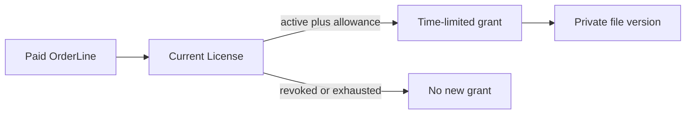

# The purchase-is-a-link trap

Imagine Midad stores a Cloudinary URL on the paid order. The first buyer copies it into a group chat. Every recipient can fetch the same asset, and a later refund cannot make the copied address disappear unless the underlying asset is changed or deleted for everyone. The URL also says nothing about personal versus commercial use, download count, seat count or the accepted terms version. It is delivery plumbing, not the sale's authority record.

A better model separates evidence from delivery. The OrderLine stores what the buyer paid for: product identity, chosen license type, price and terms snapshot. The License stores current entitlement state and counters. The ProductFile stores a private storage identifier on the server. A download endpoint checks the authenticated buyer against the License, records a DownloadGrant, and only then returns a short-lived provider URL or streams the file. A URL may be copied while it is valid, so do not promise impossible absolute prevention; limit its useful lifetime and log the issued grant.

Work through a refund. An order line remains as historical evidence; deleting it would make an audit incomprehensible. Mark the related License revoked according to the policy, and stop creating fresh grants. A previously issued URL can remain valid until its own expiry. The product page should not imply immediate recall of bytes already downloaded. Write this limitation plainly in the buyer experience and in your test. A schema that stores only `downloadUrl` has nowhere to express the distinction between historical purchase and current access.

Now consider a product update. The creator uploads version 2 of the font. Does an old personal license include updates? The choice belongs in the product's terms, with a versioned policy captured at purchase. Do not infer it from whichever file happens to be newest. A `ProductFile` has a version and release state; a `License` retains accepted terms version. The delivery service chooses an eligible file version after reading those records. This makes a refund, product withdrawal or changed update policy testable without rewriting past orders.

For a paper exercise, compare two buyer requests using the same product ID. One buyer has an active personal license with one remaining download. The other has no license but has learned the file's storage ID. Predict each response from the server and the records changed. Then compare the first buyer's second request after its allowance reaches zero. If the design merely hides a button, the second request still succeeds through the API; the database and server must enforce the decision.

## Test the tempting shortcut

Write a fictitious Order document with `downloadUrl: "https://storage.example/font.zip"`. Now give that JSON to Amina and ask what happens if she sends the URL to Kareem, who has not bought the font. The storage server sees the URL, not the relationship between Kareem and a paid OrderLine. A hidden library button cannot close this gap. If the URL is long-lived, a refund changes a MongoDB status but does not change the already-copied address. Even if you delete the order's URL field, the address remains in messages, browser history and download managers.

The arrow from License to grant is the policy decision. The grant is not itself proof of payment; it is an output of a check against durable entitlement. Discuss the diagram with a peer using a second buyer. If Kareem pastes Amina's old grant URL while it is still valid, the provider may still deliver it. The design limits that window rather than pretending it can erase copied bytes. Once the URL expires, Kareem cannot ask Midad for another because he owns no License.

<TraceRequest title="Refund after an earlier file delivery">
  <TraceStep actor="Amina" label="Download under active License" detail="Server records grant and issues a brief URL" />
  <TraceStep actor="Payment" label="Refund verified" detail="License becomes revoked; OrderLine stays as evidence" />
  <TraceStep actor="Amina" label="Ask for another grant" detail="Revoked License denies new access" status={403} />
</TraceRequest>

## Compare three records at refund time

Place the OrderLine, License and DownloadGrant side by side. The OrderLine says Amina bought a personal option under terms version 3 for a recorded amount. The License says whether she may request another file now and how many downloads remain. The grant says which file version was offered at a particular time and when its token expires. If a support agent asks what happened, all three records matter. Deleting the OrderLine to "revoke" access destroys purchase history; leaving the License active after a refund keeps new access open; deleting a grant hides a delivery attempt without removing already downloaded bytes.

Use two file versions in the example. Amina bought when version 1 was current. Nour uploads version 2. The terms may include updates or may limit buyers to the version sold. The Product's current file pointer cannot decide that on its own. Put accepted terms version and any update entitlement on the License or immutable snapshot, and select a released ProductFile that those terms allow. Do not assume latest equals authorized. Test that an unreleased version is never chosen even if it has the newest upload timestamp.

There is also a concurrency question. A License with one remaining download receives two requests at once. Both can read one if the server first fetches then saves. Later, the endpoint must use a conditional decrement or another concurrency-safe claim. The model must make `downloadsRemaining`, grant status and request identity explicit now. Draft a failure table with active/one remaining, active/zero remaining, revoked, and buyer mismatch. For each row, state whether a grant is written and whether a URL is returned.

The learning check is not a definition of "signed URL." Explain to another learner how a refund affects each of the three records and why an already downloaded font cannot be recalled from a laptop. Then show a raw API response that contains no permanent original asset URL. If the response does contain one, repair the data boundary before the private upload chapter adds real storage keys.

## Practice the limit boundary

Amina has one remaining allowed download and opens two tabs. Draw both requests reaching the API before either receives a reply. If each reads `downloadsRemaining: 1` and then saves zero, both may issue a URL. A later service must claim the allowance with a conditional database update, then create a grant tied to that claim. State how a failed provider call is repaired without gifting an extra allowance. This turns the abstract phrase "limited downloads" into a concurrency rule that can be tested.

Consider a buyer who reports that a downloaded ZIP was corrupt. The support path should inspect which ProductFile version and checksum were associated with the grant, compare with the provider object, and issue a controlled replacement if the product policy allows it. A permanent URL on the Order cannot answer which version was delivered or how many replacements were issued. It also cannot explain why one buyer has reached a limit while another has not.

Write a small acceptance table in prose: active license with allowance receives a short grant; active license without allowance receives an exhausted response; revoked license receives no new grant; different buyer receives no access to the license; unreleased ProductFile is never selected. Keep this table near the code that will be written in Module 21. The field names chosen now must support every row without searching a user's browser history for an old URL.

At the end, compare the tempting order URL with your actual records using a concrete support case. Amina says she paid but her link expired. The correct investigation starts with verified payment and OrderLine, then checks her current License and the latest DownloadGrant. Reissuing a short grant after confirming entitlement is a controlled operation. Copying a permanent URL from a support dashboard would bypass the very policy the model is meant to enforce. Record the support action and its reason so a later refund remains explainable.
