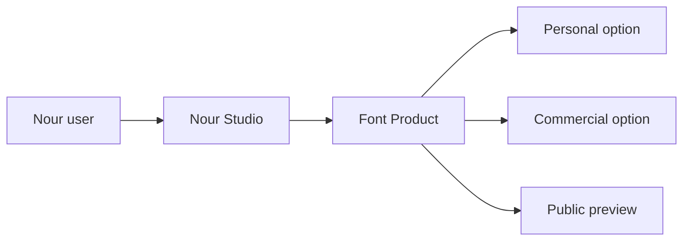

# Users, studios and products

Start with identity. `User` carries credentials and role; `Studio` carries public branding and `ownerId`. Keep one studio per owner for this course by placing a unique index on `ownerId`. The rule must exist in the database, because two fast create requests can both pass an earlier `findOne` check. Do not put an owner email on every Product as the authorization source. Email can change, whereas a stable owner ID and a Studio-to-Product link make the edit query explicit.

Create Product with `studioId`, title, description, category, preview asset IDs, `status`, and an embedded array of license options. Each option needs a stable option key, type, `priceMinor`, currency, seat limit, download limit and terms version. Price in minor units avoids binary floating point totals during checkout. Reject negative prices and limits, duplicate option keys in one product, and a published product with no purchasable option. A terms version is a pointer to text that the buyer can read, not a replacement for storing the accepted snapshot later.

A preview is deliberately public. It may be a watermarked image, short sample or subset file. It must never be the original deliverable under a different field name. Ask a teammate to inspect the raw public JSON and identify the preview versus private asset references. If both appear in the response, fix the serializer before adding routes. ProductFile, built in the next lesson, will hold the private storage key in a collection the public catalogue does not query.

Build two products for one studio and one product for another. Attempt to update Studio B's product using Studio A's session. The API must deny it after an ownership query; the frontend's missing Edit button is not evidence. Change an option price after adding the product to a cart and decide when a checkout recalculates the total. The server must use its current price at checkout, and later OrderLine snapshots preserve the amount the buyer actually accepted. This distinction should be visible in the tests you write now.

Use Mongoose validation for local shape, and database indexes for cross-request uniqueness. Validation does not automatically make a business rule concurrent-safe. Declare `studioId` query indexes for creator dashboards and a public browse index appropriate to published products. Verify actual indexes in the test database instead of assuming a schema declaration was applied. If a duplicate owner creates a second studio in a test, inspect the database index list first.

## Shape an option before writing a schema

Take Nour's font and offer a personal license for 1,200 minor units and a commercial license for 4,800 minor units. The commercial option allows more seats and a different term version. Do not model the two offers as separate Products simply because their prices differ: they share title, preview and private file release, while the buyer chooses a contract. Give each option a stable key such as `personal-v1` or `commercial-v2`, and store its type, price, currency, seat limit, download limit and terms version. A price edit may change an option's current offer, but an OrderLine later retains the selected historical values.

Build the User-to-Studio link first. Create the unique owner index and wait for it to exist in the database used by tests. Run two simultaneous Studio create calls from Nour. One should create; the other should receive a conflict or read the existing Studio. Then create Kareem's buyer account and try the same route; a buyer role alone has no Studio permission. For a Product edit, include both Product ID and the authenticated Studio ID in the server lookup. A guessed Product ID is not an ownership token.

## Validate the business rule where it belongs

Mongoose can reject a negative `priceMinor` or an unknown status before save. The service must also reject duplicate option keys within one Product. A database unique index on Studio.ownerId protects a different condition: no two Studio documents for one owner under concurrent creation. Do not mistake a schema's `unique: true` declaration for a normal validator. Inspect index metadata in the test database. If an index build fails because duplicate fixtures already exist, the application may appear to accept another Studio even though the code file says unique.

A published Product needs at least one purchasable option and a public preview that is safe to show. A draft can be incomplete while Nour works on it. Define this distinction as a publication check, not a required field that prevents saving drafts. When the option is removed after someone has a cart line, the cart should show a stale choice and ask the buyer to reselect. It should not substitute whichever option now has the lowest price. Write that test with a real Cart fixture before payment integration.

## Check the response boundary

Create two Studios, each with a Product whose title is similar. Query the public catalogue and inspect the raw JSON. It may include public preview IDs or URLs, current option names and current prices. It must not include creator credentials, original ProductFile storage IDs, unpublished versions, buyer names or License rows. Next, query Nour's dashboard as the other studio owner. The route must scope by Studio owner; filtering the array in React after fetching all Products is a leak.

The price example should reach a server calculation. A cart submitted with `priceMinor: 1` must not make the checkout total one. The server loads the chosen current option and calculates from its own record. If the displayed page is stale, return a changed-offer response before collecting payment. Save this as a test expectation for the checkout chapter. The model is ready when the same option key joins Product, Cart and later OrderLine without allowing the client to define the paid amount.

Commit the schema, unique index, publication checks and cross-studio denial together. In the ERD, mark `licenseOptions` as embedded offer definitions, not purchased Licenses. Those two names sound similar but live on opposite sides of the sale. Ask a peer to explain the difference from the diagram; if they cannot, rename the labels before further routes depend on them.

## Decide how the option changes

A creator may revise license terms without changing the underlying font file. If the current Product option simply changes `termsVersion` from 2 to 3, new checkouts should capture version 3 while an earlier paid OrderLine continues to show version 2. Do not mutate all old License rows to version 3 as a side effect of editing the catalogue. The product must be able to answer what is on offer now and what each buyer accepted then. Record a stable terms text location or a versioned copy that can still be read later.

A second edge is a free promotional option. Zero price can be valid if the business explicitly supports it, but it must not accidentally pass through a paid webhook path that assumes a PaymentIntent. If the course scope excludes free checkout, validate that `priceMinor` is positive for published options and state that rule. Do not rely on a truthiness check: zero is a valid integer but an invalid offer under the chosen policy. Tests should express the policy rather than whatever behavior JavaScript happens to produce.

Before closing the chapter, read one Product document without `populate` and one public response. Identify exactly where the embedded options appear and where private files do not. If your UI needs to fetch ProductFile to display a preview, the preview model is misplaced. Write a field-level serializer test that compares expected keys rather than merely searching for one known storage ID. A new private field added later should be excluded by default, not leak until someone updates a blacklist.
