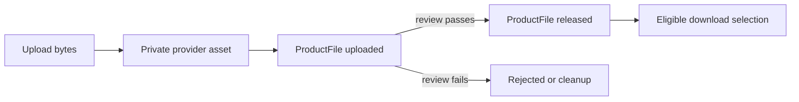

# ProductFile versions

A file is not just a URL. It has bytes, a media type, a size, a checksum, a storage identity and a release decision. Create `ProductFile` linked to Product and Studio, with a version string or monotonically increasing release number. Store the provider's private asset identifier, not a public delivery URL. Include `sha256`, `sizeBytes`, original filename after sanitization, MIME type, `status`, creation time and optional release time. Do not store the file bytes in the MongoDB document. The record explains which upload is eligible for a license and lets you verify that a download delivered the expected artifact.

Separate `uploaded` from `released`. A creator may finish uploading a new file while proofreading it. A public product can still deliver the older released version until the new version passes review. Write a query that selects a released version according to the buyer's terms. Do not use `sort(createdAt:-1)` as the entire policy: a later upload can be incomplete, rejected or outside an old buyer's update rights. A version field without a release state is only a label.

Compute SHA-256 over the uploaded bytes on the server or in a trusted upload pipeline and store the hexadecimal digest. The checksum detects accidental corruption and helps a creator identify the exact artifact used in a complaint; it is not proof that the file is safe to execute. Validate maximum byte size and permitted MIME types before persisting a release. Treat client-provided MIME type and checksum as claims to verify. A filename must never become a server filesystem path through string concatenation.

Test two studios with similarly named files. Studio A cannot list or release Studio B's ProductFile even if it knows its ID. A public catalogue GET cannot include either studio's storage key. A buyer library GET cannot include it either; the later download route will read it server-side after entitlement checks. Try a release request where ProductFile belongs to another product in the same studio. The link must match the requested product, not merely its owner's studio.

Plan cleanup for a failure after upload but before the MongoDB row is written. Mark an orphan for reconciliation, or attempt a safe deletion after logging enough identity to retry. Do not write an optimistic product record that claims a file exists before storage confirms it. The later private-file module will implement the provider-specific upload and expiry behavior; this chapter establishes a trustworthy record shape and lifecycle.

## Follow one upload through three states

Nour uploads `font-v2.zip` while version 1 is still for sale. The provider returns a private asset ID, the server calculates a SHA-256 checksum and byte size, and Midad saves a ProductFile with status uploaded. At this moment, the public Product still points to version 1 as released. Nour reviews the new file and publishes it later. A creation timestamp alone cannot express this decision; a status and release time can. If the new upload is corrupt, the Product can continue delivering version 1 without rewriting old Licenses.

Write the schema around that sequence. `storageId` is a server-only provider identifier. `sha256` is a lowercase hex digest over the exact bytes that were uploaded, not a label typed by the client. `sizeBytes` must be a nonnegative integer within the product limit. MIME type is verified from a trusted check where possible rather than accepted blindly from a browser header. A display filename is sanitized and never used to construct a filesystem path. Put a unique index on Product ID and version so two releases cannot claim the same version string.

## Exercise the broken edges

Pause after the provider accepts bytes but before ProductFile is saved. That produces an orphaned private asset. Log a correlation ID and either safely delete the asset or queue it for reconciliation; do not report the product as released. Pause after ProductFile is saved but before a release decision. That row remains uploaded and private. A future retry may find it by a stable upload key rather than creating another version. Write down which of these states a creator can see and which a buyer can see. A buyer sees neither until release.

Try to upload a file for Product A using Studio B's session. The route must load Studio B's ownership and then Product A scoped by that Studio; it should fail before giving B a usable reference to A's private asset. Try to release a ProductFile from another Product in the same Studio. Matching owner alone is insufficient because the action's product path and file link must agree. Verify both denials at the raw API layer and inspect that no release timestamp changed.

## Choose a file under a license

Suppose Amina's personal terms version 2 include free updates for one year, while Kareem's commercial terms version 1 cover only the purchased release. A download service cannot simply select the newest ProductFile. It must read the License terms, the paid OrderLine's accepted option and the released file versions. Write a selection table for old license/new release, expired update window, revoked license and unreleased file. The exact policy is a product choice, but every row should produce a deterministic selected version or denial.

Use a tiny generated test asset whose bytes are in the development fixture only. Change one byte and recalculate SHA-256 to show why a checksum identifies the artifact version. It does not establish that the ZIP is malware-free or licensed for resale; those are separate checks. In `docs/erd.md`, draw ProductFile as private and versioned, linked to one Product. Do not embed the live provider URL in Product, OrderLine or a public serializer.

## Check version and upload identity

Two browser tabs may upload a file for the same version label. A unique `(productId, version)` index makes one record win, but it does not clean up the losing tab's provider asset automatically. Decide whether an upload session key should be reused on retry or whether the loser is deleted after the duplicate-key result. Inspect the storage provider's response and the database together; a database count of one ProductFile can still hide two billable private assets. Document a cleanup job or operator procedure for that orphan.

Use a file whose exact bytes are known to your test. Upload it, compare the server-calculated SHA-256 with a local calculation, then modify one byte and confirm the digest changes. The checksum is an integrity fingerprint for a version, not a permission token. A buyer with a checksum alone must not gain access. A creator who knows another studio's checksum must not be able to release or download that studio's file. Add those distinctions to the raw response and access tests.

For a failed release, keep the old released version selected until the new one is explicitly ready. A broad query for the newest ProductFile can return an uploaded draft while the catalogue still shows a published product. Write a unit test with timestamps intentionally out of order: a newer uploaded draft, an older released version, and a revoked license. The selection must consider both file release state and license policy. This test is a direct rehearsal for the later download route.

Keep the original filename only as display text. A ZIP uploaded as `../other-studio/font.zip` must not alter a local path or provider folder chosen by the server. Generate storage identity from the authenticated studio, product and upload session, and retain the sanitized display name separately. A test with slashes, control characters and an unusually long filename should fail or normalize predictably. This matters because a private asset is still untrusted input from the creator's browser until the server has checked its ownership, size and type.
