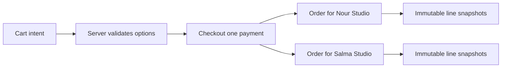

# Cart, Checkout and Order

A cart line contains Product ID, selected license-option key and intended quantity when the license permits multiple seats. It does not contain a trusted price. A shopper may leave a tab open while a creator changes an option, so the checkout endpoint must load current products, validate their publish state and chosen options, then calculate the amount on the server. Return changed-price errors clearly and require renewed confirmation. Never trust a client-supplied total, currency or studio owner ID when creating payment.

Use `Checkout` as the one-payment coordinator. It stores buyer ID, server total in minor units, currency, status, provider PaymentIntent ID once created, and a stable idempotency identity for retries. It may reference planned order lines or an immutable price snapshot. When a cart includes two creators, one Checkout still pays once, but fulfillment creates one Order per creator. This keeps creator views isolated and permits per-studio receipts without charging twice. The sum of per-creator order snapshots must equal the checkout amount.

Each `OrderLine` snapshot needs Product ID for navigation and a copy of product title, studio, license type, unit price, quantity, terms version and perhaps the preview shown at sale. Later edits to Product must not rewrite evidence of what was purchased. Save an Order status and payment reference, but avoid treating `paid` as proof merely because the browser returned from Stripe. The verified webhook will advance state and create licenses in a later module. Until then, display a pending state.

A tricky case is a removed license option after checkout preparation but before payment confirmation. Freeze the accepted option in Checkout once the buyer confirms the payment amount, and do not silently substitute a different option. If payment expires, the buyer starts a new checkout with current options. If a test mode payment succeeds after an expiration race, the reconciliation path must either honor the frozen offer or refund according to a written rule. Model the records now so later code has enough facts to make the decision.

Seed and tests should include a two-studio cart, a stale product price, a deleted option, and a buyer who sends Studio A's ID with Studio B's Product. Assert that the server's product lookup determines the studio. Compare the stored Checkout total with the sum of planned snapshot lines using integer arithmetic. A passing UI screenshot is not sufficient: inspect the raw records and the rejected request responses.

## Reprice a two-studio cart

Amina adds Nour's font under a personal option and Salma's template under a commercial option. At the moment she adds them, the cart records Product IDs and option keys. It may cache display text for convenience, but that text cannot set the payment. Nour then changes her price. At checkout, Midad loads both current Products, verifies the options remain purchasable, and computes a new total in integer minor units. Amina sees the changed price and chooses whether to continue. Charging the old client-supplied amount without a frozen offer would be a hidden pricing decision.

Checkout is the coordinator for one PaymentIntent. It owns buyer ID, total, currency and provider reference. The per-studio Orders are seller-facing views of what the single payment covered. A checksum-like reconciliation equation should hold: the sum of all OrderLine amounts and any explicit fees equals the Checkout amount, all in the same currency and minor-unit scale. Write a test for a two-studio cart and inspect both Orders. If each Order has a separate PaymentIntent, the buyer may be charged twice; if one Order contains both studios without scoped access, one creator may see another's sale details.

## Freeze the accepted offer

When Amina confirms the server-calculated total and the provider payment begins, save enough option and price details to reconstruct the offer even if Nour edits the Product a moment later. A later verified webhook should use that frozen Checkout or OrderLine snapshot, not recalculate from current Product prices. Otherwise a successful payment could appear too small or too large after a harmless catalogue edit. This is a temporal boundary: current price decides a new checkout, frozen price explains an existing attempt, paid line explains a completed sale.

Test an option removed after cart addition. Checkout should reject that line before payment rather than map its old key to a different license. Test a Product unpublished after Checkout is frozen but before payment completes. Decide and document whether the frozen offer is honored if payment succeeds or whether the system refunds it; do not leave the outcome to whichever query happens to run first. Store the chosen policy so Module 20's webhook handler can reconcile it.

## Prove isolation and arithmetic

Post a cart body with Studio B's ID attached to Nour's Product and a total of one minor unit. The server must ignore both client claims and derive Studio and amount from the Product and option records. Try a quantity or seat count above the option's limit and expect a validation error. Inspect the raw Checkout JSON to ensure it contains a stable buyer identity, exact integer total and idempotency key. Repeat the request with the same key and compare Checkout IDs; a retry after a dropped response should not create a second payment coordinator.

In the ERD, draw Cart as mutable intent and OrderLine as immutable evidence. Their fields may have similar labels, but their authority differs. Explain that difference to a peer using the reprice example. The model is ready when it can show the changed offer before payment, preserve the accepted amount after payment, and split seller views without exposing another studio's private order lines.

## Trace a partial fulfillment fixture

Although Module 20 implements the webhook, the data model should already represent a payment with two studio orders. Seed a pending Checkout with Nour and Salma lines. Pretend the first order row is saved and the process stops before the second. On retry, the coordinator should be able to find the existing order by stable checkout and studio keys, then create the missing one without changing the payment amount. Record the uniqueness key you intend to use. A counter that merely says "processed" cannot tell which child order is missing.

A checkout total also needs a currency. Adding 1,200 units of one currency to 4,800 units of another is not a valid total. Either constrain the cohort to one currency or reject mixed-currency carts before payment. Store the currency on each frozen line and on Checkout so a later provider event can be compared with the same unit. When displaying a receipt, format from minor units at the edge; do not store a rounded display string as the authoritative amount.

Ask a peer to describe what happens when Amina refreshes the payment success page before the webhook arrives. The Checkout may still be pending, and the page should tell her access is being prepared. It must not create Orders or Licenses from a redirect. The model's state names should make this waiting state possible without claiming failure or asking her to pay again. Write this expected response before the UI chapter so the frontend does not invent its own payment truth.

Use the two-studio fixture to test a dropped network response after Checkout creation. The browser retries with the same idempotency key, and the server returns the existing Checkout and frozen total. If the second call creates a new PaymentIntent, the buyer may see two pending payments for one cart. Add a unique checkout request key scoped to the buyer and inspect its database index. The test should compare the provider reference as well as the local Checkout ID, because one local row can still accidentally create a second provider object on retry.
