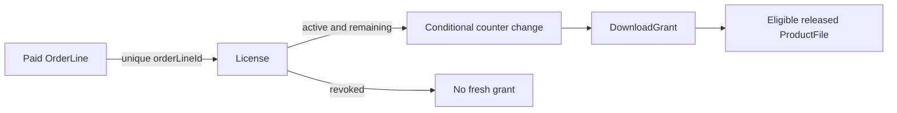

# License and DownloadGrant

A `License` links buyer, paid OrderLine, Product and selected license option. Give it a stable key or external display reference, status, accepted terms snapshot or version, seat limit, download limit, and `downloadsRemaining` when the policy uses a counter. Protect one grant per OrderLine with a unique index. A webhook retry may run concurrently with the original handler, so a prior `findOne` alone does not guarantee one license. The unique key is the final guard; on duplicate-key, read the existing license and continue reconciliation.

A `DownloadGrant` records each authorized attempt: License ID, buyer ID, file version, issue time, expiry time, status and a request or idempotency key. Store a hash or reference to any issued token if you need replay detection; do not store a live signed URL in logs. The grant is evidence and a unit for rate limiting. It does not replace the license: one license may allow several grants, and a grant may expire while the license remains active.

The download endpoint first authenticates the buyer, then loads the buyer's active License, checks policy and chooses an eligible released ProductFile. To avoid two simultaneous requests both seeing one remaining download, decrement with an atomic conditional update such as `downloadsRemaining: {$gt: 0}` and inspect whether a row matched. Create a grant after the successful decision. If the later provider URL call fails, define a repair rule: reverse the decrement under a safe idempotency key or treat a grant as spent only after delivery succeeds. The precise implementation comes later, but the schema must support distinguishing requested, issued and failed grants.

A refund should change License status without deleting the old record or OrderLine. A revoked license issues no new grants. A URL already delivered may work until expiry, and bytes already downloaded cannot be retrieved. This is why short expiry and server-side checks are both needed. Show this limitation in the product's support policy rather than promising retroactive control over a buyer's device.

Write tests for one buyer with one remaining download, two concurrent download requests, a different buyer using a known License ID, and a revoked license. Expect at most one successful decrement in the first race. Check that the unauthorized request does not reveal whether a private ProductFile exists. Inspect raw JSON from library and public catalogue: neither should disclose a license key, storage ID or token that can bypass the endpoint.

## Create an entitlement only once

Amina pays for the personal font option. The verified fulfillment service will eventually create a License tied to that paid OrderLine. Put a unique index on `orderLineId`; if the provider repeats its event or two workers process it concurrently, the database rejects a second License for the same line. The handler can then load the existing License and continue with other lines. A license key should be generated server-side, stored carefully and never placed in public catalogue JSON. A stable key helps support, but the internal database ID still identifies the row.

The conditional counter change is a separate race from the fulfillment duplicate. Suppose only one download remains and Amina opens two tabs. Both can read the old value, so a read-then-save implementation can issue two grants. A database update filtered by License ID, active status and `downloadsRemaining > 0` decrements only while the predicate still holds. Check whether a row matched. One tab may receive a grant; the other receives a limit message. Do not let the second tab reuse the first tab's signed URL unless it possesses the specific short-lived grant token.

## Make failed delivery observable

There is a narrow failure window after decrementing the allowance but before obtaining a provider URL. If the provider is unavailable, Amina should not lose a download silently. Model grant states such as requested, issued and failed with an idempotency key. On retry, the server can find the failed attempt and either finish it or compensate the counter safely. A blind increment is dangerous if another request has since spent a different allowance; tie any compensation to the exact grant attempt. The later download module will implement this, but a data model without attempt status cannot explain what happened.

A DownloadGrant should record which ProductFile version was selected, when it was issued, when its URL expires and which buyer requested it. Do not save a live URL in the record or log. The status and timestamps support support questions and abuse investigation without making the database a source of reusable links. Add indexes for License ID and issue time so a buyer's access history can be listed in order. Keep the public response small: license status and remaining count, never private provider storage ID.

## Revoke without erasing history

When a refund is verified, mark the License revoked according to the policy. The paid OrderLine remains, as does the grant history. A previously issued URL may work until expiry, and bytes already downloaded cannot be recalled. Test a revoked License asking for a new grant and an unrelated buyer trying to use its ID. Both are denied, but the support log can distinguish policy from ownership without revealing the private file in the API response.

In `docs/erd.md`, separate the arrows for paid purchase, durable License and time-limited grant. Ask a reviewer why a DownloadGrant cannot replace a License: it expires, while the entitlement may remain active; it records an attempt, while the License carries terms and counters. Ask why an OrderLine cannot replace a License: it says what was paid, not whether current access remains after refund. These distinctions are the foundation for Modules 20 and 21.

## Verify the two uniqueness rules separately

Create one License fixture for OrderLine O and attempt to create another with the same `orderLineId`. The database should reject the second even if the license keys differ. Then create two DownloadGrants from the same License when its policy allows two downloads. That should be valid, with separate grant IDs and issue times. If a developer makes `licenseId` unique on DownloadGrant, the second legitimate download fails. If they omit the unique order-line key on License, webhook replay can grant access twice. The indexes must express the different cardinalities.

A grant request also needs an idempotency identity. If the browser loses the response after a successful grant and retries, should it spend a second allowance? For the core path, let the client send a request ID and persist it with buyer and License. A repeated request ID returns the same grant state while it is valid, rather than decrementing again. A new request ID is a new attempt and follows the limit. Write these two cases as separate tests so the implementation does not confuse retry with a second intentional download.

Finally, inspect the audit trail after a refund. The License status changes; its earlier grants remain. A support agent can see that one grant was issued before revocation and one later request was denied. Do not expose the grant token itself in the support view. This design gives an honest account of access without pretending to retract files already saved on a buyer's device.

Choose how the library displays an exhausted license. Amina should still see the product she bought, the terms version, and a clear message that no further download grants are available. Removing the card entirely would make support and refund history hard to understand. A revoked license may remain visible with its status and purchase reference while the download action is disabled. The library response must derive that state from the License row, not from a cached button flag that can be bypassed with a direct API call.
