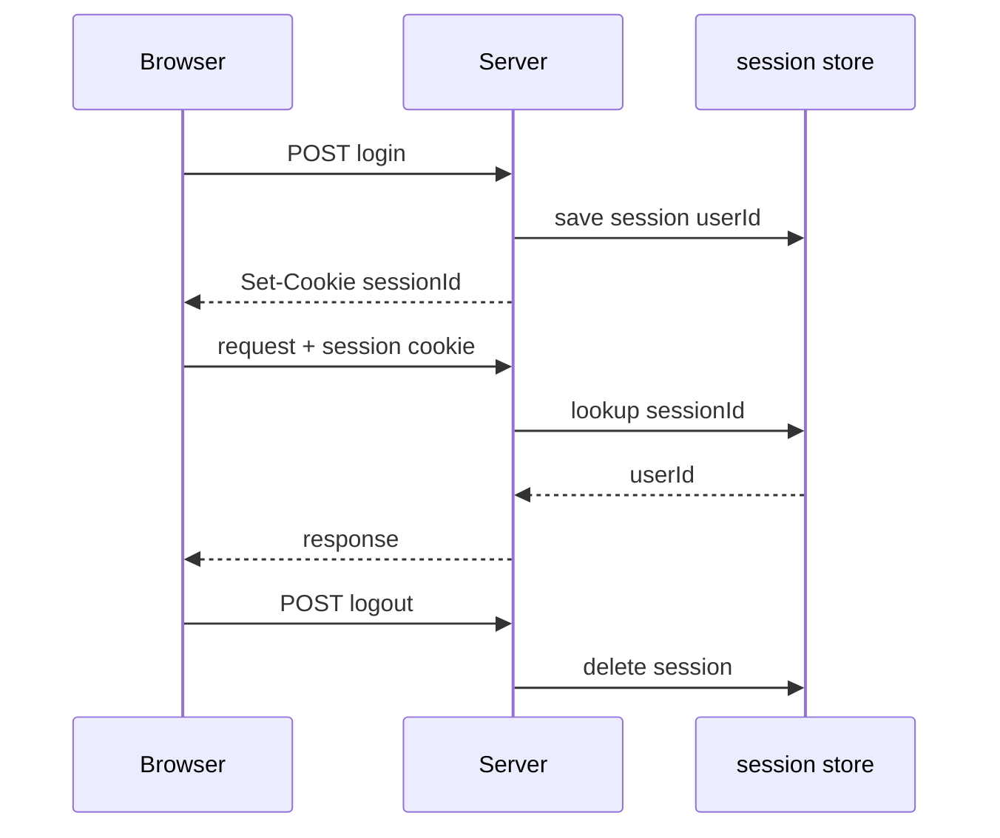
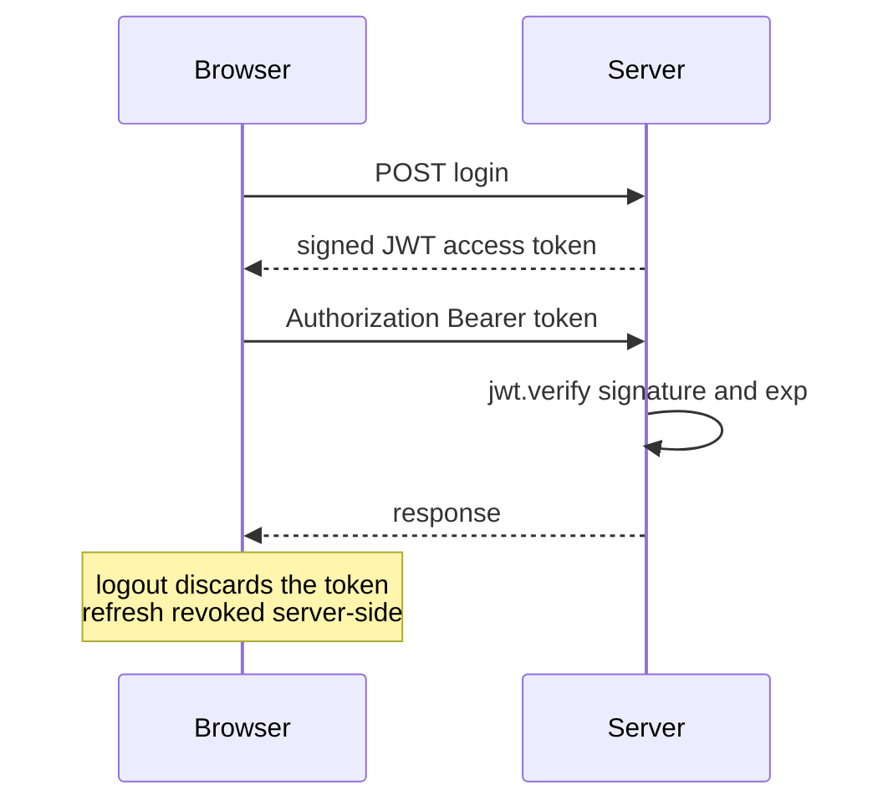

# 6.4 ,  Sessions vs JWT

> **[Learn]** · Chapter 06, Authentication API · *Stateful vs stateless; pros and cons; **JWT for this course***

Every authenticated API must answer one question: **how does the server remember who sent this request?** Two dominant patterns answer it, **server-side sessions** and **JWT (JSON Web Tokens)**, and this course mandates JWT for Midad.

<BigWordAlert term="Stateless JWT" plainEnglish="A signed token the client sends on each request, and the server validates the signature without storing a session in memory." whyItMatters="Midad uses JWTs so the API scales without a central session store, a good fit for a Node + React split." />

The choice matters more than it looks, because it decides what Midad can promise about logout. A creator who refunds a buyer and then walks away from the studio expects the buyer's access to end, and the way you store identity decides how quickly that promise can be kept.

## Why this matters

Sessions and JWT are not interchangeable labels. They change **where state lives** (a server store or a signed token), how logout behaves, and how the React client sends credentials. Picking one without understanding the other produces the classic "why doesn't logout kill access instantly?" confusion. This course picks JWT with a hashed refresh token, so the useful exercise is knowing exactly what you traded against a Redis session store.

There is a second, quieter reason to study both. Every authenticated route you write in Chapters 7 through 26 will ask the same three questions: who is this caller, what are they allowed to touch, and how do we stop them touching it after the sale is reversed. Sessions and JWT answer the first question differently, and the difference ripples into the other two.

## The problem: state has to live somewhere

A password check happens once, on a single request to `/api/auth/login`. After that point the server has no inherent memory of the caller, because HTTP is a series of unrelated deliveries. Something has to carry the outcome forward, and there are only two places to put it: on the server, keyed by an identifier the client holds, or in the client, signed so the server can trust it later without a lookup.

Sessions choose the first option. The server writes a record with the user id into a store and hands the browser a cookie holding only the lookup key. JWT chooses the second. The server signs a small payload and hands it over, and on later requests it verifies the signature instead of searching for a record. Both are honest designs, and both fail in characteristic ways when they are stretched past their assumptions.

## Think of it like a festival

**Hand stamp versus driver's licence.** Session: the venue keeps a list at the door and you show a wristband number, so the gate staff check the list every time, and cancelling your wristband takes one line in that list. JWT: you carry a signed pass with an expiry printed on it, so gate staff verify the signature and wave you through without asking anyone, and a stolen pass works until the printed time runs out.

<ComparePanel title="Sessions vs JWT">
  <CompareColumn label="Sessions">
    Server stores session in Redis/DB. Client holds session cookie. Logout deletes server-side session immediately. Requires session store at scale.
  </CompareColumn>
  <CompareColumn label="JWT (this course)">
    Server signs token; client sends Bearer header. Logout revokes refresh token. No central session lookup per request, scales horizontally.
  </CompareColumn>
</ComparePanel>

## The mechanism: signature instead of lookup

A JWT is three base64url segments separated by dots: a header naming the algorithm, a payload of claims, and a signature over the first two produced with a secret only the server knows. The server's work on every request is arithmetic, not a query. It recomputes the signature and compares, then reads `exp` to see whether the token is still inside its window.

That mechanism has one consequence that surprises almost everyone the first time. The payload is **readable by anyone holding the token**. Signing proves the claims were not altered; it does not hide them. Paste a Midad access token into a decoder and you can read the user id and the role in plain text. So the payload is a place for identifiers, never for secrets, and that rule decides what you put in it before you write a line of middleware.

## Sessions, drawn out



```
Login, server stores session in Redis or the database, returns a session id cookie
Each request, server looks up the session and loads the user
Logout, delete the session server-side
```

| Pros | Cons |
|---|---|
| Revoking a session is one delete | A store must exist and stay available |
| The cookie carries an id and nothing else | Two API instances need the same store |
| Lifetime is decided by the server | Redis joins the deploy checklist |

This is the classic choice for a monolith that renders pages on the server, where a lookup per request is cheap because the request already touches the database.

## JWT, drawn out



```
Login, server signs a JWT with a secret, client stores the token
Each request, client sends the Bearer token, server verifies signature and expiry
Logout, client discards the token, and the server revokes the refresh token
```

| Pros | Cons |
|---|---|
| No store lookup when verifying a token | A revoked License still looks active until expiry |
| Every API instance verifies with the same secret | The payload is readable by whoever holds it |
| React keeps it in memory and sends a header | Rotating the secret logs everyone out at once |

**The hybrid used here:** a short-lived JWT access token plus a long-lived refresh token stored hashed in the database, so revoking the refresh ends renewal.

## A worked example: expiry during a purchase

A buyer opens a Product page, adds the commercial License to the cart, and walks away for twenty minutes. Their access token expired eight minutes ago. What happens on the next click is decided by the design, not by the browser.

<TraceRequest title="An expired access token in the middle of a purchase">
  <TraceStep actor="React" label="sends the cart request with a stale token" detail="The token is still in memory, so the header is attached as usual" />
  <TraceStep actor="API" label="verifies and finds exp in the past" detail="TokenExpiredError, and the route returns 401 without touching the cart" />
  <TraceStep actor="React" label="calls refresh once with the cookie" detail="The refresh token is still valid, so the server signs a new access token" />
  <TraceStep actor="API" label="rotates the refresh hash" detail="The old refresh value stops working, so a replayed one gets a 401 later" />
  <TraceStep actor="React" label="retries the original request once" detail="The buyer sees a normal cart page and never learns the token changed" />
</TraceRequest>

Step three and step four are the pair that makes this safe. A refresh call is not a free renewal; it replaces the credential, so an attacker who copied yesterday's refresh cookie cannot use it after the buyer's next silent refresh. An expired access token, by contrast, is simply dead, and no amount of retrying brings it back.

## Why JWT for this course

| Factor | Midad choice |
|---|---|
| MERN SPA client | Bearer token in memory fits React |
| Module monolith | No separate session Redis until the Chapter 21 cache |
| Learning goal | Industry-standard JWT with refresh |
| Pair with Chapter 7 | The 401 refresh loop teaches real client auth |

Redis in Chapter 21 is for the catalogue cache, not for sessions.

## What goes in the payload

**Include:**

- `sub` or `userId`, the MongoDB `_id` of the User  
- `role`, `creator` or `buyer`  
- `iat` and `exp`, issued and expiry  

**Never include:**

- `passwordHash`  
- `email`, optional, and better served by a `/api/auth/me` route  
- a refresh token inside the access token  

Keep the access payload minimal; the less it carries, the less a stolen token tells an attacker.

## Refresh token pattern

The two tokens do very different jobs. One proves you are still logged in for minutes, the other proves you are still logged in for days.

| | Access JWT | Refresh token |
|---|---|---|
| Lifetime | 15 minutes | 7 days |
| Travels as | Authorization header | httpOnly cookie, or body while testing with curl |
| Server record | None | Hash in `User.refreshTokenHash` |
| To end it | Wait for `exp` | Clear the hash on logout or rotation |

**Rotation, which is recommended:** a new refresh token on each refresh call, and the old hash invalidated in the same update.

## Decision record

Document this in your learning log so the choice survives the week:

*"Midad uses JWT access tokens verified with JWT_SECRET and refresh tokens hashed on User. Access is stateless; refresh revocation provides logout. A session store is deferred."*

## Common questions

**Q: Are JWTs encrypted?**  
A: No, they are *signed*, which is a different thing. Anyone with a token can decode the payload and read its contents. What they cannot do is change it, because the signature only verifies if the payload is untouched. So never put secrets, passwords, or anything sensitive in a JWT. Treat the payload as public and use the signature only as tamper evidence.

**Q: Why bother with a short access token if a refresh exists?**  
A: To limit the blast radius of a leak. The access token is what the browser keeps in memory and sends with every request, so it is the most likely thing for a script to steal. At fifteen minutes, a stolen token becomes useless quickly. The refresh token lives somewhere safer and can be revoked server-side, which is why it can afford a long lifetime.

**Q: Why not sessions with the Express default memory store?**  
A: Two reasons for this course. The default memory store keeps sessions in the RAM of one process, so a second process does not know about them and a restart loses everyone. And the SPA with a Bearer token is the pattern the rest of the course builds, including the Chapter 7 retry loop. Sessions are fine for small apps; they are just not the pattern this project uses.

**Q: What breaks when the signing secret changes?**  
A: Every token signed with the old secret fails verification at once, so every logged-in buyer gets a 401 on their next request and is pushed through the refresh path. If the refresh cookie is still valid, the app recovers silently; if the refresh hash was also keyed to the old secret, everyone is logged out. That is why `JWT_SECRET` is loaded from the environment once, and why changing it is a deployment decision rather than a code edit.

## Failure modes and how to recognise them

Three failures account for most of the confusion around this chapter. The first is an access token that carries a password hash or an email, which turns any stolen token into a data leak and is fixed by trimming the payload in the sign call. The second is a login route that returns both tokens in the JSON body and a client that stores the long one in localStorage, which quietly converts a seven day credential into a script readable one and is fixed in Chapter 7 by moving it to a cookie. The third is a refresh route that signs a new access token without replacing the stored hash, which means a stolen refresh value keeps working forever and defeats the whole point of rotation.

## Debugging path

When a protected route answers 401 and you believe the buyer is logged in, work in this order. Decode the token and look at `exp` first, because an expired token and an invalid signature look identical to the client and completely different to you. Then check that the server verifying the token is using the same `JWT_SECRET` value that signed it, which is the usual cause of "invalid signature" after an environment change. Then check the header format, since `Bearer` with no space, or a lowercase scheme, fails before your middleware runs. Only after those three is the route logic a suspect.

## Trade-off: what you gave up

JWT with refresh buys horizontal scale and one less piece of infrastructure, and it costs instant revocation of access. A buyer whose License is revoked still holds a valid access token for up to fifteen minutes, so any route that must refuse immediately has to read the database rather than trust the token alone. Chapter 25 and Chapter 26 lean on that rule: download limits and refund revocation are checked against `DownloadGrant` and `License` documents, not against a claim in a token, because a claim describes the past and the database describes now.

## ✅ Do / ❌ Don't

**✅ Do:** Keep the access lifetime short, fifteen minutes by default.

**✅ Do:** Hash the refresh token before storing it, the same way you treat a password.

**❌ Don't:** Put `JWT_SECRET` in git or in a Vite client variable.

**❌ Don't:** Store the access token in localStorage if you can avoid it; Chapter 7 keeps it in memory.

## Reflect

What happens if a buyer clicks logout but their access JWT has not expired? How does refresh revocation help, and which routes still need a database check to refuse a revoked License immediately?

## Next

**Sub-chapter 6.5:** Password hashing, bcrypt, salt and cost factor.

Architecture chosen, password storage mechanics next.
