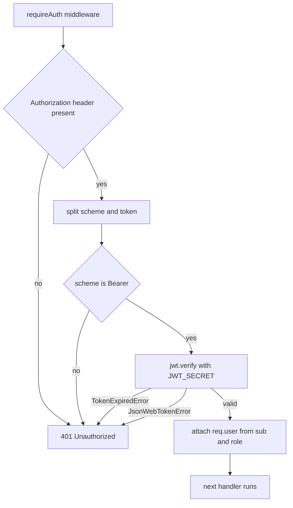

# 6.7 ,  Prime your thinking

> **[Learn]** · Chapter 06, Authentication API · *Mandatory reads: bcrypt, JWT intro*

Before scaffolding auth routes, read how bcrypt and jsonwebtoken behave in Node, especially the async APIs and the error types. Thirty minutes here prevents a week of "invalid signature" loops.

<BigWordAlert term="Access vs refresh token" plainEnglish="A short-lived access token for API calls, and a longer refresh token that gets new access tokens without a re-login." whyItMatters="Midad access tokens expire in minutes, and refresh tokens keep buyers logged in across tab sessions." />

Both libraries you are about to use are small, stable and widely copied, which is exactly why so much of the code written about them is out of date. A blog post from 2019 calls `bcrypt.hash` with a callback and signs tokens with an algorithm the current library will refuse. Reading the READMEs first means the code you scaffold in 6.9 looks like the version you actually installed, and the failures you meet are real failures rather than last decade's.

```predict
prompt: "A buyer's access token expires while their refresh token is still valid. What should Midad do?"
options:
  - id: extend-expired
    label: "Keep accepting the expired access token until logout"
  - id: rotate-access
    label: "Use the refresh token to mint a new access token"
correctOptionId: rotate-access
explanation: "Short-lived access tokens limit exposure. A valid refresh token is the credential used to mint a replacement; an expired access token must not become valid again."
allowRetry: true
```

## The problem: four libraries, four failure shapes

The authentication module looks like one feature and is actually four mechanisms stacked. Password storage is a deliberate computation. Token signing is a signing computation. Token verification is a comparison that throws instead of returning false. And session renewal is a database write that must be atomic with the answer it returns. Each of those has a different failure shape, and a route that mixes them without knowing which is which turns one clear error into four vague ones.

The most common version of that confusion is a login handler that catches every error in the same block and returns "Invalid credentials". A buyer who typed the right password and met a signature mismatch sees the same message as a buyer who typed the wrong one, and the developer sees nothing at all in the logs. Reading the error names before you write the handler is what stops that from happening.

## The mechanism: bcrypt spends time, JWT spends arithmetic

bcrypt is designed to be slow on purpose. It takes the password, generates a random salt, and runs a key derivation loop whose length is set by a cost factor. A cost of 10 means roughly a thousand iterations of the underlying cipher setup, and the result embeds the algorithm, the cost and the salt so `compare` can reconstruct the computation later without a second column in the database. The defence is economic: a stolen `passwordHash` column costs an attacker real money per guess instead of a fraction of a second.

One behaviour is worth knowing before you write a route. bcrypt's `compare` is not a string comparison: it re-derives the hash using the salt and cost recorded inside the stored value, which is why a hash produced at cost 8 still verifies after you raise the cost to 10, and why upgrading old hashes is a separate decision rather than a side effect.

jsonwebtoken is the opposite kind of computation. Signing is a hash over the header, the payload and a secret, and verification recomputes that hash and compares. There is no stored state and no database read, which is why the check is fast and why a revoked user can still present a valid token until it expires. The library adds two errors that matter to your middleware: `TokenExpiredError` when `exp` is in the past, and `JsonWebTokenError` for a malformed token or a signature that does not match.

The throwing behaviour is the part to design around. `verify` never returns null, and it checks the algorithm against the set you allow, so a token signed with a different algorithm is rejected before your code reads a single claim. A middleware that wraps the call in a bare `try` block and answers 401 for everything is correct at the protocol level and useless at the log level, which is why the two error names matter enough to catch separately.

## A worked example: registration to a protected route

Trace what happens to a creator who registers a Studio account and then loads their dashboard, with the four mechanisms in order.

<TraceRequest title="From a new Studio account to a protected dashboard">
  <TraceStep actor="API" label="validates the register body" detail="email and password pass the schema, so the handler runs at all" />
  <TraceStep actor="API" label="hashes with bcrypt at cost 10" detail="The stored document keeps a salted hash, and the plain password leaves memory" />
  <TraceStep actor="Server" label="signs an access token and a refresh token" detail="sub is the user id, role is creator, exp is fifteen minutes away" />
  <TraceStep actor="DB" label="stores only the refresh hash" detail="The refresh value itself is never written, so a database read cannot reuse it" />
  <TraceStep actor="API" label="verifies the Bearer token on the next request" detail="A bad signature throws JsonWebTokenError and the route answers 401" />
</TraceRequest>

Read steps two and three together. The password and the token secret are different secrets with different jobs, and mixing them up is a real bug: signing the token with the password hash produces tokens that expire the moment a creator changes their password, and using `JWT_SECRET` as a bcrypt salt produces hashes nobody can compare. Keep them in separate config keys and the confusion never arises.

## The verification path as a diagram



The shape to notice is that every failure converges on the same 401 and every success leaves the middleware through one door with `req.user` set. That is what makes Chapter 8 possible: ownership checks read `req.user.id` and never re-parse a header. It also means the response body never explains which check failed, because a buyer who can distinguish "expired" from "bad signature" from "wrong secret" can map your deployment.

## Trade-offs worth naming before you code

The bcrypt cost factor is a genuine trade-off between attacker cost and login latency. Cost 10 keeps a login under a hundred milliseconds on a laptop; cost 14 makes guessing sixteen times harder and makes every login feel slow. For Midad, cost 10 is the right default, and the honest way to describe it in a learning log is that you chose a login latency budget and let the cost follow.

Token lifetime is the same kind of trade in the other direction. A long access lifetime means fewer refresh round trips and a larger window in which a revoked License still looks active. Fifteen minutes is short enough that the window is small and long enough that a normal browsing session never notices.

Storing the refresh hash on the User document is a third. It gives one active session per account, which is simple to reason about and impossible to extend to a second device without a separate collection. Chapter 7 does not need multiple devices, so the simple version wins, but the limitation should be written down rather than discovered later.

## Failure modes to recognise

A login route that returns "invalid credentials" for a server error hides outages and is fixed by catching the specific error types instead of everything. A middleware that verifies with the wrong secret produces a steady stream of `JsonWebTokenError` while the token in the header looks perfectly formed. An OTP stored in plain text in a development database is fine only while the database is local, which is why the hashed variant exists. And a refresh handler that signs a new access token without replacing the stored hash leaks a permanent credential, which is the failure that looks like success.

## Debugging path

When a token check fails, prove each link in the chain rather than rewriting the middleware. Sign a token in an isolated script with the same secret and payload, then verify it in the same script, so you separate the library from the route. Compare `exp` in the decoded payload with the current time before blaming the signature. Print the first characters of the secret from config and from the process environment to confirm they are the same string, since a trailing newline pasted into a host dashboard is a real cause. Then reproduce the request with curl, where the header is exactly what you typed, and only then return to the React client where the header is assembled by code.

## Mandatory reads

Read these four in order. The first two are the tools you will type into `server/src/` this chapter, so read the official READMEs and use the APIs the maintainers intend, not the way an old blog post remembers them.

| Resource | Focus |
|---|---|
| [bcrypt npm readme](https://www.npmjs.com/package/bcrypt) | hash and compare async API |
| [jsonwebtoken readme](https://www.npmjs.com/package/jsonwebtoken) | sign, verify, expiresIn |
| [JWT.io introduction](https://jwt.io/introduction) | structure recap |
| Express [Router mounting](https://expressjs.com/en/guide/routing.html) | `/api/auth` prefix |

Optional: [OWASP Authentication Cheat Sheet](https://cheatsheetseries.owasp.org/cheatsheets/Authentication_Cheat_Sheet.html), password storage section.

## bcrypt API notes

```javascript
// hash, async preferred
const hash = await bcrypt.hash(password, 10)
// compare
const match = await bcrypt.compare(password, user.passwordHash)
```

Sync variants exist. Use the async form inside Express handlers so a hash does not block the event loop for the whole server.

## jsonwebtoken API notes

```javascript
const token = jwt.sign({ sub: userId, role }, secret, { expiresIn: '15m' })
const payload = jwt.verify(token, secret) // throws if invalid or expired
```

Error names to catch in middleware:

- `TokenExpiredError`  
- `JsonWebTokenError`  

Return 401 with `{ message: 'Unauthorized' }`. Do not leak error details to the client in production.

## Express middleware order preview

```
app.use(express.json())
app.use('/api/auth', authRoutes)
// later: app.use('/api/studios', requireAuth, studioRoutes)
```

`requireAuth` is applied per route or per router, not globally, so the health route stays public.

## HTTP validation pattern

`auth.schema.js` decides what each route is allowed to receive. Every field listed here is something a real marketplace API validates, and garbage in, garbage out is how bad APIs start.

| Route | Body fields |
|---|---|
| register | email, password, role, displayName? |
| login | email, password |
| verify-otp | email, otp |
| refresh | refreshToken (if body mode) |

Return 400 with field errors before the service layer runs.

## OTP implementation options

Both options store the code on the User document, and they differ in how much damage a leaked database does. Plain text is acceptable for a dev-only demo; hashed is what you ship.

| Option | Storage |
|---|---|
| Plain OTP and expiry | `otpCode`, `otpExpiresAt` on User, dev only with a short TTL |
| Hashed OTP | `otpHash`, treated like a password |

Dev delivery: `console.log('OTP:', otp)` when `NODE_ENV` is development.

## Note-taking template

```
Register service steps:
1. validate
2. duplicate email check
3. hash password
4. create user and Studio profile
5. generate OTP
6. return message plus dev OTP

requireAuth:
- parse the header
- verify
- attach req.user
```

## Time box

| Activity | Minutes |
|---|---|
| bcrypt readme | 10 |
| jsonwebtoken readme | 15 |
| OWASP skim | 10 |
| Map routes to service functions | 15 |

## ✅ Do / ❌ Don't

**✅ Do:** Test `jwt.verify` with an expired token by hand, so you have seen the error name.

**✅ Do:** Keep your curl collection notes for 6.18.

**❌ Don't:** Implement handlers before `JWT_SECRET` exists in config.

## Self-check before the build cluster

- [ ] I can sign and verify a JWT in isolation
- [ ] I can hash and compare a password
- [ ] I know 401 versus 403, unauthenticated versus authenticated but not permitted

## Next

**Sub-chapter 6.8:** Authentication and token safety knowledge check.

Reading done, the build starts at 6.9.
