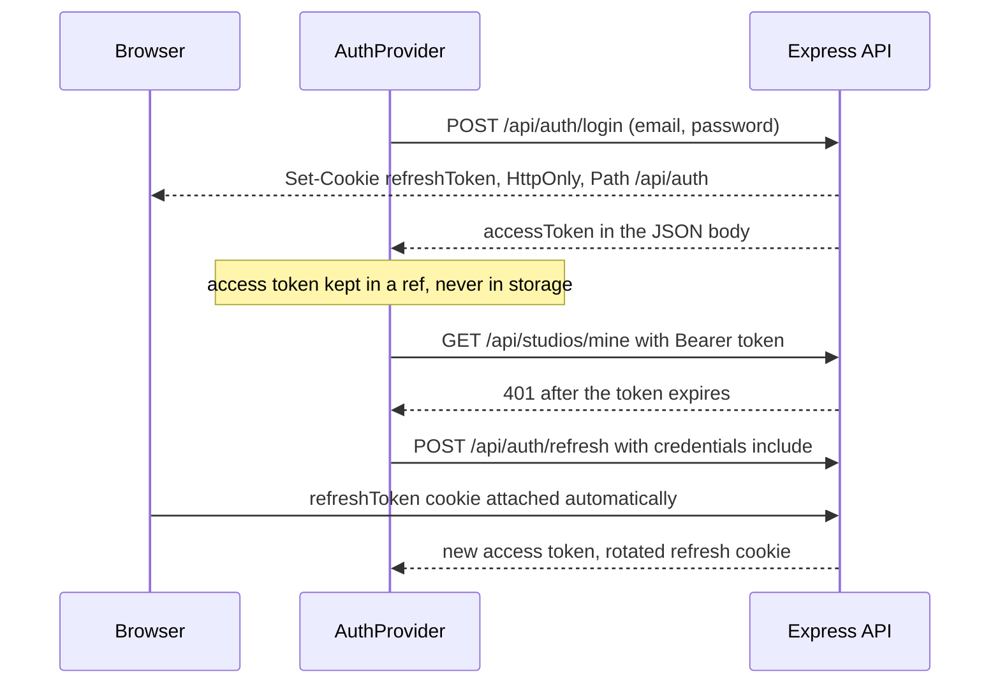

# 7.4 ,  Where tokens live

> **[Learn]** · Chapter 07, Login & registration · *Access in memory; refresh in an httpOnly cookie*

This is the concrete storage map for the Midad client. You implement it in 7.10 and 7.14, and every later page that reads a License or a DownloadGrant depends on it being right.

<BigWordAlert term="localStorage trade-off" plainEnglish="Browser storage that survives a refresh but is readable by any JavaScript on the page, so it is exposed to XSS." whyItMatters="A token in localStorage survives a reload, and so does the script that can read it." />

## Why this matters

"Vague auth state" bugs dominate beginner SPAs: a token in localStorage, a refresh that never happens, a reload that logs everyone out, or a refresh call that runs on the login page and causes a loop. This page pins **exactly where each token lives** so the implementation matches the security intent from 7.2.

The reason to be fussy here rather than pragmatic is that the two tokens are not equally valuable. The access token is a fifteen minute pass. The refresh token is a seven day key that can mint new passes, so losing it is a much larger event. Putting the cheap credential somewhere convenient and the expensive one somewhere safe is the whole design, and it only works if the client never mixes the two homes.

## The problem: memory is invisible and cookies are not

A React app cannot see its own memory from the outside. There is no DevTools panel for a variable inside a provider, no way to inspect what the API client will send on the next request, and no persistent record after a reload. That makes memory a wonderful place for a short-lived credential and a terrible place to debug. The refresh cookie is the opposite: invisible to JavaScript by design, and perfectly visible in the Network tab, which is exactly the visibility split you want when something goes wrong.

So the storage map has an asymmetry that is deliberate and slightly awkward. The value you can inspect in DevTools is the one you should never read in code, and the value your code uses constantly is the one you cannot inspect at all. Everything in this sub-chapter follows from accepting that trade instead of fighting it.

## The mechanism: two lifetimes, two homes

The access token lives in a JavaScript variable inside `AuthProvider`, not in localStorage, not in sessionStorage, and not in a JS-readable cookie. The trade-off is deliberate: memory survives only while the tab is open, so a page reload requires a silent refresh. That small inconvenience buys a much smaller theft window if a script ever runs on your page.

The refresh token lives for days, so it needs the strongest protection the browser offers: a cookie JavaScript cannot read. The server writes it with `Set-Cookie`, the browser stores it, and your React code never sees the value. When the API client calls `/api/auth/refresh` with `credentials: 'include'`, the browser attaches the cookie automatically, with no token plumbing in your code at all.



Read the last three arrows as one unit. The browser, not React, is the party that proves the refresh token, and the server answers by rotating it. React only ever holds the short-lived result.

## A worked example: a reload in the middle of a session

A creator has a Studio dashboard open, leaves for lunch, and comes back to a browser that reloaded the tab. Trace what the app does before it paints anything.

<TraceRequest title="Reload with an empty memory and a valid cookie">
  <TraceStep actor="Client" label="document loads, JS memory is empty" detail="The access token from before the reload no longer exists anywhere" />
  <TraceStep actor="React" label="AuthProvider calls refreshAccessToken()" detail="This runs on mount, before protected routes are allowed to render" />
  <TraceStep actor="API" label="reads the httpOnly cookie" detail="credentials include lets the browser attach it, so the server sees a valid refresh token" />
  <TraceStep actor="React" label="stores the new access token in a ref" detail="isLoading flips false, and the dashboard renders with real data instead of a redirect" />
  <TraceStep actor="Client" label="a 401 later triggers one retry" detail="If the refresh itself fails, the app clears state and shows the login page" />
</TraceRequest>

The intermediate state is the part beginners skip. Between mount and the refresh response there is a real window where the app knows nothing about the user, and rendering protected routes in that window produces the flash of the login screen that makes a working app feel broken. `isLoading` exists to cover exactly that window, and it should be true until the refresh resolves, whether the answer is a token or a 401.

## Access token, memory only

The access token is a short-lived credential the API client attaches to every request. It lives in a JavaScript variable inside the AuthProvider, and nowhere else.

**Location:** `useRef` or a closure variable inside `AuthProvider`, rather than React state, if you want to avoid re-renders on token rotation. Plain state is fine if simpler.

**Set when:**

- Login success  
- Refresh success  
- App boot refresh success  

**Clear when:**

- Logout  
- Refresh failure  
- A 401 that survives the retry  

**Never:** localStorage, sessionStorage, or a JS-readable cookie.

## Refresh token, httpOnly cookie

**Set by:** the server, with `Set-Cookie`, on login and refresh responses.

**Read by:** the browser automatically on `fetch(..., { credentials: 'include' })` to `/api/auth/refresh`.

**Client JS:** never reads the refresh value. It is opaque to React.

## Server cookie spec, coordinated with Chapter 6

| Attribute | Dev | Production |
|---|---|---|
| HttpOnly | true | true |
| Secure | false (localhost) | true |
| SameSite | Lax | Lax |
| Path | /api/auth | /api/auth |
| Max-Age | 7d | 7d |

Cookie name: `refreshToken`, documented as a constant on both sides.

`samesite=Lax` is enough for this flow because the refresh call is same-site from the client's point of view, and `Path=/api/auth` means the cookie is not attached to catalogue or Studio requests at all. A refresh credential that never travels on ordinary requests has fewer chances to be logged, proxied or replayed.

## Boot sequence

On every page load the access token is gone from memory, so the app must try to rebuild the session before rendering anything. Otherwise a logged in buyer flashes at the login screen, or gets bounced there entirely.

```
App mounts
  then AuthProvider calls refreshAccessToken()
  then POST /api/auth/refresh (cookie sent)
  200: set access in memory, optionally load the user from /api/auth/me
  401: the user stays logged out
  then set isLoading false
```

Preventing a flash redirect on protected routes during boot is the whole point of the sequence.

## Logout sequence

Logging out is symmetric with logging in: the client drops what it holds in memory, and the server invalidates the refresh cookie so it cannot be replayed. Do both sides, because clearing only the client leaves a usable refresh token behind for anyone who copies the cookie first.

```
Client: clear the access token in memory
Client: POST /api/auth/logout with credentials include
Server: clear the refresh cookie and the refreshTokenHash
Client: redirect to /login
```

## Dual mode during migration

You may be wiring the client while Chapter 6 still returns the refresh token in the JSON body. That is an acceptable stepping stone, but be honest about it. Setting the cookie from the client's JavaScript is **less secure**, because the browser sees the refresh value, even briefly, and should only be a temporary bridge. The gate requires the server-side httpOnly cookie for final submission.

## Failure modes

Four failures cover almost every auth bug in a MERN client. An access token in localStorage survives a reload and is readable by any injected script, which is the single most common mistake in this stack. A refresh token stored in localStorage or a JS-readable cookie protects the most valuable credential with the weakest available mechanism, so a stolen value keeps working for a week. A missing boot refresh logs a buyer out on every reload, which users report as "the site forgets me". And a refresh interceptor that runs on the login page turns a wrong password into a refresh attempt, a second 401, and a redirect that looks like a crash.

## Debugging path

When a silent refresh fails, look at the request rather than at the React code. Open the Network tab, find the `/api/auth/refresh` call, and check three things in order: whether the request carried a cookie at all, whether the response was a 401 with an empty body or a 500 with a stack trace, and whether `Set-Cookie` appears on the response of the login call that preceded it. A missing cookie with a 401 almost always means `credentials: 'include'` is absent or the cookie `Path` does not cover `/api/auth`. A cookie present with a 401 means the stored hash and the cookie disagree, which is a server question about rotation.

## Common questions

**Q: Why useRef instead of useState for the access token?**  
A: Both work, and the difference is re-renders. `useState` repaints every component that reads the value whenever it changes, so a silent refresh that rotates the token could re-render the whole tree for no visible reason. `useRef` holds the value without triggering a re-render. The catch is that components do not automatically notice ref changes, which is fine here because the API client reads the token, not the UI.

**Q: Can React read the refresh cookie to debug?**  
A: No, and that is by design. `httpOnly` makes the cookie invisible to JavaScript, so `document.cookie` will not show it. To check it, open the Network tab, click the refresh request, and read the `Set-Cookie` response header, or look under Application, Cookies in DevTools. If you cannot find it there, the cookie was not set, which is a server-side question.

**Q: What is `credentials: 'include'`?**  
A: Browsers do not send cookies on cross-origin requests by default, and your Vite dev server on port 5173 is a different origin from your Express API on port 3000. `credentials: 'include'` is the fetch option that says send cookies on this request, so the httpOnly refresh cookie reaches `/api/auth/refresh`. Forget it and the silent refresh always returns 401, which is the classic works in curl, fails in the browser bug.

**Q: Why protect the refresh token more than the access token?**  
A: Because the two are not equally valuable. The access token expires in about fifteen minutes, so a stolen one has a short life. The refresh token stays valid for days and can mint new access tokens the whole time, so stealing it is like stealing the key to the cash machine instead of one day's cash. That asymmetry drives the split.

**Q: Why does a page reload wipe the access token from memory?**  
A: Memory is not a storage location. It is temporary working space tied to the running page, and a reload tears down the page and its variables. That is by design: the access token never outlives the page session, and the boot sequence rebuilds it from the cookie before rendering.

## ✅ Do / ❌ Don't

**✅ Do:** Use `sameSite: Lax` for localhost development.

**✅ Do:** Scope the cookie `Path` to `/api/auth` at minimum.

**❌ Don't:** Expose the refresh token on the window object for debugging in committed code.

## Self-check

- [ ] I can name the home of each token without opening the code
- [ ] I can explain what an XSS bug gains from a token kept in localStorage
- [ ] I can point to the two cookie flags that break when a site is served over plain HTTP

## Next

**Sub-chapter 7.5:** The 401 retry loop, refresh once, otherwise logout.

Placement clear, the interceptor algorithm next.
