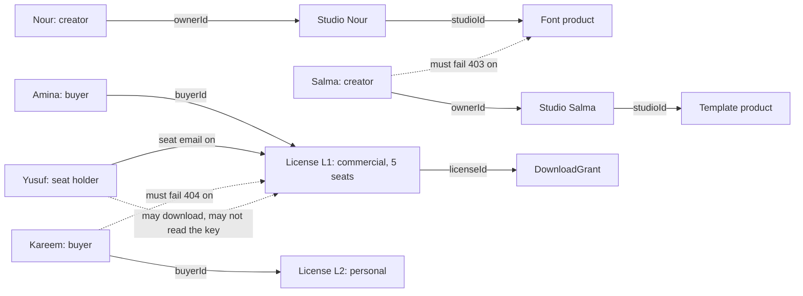

# Whose studio, whose licence?

At 09:20 on a Monday, four people are signed in to Midad. Nour, a creator, is looking at her product table with two published fonts. Salma, another creator, is editing the license option for a CV template. Amina, a buyer, is opening her library to download the font she bought on Friday. Yusuf is a designer at the small agency that holds Amina's commercial license, and she added his work email to one of the five seats.

Yusuf holds a buyer account with no purchase of his own. Amina added his work email to one of the five seats on her commercial license, so he can download the files and owns nothing.

All four requests are authenticated. Each one may touch a different record, and one of them may touch a record the others cannot. Nour may edit her product and its private file. Salma may edit her own and no other. Amina may read her license, copy the key and request a download. Yusuf may request a download through the seat he was given and may not read the key, change the seats or ask for a refund.

Authentication answered who each caller is. It did not answer which records belong to them, and it did not decide which fields inside a record are theirs to read. That second job is this module, and in a marketplace where the most valuable endpoint hands out a private file, it is the difference between a product and a leak.

## A token proves identity, and a role proves very little

When Amina signs in, the API returns an access token that resolves to a user id and a role, and the role is `buyer`. The same resolution works for Kareem, who also buys on Midad, and for a buyer who has never bought anything. A middleware that asks only whether the caller is a buyer passes for all three, which is the gap this module closes.

The role is still useful, because it refuses a whole category of caller before a record is loaded. A creator token on a buyer download route, or a buyer token on a studio edit route, should be refused without a database read. But the role cannot answer the question a marketplace actually asks, which is whether this particular license, for this particular product, belongs to this particular person.

So every protected route answers two questions. What kind of caller is this, and does this specific record belong to them? The first is a role check and it runs before the handler. The second is an object check and it needs a path from the record to the person through a stored field you can name. If you cannot name the field, the check does not exist yet.

## Four kinds of ownership in one marketplace

Midad has four, and they are not variations of one idea. A **studio owner** is a creator whose user id is stored as `ownerId` on one Studio. A **product owner** is not a stored role at all: a product belongs to a studio through `studioId`, and the studio belongs to the creator. The product check is therefore one hop, and the hop is the whole check.

A **license holder** is the buyer who paid. The license stores `buyerId`, and the paid order line that created it stores the same buyer. This is a different person from the product owner, and confusing the two is the bug that lets a creator read a buyer's key because she uploaded the file.

A **seat holder** is a named person on a commercial license, stored inside the license as an entry in `seats` with an email and a name. On the core path the seat holder may request a download and may not read the license key, change the seat list, or ask for a refund. That is a product decision, and it belongs in the matrix rather than in a conversation.

The four are also not equally durable. A studio owner exists until the studio is closed. A product owner follows the product. A license holder exists until a refund revokes the license. A seat holder exists until the buyer removes the email or the license is revoked. Every route that touches a record has to know which of the four it is asking about.

## Two failures a role check cannot stop

The first failure is the cross-creator edit. Salma learns a product id from a public catalogue page, or from a screenshot in a support thread. Product ids are not secrets; they appear in URLs that buyers share. She sends a price change to that id with her own valid creator token. A route that checks the role and then updates by id alone accepts it, and Nour's font now costs whatever Salma typed.

The second failure is the cross-buyer read. Kareem learns a license id, or guesses one, and asks the library route for it. A route that loads the license by id and then compares the buyer afterwards may still return a product title, a terms version or a remaining download count in an error body, a log line or a serialized response. The check has to be in the query, so a failed match returns nothing at all.

Both failures have the same shape, and it is worth saying plainly: the identifier came from the caller and the server trusted it. The fix is not a hidden button and it is not an unguessable id. The fix is that the record is loaded through a condition the caller cannot supply, and the condition names the owner field.

## Expired is not revoked, and both are denied

A license has three states that matter to access. It is `active` while the buyer may download. It is `revoked` after a refund is confirmed, and it never returns to active. It is `expired` when its own expiry time has passed, which the core path uses for nothing yet and the stretch module uses for time limited commercial terms.

The trap is a route that checks `status === 'active'` and nothing else. That passes for a license whose expiry has passed if no job has run to mark it, so the access decision depends on a background task keeping up. The download query carries the status and the time, so a stale status cannot open a door. Write both conditions in the same filter and add two tests, one with a revoked license and one whose expiry is in the past by a minute.

A refund makes this visible in the demo. When a creator refunds their own order, the licenses of that order are revoked and the buyer's library shows the purchase history with the download action unavailable. An already issued link may still work until it expires, and no software can take back a file someone saved. Both facts belong in the module notes, because an honest limit is easier to defend than a promise that cannot be kept.

## Need to know, field by field

The status code is the easy part. The field list is harder, and it is where most teams leak. A record a caller may read can still carry fields they have no reason to see.

For a creator on her own product, the useful fields are the title, the options with prices and limits, the previews, the file version, its size and its checksum, and the publication state. The creator does not need any buyer's license key, any seat email, any download grant or the buyer's account details. A creator sales page shows counts and dates, never the keys themselves.

For a buyer on her own license, the useful fields are the product title and creator name, the license type, the accepted terms version, the seat limit, the downloads remaining and the copyable key. The buyer does not need the storage identifier, the file version's internal id, the order line of another buyer in the same checkout, or the platform's payment reference.

For a seat holder, the list is narrower again. The seat holder sees the product title, the license type and a download action. The key stays with the buyer, because the key proves a purchase and the seat proves a permission to use.

Write those three lists down before writing a serializer. A projection that names its fields is a decision a reviewer can check. A projection that deletes two keys from a full document is a decision that will be wrong by the next module.

## 403 or 404, and why the choice matters

A wrong owner is not an unauthenticated caller, so 401 is the wrong answer. The token is valid, and a 401 sends the client into a refresh loop that hides the real problem from everyone, including the person debugging it.

The real choice is between 403 and 404, and the deciding question is whether the caller is allowed to know the record exists. A product is on a public catalogue page, so a creator who tries to edit another creator's product may be told that the action is refused. A license is private, so a buyer who asks for another buyer's license should receive the same answer as one who asks for an id that was never created.

Midad uses both codes and states the rule in `docs/AUTHORIZATION.md`. A refused edit of a public record answers 403 with a short code. A refused read of a private record answers 404 with the same body it would give for a missing id. A license that belongs to the caller but is revoked answers 403 with a plain explanation, because that caller is already allowed to know the state. Three different answers, each honest about what the caller already knows.

## Read the diagram as four checks

The diagram shows the four paths and the requests that must fail. Solid arrows are ownership or a stored reference. Dotted arrows are the crossings you will write tests for, and each one crosses exactly one boundary.

Three things are worth noticing. The studio arrow carries ownership and the product arrow carries a stored studio id, so a product check is one query against the studio owner. Amina and Kareem have separate licenses for different products, and nothing makes one authorize the other. Yusuf's arrow reaches the license without becoming its buyer, which is why a route that checks only `buyerId` refuses the one caller a commercial seat exists for.

## What this module builds

Lesson 8.2 writes the guards: a role middleware, a studio ownership helper, a product helper that stays inside the proven studio, and a license check that admits the holder or an assigned seat and then checks state. Lesson 8.3 turns them into `docs/AUTHORIZATION.md` and a test suite with two buyers, two creators and an expired license. Lesson 8.4 is the gate, and it asks you to show four refusals and one honest limit.

Keep the 09:20 scene in mind while you build. The goal is not to make Nour's request work. The goal is to make Salma's identical request fail, in a way that tells her nothing about a product she has no right to edit.
