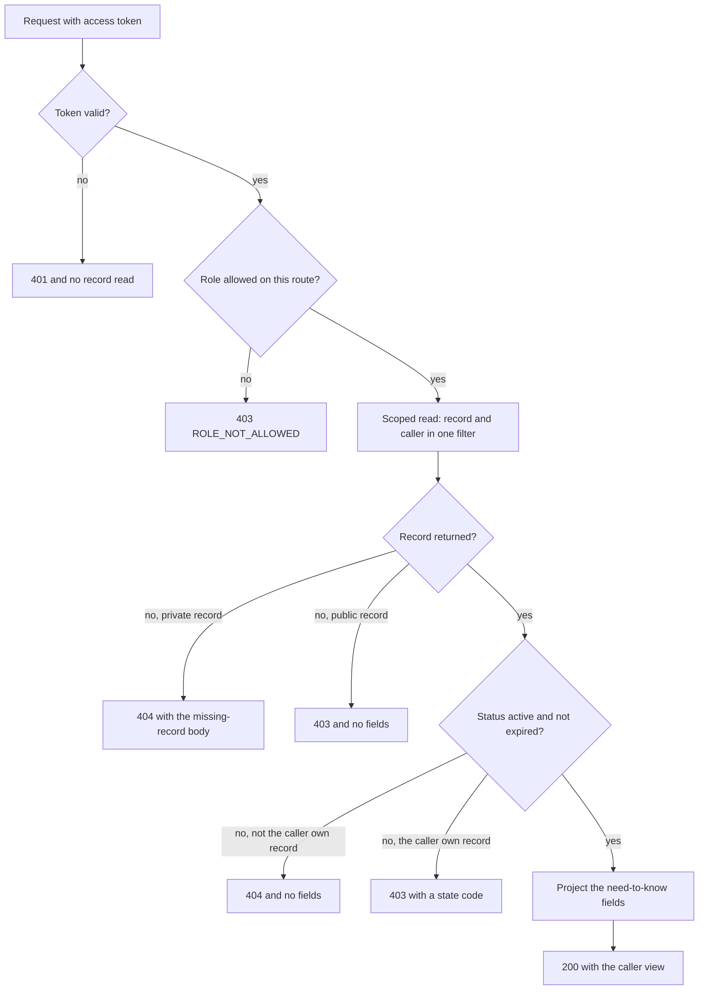

# Object checks on studios, products and licences

Four routes carry almost all the risk in Midad. A creator edits one of her products. A creator replaces a product's private file. A buyer opens her license. A buyer requests a download. Each route has a different path from the record to the person, and each one fails differently when the check is missing. The download route is the one to build carefully, because it ends at a private file.

The recipe has two layers that do different work. A role guard runs before the handler and refuses whole categories of caller. An object check runs inside the handler, loads the record through a condition the caller cannot supply, and decides whether this record belongs to this user. Neither layer is enough alone, and a route with only the first is the bug you will write a failing test for.

## Write the route contracts down first

Before the code, write the table. Each row names the route, the role that may reach it and the stored field the check follows. A row whose scope cell cannot name a field has no check to write yet.

| Route | Role | Scope to prove |
|---|---|---|
| `PATCH /me/studio` | creator | the studio with `ownerId` equal to the caller exists |
| `PATCH /me/studio/products/:productId` | creator | the product's `studioId` resolves to a studio owned by the caller |
| `POST /me/studio/products/:productId/files` | creator | the same path, proven before any bytes are read |
| `GET /me/library` | buyer | every license is filtered by `buyerId` equal to the caller |
| `GET /me/licenses/:licenseId` | buyer | `buyerId` equal to the caller, or `seats.email` equal to the caller |
| `POST /me/licenses/:licenseId/downloads` | buyer | the same, plus an active state and a remaining allowance |
| `POST /me/orders/:orderId/refund` | creator | the order's `studioId` resolves to a studio owned by the caller |
| `POST /licenses/verify` | anonymous | no ownership; answers status only and never buyer details |

The verify row is the interesting one. It is public, rate limited and deliberately narrow, because it answers whether a key is valid rather than who holds it. Every other row is a person asking about their own record, and the scope cell names the field that decides it.

## Where each check sits in the request

The diagram shows the order of the checks and the two exits that carry no record. A role refusal happens before a database read. The object check happens after a scoped read that returned either a record or nothing. The state check happens last, because a revoked license is a different answer from a license you do not hold.



The last two boxes are the part teams skip. A correct check with a wide projection still hands a buyer the storage identifier of a file version, and that is a leak even though the caller was allowed to read the record.

## The role guard is a filter, not a decision

The guard is deliberately small. It reads the authenticated user, compares the role with an allowed list, and either continues or ends the request. It must not load a record, because a guard that half checks is worse than one that does not check at all.

```js
// server/src/modules/auth/require-role.js
export function requireRole(...allowed) {
  return function roleGuard(req, res, next) {
    if (!req.user) return next(httpError(401, 'AUTH_REQUIRED'));
    if (!allowed.includes(req.user.role)) return next(httpError(403, 'ROLE_NOT_ALLOWED'));
    return next();
  };
}
```

Two details are worth copying. A missing user answers 401 and a wrong role answers 403, because the browser treats those differently: 401 starts a refresh, and 403 does not. And the refusal carries a short code rather than a sentence about what the caller would need to be, because a helpful denial is still a disclosure.

## The object helper follows a stored field

The helper turns a caller and an id into a decision. Its result type is explicit, so the handler maps it to a status without guessing which kind of record failed.

```ts
// server/src/modules/auth/access.types.ts
export type Actor = { id: string; role: 'creator' | 'buyer'; email: string };

export type AccessDecision =
  | { allowed: true; via: 'studio-owner' | 'license-holder' | 'seat-holder' }
  | {
      allowed: false;
      code:
        | 'PRODUCT_NOT_OWNED'
        | 'LICENSE_NOT_FOUND'
        | 'LICENSE_REVOKED'
        | 'LICENSE_NOT_ACTIVE'
        | 'LICENSE_EXPIRED';
    };
```

The creator path is two queries and one condition each. The first finds the caller's studio, and the second finds the product inside that studio. Never load the product by id and then compare a studio id in JavaScript, because the load already returned the record and every later log line and error path has something to leak.

```js
// server/src/modules/catalog/owned-product.js
export async function loadOwnedProduct({ productId, actor, Studio, Product }) {
  const studio = await Studio.findOne({ ownerId: actor.id }).lean();
  if (!studio) return { decision: { allowed: false, code: 'PRODUCT_NOT_OWNED' } };
  const product = await Product
    .findOne({ _id: productId, studioId: studio._id })
    .lean();
  if (!product) return { decision: { allowed: false, code: 'PRODUCT_NOT_OWNED' } };
  return { decision: { allowed: true, via: 'studio-owner' }, product, studio };
}
```

The buyer path is one query with a disjunction, and that is the whole trick. The filter matches a license whose `buyerId` is the caller or whose `seats.email` contains the caller's email. If the license belongs to neither, the query returns nothing and the route answers exactly as it would for an id that was never created.

```js
// server/src/modules/licenses/usable-license.js
export async function loadUsableLicense({ licenseId, actor, License }) {
  const now = new Date();
  const license = await License.findOne({
    _id: licenseId,
    $or: [{ buyerId: actor.id }, { 'seats.email': actor.email }],
  }).lean();
  if (!license) return { decision: { allowed: false, code: 'LICENSE_NOT_FOUND' } };

  const via = license.buyerId.equals(actor.id) ? 'license-holder' : 'seat-holder';
  if (license.status === 'revoked') return { decision: { allowed: false, code: 'LICENSE_REVOKED' } };
  if (license.status !== 'active') return { decision: { allowed: false, code: 'LICENSE_NOT_ACTIVE' } };
  if (license.expiresAt && license.expiresAt <= now) {
    return { decision: { allowed: false, code: 'LICENSE_EXPIRED' } };
  }
  return { decision: { allowed: true, via }, license };
}
```

Read the order of the checks. Ownership comes first, so a stranger learns nothing about the state of a license that is not theirs. State comes second, so the holder gets an honest explanation. Then the projection decides what a seat holder may see, and the key is not on that list.

## Keep the state check in the query for limits

The status check above is enough for reads and for opening the download form. It is not enough for the download itself, because issuing a link also spends an allowance, and that has to be one conditional write. Module 21 builds the full route and Module 25 proves it under parallel requests, and the shape belongs here so the guard does not have to be rewritten later.

```js
// inside the download handler, after the ownership decision
const spent = await License.findOneAndUpdate(
  {
    _id: license._id,
    status: 'active',
    downloadsRemaining: { $gt: 0 },
    $or: [{ expiresAt: { $exists: false } }, { expiresAt: { $gt: new Date() } }],
  },
  { $inc: { downloadsRemaining: -1 } },
  { new: true }
);
if (!spent) return next(httpError(403, 'DOWNLOAD_LIMIT_REACHED'));
```

The read you did a moment earlier is not the permission. This write is. A route that checks twice and writes without the filter passes its own test and fails the parallel test, because two requests can both read one remaining download.

## Prove the gap with two failing tests

Write the tests before the fix. The first is the cross-buyer download. Kareem sends Amina's license id to the download route with his own valid buyer token. The assertions are the status, the absence of a link in the body, and the stored allowance afterwards, because a handler can refuse after it has already spent a download.

```js
// tests/authz/cross-buyer-download.test.js
import { describe, it, expect } from 'vitest';
import { api, seedTwoBuyers, loginAs, readLicense } from './helpers.js';

describe('Kareem cannot use Amina license', () => {
  it('refuses the download and spends nothing', async () => {
    const fixture = await seedTwoBuyers();
    const token = await loginAs(fixture.kareem);
    const res = await api()
      .post(`/api/me/licenses/${fixture.aminaLicense.id}/downloads`)
      .set('Authorization', `Bearer ${token}`);
    expect(res.status).toBe(404);
    expect(res.body.link).toBeUndefined();
    const after = await readLicense(fixture.aminaLicense.id);
    expect(after.downloadsRemaining).toBe(3);
  });
});
```

Run it against the current route and read the failure. The interesting part is not the status line. It is that the response carried a link and an expiry for a license the caller does not hold.

```text
FAIL  tests/authz/cross-buyer-download.test.js
AssertionError: expected 200 to be 404
  + expected - actual
  -200
  +404
```

The second test is the cross-creator edit. Salma sends a price change to Nour's product. The assertion is 403, no product fields in the body, and an unchanged price when Nour reloads her own product.

```js
// tests/authz/cross-creator-product.test.js
it('refuses Salma editing a Nour product', async () => {
  const fixture = await seedTwoCreators();
  const token = await loginAs(fixture.salma);
  const res = await api()
    .patch(`/api/me/studio/products/${fixture.nourProduct.id}`)
    .set('Authorization', `Bearer ${token}`)
    .send({ licenseOptions: [{ key: 'personal-v1', priceMinor: 1 }] });
  expect(res.status).toBe(403);
  expect(res.body.licenseOptions).toBeUndefined();
  const after = await readProduct(fixture.nourProduct.id);
  expect(after.licenseOptions[0].priceMinor).toBe(1200);
});
```

The third test is the state check, and it catches the route that trusts a status field alone. Seed one license with `status: 'revoked'` and one with `status: 'active'` and `expiresAt` a minute in the past. Both requests answer 403, both bodies carry a state code, and no DownloadGrant is created for either.

## Wire the checks into the routes

The route file changes in two ways: the guard is registered, and the handler replaces its unscoped load with the helper.

```diff
- router.post('/me/licenses/:licenseId/downloads', issueDownload);
+ router.post(
+   '/me/licenses/:licenseId/downloads',
+   requireAuth,
+   requireRole('buyer'),
+   issueDownload
+ );
```

Inside the handler, the change is not an `if` after a load. Call `loadUsableLicense`, map a refusal to its code, and only then read the `ProductFile` version the license names. The file read is the last step, and it happens with a license id that has already been proven.

Add one more rule to the route, and it is the one that survives review. No handler may choose which record to update from a request body. The product id comes from the path and the studio id from the session. If an edit form sends a studio id, ignore it, because a form field that selects the target turns a proven check into a suggestion.

The upload route needs the check before the bytes, and the order of operations is the whole design. A multipart parser that runs before the ownership check has already accepted a file from a stranger and written it somewhere, so the route resolves the product first, answers 403 or 404, and only then streams the body to storage. Set the size cap and the allowed content types in the same handler, because a rejected upload should cost one small read rather than a full transfer on a metered connection.

Module 13 builds that path and Module 11 adds the product routes. What belongs here is the shape they inherit: path id, session identity, one scoped query, one decision, then work. When a later route forgets the third step, the tests in lesson 8.3 are the reason somebody notices.

## Keep the refusal quiet

Every refusal returns a small body with a code and nothing else. No record fields, no owner id, no list of the fields that would have been allowed, and no hint about which condition failed. The server log records the caller, the route and the target id, because you will need that during an incident. The response does not.

One more field matters on the success path. A creator reading her own product should receive the projection from lesson 8.1, not the whole document. A guard that stops the wrong person and then hands the right person too much has done half the work.

## Acceptance criteria

- [ ] `requireRole` answers 401 without a user and 403 for a wrong role, before any record is read.
- [ ] The product route loads the studio from the session, then the product inside that studio, and never the product alone.
- [ ] Kareem's download request for Amina's license answers 404 with no link and leaves the allowance unchanged.
- [ ] Salma's edit of a Nour product answers 403 with no product fields and the stored price unchanged.
- [ ] A revoked license and a license past its expiry both answer 403 with a state code and create no download grant.
- [ ] A license id that does not exist and a license held by someone else answer with the same status and the same body.
- [ ] The seat holder can open the download route and cannot read the key.
- [ ] No handler picks the record to update from a request body field.
- [ ] The download handler's allowance is spent by one conditional update whose filter carries the state and the remaining count.

If a crossed request answers 401, the route is missing the guard or the guard runs after the handler. If it answers 200 with a filtered object, the write happened and the refusal was cosmetic. If a private record answers 403 to a stranger, revisit lesson 8.1: the caller may not be allowed to know the record exists at all.
