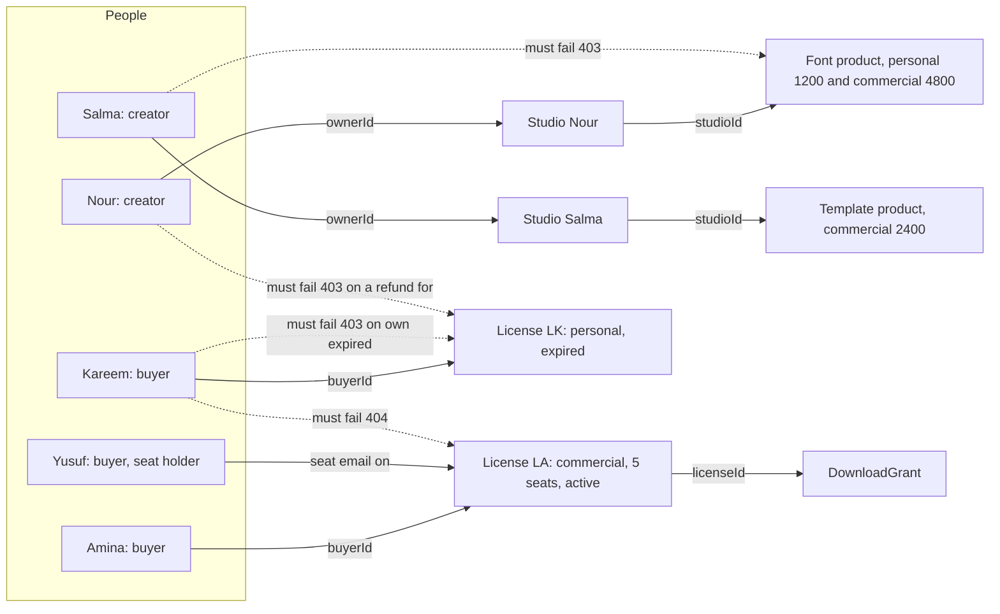

# The authorization matrix and two-buyer tests

A guard you wrote is not a permission model until a second person can read the model and disagree with it. The matrix is that readable form. Each row says who may do what to which record, which stored field proves it, which status the refusal carries, and which test demonstrates it. The test suite is the evidence that the code agrees with the table rather than with the author's memory.

This lesson writes both, and it keeps the fixture small on purpose. Two creators, two buyers, one seat holder, one revoked license, one expired license and one paid order per buyer. A small fixture catches more, because every crossed request is easy to name and every state change is easy to check afterwards.

## Draw the fixture before the matrix

The diagram is the test topology. Solid arrows are ownership or a stored reference. Dotted arrows are the requests that must fail, and each one crosses exactly one boundary, so a red test points at one check rather than at three.



Four things are worth noticing. The creators' arrows stop at products, because a creator owns no license and has no read path into a buyer's library. Amina and Kareem hold separate licenses for different products, and nothing makes one authorize the other. Yusuf reaches Amina's license through a seat and without becoming its buyer. Kareem's own expired license is a different refusal from a license he never held, and the matrix needs both rows.

## Fill the matrix

Put this table in `docs/AUTHORIZATION.md`. Keep one row per action rather than one row per route, because a route may serve two actors with different fields. The scope column names the field the check follows, and the last column names the test that proves it.

| Actor | Resource | Action | Scope field | Expected | Proof |
|---|---|---|---|---|---|
| Anonymous | any protected route | read or write | none | 401 | `auth-required` |
| Buyer | own library | list licenses | `license.buyerId` | 200 | `own-library` |
| Buyer B | Buyer A library | list licenses | `license.buyerId` | only own rows | `cross-buyer-library` |
| Buyer | own license | read details | `license.buyerId` or `seats.email` | 200 | `own-license` |
| Buyer B | Buyer A license | read details | same disjunction | 404, no fields | `cross-buyer-license` |
| Seat holder | the license that names them | read details | `seats.email` | 200, no key field | `seat-holder-view` |
| Seat holder | the license that names them | read the key | `license.buyerId` only | 403, code only | `seat-holder-no-key` |
| Buyer B | Buyer A license | request download | owner plus state plus allowance | 404, no link | `cross-buyer-download` |
| Buyer | own active license | request download | owner plus state plus allowance | 200 and one grant | `own-download` |
| Buyer | own revoked license | request download | `license.status` | 403 `LICENSE_REVOKED` | `revoked-download` |
| Buyer | own expired license | request download | `license.expiresAt` | 403 `LICENSE_EXPIRED` | `expired-download` |
| Buyer | own license at zero allowance | request download | `downloadsRemaining > 0` | 403 `DOWNLOAD_LIMIT_REACHED` | `limit-download` |
| Buyer | own license | add a seat | owner only, seats below limit | 200 | `seat-add` |
| Seat holder | the license that names them | add a seat | `license.buyerId` only | 403 | `seat-holder-no-seat-add` |
| Creator A | own product | edit | `product.studioId` to `studio.ownerId` | 200 | `own-product-edit` |
| Creator B | Creator A product | edit | same chain | 403, no fields | `cross-creator-product` |
| Creator A | own product | upload a file | same chain, before bytes | 200 | `own-file-upload` |
| Creator B | Creator A product | upload a file | same chain | 403 before storage | `cross-creator-upload` |
| Creator A | order of own studio | refund | `order.studioId` to `studio.ownerId` | 202 | `own-refund` |
| Creator B | Creator A order | refund | same chain | 403, no fields | `cross-creator-refund` |
| Buyer | an order | refund | no buyer route exists | 404 | `buyer-cannot-refund` |
| Anonymous | license verify | read status | none, rate limited | 200 status only | `verify-status-only` |

The download and refund rows are the ones that decide whether this module did its job, so do not shorten them. Read the download blocks as three separate conditions: ownership, state and allowance. Read the refund blocks as the mirror image, where the holder of the money is the creator and the buyer has no route at all.

## Write five kinds of test

Every row belongs to one of five families, and each family asserts something different. Mixing them gives a suite that reports status codes and proves very little.

The first family is the owner's success. Amina opens her library, reads her license, copies the key and requests a download, and each response carries exactly the fields lesson 8.1 listed. This catches a guard so strict that it refuses legitimate work, which happens when a scope compares the wrong pair of fields.

The second family is the crossed request. Kareem sends Amina's license id to the details route and to the download route. The assertions are the status, the absence of record fields in the body, and the stored state afterwards. The third assertion is the one that catches a handler that spent a download before it refused.

The third family is the state refusal. Kareem's own license is expired, so the download answers 403 with a state code rather than 404. Add a revoked fixture and assert the same shape. These two rows are the ones a reviewer checks first, because they are the difference between a marketplace that honours a refund and one that only hides a button.

The fourth family is the escalation attempt. A buyer sends a creator route, a creator sends a buyer route, and a seat holder sends the route that adds a seat. The role guard handles the first two, and the matrix handles the third, because a seat holder is a legitimate buyer with a narrower license scope.

The fifth family is the projection. The right person reads the right record and must still not see fields outside their need. A creator's product response carries no buyer email and no license key. Amina's license response carries no storage identifier and no order line of another buyer in the same checkout. Yusuf's view carries no key at all.

## Assert the absence as well as the status

A test that checks the status alone passes against an implementation that returns the whole record inside a 403 body, which is a real bug because clients log and display error bodies. Assert the shape as well.

```js
// tests/authz/cross-buyer-license.test.js
import { describe, it, expect } from 'vitest';
import { api, seedTwoBuyers, loginAs } from './helpers.js';

describe('buyer B and buyer A', () => {
  it('returns the same body for another buyer license and a missing one', async () => {
    const fixture = await seedTwoBuyers();
    const token = await loginAs(fixture.kareem);
    const crossed = await api()
      .get(`/api/me/licenses/${fixture.aminaLicense.id}`)
      .set('Authorization', `Bearer ${token}`);
    const missing = await api()
      .get('/api/me/licenses/66f0c1a2b3c4d5e6f7a8b9cf')
      .set('Authorization', `Bearer ${token}`);
    expect(crossed.status).toBe(404);
    expect(crossed.body).toEqual(missing.body);
    expect(JSON.stringify(crossed.body)).not.toContain('commercial');
  });
});
```

The last assertion looks crude and is worth keeping. It fails when a later error handler adds the requested record to the error context, which is the most common way a clean refusal starts leaking. Add the mirror test for the download route, and add the state check after every crossed write: reload the target as its owner and assert the allowance, the status and the seat list are unchanged.

## Test the two state refusals separately

The revoked and expired rows need separate fixtures, because a route can pass one and fail the other. A revoked license is revoked because a refund was confirmed, and the state is a stored field. An expired license may still be stored as `active` if no job has run, and the condition is a comparison with the current time. A route that checks only the status field passes the revoked test and fails the expired one, which is exactly why both belong in the suite.

```js
// tests/authz/license-state.test.js
it('refuses a download for an expired license without a job having run', async () => {
  const fixture = await seedExpiredLicense();   // status active, expiresAt one minute ago
  const token = await loginAs(fixture.kareem);
  const res = await api()
    .post(`/api/me/licenses/${fixture.license.id}/downloads`)
    .set('Authorization', `Bearer ${token}`);
  expect(res.status).toBe(403);
  expect(res.body).toEqual({ code: 'LICENSE_EXPIRED' });
  expect(await countGrants(fixture.license.id)).toBe(0);
});
```

Use an injectable clock for the expiry boundary, because a test that waits a real minute is a test somebody will delete. The same clock lets you assert both sides: one second before expiry passes, one second after fails.

## Keep the matrix alive with a coverage test

A matrix written once becomes fiction within two modules. The cheapest way to keep it honest is to compare the registered routes with the headings in the file. A short test prints every route and fails when a route has no row.

```js
// tests/authz/matrix-coverage.test.js
import { describe, it, expect } from 'vitest';
import { registeredRoutes } from '../../src/app.js';
import { matrixRoutes } from './matrix.js';

it('every mutating route has a matrix row', () => {
  const documented = new Set(matrixRoutes('../../docs/AUTHORIZATION.md'));
  const missing = registeredRoutes()
    .filter((route) => route.method !== 'GET')
    .filter((route) => !documented.has(`${route.method} ${route.path}`));
  expect(missing).toEqual([]);
});
```

Run it before you finish the matrix and read the failure, because the failure is the list of routes somebody added without deciding who may call them.

```text
FAIL  tests/authz/matrix-coverage.test.js
AssertionError: expected [ ...(3) ] to deeply equal []
  + 'POST /api/me/licenses/:licenseId/downloads'
  + 'POST /api/me/orders/:orderId/refund'
  + 'POST /api/me/studio/products/:productId/files'
```

The test will not tell you whether a check is correct, and it will tell you where to look. Pair it with a projection test that imports the allowed field lists from one module, so a field added to a serializer forces a decision about who may see it instead of leaking by default.

## What the suite cannot see

The suite runs as one of the accounts it seeds, and that is its first limit. A check that depends on the caller's email being present in the token passes every test here and fails for a caller whose email changed after the seat was assigned. Add one fixture with a stale seat email and one test that a seat holder whose account email changed is refused until the buyer updates the seat. The refusal is correct, and the message should say so, because a silent 403 on a paid seat becomes a support ticket that nobody can diagnose.

The second limit is timing. A refusal that runs a full aggregation before it answers tells an attacker more than one that stops at the first filter, and no assertion in this suite measures that difference. Keep the refusal path short: one scoped query, one mapping to a code, nothing else on the way out. Write the limit at the bottom of the matrix so a later reviewer knows it was considered rather than missed.

The third limit is the aggregate. A creator sales page that returns a count of downloads for a product is not a record read, so no row in the matrix covers it. Decide which counts a creator may see, write that decision as a sentence under the table, and test one count that must not include another creator's product. A count is data even when no record is returned, and a dashboard that totals every creator's sales is the same leak as a list of their keys.

Three limits, one habit: when a test cannot reach a case, write the case down where the next person will read it. A matrix that claims more than the suite proves is worse than a shorter matrix with an honest footnote.

```quiz
type: mcq
question: "Kareem asks for a license id held by Amina. His own license for another product is expired. Which pair of answers should the API give for the two requests?"
options:
  - "404 for Amina's license, 403 for his own expired one"
  - "403 for both, because neither request may issue a download"
  - "404 for both, so an attacker learns nothing about any state"
  - "200 for Amina's license, 403 for his own expired one"
correct: 0
explanations:
  - "Right. A license he does not hold is answered like a missing record, and a license he does hold gets an honest state refusal."
  - "One status for both cases would either leak that Amina's license exists or hide Kareem's own state from him."
  - "Kareem is allowed to know the state of his own purchase, and his library page shows it anyway."
  - "Ownership is checked before state, so a record he does not hold never returns fields."
```

```quiz
type: mcq
question: "A seat holder opens the license details route. What should the response contain?"
options:
  - "The full license, because the seat gives the same rights as the buyer"
  - "Product, license type and a download action, without the license key"
  - "A 403, because only the buyer may read a license row at all"
  - "Everything except the buyer email and the order line id"
correct: 1
explanations:
  - "A seat is permission to use the files, not ownership of the purchase record."
  - "Right. The seat holder needs the product and the download action, and the key stays with the buyer."
  - "The seat holder must be able to reach the download, so a 403 on the whole record is too strict."
  - "The key is the field that must not appear, and this option leaves it in."
```

```quiz
type: mcq
question: "Which change keeps the matrix from drifting away from the code?"
options:
  - "Reviewing the matrix at the end of the course, before the demo"
  - "A test that fails when a mutating route has no matrix row"
  - "Putting the matrix in the README instead of a docs file"
  - "Writing a matrix row for every function in the services folder"
correct: 1
explanations:
  - "A review at the end finds drift after it has already shipped."
  - "Right. The test turns a missing decision into a red suite, which is the cheapest reminder available."
  - "The location does not matter. The missing check does."
  - "Rows are actions on records, not functions, so this creates rows nobody enforces."
```

The next lesson is the gate. It asks you to show four refusals, one honest limit and the matrix that predicted each of them.
