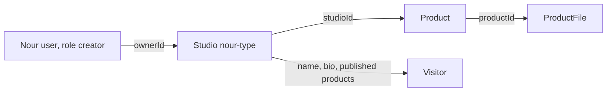

# A creator needs a studio

Nour is a type designer. She registered on Midad yesterday, chose the creator role and confirmed her email. This morning she logs in and the dashboard is empty. She has six font families on her laptop and no way to list any of them, because nothing in the system can answer the first question a buyer asks about her work: who made it?

Her account proves that she can sign in. It does not prove that she sells anything, and those are two different facts. A `User` record holds what the platform needs in order to recognise a person: an email address, a password hash, a role, a verification state. A `Studio` record holds what a buyer needs in order to judge the work: a published name, a short bio, a public address and an open or closed state. This module adds the second record and the routes that keep it safe.

Blurring the two records looks harmless on the first day and hurts on every day after. If the catalogue reads a creator's display name from `User.email`, then Nour cannot present herself as Nour Type Studio without changing the address she logs in with. If a product points at a `User` id, the public product page can reach the owner's email and verification state through one careless `populate`. Two audiences, one document, and one set of fields that must never leave the server.

One studio per creator is both a product rule and a database rule. The dashboard, the product list, the order list and the sales summary all scope their queries by a single studio. A second studio would double each query and split one creator's sales across two records. Worse, it would make the ownership chain ambiguous: a product belongs to one studio, and the creator asking to edit it may own the other.

Write the rule where two fast requests cannot break it. Put a unique index on `ownerId` in the Studio collection. A `findOne` check before `create` looks like it enforces the rule, and it does when one request arrives at a time. Two taps on a slow phone during a weak connection are exactly the case where both requests read an empty result and both insert. The index turns the second insert into a duplicate key error, and you map that error to a 409 response with a plain message.

Four fields carry this lesson. `name` is what a buyer reads on the product page, trimmed and capped at 60 characters. `bio` is a short paragraph about the work, capped at 280 characters and stored as plain text so it cannot inject markup into the catalogue. `slug` is the public address. `status` is `open` or `closed`, and a closed studio stays visible while its published products stop accepting new buyers. Add `ownerId`, and the record is complete for this week.

The slug needs its own rules because it becomes a URL. `Nour Type` becomes `nour-type`: lowercased, spaces replaced by hyphens, punctuation removed, runs of hyphens collapsed. It must be unique across all studios, and the uniqueness check must ignore case. `nour-type` and `Nour-Type` are the same address to a browser and the same key to a person typing it. Treat the stored slug as lowercase always, validate the same pattern on create and on update, and return a field-level 409 when another creator already holds it.

One question about creation timing is worth settling now. The studio is created once, on purpose, by a creator who is looking at a form. It is not created as a side effect of registering, and it is not created by the first product upload. Automatic creation removes the moment when a creator chooses a name and sees the address they will share, and it hides a failure: a registration that half succeeds leaves an account with a studio nobody asked for. Keep one explicit route, one form and one obvious result. Module 10 builds that form, and it can only exist because this module returns a clear 404 when a creator has no studio yet.

Decide early what the name is not. Midad does not verify legal identity. It does not collect a tax number, and it does not check that Nour drew the fonts she uploads. The `name` field is a display name, and the platform says so in the settings copy. A real marketplace would add identity review, payout onboarding and a takedown process. Those are deliberately outside this course, and pretending otherwise in the interface would be a lie that a reviewer will find.

The studio is also not a file store. Private files live on `ProductFile`, one version per upload, and they are reachable only through a license check in a later module. The studio is the root of the ownership chain, nothing more. Every creator route resolves the signed-in user to a studio, then the studio to its products. No route may take a product id from the browser and treat it as proof of anything.

The diagram has four arrows and only three stored fields. `ownerId`, `studioId` and `productId` are values written on the child record. The fourth arrow, from the studio to a visitor, has no stored field at all: it is a read path that returns a deliberately narrow projection. Notice that nothing joins `User` directly to `Product`. If your model grows a `creatorId` on `Product`, you now have two answers to the same question, and eventually the two answers disagree.

The first failure is that shortcut. Suppose the create-product route copies the signed-in user's id into `Product.creatorId` because the session already has it. The route works, the product saves, and the creator dashboard reads `Product.find({ creatorId })` and looks correct. Then the public studio page queries by `studioId`, finds nothing, and shows an empty studio while six products sit in the database. Two queries, two sources of truth, one support ticket.

The second failure is the near-miss that passes code review. A helper loads the studio, checks the result is empty, and then creates the record. On a test machine it never fails. Under a double submit it throws a duplicate key error, and if nobody mapped that error, the browser receives a 500 for what is really a conflict. Write the mapping with the handler, not after the first confusing report from a learner on a slow connection.

Plan four ownership tests before you write a route. Creator B requests creator A's studio and expects a denial. A buyer requests the creator routes and expects a 403. A second create from one creator expects a 409. An anonymous visitor requests the public slug and expects a 200 that contains no email, no owner id and no draft product. The last test is the one people forget, because it is the only one where the correct answer is a successful response.

That public projection is the part the rest of the course reuses. The catalogue module reads a studio name for every product card, the product page shows the creator block, and the buyer's library groups purchases by creator. Fix the field list now, add a serializer test that compares the returned keys rather than searching for one known value, and later modules inherit a boundary you have already proved.

The next lesson builds the four routes and the tests that deny the wrong creator. The gate after that gathers the raw refusals as evidence. Module 10 then turns the same record into a form that works on a phone held in one hand.
