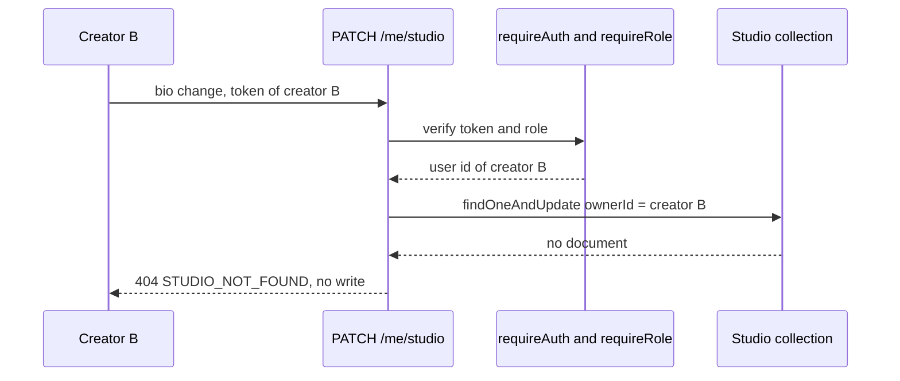

# Studio fields, slugs and ownership

The model from the last lesson gives a creator an owner record. The danger starts with the routes, because a route is where a client-supplied value meets a signed-in identity and the two are easy to confuse. Four routes carry this lesson, and only three of them take their owner from the session. The fourth answers a visitor and must never accept an owner at all. Writing them in the right order makes the denial obvious; writing them in a hurry makes a studio editable by anyone who guesses a slug.

Start with the shape. A creator's own screen needs to read, create and update one studio. A visitor needs to read a studio by slug and nothing else. There is no route that takes a studio id from the request body, and no route that accepts an `ownerId` field from the client. That single decision removes a whole class of bug before the handlers exist.

```js
// server/src/modules/studios/studio.routes.js
router.post("/me/studio", requireAuth, requireRole("creator"), createStudio);
router.get("/me/studio", requireAuth, requireRole("creator"), getMyStudio);
router.patch("/me/studio", requireAuth, requireRole("creator"), updateMyStudio);
router.get("/studios/:slug", getPublicStudio);
```

The first three answer to the session, so they do not need an id in the path. `GET /me/studio` returns the creator's studio or a 404 with the code `STUDIO_NOT_FOUND`, and that 404 is a normal answer, not an error state to hide. Module 10 reads it to decide whether to show the onboarding form. If you answer an empty 200 object instead, the client has to guess whether a studio exists by testing a property, and every page grows its own version of that guess.

Two indexes make the collection behave. The first enforces one studio per creator; the second makes the public address unique. Both are declared on the schema so a new environment builds them from the model, and both must exist in the test database before any conflict test runs.

```js
// server/src/modules/studios/studio.model.js
const studioSchema = new mongoose.Schema(
  {
    ownerId: { type: Schema.Types.ObjectId, ref: "User", required: true, index: true },
    name: { type: String, required: true, trim: true, maxlength: 60 },
    slug: { type: String, required: true, lowercase: true, trim: true, minlength: 3, maxlength: 40 },
    bio: { type: String, default: "", trim: true, maxlength: 280 },
    status: { type: String, enum: ["open", "closed"], default: "open" },
  },
  { timestamps: true },
);

studioSchema.index({ ownerId: 1 }, { unique: true });
studioSchema.index({ slug: 1 }, { unique: true });
```

## Bind the owner from the session, never from the body

In `createStudio`, take `req.user.id` as the owner and ignore any `ownerId` the client sends. Ignoring is better than rejecting, because a stale client may still post the field, and a 400 for a field you do not use invites a support question about nothing. What matters is that the stored value comes from the verified token and nowhere else. The same rule applies to the update route: it loads the studio by owner and never by an id in the payload.

The update route can be written in two shapes, and only one of them is safe. The unsafe shape loads the studio by id, then compares `studio.ownerId` with the session. That works until someone adds a log line, an error message or a populated field, and the response leaks a little of another creator's record. The safe shape puts the owner in the query itself, so a request from the wrong creator finds no document at all and nothing to leak.

```js
// server/src/modules/studios/studio.service.js
export async function updateMyStudio(ownerId, patch) {
  const studio = await Studio.findOneAndUpdate(
    { ownerId },                 // ownership is part of the lookup
    { $set: pickStudioFields(patch) },
    { new: true, runValidators: true },
  );
  if (!studio) throw new ApiError(404, "STUDIO_NOT_FOUND", "No studio for this account.");
  return studio;
}
```

`pickStudioFields` is a whitelist, not a filter. It returns `name`, `bio`, `slug` and `status` when they are present, and drops everything else, including `ownerId` and `_id`. A whitelist keeps working when someone adds a private field later; a blacklist stops working the moment a new field appears. This is the same discipline the catalogue serializer needs in Module 14, applied at the write boundary instead of the read boundary.

## Normalise the slug in one place

The slug is a URL, so it has one normaliser and one validator, both in `server/src/modules/studios/slug.js`. The function lowercases, replaces spaces and underscores with hyphens, strips everything outside `[a-z0-9-]`, collapses repeated hyphens and trims leading and trailing hyphens. The validator then checks the result against `^[a-z0-9][a-z0-9-]{1,38}[a-z0-9]$`. Deriving the slug from the name is a convenience for the form, not a rule the server trusts: the server normalises whatever arrives and validates the normalised value.

Two creators asking for the same slug is a conflict rather than a validation error, because the value is well formed and someone else already holds it. Return 409 with a body that names the field, so the form can put the message under the input instead of at the top of the page: `{ "code": "SLUG_TAKEN", "field": "slug", "message": "Another studio already uses this address." }`. Do not offer a numbered suggestion automatically. The creator picks a different address; a silent `nour-type-2` creates an account nobody can remember.

The status field deserves one rule of its own. Set `status` to `open` on create and let the creator close or reopen it through the update route. A closed studio keeps its page and its published products visible, but the purchase path refuses new licenses, which Module 16 enforces when a cart line is added. Say this in the settings copy so a creator closing a studio understands that existing buyers keep their access. Closing a studio is not a refund.

## Return a projection, not a document

The public route answers an anonymous visitor, so the response is a whitelist of four fields: `name`, `slug`, `bio` and `status`, plus the published products that the catalogue module will add. It must not include `ownerId`, the owner's email, the creation date or the studio's internal id. Write the serializer as an explicit object literal rather than `res.json(studio)`, and add a test that compares the sorted key list. A test that searches for one known email address passes on the day it is written and fails to catch the field added next month.

```js
// server/src/modules/studios/studio.serializer.js
export function publicStudio(studio) {
  return { name: studio.name, slug: studio.slug, bio: studio.bio, status: studio.status };
}
```

## Write the failing tests first

Each route has one test that fails before the handler exists and one that fails if the ownership query is wrong. Run them against the test database with its indexes built, because a duplicate-key test that runs without the unique index proves nothing.

```js
// server/tests/studios.test.js (node:test, fails until the routes exist)
test("a creator cannot create two studios", async () => {
  await api.post("/api/v1/me/studio").set(auth(nour)).send({ name: "Nour Type", slug: "nour-type" }).expect(201);
  const second = await api.post("/api/v1/me/studio").set(auth(nour)).send({ name: "Nour Two", slug: "nour-two" });
  assert.equal(second.status, 409);
  assert.equal(await Studio.countDocuments({ ownerId: nour.id }), 1);
});

test("creator B cannot write to creator A's studio through the body", async () => {
  const before = await Studio.findOne({ ownerId: nour.id }).lean();
  await api.patch("/api/v1/me/studio").set(auth(salma))
    .send({ bio: "Changed by someone else", ownerId: nour.id })
    .expect(200);                       // the write lands on Salma's own studio
  const after = await Studio.findOne({ ownerId: nour.id }).lean();
  assert.equal(after.bio, before.bio);
  assert.equal(after.updatedAt.getTime(), before.updatedAt.getTime());
});
```

The unchanged document matters more than the status code. The second test returns 200 on purpose, because Salma is allowed to edit her own studio, and the point is that the `ownerId` in her body went nowhere near Nour's record. A request that looks like a denial but still writes is not a denial, and a request that answers 200 while writing to the wrong record is worse. Add a third test for the public route that fetches `GET /api/v1/studios/nour-type` without a token, expects 200, and asserts the response contains exactly `["bio", "name", "slug", "status"]`. Add a fourth where a buyer posts to `/me/studio` and expects 403, which the role middleware answers before any database work.

Choose one answer for a studio that belongs to someone else: 404 or 403. This course uses 404 for the creator routes, so the existence of another creator's studio is not confirmed by the API, and one code path covers both "no studio yet" and "not yours". Whichever you choose, keep it consistent across the three creator routes and write it in `docs/AUTHORIZATION.md`. Mixed answers across those routes make the gate harder to read and teach the learner that the choice does not matter.



Read the diagram from the middle outwards. The ownership value never travels from the client to the database; it is produced by the token check and inserted into the query by the handler. That is why the denial happens inside the database call and not in an `if` after it. The takeaway is that the fourth participant, the collection, is the thing that refuses.

Now debug the two failures you will actually meet. If a creator's second submit returns a 500, the duplicate key error is escaping the handler: catch error code 11000 and map it to 409 for `ownerId` and for `slug`. If a creator with a studio still lands on the onboarding form in the next module, check whether `GET /me/studio` returns 200 with a body the client cannot parse, because a missing serializer field looks exactly like a missing studio.

One design question is worth committing to before you finish. Nour renamed her studio from Nour Type to Nour Type Foundry, so the slug she shared on social media no longer matches her name. Decide what the update route does with the slug. This course keeps the slug editable and shows a warning in the form that old links stop working. The alternative is a permanent redirect table from the previous slug, which is the right answer for a studio with paying buyers and an extra table to maintain. State your choice in the settings copy and in `docs/AUTHORIZATION.md`, so a reviewer can see it was a decision rather than an oversight.

```quiz
type: mcq
question: "Creator B has her own studio. She sends a PATCH to /me/studio with a body containing the ownerId of creator A. What changes in the database?"
options:
  - "Only B's own studio, because the body ownerId is ignored"
  - "Only A's studio, because the body names A as the owner"
  - "Neither studio, because the body ownerId is refused with 400"
  - "A new studio for B, because ownerId makes it a create"
correct: 0
explanations:
  - "Right. The handler keeps a whitelist of writable fields and looks the studio up by the token owner, so only B's own record can change."
  - "This is the defect the chapter spends its length removing. An id in the body is not an identity, and the token decides who is writing."
  - "A 400 is a possible policy, but this course ignores unused fields, so the reason nothing reaches A's record is the owner query."
  - "A patch never creates. The handler updates the one studio that belongs to the signed-in creator, and it has no path that inserts."
```

Commit the model, the slug helper, the four routes, the serializer and the four tests together. Then run the suite twice, once with a clean database and once after a failed second create, because a unique index that only works on the first run is a test setup problem rather than a route problem. The next lesson turns this evidence into the module gate.
