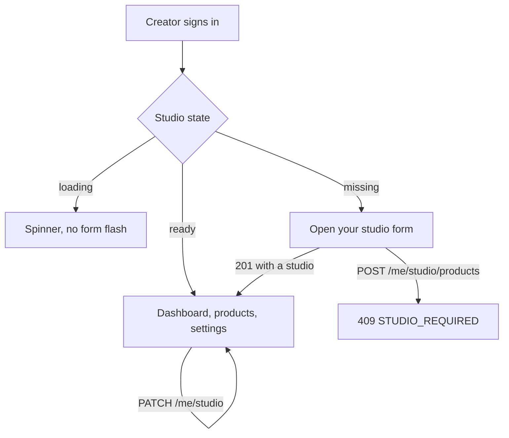

# The creator who has no studio page

Salma designs CV templates. She registers on Midad this morning, chooses the creator role, confirms her email and signs in. The client sends her to the products page, because that is where a creator works. The page asks `GET /me/studio`, receives a 404, and shows an empty table with a red bar that reads `Request failed with status code 404`. Salma cannot tell whether the platform is broken, whether her account is wrong, or whether she skipped a step nobody told her about.

That confusion is the problem this module solves. Two accounts share the same role and the same home address: a creator with a studio and a creator without one. The session token cannot tell them apart, because the role is `creator` in both cases. Only the studio record answers the question, and the answer has to shape the screen before any product page renders.

The first instinct is to catch the 404 in each page and show an empty state. It looks cheap and it spreads the decision across five files. The dashboard, the product list, the settings page, the orders page and the product form each need the same check, and each will express it slightly differently. When one of them forgets, Salma sees the red bar again on one screen out of five, which is worse than seeing it everywhere, because now the bug looks random.

Give the decision one owner. A layout route wraps every creator screen, asks for the studio once, and renders one of three things: a loading state, the onboarding form, or the requested screen. The layout is the only place that interprets a 404 from `GET /me/studio`. Pages below it receive a studio object they can trust, so a product page never has to ask whether a studio exists. This is the routing gate the module is named for.

Read the diagram as three exits from one question. The middle exit is the one the course is about, and it has two arrows leaving it. The happy arrow goes to the dashboard once the studio exists. The refused arrow is a product create attempt from a creator who has not opened a studio, and the server answers 409 instead of creating a product with no owner. Both arrows matter, because the client gate cannot stop a request typed into a terminal or replayed from an old tab.

That last point is worth stating plainly. The client gate is a courtesy that keeps Salma from meeting an error she cannot act on. The server is the gate. `POST /me/studio/products` must load the creator's studio and refuse with a clear 409 when there is none, and the same middleware protects every later product route. If you build only the client guard, a curl request creates an orphan product, and the catalogue has a product whose creator has no page. Nobody will notice until a buyer clicks it.

Which routes need a studio is a decision, not a detail. The dashboard, the product list, the product form, the orders list and the settings page all need one. The onboarding form does not, because it is the way to get one. Public pages do not, because a visitor has no account at all. Write that list in the router file as a nested route structure rather than as a condition inside each page, so adding a page later forces the choice to be made once.

The onboarding form itself is small on purpose. It asks for three things: the studio name, the address it will live at, and a short bio. Every extra field is a decision Salma has to make before she can see anything work, and the settings page can hold the rest later. A creator who is learning the platform should be able to finish onboarding in under a minute on a phone, with the keyboard open, without scrolling sideways.

The 360 pixel width is the design target for this form, not a smaller version of a desktop layout. A cheap Android phone in portrait reports about 360 CSS pixels. At that width a two column layout with a sidebar becomes a horizontal scroll, labels detach from inputs, and the submit button ends up off screen. Build one column, full width inputs, a 16 pixel font inside the fields so mobile browsers do not zoom on focus, and touch targets of at least 44 pixels for the submit button and the status toggle.

Test at that width in the browser device toolbar with the network throttled, then on a real phone. Type a long studio name and watch whether the slug preview wraps or overflows. Open the keyboard and check whether the submit button is still reachable. Rotate to landscape and back. These checks take five minutes and they find the failures that a desktop screenshot hides, including the one where the form is perfect but the error message is below the fold and Salma taps submit three times.

The slug needs a preview rather than an explanation. Show `midad.app/studios/` as static text and the normalised slug beside it, updating as she types the name, with a small note that the address can be changed later. When the server answers 409 because another creator holds the address, put the message under the slug field and keep the rest of her typing intact. A page that resets on a conflict teaches her to write the bio twice on a slow connection.

The settings page is the same three fields with a different intent. It is pre-filled, it saves with `PATCH /me/studio`, and it also owns the open or closed state. Two details are easy to get wrong. Disable the save button until a field actually changes, so a stray tap does not rewrite `updatedAt` and confuse a later audit. And when the slug changes, warn that old links stop working, because a creator who has shared her address on social media is about to break those links.

After a successful create, the layout must learn that a studio exists before it navigates. Two things can go wrong here and both look like a broken form. If the app navigates first and refetches after, the gate briefly sees the old missing state and pushes Salma back to onboarding, which feels like the save failed. If the app caches the missing state and never refetches, the form works and the redirect loops forever. Update the cached state from the 201 response body, then navigate.

One more loop is waiting for you. If the onboarding route sits inside the same gate as the dashboard, a creator without a studio is redirected from `/studio/new` to `/studio/new` and the browser spins. Keep the onboarding route outside the gate, and give it its own rule: a creator who already has a studio and visits it should be sent to the dashboard instead of seeing an empty form.

Accessibility belongs in this lesson because it changes the markup. Every field needs a visible label tied to its input, errors need to be announced rather than only coloured red, and the whole form must work with a keyboard alone. Colour alone cannot carry the closed state either, so pair the toggle with the words open and closed. These are cheap now and expensive to retrofit after five screens copy the first form.

The next lesson builds the layout, the hook, the two pages and the server guard, and it starts with a test that fails: a creator with no studio who asks for the products page must land on the onboarding form. The gate after that proves it with the phone in your hand and the raw requests beside you.
