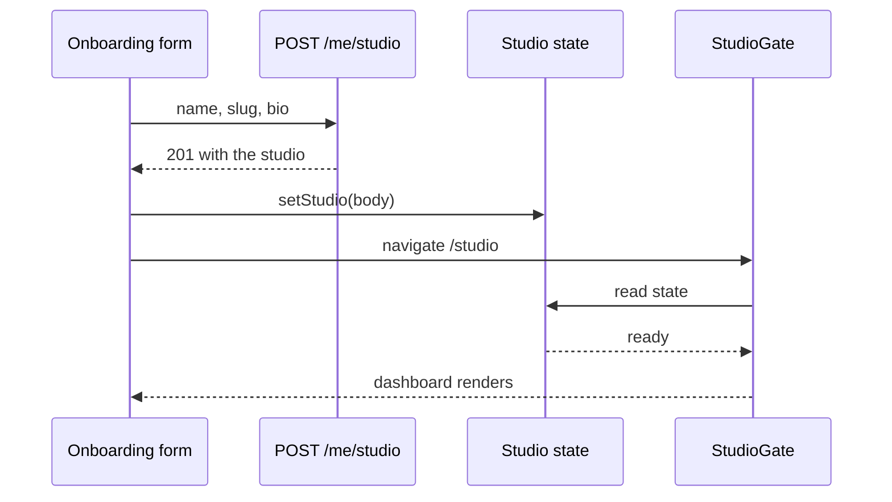

# Onboarding, settings and the routing gate

Three pieces of code make the last lesson real: a server guard that refuses product routes without a studio, a hook that holds one studio state for the whole creator area, and a form that creates or edits the record. Build them in that order. If you build the form first, you will find yourself testing the interface to discover whether the server rule works, which is the wrong instrument for the question.

## Refuse first on the server

`requireStudio` sits behind `requireAuth` and `requireRole("creator")` on every route that needs an owner. It loads the studio by the session user and attaches it to the request, so handlers never query for it again and never accept a studio id from the client.

```js
// server/src/modules/studios/require-studio.js
export async function requireStudio(req, res, next) {
  const studio = await Studio.findOne({ ownerId: req.user.id }).lean();
  if (!studio) {
    return next(new ApiError(409, "STUDIO_REQUIRED", "Open your studio before adding products."));
  }
  req.studio = studio;
  next();
}
```

`POST /me/studio/products` is therefore unreachable for a creator with no studio, and the answer is a 409 rather than a 404. The distinction is useful: the route exists, the account is allowed, and the missing thing is a setup step. A 404 would suggest the route is wrong, and a 403 would suggest a permissions problem that the creator cannot fix. Module 11 registers products on the route this middleware protects.

## One hook, four states

The client needs more than "loading, missing, ready". A request that never reaches the server is not the same as a server that says no studio exists. On a weak connection the fetch fails, and a two state model interprets that failure as missing, so Salma is shown an onboarding form even though she opened a studio last week. She fills it in, submits, and receives a 409 because the studio already exists. The interface was wrong, not the API.

```ts
// client/src/studio/types.ts
export type StudioState =
  | { status: "loading" }
  | { status: "missing" }
  | { status: "failed"; message: string }
  | { status: "ready"; studio: Studio };

export interface Studio {
  name: string;
  slug: string;
  bio: string;
  status: "open" | "closed";
}
```

If your client is plain JavaScript, keep this contract as a comment above the hook and assert it in the tests. The names matter more than the syntax: `missing` means the server answered 404, `failed` means the request did not produce an answer, and the two render different screens. `failed` offers a retry button and keeps the retry on the same route, so a dropped connection costs one tap rather than a form.

The hook fetches once when the creator area mounts and exposes `state` and `setStudio`. `setStudio` is how the form hands over the 201 body without a second round trip. Treat the 401 case separately: clear the token and send the creator to the login page rather than showing a retry button that can never succeed.

```jsx
// client/src/studio/StudioGate.jsx
export function StudioGate() {
  const { state, reload } = useStudio();
  if (state.status === "loading") return <StudioSkeleton />;
  if (state.status === "failed") return <RetryPanel message={state.message} onRetry={reload} />;
  if (state.status === "missing") return <Navigate to="/studio/new" replace />;
  return <Outlet context={{ studio: state.studio }} />;
}
```

`replace` matters. Without it the browser back button returns to a gated page, the gate reads `missing` again, and Salma is pushed forward in a loop she cannot escape. Screens below the outlet read the studio from the outlet context, so a product page cannot render before an owner exists, and it does not need its own guard.

## Write the onboarding form

The form posts `name`, `slug` and `bio` to `POST /me/studio`. Derive the slug from the name as Salma types, but stop deriving once she edits the slug by hand, because a creator who typed her own address does not want it overwritten by the next keystroke in the name field. Show the address as static text plus the slug, and normalise the preview with the same rules the server uses.

```js
// client/src/studio/slug.js, mirrors server/src/modules/studios/slug.js
export function toSlug(input) {
  return input.toLowerCase().replace(/[^a-z0-9]+/g, "-").replace(/^-+|-+$/g, "").slice(0, 40);
}
```

Handle the three answers that matter. A 201 updates the studio state and then navigates to `/studio`. A 409 with `field: "slug"` shows the message under the slug input and leaves everything else as typed. A 409 with `code: "STUDIO_CONFLICT"` means a studio already exists for this account, so update the state and navigate to the dashboard instead of asking Salma to solve a problem that is already solved.



Notice the order of the last four steps. The state changes before the navigation, so the gate reads `ready` on its first render and never flashes the onboarding form. If you swap those two steps, the gate reads the old `missing` value, redirects back to the form, and the save looks broken even though the database is correct.

## Reuse the form for settings

The settings page renders the same three fields, pre-filled from the cached studio, and saves with `PATCH /me/studio`. It adds the open or closed toggle and one piece of copy that the onboarding form does not need: changing the slug breaks links that already point at the old address. Keep the save button disabled until a value changes, and send only the changed fields so a slow connection carries less data.

Two behaviours belong in this page. Closing a studio keeps its page and its published products readable, so the copy must not say the studio is deleted. And a failed save on a weak connection must keep the typed values on screen with a retry, never reset the fields to the stored ones, because the creator will otherwise lose a paragraph of bio and assume the platform ate it.

## Fit the screen Salma actually holds

Lay the form out as one column with a maximum width of 28rem, full width inputs, and 16 pixel text inside every field. Give the submit button a height of 44 pixels and place it at the end of the form, not in a fixed footer that the keyboard covers. The status toggle is a labelled control with the words open and closed beside it, so the state is readable without colour.

```css
/* client/src/studio/studio-form.css */
.studio-form { display: grid; gap: 1rem; max-width: 28rem; padding: 1rem; }
.studio-form input, .studio-form textarea { width: 100%; font-size: 16px; padding: 0.75rem; }
.studio-form button[type="submit"] { min-height: 44px; }
```

Check the result at 360 pixels wide with the keyboard open. The four failures to look for are a horizontal scrollbar, a label that sits far from its input, an error message below the fold, and a submit button that moves while you type. Fix them in the layout, not with a media query for one screen size, because a creator on a tablet in portrait meets the same constraints.

Then walk the form with the keyboard alone. Tab from the name field to the slug field and confirm the focus ring is visible against the page background, because a low contrast ring on a cheap screen is the same as no focus at all. Press enter in a text field and confirm it submits once rather than twice. On the settings page, tab to the status toggle and change it without a mouse. These checks catch the two defects that make a form unusable for a screen reader user and invisible in a screenshot: a field whose only label is grey hint text inside the box, and an error that exists only as a red border.

The onboarding route keeps one rule of its own. A creator who already has a studio and opens `/studio/new` directly should be sent to the dashboard rather than shown an empty form that will answer 409 on submit. Read the same studio state and branch on it, instead of letting the page ask the API a second time. One source of state, two entry points, and no route that can produce a conflict the creator cannot understand.

## Write the tests that fail first

The first test describes the behaviour from the last lesson and fails until the gate exists. The others protect the pieces that are easy to break later.

```jsx
// client/src/studio/StudioGate.test.jsx
test("a creator without a studio lands on onboarding", async () => {
  server.get("/me/studio", () => 404);
  renderApp({ route: "/studio/products", role: "creator" });
  expect(await screen.findByRole("heading", { name: /open your studio/i })).toBeTruthy();
});

test("a dropped request offers a retry, not the onboarding form", async () => {
  server.get("/me/studio", () => networkError());
  renderApp({ route: "/studio/products", role: "creator" });
  expect(await screen.findByRole("button", { name: /try again/i })).toBeTruthy();
  expect(screen.queryByRole("heading", { name: /open your studio/i })).toBeNull();
});
```

Add two more. A creator with a studio reaches the products page, and a creator who submits the form lands on the dashboard and does not bounce back to the form. Then add the server test that proves the guard: post a product as a creator with no studio and expect 409 with the code `STUDIO_REQUIRED`, and confirm the product collection is still empty. That test is the one a reviewer will look for, because it is the difference between a gate and a suggestion.

```quiz
type: mcq
question: "Salma has a studio. Her phone drops the connection while the creator area loads, and the fetch fails. What should the gate show?"
options:
  - "The onboarding form, because no studio was found"
  - "A retry panel, because no answer came back"
  - "The dashboard, with an empty studio cache"
  - "The login page, because the session expired"
correct: 1
explanations:
  - "This is the defect the four state model removes. A failed request is not a server saying the studio is absent, and showing the form invites a duplicate create."
  - "Right. A transport failure is its own state, so the gate keeps Salma where she is and offers one retry instead of a form she does not need."
  - "The dashboard needs a studio object for every heading and every save, so rendering it without one produces a second class of error."
  - "Only a 401 clears the token. A dropped connection says nothing about the session, and a login redirect would lose the retry."
```

Commit the guard, the hook, the gate, the two pages and the four client tests with the server test. Then open the app on your own phone at 360 pixels and complete onboarding once. The gate in the next lesson asks you to do it again as evidence, on a fresh account, with the raw requests saved beside the screenshots.
