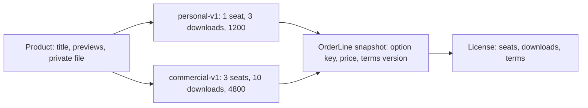

# A product is sold under a licence, not a quantity

Amina is a designer building a logo for a client. She finds a font family she likes on Midad and opens the product page. The page asks her how many she would like. There is no answer that makes sense. One copy of the file is the file, and two copies are the same bytes on the same disk. Whatever she is choosing between, it is not a number of items.

The quantity field is a habit imported from selling objects, and it stops being true the moment the thing being sold can be copied for free. A quantity of two has no meaning unless you invent one: two machines, two projects, two years. Each invented meaning is a rule someone has to write, test and explain, and the buyer still has to guess. The real choice is not how much of the file she gets. It is what she is allowed to do with it.

So the purchasable thing in Midad is a license option, and the cart line is a product plus one option. The quantity is always one, and it is not stored as something the buyer can edit. A creator publishes a product with a small list of options, and each option describes a right, a limit and a price. Module 16 builds the cart around that shape; this module builds the product and its options.

This course uses two option types, and both are written in plain English rather than legal language. A personal license is for one person, for their own projects, with no client work and no paid work. A commercial license is for client work and paid projects, and it names a number of seats that may use the file. The sample terms are short on purpose and clearly labelled as course samples. Real terms for real creators need a lawyer, and a course that pretends otherwise would teach the wrong habit.

The seat limit is the number of people allowed to use the file under the license. One seat is Amina alone. Three seats is Amina and two colleagues on the same client project. The limit is stored on the option now and enforced later, when Module 25 assigns named seats to a license and refuses the fourth. Storing the limit without enforcing it is a decision, not an oversight: the license record has to exist before the enforcement chapter can mean anything.

The download limit is a different number and it is easy to confuse with the seats. It counts how many delivery links one license may issue over its life, not how many people may use the file. Amina might have one seat and five downloads, because she works on two machines and sometimes the link expires before she finishes. A creator selling an icon pack might allow two seats and ten downloads. Keep the two fields named for their meaning, `seatLimit` and `downloadLimit`, so a later route cannot pick the wrong one.

Price is stored in minor units as an integer. `priceMinor: 1200` with `currency: "USD"` means twelve dollars. Store the number the payment provider expects, and format it once at the edge of the interface. Floating point money fails in a way that looks random: 12.30 plus 4.80 is not 17.10 in binary floating point, and a cart total built from parsed decimal strings drifts by a cent on some combinations. Integers do not drift, and a division by 100 at render time is all the conversion the client needs.

Every option carries a terms version, and the version is a string that points at text a buyer can read. `termsVersion: "personal-2026-01"` names the exact words that were offered on the day of the sale. This matters later: an order line snapshots the version the buyer accepted, and a license records the same version, so a creator editing the terms next month does not silently change what Amina agreed to. Without the version, a dispute becomes a question about which copy of the text was live at the time, and nobody can answer it.

Read the diagram from the product down. One product, two contracts, and the buyer picks one. The snapshot in the middle is the record of what was chosen, and the license on the right is the live access that a later module grants and limits. The important shape is that the option is embedded in the product while the license is a separate record, because the option is an offer and the license is a purchase.

One product with two options is not the same as two products. A creator who duplicated the font to offer both licenses would upload the same private file twice, keep two preview galleries in step, and split reviews and sales figures across two listings. A buyer comparing the two would not see them side by side. The option list keeps the shared facts in one place and puts the variable part, which is the contract, in a small array.

The rest of the product record is the part a buyer reads before deciding. It needs a title, a slug for its public address, a short description, a category and a format label such as font or template. Those fields are shared by every option, which is exactly why they belong on the product and not on the option. A product also needs a status, and the status is not a free text field: a draft is work in progress, and published means a buyer can reach it. Module 13 adds the file that makes a published product deliverable.

The failure to avoid is putting a single license type on the product. `Product.licenseType = "personal"` can be written in one line and it works for a week. Then Amina's client wants commercial rights for the same font, and the creator has to create a second product with a second upload. Then a buyer who bought personal rights wants to upgrade, and there is no record to upgrade from. The publish rule also has nothing to check, because a product with a type field looks complete even when no price exists.

A second near-miss is price as a formatted string. `price: "$12.00"` reads well in the database browser and destroys arithmetic. Somebody parses it, somebody else sorts it as text, and the cart total shows 12.00 plus 48.00 as 1248.00. Store the integer and the currency code, and keep the formatting in one function. When a test asserts the total of a two option cart, assert an integer, not a string with a symbol in front.

The publish rule belongs to this model. A draft may have zero options while a creator is still thinking. Publishing requires at least one option, because a product nobody can buy is not for sale. Module 13 adds a second condition, an active private file, and the two rules live together in one place so a reviewer can read the whole definition of published in one function rather than searching five routes.

Limits need the same care as price. `seatLimit` and `downloadLimit` are positive integers, and a validator rejects zero, negatives and decimals. A zero download limit means the buyer pays and cannot receive anything, which is not a product, it is a bug with a price. Decide the rule once and write it as a test, so a later bulk import cannot introduce an option that cannot deliver.

The next lesson turns this model into five routes with validation, a publish action and ownership tests. The gate after that proves that the wrong creator cannot see or change any of it, and that a product with no option cannot be published no matter which route is used.
