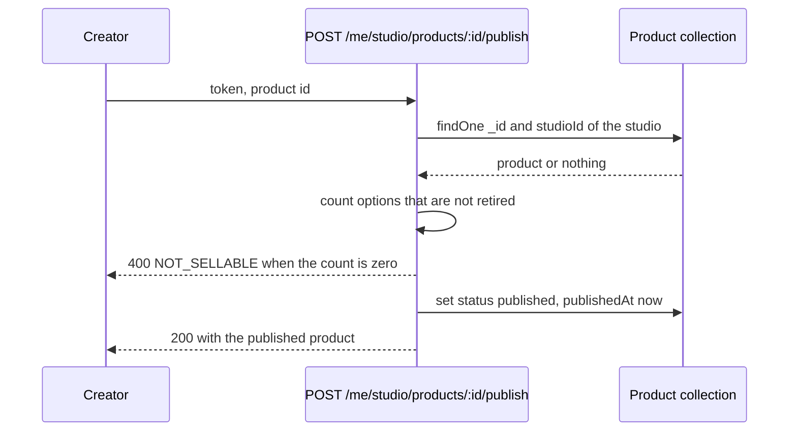

# Product routes, license options and terms versions

The product model has one hard part, and it is not the title or the slug. It is the option array, because that is where a creator's intent becomes a price and a limit that a buyer will rely on. A validation gap there does not produce an ugly screen. It produces a product that cannot be fulfilled, or a total that is one cent wrong across a whole checkout.

Five routes carry the lesson, and the studio id never comes from the client. `requireStudio` from the last module loads the owner's studio and puts it on the request, so every query is scoped before the handler sees a product id.

```js
// server/src/modules/products/product.routes.js
router.post("/me/studio/products", requireAuth, requireRole("creator"), requireStudio, createProduct);
router.get("/me/studio/products", requireAuth, requireRole("creator"), requireStudio, listMyProducts);
router.patch("/me/studio/products/:productId", requireAuth, requireRole("creator"), requireStudio, updateProduct);
router.post("/me/studio/products/:productId/publish", requireAuth, requireRole("creator"), requireStudio, publishProduct);
router.get("/studios/:studioSlug/products/:productSlug", getPublicProduct);
```

The first four queries include `studioId: req.studio._id`. That is the whole ownership rule, written once per handler as part of the filter. A product id from the path is a locator, not a permission, and a wrong creator should receive the same 404 as a product that does not exist.

## Put the rules in the schema and the policy in one service

The product schema holds the shared facts: title, slug, description, category, format, `studioId`, status, `publishedAt` and the embedded options. Each option carries a key, a type, a price in minor units, a currency, a seat limit, a download limit, a terms version and a retired flag.

```js
// server/src/modules/products/product.model.js
const licenseOptionSchema = new mongoose.Schema(
  {
    key: { type: String, required: true, match: /^[a-z]+-v\d+$/ },
    type: { type: String, required: true, enum: ["personal", "commercial"] },
    priceMinor: { type: Number, required: true, min: 1, validate: Number.isInteger },
    currency: { type: String, required: true, uppercase: true, minlength: 3, maxlength: 3 },
    seatLimit: { type: Number, required: true, min: 1, validate: Number.isInteger },
    downloadLimit: { type: Number, required: true, min: 1, validate: Number.isInteger },
    termsVersion: { type: String, required: true },
    retired: { type: Boolean, default: false },
  },
  { _id: false },
);
```

Mongoose rejects a negative price, a decimal seat count and a missing field. It cannot reject two options that claim the same key or two personal options on one product, because those are rules about the array rather than about one value. Put those in `validateOffers(options)` in `server/src/modules/products/offers.service.js`, call it from create and update, and test it directly.

```js
// server/src/modules/products/offers.service.js
export function validateOffers(options, termsCatalogue) {
  if (!Array.isArray(options) || options.length === 0) throw invalid("At least one license option is required.");
  const keys = new Set();
  const types = new Set();
  for (const option of options) {
    if (keys.has(option.key)) throw invalid("Two options share the key " + option.key + ".");
    if (types.has(option.type)) throw invalid("A product offers one " + option.type + " option at a time.");
    if (!termsCatalogue.has(option.termsVersion)) throw invalid("Unknown terms version " + option.termsVersion + ".");
    keys.add(option.key);
    types.add(option.type);
  }
}
```

The terms version must come from a list the server controls. `server/src/modules/products/terms.js` maps a version string to the text a buyer reads, and `GET /terms/:version` serves it without authentication. If the version were free text, a creator could publish `personal-v99` with no text behind it, and the buyer's order would point at words nobody can produce. The allow-list turns that into a 400 while the creator is still on the form.

Error shape deserves as much care as validation itself. Return one envelope with a `code` and a list of `errors`, and give each entry a `field` that matches the input name in the form: `priceMinor`, `seatLimit`, `licenseOptions.0.key`. The client then places each message under the right input instead of printing a paragraph at the top of the page. A generic 400 with the words "validation failed" forces the creator to guess which of seven fields is wrong, and guessing is where people give up on a form.

The product slug reuses the slug helper from Module 9 with one change: it is unique per studio rather than unique across the platform. Two creators may both sell a `minimal-serif` family, because the public address includes the studio: `/studios/nour-type/products/minimal-serif`. Implement that with a compound unique index on `(studioId, slug)` and the same duplicate key mapping, so a second product in one studio receives a 409 that names the field. The public route resolves the pair, never the product slug on its own.

Embedding the options is a trade-off worth naming. One document read returns the product and every offer, and a publish check needs no join. The cost is that options cannot be queried on their own, so a future feature such as "list every commercial option under 2,000" reads every product, and an array that grows past a few dozen entries makes a full replacement on save expensive. Options per product stay in single digits in this course. If a marketplace later needed per-option availability or per-option approval, a separate collection with its own index would be the right move, and the option key would become the join field.

The list route for the creator's own dashboard sorts by `updatedAt` descending and paginates at 20, because a creator with sixty products still edits the newest one. Its projection includes status, `publishedAt`, the option count and the lowest live price, which is what the table needs to render. It must not include retired options as if they were purchasable, and it must not include any file metadata, because the dashboard has no business reading storage fields to draw a row.

## Make the key the identity of an offer

An option key such as `personal-v1` is stable and it is not a label. New checkouts copy the key, the price, the limits and the terms version onto the order line, so an edit under the same key changes what a future buyer sees but never what an earlier buyer accepted. That is the reason the key carries a version suffix: when a creator changes the personal terms, the new offer is `personal-v2`, and `personal-v1` becomes `retired: true` so new carts cannot choose it.

The rule has one consequence worth stating in the form: retiring an option is not deleting it. The record stays, because order lines and licenses point at it, and the creator sees it in the dashboard with a retired label. Deleting the option from the array would strand every historical order that names it. Allow removal only while a product is a draft and has no orders, and make that check explicit rather than a side effect of an update.

## Publish is a function, not a button

Publishing is where the option list becomes a promise to buyers, so it gets its own route and its own function. The function loads the product by studio and id, refuses anything already published, and then checks the purchase conditions in one place.

```js
// server/src/modules/products/publish.service.js
export async function publishProduct(studioId, productId) {
  const product = await Product.findOne({ _id: productId, studioId });
  if (!product) throw new ApiError(404, "PRODUCT_NOT_FOUND", "No product with that id.");
  const sellable = product.licenseOptions.filter((option) => !option.retired);
  if (sellable.length === 0) {
    throw new ApiError(400, "NOT_SELLABLE", "Add at least one license option before publishing.");
  }
  product.status = "published";
  product.publishedAt = new Date();
  await product.save();
  return product;
}
```

Module 13 adds a second condition to this function, an active private file. Keep the checks in the order a creator can fix them: options first, then the file, then anything about the terms catalogue. A creator who is told two problems at once fixes neither.



Notice that the count happens on the server after the ownership query, not in the browser. The publish button can be disabled in the client as a courtesy, and the function still has to refuse, because a request can arrive without the button. The same reasoning applies to price: the client shows a formatted amount, and the server stores and returns integers.

## The public route returns what a buyer needs

`GET /studios/:studioSlug/products/:productSlug` answers anonymous visitors, returns only published products, and never returns a draft. Its serializer lists the fields explicitly: title, slug, description, category, format, the studio name and the option summaries. Each summary carries the key, type, `priceMinor`, currency, seat limits, download limits and terms version, because a buyer comparing two options needs all of them before paying.

Nothing about storage belongs in that response. No file id, no checksum, no delivery URL, no draft version. When Module 13 adds private files, this serializer is the first place a leak would appear, so write it as an object literal now and add a key-list test with it.

## The tests that fail first

Each ownership test asserts an unchanged document as well as a status code, and the publish test asserts the product stays a draft.

```js
// server/tests/products.test.js (fails until the routes exist)
test("another creator cannot publish someone else's product", async () => {
  const product = await createDraft(nour, { options: [personalOption()] });
  await api.post("/api/v1/me/studio/products/" + product.id + "/publish").set(auth(salma)).expect(404);
  const after = await Product.findById(product.id).lean();
  assert.equal(after.status, "draft");
  assert.equal(after.publishedAt, undefined);
});

test("a product with no live option cannot be published", async () => {
  const product = await createDraft(nour, { options: [] });
  const res = await api.post("/api/v1/me/studio/products/" + product.id + "/publish").set(auth(nour));
  assert.equal(res.status, 400);
  assert.equal(res.body.code, "NOT_SELLABLE");
});
```

Add five more. A decimal price of 12.5 is refused with a 400 that names `priceMinor`. Two options with the same key are refused. A terms version that is not in the catalogue is refused. The public route returns `null` or 404 for a draft product, and the option summaries contain no storage field. Run the suite against a database with the product and studio indexes present, because a unique index on `(studioId, slug)` is what makes two products with the same address impossible under a double submit.

```quiz
type: mcq
question: "A creator edits the price of personal-v1 from 1200 to 1500 while three paid orders point at personal-v1. What should the API allow?"
options:
  - "The edit, but only after every pending cart line is cleared"
  - "No edit, because a purchased option becomes immutable"
  - "The edit, because paid orders snapshot the price they paid"
  - "The edit, and a rewrite of the three orders to 1500"
correct: 2
explanations:
  - "Clearing carts is a separate cleanup job. It does not decide whether the offer behind an existing order may change."
  - "Historical orders stay readable either way, so blocking the edit would stop a creator from ever correcting a price without a new key."
  - "Right. Each order line keeps its own copy of the price and the terms version, so a new price applies to new checkouts and leaves paid orders untouched."
  - "Rewriting paid orders would destroy the record of what the buyer agreed to, which is the one thing the snapshot exists to protect."
```

One debugging note before the gate. If a product appears published with no options, the route did not do it. Check for a seed script or a manual database edit that set `status` directly, then add a test that saves a published product with an empty option list and expects a validation error. Guarding the route is not the same as guarding the document.

Commit the schema, the offer service, the terms catalogue, the five routes and the tests. The next lesson collects the denials, the validation failures and the publish refusal as gate evidence. Module 12 then builds the product table and the option editor in the browser, and Module 13 adds the file that makes a published product deliverable.
