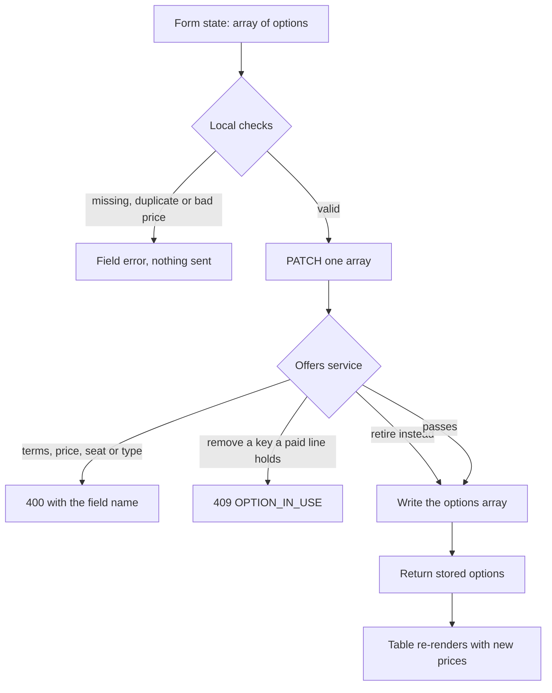

# Product table and the license editor

Module 11 left you with product routes that work when called by hand: create, list, change, publish, and the Studio ownership check on each. This lesson puts a screen on them. It adds one small route for the counts and one for reading a single product back, a table with status tabs, a price column that prints every option, and a form whose license editor can add, retire and remove rows before it saves.

Build in this order: the counts route, the creator read route, the table, the price formatting, the editor state, the save, then the error mapping. Doing it in this order means every number and every row on the page has a query behind it that you can run from a shell, which is the only way to tell a display bug from a scoping bug.

## Counts come first, and they are scoped

The tabs at the top of the table need numbers, and the numbers need to come from the database rather than from the page that is currently loaded. A creator with four drafts on page two of a list still needs a four on the draft tab. Add one route and let `requireStudio` decide the Studio.

```js
// server/src/modules/products/product.routes.js
router.get("/me/studio/products/counts", requireAuth, requireRole("creator"), requireStudio, getCounts);
router.get("/me/studio/products/:productId", requireAuth, requireRole("creator"), requireStudio, getOwnProduct);
```

```js
// server/src/modules/products/product.service.js
export async function countByStatus(studioId) {
  const rows = await Product.aggregate([
    { $match: { studioId } },
    { $group: { _id: "$status", count: { $sum: 1 } } },
  ]);
  const counts = { draft: 0, published: 0, archived: 0 };
  for (const row of rows) counts[row._id] = row.count;
  return counts;
}
```

The `$match` goes first and uses the Studio that `requireStudio` loaded from the session. Group first and filter afterwards counts every creator's products and throws most of the answer away, which is slower and one refactor away from returning a total that belongs to somebody else. The zero filled shape matters too: the page renders three tabs, and a missing key would draw a blank instead of a zero.

The read route exists because Module 11 has no creator route for a single product. Without it, the editor would have to find its product in the list response, and the list response is a table projection, not a document. One route, scoped by `studioId`, returning the product with its options, is enough.

## The table reads one status at a time

The table lists the caller's products, most recently changed first, with a tab for each status. The default tab is `draft`, because a draft is the only status that is waiting on the creator. An unknown status is a `400` with a `code` of `BAD_STATUS`, not an empty list. An empty list says no product is in that state, and a `400` says the client sent a value the server never offered. Since the tabs come from a fixed list in your own interface, a wrong value is your typo and it should be loud.

```js
// server/src/modules/products/product.service.js
const STATUSES = ["draft", "published", "archived"];

export async function listOwnProducts(studioId, rawStatus) {
  const status = rawStatus ?? "draft";
  if (!STATUSES.includes(status)) throw new ApiError(400, "BAD_STATUS", "Unknown status");
  return Product.find({ studioId, status }).sort({ updatedAt: -1 }).limit(100).lean();
}
```

Module 11's list route already projects a status, a publication date, an option count and the lowest live price. Extend that projection to include the option summaries, because the table has to print one line per option, and keep everything else out. Do not fetch every product and filter in the browser, and do not fetch a row's options through a second call per row. A creator on a phone with expensive data should get the whole table in one response of roughly 30 to 60 kilobytes, which is small enough to load and small enough for you to read in the network panel.

Each row carries the title, category, format, status, the option list, the last update time, and a boolean that says whether a released private file exists. Module 13 adds that file, so the field reads `false` for every row today. That is honest: the dashboard can tell a creator that a deliverable is missing without telling anyone where a deliverable lives.

## A price column that shows every license

The row prints one line per option. `personal at 1,200` and `commercial at 4,800` are two facts, and collapsing them into a single `1,200` hides the contract a business buyer will choose. Format from minor units at the edge of the application and never store a display string.

```js
// client/src/features/dashboard/money.js
export function formatMinor(amountMinor, currency) {
  return new Intl.NumberFormat("en", { style: "currency", currency }).format(amountMinor / 100);
}
```

Two digits after the decimal point is not a law, it is a choice this course makes so that every stored amount is an integer. Keep the choice in one function. A table cell that divides by 100 in one place and by 1000 in another is how a 48 unit font becomes a 4.80 unit font for one creator and a 480 unit font for another, and the bug only appears in the row nobody checked.

Currency lives on the option, because Module 11 put it there, and the core path keeps one currency per product. Pass the option's currency into the formatter rather than reading a single product level value. If a creator ever lists two options in different currencies, the row should print each amount with its own symbol and the checkout path in Module 18 will reject the mixed cart before any money moves.

<MustRead
  title="Mongoose validation"
  url="https://mongoosejs.com/docs/validation.html"
  source="Mongoose documentation"
  description="Read the sections on built in validators and on validation being skipped by update helpers. It explains why the rules you write in the form must also exist in the offers service, and why findOneAndUpdate does not run every validator."
  readMinutes={10}
/>

## The license editor is an array in form state

The editor is the part of the form that carries the product's commercial meaning. Its state is an array of drafts, and every change creates a new array. Do not model three fixed slots for three license types, because the array is already the shape that Module 11 validates and a fixed form would need a migration the first time an option is retired.

```js
// client/src/features/dashboard/licenseOptions.js
/**
 * @typedef {Object} LicenseOptionDraft
 * @property {string} key              stable identity, for example personal-v1
 * @property {"personal"|"commercial"} type
 * @property {number} priceMinor       integer, 1 or more
 * @property {string} currency         three letter code, uppercase
 * @property {number} seatLimit        personal is exactly 1
 * @property {number} downloadLimit    integer, 1 or more
 * @property {string} termsVersion     chosen from the catalogue, not typed
 * @property {boolean} retired         keeps the key for history, hides it from buyers
 * @property {boolean} isNew           local only, never sent
 */
```

Each row has a select for the type, a text input for the key, an input for the price in major units, a select for the currency, inputs for the seat limit and download limit, a select for the terms version, and a remove button. The price input holds what the creator types, and the conversion to minor units happens once, on submit, with a check that rejects a third decimal place instead of rounding it away. The seat input disappears for a personal option and shows `1`, because a personal license for three seats is a commercial license wearing the wrong label.

The terms version is a select, not a text box. Module 11 keeps a catalogue of version strings with the text behind each one, and the service refuses a version it cannot serve. Populate the select from that catalogue so a creator chooses `personal-2026-01` rather than typing a plausible looking string that no buyer can read.

Three rules belong in the form and again in the service. At least one option, because a product with no option cannot be bought and cannot be published. One option of each type, because Module 11 refuses a second personal offer on the same product. And a unique `key` inside one product. The browser can catch all three before the request leaves the phone, and the server must still enforce them, because the browser is a suggestion.

The key is the part learners rush. Use the pattern Module 11 already validates: a lowercase type and a version, such as `personal-v1` or `commercial-v2`. The key is what an OrderLine and a License will point at later, so a price change keeps the key and a changed contract gets a new one. Editing the key of an existing option renames an identity that other records may already hold, and the service should refuse it with an error on that field rather than quietly rewriting history.

## One save, and a refusal that is not a delete

The save sends the whole array in one `PATCH`, and the service validates the array as a unit. A per row endpoint would let a creator leave the product with no options between two requests, and a half applied edit is worse than a refused one. Validate, then write, then answer with the stored options.

```js
// server/src/modules/products/offers.service.js (the dashboard rules added here)
export function validateOffersForSave(options, termsCatalogue) {
  if (!options.length) throw fieldError("licenseOptions", "Add at least one license option");
  const keys = new Set();
  const types = new Set();
  for (const option of options) {
    if (keys.has(option.key)) throw fieldError("licenseOptions", `Duplicate key ${option.key}`);
    if (types.has(option.type)) throw fieldError("licenseOptions", `A second ${option.type} option is not allowed`);
    if (!termsCatalogue.has(option.termsVersion)) throw fieldError("termsVersion", "Unknown terms version");
    if (!Number.isInteger(option.priceMinor) || option.priceMinor < 1) {
      throw fieldError("priceMinor", "Price must be a positive integer in minor units");
    }
    if (option.type === "personal" && option.seatLimit !== 1) {
      throw fieldError("seatLimit", "A personal license covers one seat");
    }
    keys.add(option.key);
    types.add(option.type);
  }
}
```

Removing a row needs one more rule, and it is the rule Module 11 stated as a principle. While a product is a draft with no paid order line, removing an option is free. Once the product is published, or once any paid line references the key, removal would strand a receipt, so the server refuses it with `409 OPTION_IN_USE` and the editor offers retire instead. Retiring sets `retired: true`, keeps the key and its history, and hides the option from buyers. The publish check already counts only options that are not retired, so a product whose last live option is retired stops being sellable.



The diagram is worth reading twice. The two refusal paths are different promises: a `400` says a value is invalid, and a `409` says the value is valid but the world has moved. A single "could not save" message for both teaches the creator nothing and hides a real conflict behind a typo.

## Three tests that should fail today

Write these before the form exists, run them, and keep the output. Each fails for a different reason, and the failure messages tell you which layer is missing.

```js
// server/tests/dashboard.test.js
test("counts are scoped to the signed in Studio", async () => {
  const res = await request(app).get("/me/studio/products/counts").set("Authorization", `Bearer ${nourToken}`);
  expect(res.status).toBe(200);
  expect(res.body.counts.published).toBe(2);
  expect(res.body.counts.draft).toBe(1);   // currently counts Salma's draft too
});

test("an unknown status tab is refused, not answered with an empty list", async () => {
  const res = await request(app).get("/me/studio/products?status=withdrawn").set("Authorization", `Bearer ${nourToken}`);
  expect(res.status).toBe(400);            // currently 200 with []
  expect(res.body.code).toBe("BAD_STATUS");
});

test("removing an option that a paid order line holds is a conflict", async () => {
  const res = await request(app).patch(`/me/studio/products/${soldFont.id}`)
    .set("Authorization", `Bearer ${nourToken}`)
    .send({ licenseOptions: [personalOnly] });
  expect(res.status).toBe(409);
  expect(res.body.code).toBe("OPTION_IN_USE");   // currently 200 and the key is gone
});
```

The first test can pass for the wrong reason if Salma has no draft, so seed her with one. The third test needs a paid OrderLine fixture, and Module 18 has not built one yet. Create the fixture directly in the test with the fields the snapshot will use: product identifier, the option key, the license type and the amount. The rule is written now because the first sale is when removal starts to hurt.

## Choose the right refusal

The form maps three failure shapes to three sentences, and the mapping is part of the build rather than a later polish task.

```quiz
type: mcq
id: digital-goods-dashboard-q1
question: "A creator edits a published font and removes the commercial option. A paid order line from last week holds that option key. The server refuses the save. Which refusal is correct?"
options:
  - "400 with a code of NOT_SELLABLE, because a published product must keep at least two options"
  - "409 with a code of OPTION_IN_USE, because the value is valid and a stored record depends on it"
  - "200 with the option marked retired and a warning added to the response body"
  - "404 with a code of PRODUCT_NOT_FOUND, because the option key no longer exists after the edit"
correct: 1
explanations:
  - "A published product may keep a single live option. The refusal comes from another record holding the key, not from the count."
  - "A conflict describes a valid request that cannot be applied while current records depend on it, and it points the creator at retire instead."
  - "Removal is what the creator asked for. Silently retiring something else makes the screen disagree with the stored document."
  - "The product and the option both exist until this request. Answering not found hides the reason."
```

The same envelope carries the publish refusal, which Module 11 already wrote as `NOT_SELLABLE` with a `400`. A validation answer lists each problem with the field name the form uses, such as `licenseOptions.0.priceMinor`, so the editor can put the message under the right input instead of printing a paragraph at the top of the page.

Acceptance before the gate: the counts route answers `200` for the owner and `403` for a buyer, the read route answers `404` for another creator's product, the table shows only the caller's products for each of the three tabs, the row prints every option with its own price and limits, the editor adds and retires rows and refuses a duplicate key in the browser and on the server, and a save that would strand a sold option returns `409` with the key in the message. Then open the page on your narrowest browser window and check that the option list is readable without a horizontal scroll. Module 15 will do the same check on a buyer page at 360 pixels, and a table that fails it here will fail there too.
