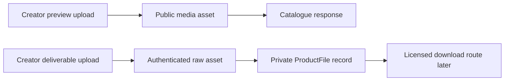

# Separate public previews from private deliverables

A creator sells a font. A visitor needs to see how it looks before buying, so the preview image is public. The ZIP file that contains the font is the paid deliverable, so it must remain private. Putting both under one generic `uploads` array makes this easy to get wrong: a catalogue serializer may expose the private URL, or a storage setting that works for a preview may make the ZIP available to anyone. This module gives the two kinds of media separate models, routes and tests.

The diagram has no arrow from the public catalogue to the private asset. A visitor may see a preview's ordinary URL, its alt text and order in the gallery. The private file record stays on the server. Its identifier is used only after a buyer has an active license in Module 21. Hiding a Download button before purchase is not enough if a public JSON response or predictable storage URL already reveals the file.

## Choose the storage controls explicitly

Cloudinary's default `upload` delivery type is public and suitable for a preview image. Its `private` type protects the original but can leave derived assets accessible depending on configuration. For the core deliverable path, upload the raw file with the `authenticated` delivery type, which protects the original and derived assets. Later, the server will generate a time-limited private download URL after checking a license. A normal signed delivery URL proves its signature but does not, by itself, mean the buyer's permission will be rechecked on each request. Do not describe a signed URL as revocable or expiring unless you use the time-limited mechanism and set its expiry.

Keep API credentials on the server. In `server/src/modules/media/public-preview.service.js`, accept only image formats supported by the course's preview renderer, set a size cap, upload as public, and store a public URL with width, height, order and alt text. In `server/src/modules/media/private-file.service.js`, accept the allowed deliverable formats for this lesson, such as generated ZIP and PDF fixtures, with a separate size cap and content-type check. Stream or buffer under a defined maximum; do not trust the browser's filename or MIME string as proof of file contents. Store the returned authenticated asset ID, resource type, byte size and server-computed SHA-256 in a private ProductFile record.

The checksum helps detect an unexpected change or duplicate upload. Compute it from the bytes the server receives, not from a value the browser claims. Give each upload a new ProductFile version and keep previous versions for licenses that point to them. A creator may replace a corrupt file, but an old order must still explain which version was sold or whether the product's update policy grants the correction. Deleting the old asset while active grants refer to it would make paid buyers lose access. The later library module uses this version boundary when it creates a link.

## Define who can upload and publish

Create `POST /me/studio/products/:productId/previews` and `POST /me/studio/products/:productId/files`. Both routes authenticate a creator and load the Product under that creator's Studio ID. Another creator's product ID must return a denial before any bytes are sent to storage. Reject a deliverable upload from a buyer account. A creator may reorder or delete public previews through their own product route. Removing a private version needs a separate rule because past licenses may depend on it; the core path can disallow deletion while any active grant points at the version.

The product publish action checks for a valid license option, at least one public preview and an active private file version. A draft may lack those fields. A published product should not expose a purchase button if the private file is missing or failed validation. Do not use the existence of a URL as the only file check; confirm the private storage response and ProductFile status. A partial upload must remain a draft. If the process stops after storage succeeds but before the database row is written, log the orphaned asset ID for a cleanup job; do not automatically publish the product.

Think through a concrete Studio A upload. The creator selects a public JPEG preview and a ZIP deliverable. The server validates the creator's ownership of Product P before receiving either file. It stores the JPEG as public preview version one and the ZIP as authenticated ProductFile version one. The product stays draft until a license option exists and both uploads report success. A visitor requests the catalogue row and receives the JPEG URL but no ZIP identifier. If the visitor guesses the ZIP's file name from the product slug, storage still denies the unsigned request because the asset is authenticated. This is defense in depth: the serializer withholds identifiers, and storage enforces the file boundary independently.

Now Creator A uploads a corrected ZIP. The server writes ProductFile version two but does not erase version one while a paid grant refers to it. The creator may mark version two as current for future sales. The buyer who purchased version one keeps a receipt that names version one, and Module 21 checks the grant's file version before creating a URL. If the course later offers free corrections, the product needs an explicit update entitlement; silently swapping all buyers to version two would make the receipt and access policy ambiguous. This exercise is why version is a first-class field rather than a filename suffix.

Consider a malicious or accidental upload, too. A file extension can lie. Set a maximum size before reading the entire request into memory, verify allowed content types and inspect the bytes as far as the course's validation stack supports. Do not render an uploaded PDF as trusted HTML in your own origin. A full malware-scanning service is outside this course's core scope, so state that limit in deployment notes and use generated teaching fixtures. If a real creator later joins the platform, the product team must add a review or scanning process before allowing arbitrary downloads to buyers.

In `server/src/modules/catalog/product.serializer.js`, list fields explicitly rather than spreading a Mongoose document into JSON and deleting a few keys. Include product title, creator display name, license summaries and public previews. Exclude ProductFile rows, authenticated asset IDs, internal upload status, checksums and any future download URL. In the creator dashboard response, show file format, size, checksum prefix and version status, but avoid returning the storage secret or a reusable private URL. The creator needs to know that a file is present, not how to bypass the buyer authorization path.

## Build and inspect both paths

Use a generated placeholder ZIP and PDF in seed data; do not package a real commercial font or book without permission. Upload a preview and verify that an anonymous visitor can see it. Upload the deliverable and verify that its unsigned storage URL fails. Inspect the raw anonymous product JSON for private identifiers. Then sign in as Creator B and try to upload to Creator A's product ID. The API must reject it. Try to publish a draft with no file, and one with no license option; both must remain drafts with specific errors.

For a failure-path test, make the storage call fail after the route validates the product. The product remains a draft and the API shows a retriable error. Make the database write fail after a successful upload in a controlled test and verify the cleanup log or compensating delete. The user should not see “published” merely because a progress bar reached 100 percent. Save the public response, denied unsigned URL, cross-creator status and publish-rule results in `docs/PRIVATE-FILES.md`. Module 21 will use the authenticated file record, so any leak here becomes a permanent weakness in the later license flow.

When debugging an unexpected public file, inspect the asset's actual delivery type in Cloudinary, then the raw catalogue response and finally the UI. If the storage URL works anonymously, changing React will not fix it. Re-upload under the authenticated type, remove the exposed asset and review logs for where its URL was sent. If the asset is protected but the catalogue still includes a private ID, fix the serializer and add a raw-response regression test. Distinguish those two defects in the issue log; they have different remedies and different exposure windows.
