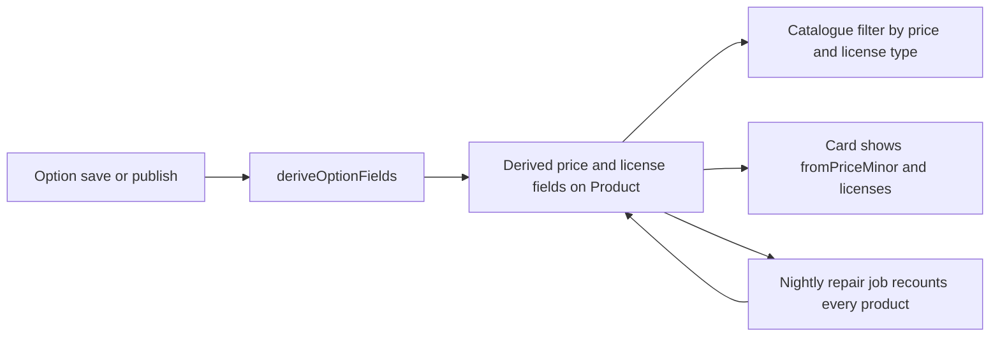

# Filters, pagination and the N+1 trap

The route is already outlined. This lesson writes it, and the first file is a test that counts queries. A test that checks only the JSON shape cannot tell a three query page from a forty-one query page, and the difference is what Amina feels on a phone with a weak signal. Shape tests pass on both kinds of implementation, which is why performance gets fixed late and badly.

The counter is small. A Mongoose plugin records each model operation, and the test asserts on the length of the recorded list. Put it in `server/src/test/query-counter.js`, register it before the models compile, and reuse it for the cart and order routes later.

```js
// server/src/test/query-counter.js
export function startQueryCounter(mongoose) {
  const operations = [];

  mongoose.plugin((schema) => {
    schema.pre(/^(find|count)/, function () {
      operations.push(this.model.modelName);
    });
  });

  return {
    get operations() {
      return [...operations];
    },
    get count() {
      return operations.length;
    },
    reset() {
      operations.length = 0;
    },
  };
}
```

## The failing test comes first

Seed twenty published products across three Studios and ask for one page. Assert that three operations is the ceiling, then ask for a smaller page and assert the count did not change. Run both before the batched lookup exists. The failure message names a number, which is a better diagnosis than reading the handler and guessing.

```js
// server/tests/catalogue.test.js
test("a page of cards costs a fixed number of queries", async () => {
  const counter = startQueryCounter(mongoose);

  await request(app).get("/api/v1/catalogue?limit=20").expect(200);
  const atTwenty = counter.count;

  counter.reset();
  await request(app).get("/api/v1/catalogue?limit=5").expect(200);
  const atFive = counter.count;

  expect(atTwenty).toBeLessThanOrEqual(3); // 33 before the fix: count, page and 31 Studio lookups
  expect(atTwenty).toBe(atFive);
});
```

If the count is high and drops when the page shrinks, the route is doing work per row, and the gap between the two numbers tells you how much. That single observation is the whole N+1 problem in one line of output. Fix the shape, then look at the index.

## Write the contract in one file

Put the accepted query and the public card in `server/src/modules/catalogue/catalogue.public.js`, beside the serializer. The project is JavaScript, so the contract is JSDoc that the editor and the reader both understand.

```js
// server/src/modules/catalogue/catalogue.public.js
/**
 * @typedef {Object} CatalogueQuery
 * @property {"font"|"template"|"icons"|"ebook"} [category]
 * @property {"otf"|"ttf"|"zip"|"pdf"|"fig"} [format]
 * @property {"personal"|"commercial"} [licenseType]
 * @property {number} [minPriceMinor]  integer, compared with the cheapest option
 * @property {number} [maxPriceMinor]  integer, compared with the cheapest option
 * @property {number} page             1 or more
 * @property {number} limit            1 to 60, default 20
 */

/**
 * @typedef {Object} CatalogueCard
 * @property {string} id
 * @property {string} slug
 * @property {string} title
 * @property {string} category
 * @property {string} format
 * @property {{ url: string, alt: string } | null} coverPreview
 * @property {{ id: string, name: string, slug: string }} studio
 * @property {number} fromPriceMinor
 * @property {string} currency
 * @property {Array<{ type: string, priceMinor: number, currency: string }>} licenses
 * @property {string} publishedAt
 */
```

`fromPriceMinor` is on the card because a grid shows one number. `licenses` is on the card because Module 15 needs the license types without a second request, and because a card that claims a commercial license exists must be able to prove it. Neither field is trusted by any write path. The `slug` is there because the public product route from Module 11 resolves a Studio slug and a product slug, so a card that cannot name its slug cannot link to its own page.

## Parse the query, then build the filter

Validation lives in one function, and the route passes its result onward. Two mistakes are easy here. Spreading `req.query` into the database filter lets a caller send an operator or a status you never offered. Treating a failed conversion as a server error turns a typed letter in a price box into a `500`.

```js
// server/src/modules/catalogue/catalogue.query.js
const CATEGORIES = ["font", "template", "icons", "ebook"];
const FORMATS = ["otf", "ttf", "zip", "pdf", "fig"];
const LICENSE_TYPES = ["personal", "commercial"];
const ALLOWED = ["category", "format", "licenseType", "minPriceMinor", "maxPriceMinor", "page", "limit"];

export function parseCatalogueQuery(raw) {
  for (const key of Object.keys(raw)) {
    if (!ALLOWED.includes(key)) throw new BadRequest(key, "Unknown catalogue parameter");
  }
  if (raw.category && !CATEGORIES.includes(raw.category)) throw new BadRequest("category", "Unknown category");
  if (raw.format && !FORMATS.includes(raw.format)) throw new BadRequest("format", "Unknown format");
  if (raw.licenseType && !LICENSE_TYPES.includes(raw.licenseType)) throw new BadRequest("licenseType", "Unknown license type");

  const minPriceMinor = toOptionalInt(raw.minPriceMinor, "minPriceMinor");
  const maxPriceMinor = toOptionalInt(raw.maxPriceMinor, "maxPriceMinor");
  if (minPriceMinor != null && maxPriceMinor != null && minPriceMinor > maxPriceMinor) {
    throw new BadRequest("minPriceMinor", "Minimum is above the maximum");
  }

  return {
    category: raw.category ?? null,
    format: raw.format ?? null,
    licenseType: raw.licenseType ?? null,
    minPriceMinor,
    maxPriceMinor,
    page: Math.max(1, Number.parseInt(raw.page ?? "1", 10) || 1),
    limit: Math.min(60, Math.max(1, Number.parseInt(raw.limit ?? "20", 10) || 20)),
  };
}
```

The filter is built from that parsed object and nothing else. The status is never a parameter: the service writes `status: "published"` into every filter it builds, so no caller can ask for a draft, and an archived product is not reachable by any route.

## A price filter over embedded options

The awkward filter is price. Each Product holds an array of license options, and a buyer's ceiling has to compare against the option they would actually buy. Against the array itself, `$elemMatch` with a range works, and then the same query also has to filter by license type, and by category, and sort by date. A multikey index cannot serve all of that together, so the page that should be the fastest in the product becomes a scan with a post filter.

The build stores the answer on the Product instead. Three derived fields sit beside the options: `priceMinorMin`, `priceMinorMax` and `currency`, plus `licenseTypes`, an array of the distinct types that the live options currently offer. A buyer's ceiling compares against `priceMinorMin`, because a product is worth showing when at least one of its options fits the budget. The license type filter becomes an equality test on `licenseTypes`, and the card gets its from price and its currency without reading the array.

```js
// server/src/modules/catalogue/derive.js
export function deriveOptionFields(options) {
  const live = options.filter((option) => !option.retired);
  if (!live.length) throw new ApiError(400, "NOT_SELLABLE", "A published product needs one live option");
  const prices = live.map((option) => option.priceMinor);
  const currencies = new Set(live.map((option) => option.currency));
  if (currencies.size > 1) throw new ApiError(400, "MIXED_CURRENCY", "One product holds one currency");
  return {
    priceMinorMin: Math.min(...prices),
    priceMinorMax: Math.max(...prices),
    currency: live[0].currency,
    licenseTypes: [...new Set(live.map((option) => option.type))],
  };
}
```

One service owns that calculation, and every write path that can change the options calls it: create, update and publish. That is the cost of the design, and it is real. A path that forgets the call leaves a product in the catalogue with an old price and a filter that disagrees with the card. The alternative, an aggregation that unwinds the option array on every browse request, removes the copy and makes the hot read slower and harder to index. When to switch: if options change far more often than they are browsed, or if the derived fields need a value from another collection, move the calculation into the write and add a nightly repair job that recomputes every product.



The diagram is a warning about writers. Three routes can change an option, one job repairs them, and all four must agree, or the grid and the card will quote different numbers for the same product. Guard the copy with a test: change a personal price from 1,200 to 900, reload the catalogue with `maxPriceMinor=1000`, and expect the product to appear.

## Page, total and a stable sort

Pagination answers three questions: which slice, how many in total, and whether another page exists. Return all three. A grid that shows "214 products" and a next button needs a count, and a client that receives only a slice has to guess.

```js
// server/src/modules/catalogue/catalogue.service.js
const filter = { status: "published" };
if (query.category) filter.category = query.category;
if (query.format) filter.format = query.format;
if (query.licenseType) filter.licenseTypes = query.licenseType;
if (query.maxPriceMinor != null) filter.priceMinorMin = { $lte: query.maxPriceMinor };
if (query.minPriceMinor != null) filter.priceMinorMax = { $gte: query.minPriceMinor };

const [total, rows] = await Promise.all([
  Product.countDocuments(filter),
  Product.find(filter)
    .sort({ publishedAt: -1, _id: -1 })
    .skip((query.page - 1) * query.limit)
    .limit(query.limit)
    .lean(),
]);
```

The sort includes `_id` after `publishedAt`, because two products published in the same second would otherwise swap places between page one and page two, and a buyer would see one product twice and another never. `skip` is fine for the first few hundred rows and it is not fine for the ten thousandth page, because the database still walks the skipped documents. If a real catalogue reaches that size, move to a keyset page that carries the last `publishedAt` and `_id` instead of a page number. Name the switch in a comment, and keep the response shape the same so the client does not change.

## One lookup for the Studio names

Every card shows a Studio name and slug. There are two credible ways to get them, and both are constant in the number of cards.

```js
// server/src/modules/catalogue/catalogue.service.js (after the page query)
const studioIds = [...new Set(rows.map((row) => String(row.studioId)))];
const studios = await Studio.find({ _id: { $in: studioIds } }).select("name slug").lean();
const byId = new Map(studios.map((studio) => [String(studio._id), studio]));
```

That is the third query, and it stays the third query when the page grows to sixty cards. The alternative is `populate({ path: "studioId", select: "name slug" })`, which also issues one extra query and returns documents instead of the plain objects this serializer expects. Both fit the budget; pick one, write it down, and keep the counter test as the thing that notices when a third lookup appears inside the loop.

## Index for the request that runs most

Four indexes cover the filters this module offers. Read each one left to right: equality fields first, then the sort, then a range.

```js
// server/src/modules/catalogue/product.schema.js
productSchema.index({ status: 1, publishedAt: -1, _id: -1 });
productSchema.index({ status: 1, category: 1, publishedAt: -1, _id: -1 });
productSchema.index({ status: 1, format: 1, priceMinorMin: 1 });
productSchema.index({ status: 1, licenseTypes: 1, priceMinorMin: 1 });
```

The first index serves the default request, which is the one every visitor runs. An index that started with `category` could not serve that request at all, because the leading field is missing, and that is the most common indexing mistake in a catalogue. It stays invisible until the collection grows, and then the browse page slows down for everyone at once.

Verify with `explain("executionStats")` on two requests: the default one, and one with a category, a format and a price ceiling. Look for an index scan plan and for `totalDocsExamined` close to the number of documents returned. Record your own two numbers in the learning log instead of repeating a figure from this page. If a plan says collection scan, check the index key order before you add another index.

## Serialize from a list

The serializer receives plain objects and returns cards. It lists the fields it copies, so a new private field added to the schema is excluded by default.

```js
// server/src/modules/catalogue/catalogue.serializer.js
export function toCatalogueCard(product, studio) {
  return {
    id: String(product._id),
    title: product.title,
    category: product.category,
    format: product.format,
    coverPreview: product.previews?.[0]
      ? { url: product.previews[0].url, alt: product.previews[0].alt }
      : null,
    studio: { id: String(studio._id), name: studio.name, slug: studio.slug },
    fromPriceMinor: product.priceMinorMin,
    currency: product.currency,
    licenses: product.licenseOptions
      .filter((option) => !option.retired)
      .map((option) => ({
        type: option.type,
        priceMinor: option.priceMinor,
        currency: option.currency,
      })),
    publishedAt: product.publishedAt,
  };
}
```

Four option fields are deliberately absent: the `key`, `seatLimit`, `downloadLimit` and `termsVersion`. The card does not compare contracts, and the detail route from Module 11 already returns them for the product page. A grid that ships every contract limit for twenty products sends data Amina never reads, and a retired option appears in neither field.

## The tests that keep it honest

Five tests belong beside the route, and each one states a promise rather than a shape. A draft product is absent from the default list and answers `404` by identifier. A request with `category=font` contains no template. A request with `minPriceMinor=2000&maxPriceMinor=1000` returns `400` naming `minPriceMinor`. A request with `status=draft` returns `400`, because `status` is not an offered parameter. The serialized page, turned into a string, does not contain `storageId` or `sha256`, which is a blunt assertion that survives a new nested object.

```quiz
type: mcq
id: digital-goods-catalogue-q1
question: "Each Product holds its license options in an embedded array. A buyer sends maxPriceMinor=3000 and licenseType=personal. Which change makes that filter one indexed condition instead of an unwind over the array?"
options:
  - "Store priceMinorMin and a licenseTypes array on the Product and update them when options change"
  - "Add $elemMatch on licenseOptions and a separate $elemMatch for the license type in the same filter"
  - "Read the page first and drop products above the ceiling in JavaScript before sending the response"
  - "Add a $lookup stage that joins the options collection and filters after the join"
correct: 0
explanations:
  - "Two plain fields can carry equality and range conditions in one compound index, which is what the hot read needs."
  - "Two $elemMatch clauses on the same array cannot both be served by one index, and the sort still has to run afterwards."
  - "Filtering after the read returns the wrong total and the wrong number of rows per page."
  - "There is no options collection to join, and a lookup per page adds work without removing the array problem."
```

Acceptance before the gate: the query counter reports three operations for a page of twenty and three for a page of five, the default request uses an index whose plan you saved, the price filter respects both bounds against `priceMinorMin` and `priceMinorMax`, and the raw response for a filtered page contains no private file field, no draft product and no option `key`. The gate then asks you to bring the plan, the counter output and the JSON.
