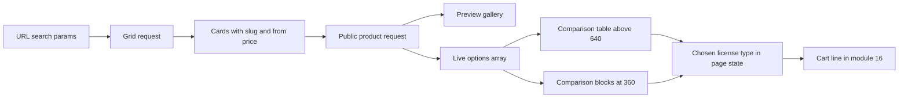

# Product page, previews and license comparison

Lesson 14.2 built the grid route. This lesson builds the two screens a buyer uses, and it does not invent a third route: the public product route already exists from Module 11, and Module 13 added the previews to it. The work here is shaping what that route returns for a comparison, then building the grid, the gallery, the comparison and the choice.

Build in this order, because each step gives the next one something to test. The option summary first, then the grid with its filters in the URL, then the preview gallery, then the comparison, then the choice.

## One sentence added to the option summary

`GET /studios/:studioSlug/products/:productSlug` answers one published product. It keeps the rule the grid uses: a draft or an archived product returns `404`, even when both slugs are correct. The serializer lists its fields, and Module 11 already returns the key, the type, the price in minor units, the currency, the seat limit, the download limit and the terms version for every option.

```js
// server/src/modules/products/product.serializer.js (what the page receives)
/**
 * @typedef {Object} LicenseOptionView
 * @property {string} key
 * @property {"personal"|"commercial"} type
 * @property {number} priceMinor
 * @property {string} currency
 * @property {number} seatLimit
 * @property {number} downloadLimit
 * @property {string} termsVersion
 * @property {string} allowedUse     one plain sentence, resolved from the terms catalogue
 * @property {string} termsUrl       GET /terms/:version
 */

/**
 * @typedef {Object} ProductDetail
 * @property {string} slug
 * @property {string} title
 * @property {string} description
 * @property {string} category
 * @property {string} format
 * @property {{ slug: string, name: string }} studio
 * @property {Array<{ url: string, alt: string, width: number, height: number }>} previews
 * @property {Array<LicenseOptionView>} options
 */
```

Two decisions live in that contract. The previews arrive in gallery order with width and height, so the page can reserve space and never jumps while a photograph loads. And `allowedUse` is a sentence resolved on the server from the terms catalogue that Module 11 already keeps, not a string the client invents. The wording of a license is the same on every device and every release, and one place changes it.

The summarizer skips retired options, because a buyer must not compare a contract that is no longer for sale. It also carries no storage identifier, no checksum, no byte size and no delivery address, because the buyer has not bought anything yet and Module 21 is the only route that turns a license into a link.

The page names the Studio that made the product, with its display name and a link to its public page. That page is out of scope for this module, so the link stays a text line until a later module builds a Studio view. Saying so in the code today is better than shipping a link that leads to a blank screen on the day a buyer taps it.

The detail request also needs an honest failure state. A `404` renders one sentence that says the product is no longer available and offers a link back to the grid, because a product that slipped out of publication and an address typed by hand look identical from the browser. A `500` renders a retry control and does not pretend the product is gone, since a buyer who sees "not available" during an outage will not come back.

## Filters live in the URL

The grid reads its filters from the address bar, not from component state. A buyer who filters to templates under 3,000 and refreshes the page should see the same grid, and a link sent to a friend should open the same list. The URL is also the cheapest place to keep state on a phone that may lose the tab.

```js
// client/src/features/shop/useCatalogue.js
export function useCatalogue(searchParams) {
  const query = searchParams.toString();
  const [state, setState] = useState({ status: "loading", data: null });

  useEffect(() => {
    const controller = new AbortController();
    setState({ status: "loading", data: null });
    fetch(`${API_BASE}/catalogue?${query}`, { signal: controller.signal })
      .then((response) => response.json())
      .then((data) => setState({ status: "ready", data }))
      .catch((error) => {
        if (error.name !== "AbortError") setState({ status: "error", data: null });
      });
    return () => controller.abort();
  }, [query]);

  return state;
}
```

The abort matters. A buyer who taps three filters in two seconds sends three requests, and without cancellation the slowest answer can arrive last and overwrite the newest grid. The symptom is a grid that matches a filter the buyer already changed, which looks like a caching bug and is a race.

The filter panel is four selects and one number input, not a free text box, so nothing depends on typing speed on a weak connection. Changing a filter replaces the relevant search parameter and resets the page to 1. An empty result is a sentence, not a blank area: it names the active filters and offers one tap to clear them.

Each card links to `/studios/{studio.slug}/products/{slug}`, which is why the catalogue card in Module 14 carries both slugs. A card without a slug can render a title and a price and cannot open its own page.

## The gallery shows evidence, not decoration

A preview exists so a buyer can judge the font, the template or the icon style before paying. The gallery therefore has one large image and a row of thumbnails, and the first preview is the one the grid already used as a cover. Selecting a thumbnail changes the large image and nothing else.

Build it with real buttons, not clickable divs. Each thumbnail is a button with `aria-pressed` and a label taken from the preview's alt text, so a keyboard user can tab to it and a screen reader can announce which preview is showing. Arrow keys move between thumbnails, because a row of six is tedious to tab through on a phone with a keyboard attached.

The images load lazily below the fold and the large image reserves its space from the width and height the server sent. A gallery that shifts the price down the page while Amina is reading it is a gallery that makes her tap the wrong thing.

## One comparison, two layouts

The comparison is the centre of the page. Above roughly 640 pixels it renders as a table: a row for allowed use, seats, downloads and price, and one column per license option. At 360 CSS pixels it renders each option as a block, with the license type as a heading and one labelled row per fact. Both layouts read from one array of options, so a number cannot appear in one and not the other.

<MustRead
  title="Tables tutorial"
  url="https://www.w3.org/WAI/tutorials/tables/"
  source="W3C Web Accessibility Initiative"
  description="Short guide to table headers, captions and scope. Read the sections on header scope and on caption placement before you write the wide layout, because a table of license terms that a screen reader cannot associate with its row labels is a table of numbers."
  readMinutes={15}
/>

The wide layout is a real table element with a caption, a header row and `scope` attributes on both column and row headers. The narrow layout is a definition list per option, with the same labels in the same order. Render both from the same options array and choose between them with a small hook that listens to `matchMedia("(min-width: 640px)")`, so the test can force either layout without a browser resize.

The alternative is one table that CSS reformats at a narrow width. It has one code path and it removes the row and column relationships that some screen readers depend on. That is a real cost, and it is the reason this build keeps two renders and one data source. When to switch back: if the comparison grows past about six facts, two renders become a maintenance problem and a single table with a sticky label column is the better trade.



The diagram has one options array feeding two layouts and one selection feeding the cart. That is the invariant the tests protect: however the facts are arranged, the chosen value is a license type, and it is the only thing the cart receives besides the product identifier.

## The choice starts empty

No option is selected when the page opens. The buyer reads the comparison, then chooses with a radio group, because a radio group is what a screen reader and a keyboard already know how to operate. The call to action stays disabled until a choice exists, and the enabled button carries the chosen price, so the amount on the button is the amount the buyer just read.

```jsx
// client/src/features/shop/LicenseChoice.jsx (shape only)
const [chosenType, setChosenType] = useState(null);
const chosen = options.find((option) => option.type === chosenType) ?? null;

<fieldset>
  <legend>Choose a license</legend>
  {options.map((option) => (
    <label key={option.key}>
      <input
        type="radio"
        name="license"
        value={option.type}
        checked={chosenType === option.type}
        onChange={() => setChosenType(option.type)}
      />
      {option.type} at {formatMinor(option.priceMinor, option.currency)}
    </label>
  ))}
</fieldset>
```

Two details are easy to miss. The `name` on every radio is the same, so the browser treats the group as one choice. And the value is the license type, because Module 16's cart line holds a product identifier and a license type, and Module 11 allows one option of each type at a time. Keep the option key in the response for the receipt, and send the type to the cart.

Preselecting the cheapest option would raise conversion today and cause disputes next month, because the cheapest option is the one with the narrowest rights. A buyer who has to read two rows before choosing has read the row that decides whether client work is allowed.

## Four tests to write first

These fail against an empty page and they state the promises the page makes.

```jsx
// client/src/features/shop/ProductPage.test.jsx
test("the comparison shows seats and downloads for every option", () => {
  render(<Comparison options={twoOptions} />);
  expect(screen.getByText("3 seats")).toBeInTheDocument();
  expect(screen.getByText("5 downloads")).toBeInTheDocument();
});

test("no option is selected and the action is disabled on first render", () => {
  render(<ProductPage product={detailFixture} />);
  expect(screen.getByRole("radio", { name: /commercial/i })).not.toBeChecked();
  expect(screen.getByRole("button", { name: /choose a license first/i })).toBeDisabled();
});

test("the narrow layout renders labelled blocks, not a table", () => {
  mockMatchMedia(false);              // below 640 pixels
  render(<Comparison options={twoOptions} />);
  expect(screen.queryByRole("table")).toBeNull();
  expect(screen.getAllByRole("definition")).toHaveLength(8);
});
```

Add a fourth test that renders the detail fixture through the page and asserts the document body contains neither `storageId` nor `sha256`. It is the same blunt search as the catalogue gate, and it catches a prop spread that nobody reviewed.

## Check the page at 360 pixels

Set the browser to 360 by 640 CSS pixels and walk the page with the network panel open. The comparison must show one block per option with every label repeated, nothing may scroll sideways, and the price must stay in full body colour rather than a muted grey. Tap targets of at least 24 by 24 CSS pixels are the minimum under WCAG 2.2 target size, and 44 is comfortable on a phone, so size the radio rows for a thumb.

Then use the keyboard only: tab to the gallery thumbnails, press arrow keys, tab to the radio group, choose with the arrow keys, and reach the action. If any step needs a mouse, the page is not ready for the gate.

```quiz
type: mcq
id: digital-goods-shop-q1
question: "The comparison has four facts and up to three license options, and it must work at 360 CSS pixels. Which build keeps the meanings of the facts readable for a screen reader at both widths?"
options:
  - "One table element, reformatted at a narrow width with display block on the rows and cells"
  - "One options array rendered twice, as a table with scoped headers above 640 pixels and as labelled blocks below it"
  - "A horizontally scrollable table with a sticky first column, smaller text on phones and a hint that the table scrolls sideways"
  - "An accordion that reveals one option at a time so the page never shows two columns"
correct: 1
explanations:
  - "Changing the display of table parts removes the row and column relationships that assistive technology uses."
  - "Each layout keeps its own meaning, and both read from one array, so the facts cannot disagree."
  - "A sideways scroll inside a phone page hides facts and asks the buyer to discover that it scrolls."
  - "Hiding an option behind a tap makes comparison sequential, and the buyer usually stops after the first one."
```

Acceptance before the gate: the public product route returns only documented fields, skips retired options and answers `404` for a draft, the grid keeps its filters in the URL and survives a refresh, the gallery is keyboard operable with alt text on every image, the comparison shows allowed use, seats, downloads and price for every live option in both layouts, no option is preselected, and the action carries the chosen price. Then open the page at 360 pixels with the network panel open and confirm that no response contains a storage identifier or a checksum.
