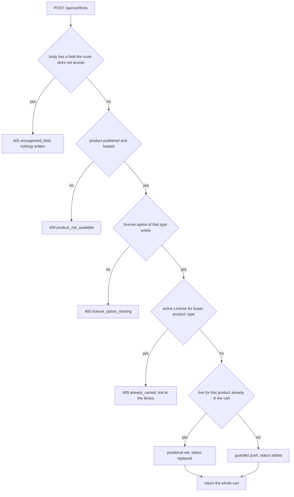

# One line per product, licence switches and owned items

The rules from the last chapter are statements about a cart that no client can break. Writing them down is easy. Making them true under a double click, a retried request, a stale tab and two devices at once is the work of this chapter, and the shape of the enforcement matters more than the amount of code.

Four routes carry the cart, and each one has a single job.

```js
// server/src/modules/cart/cart.route.js (partial, imports omitted)
router.get('/cart', requireAuth, getCart);
router.post('/cart/lines', requireAuth, addLine);
router.patch('/cart/lines/:productId', requireAuth, switchLicense);
router.delete('/cart/lines/:productId', requireAuth, removeLine);
```

`GET` returns the whole cart. `POST` adds a product or changes the license on the line that already holds it. `PATCH` changes the license type of a line that is already there. `DELETE` removes it. All four take the buyer from the session, so no route has a buyer parameter to get wrong.

The service behind the routes has one contract, and it says which outcomes are normal and which are refusals.

```js
// server/src/modules/cart/cart.service.js (contract only)
/**
 * @param {{ buyerId: string, productId: string, licenseType: 'personal' | 'commercial' }} input
 * @returns {Promise<{ status: 'added' | 'replaced' | 'unchanged', cart: CartView }>}
 * @throws {CartError} code: 'unsupported_field' | 'product_not_available'
 *                   code: 'license_option_missing' | 'already_owned'
 */
async function addLine(input) {}
```

A `status` of `replaced` tells the interface to say that the license changed rather than that a new item was added. That distinction is small in the API and large in the interface: one shows "Added to cart", the other shows "Switched to commercial, price updated", and only the second prepares the buyer for a different total at checkout.

## The cart document

One document per buyer holds the lines. The buyer field is unique, which is the constraint the rest of the chapter leans on.

```js
// server/src/modules/cart/cart.model.js (partial)
const cartSchema = new Schema(
  {
    buyerId: { type: Schema.Types.ObjectId, ref: 'User', required: true, unique: true },
    currency: { type: String, enum: ['usd'], default: 'usd' },
    lines: { type: [cartLineSchema], default: [] },
    updatedAt: { type: Date, default: Date.now },
  },
  { timestamps: true }
);
```

The unique index on `buyerId` does two jobs. It makes "my cart" a single lookup with no sort and no tie break, and it makes a concurrent first add collide on one document instead of creating two carts with one line each, which is a state no route in this module can repair.

## Add a line, refusing early

The add handler runs its checks in a fixed order, cheapest first, and stops at the first failure. The order is the design, so read it as a sequence of refusals rather than a checklist.

1. Reject any field the route does not accept. `quantity`, `priceMinor`, `studioId`, `buyerId` and any unknown key return 400 with `unsupported_field`.
2. Load the Product by id and require `status: 'published'`. A draft or a missing product returns 404, so the route does not confirm which ids exist.
3. Find the license option of the requested type on that Product. A type the product does not offer returns 400 with `license_option_missing`.
4. Look for an active License for this buyer, product and type. If one exists, return 409 with `already_owned`.
5. Replace the license on an existing line for that product, or insert a new line.

Steps one and two are what a beginner skips, and both are cheap. Step one exists because a client that believes it can send a quantity is a client that will one day show a total Midad never charged. Step two exists because a Product can be unpublished between the page load and the click, and a cart line pointing at an unpublished product cannot be priced at checkout.

Step three deserves a sentence of its own. The `licenseType` in the request is a name, and a name is not an option. A product may offer personal and commercial, or only personal, or two commercial options with different seat counts in a later version of the schema. The route looks the option up on the Product it just loaded and stores the option key it found, which is the stable string Module 11 gives every option, such as `personal-v1`. It never builds a price from the type string. If a product ever offers two options of the same type, the request grows a `licenseOptionKey` field and the lookup moves from the type to the key.

Step four is the owned-item check, and it is the one that needs an index.

```js
// server/src/modules/licenses/license.query.js (partial)
// The cart and the library share this filter so the badge and the refusal cannot disagree.
function activeLicenseFilter({ buyerId, productId, licenseType }) {
  return { buyerId, productId, licenseType, status: 'active' };
}

// server/src/modules/licenses/license.model.js (partial)
licenseSchema.index({ buyerId: 1, productId: 1, licenseType: 1, status: 1 });
```

Without that index the check is a collection scan on every add. With it, the check is one index lookup that returns at most one document, and the cart stays fast as the License collection grows with every sale on the platform.

## Make the write carry the guard

The guard against a second line belongs in the write filter, not in a read before it. Two requests can both read an empty cart and both decide to push. Only one of them can match a filter that excludes a line that is already there.

```js
// server/src/modules/cart/cart.service.js (partial, error mapping omitted)
// Replace the license on the line that already holds this product.
const replaced = await Cart.updateOne(
  { buyerId, 'lines.productId': productId },
  {
    $set: {
      'lines.$.licenseType': licenseType,
      'lines.$.licenseOptionKey': option.key,
    },
  }
);

// Otherwise insert, but only if no line for this product exists.
if (replaced.matchedCount === 0) {
  await Cart.updateOne(
    { buyerId, 'lines.productId': { $ne: productId } },
    {
      $push: {
        lines: {
          productId,
          licenseType,
          licenseOptionKey: option.key,
          studioId: product.studioId,
          addedAt: new Date(),
        },
      },
    },
    { upsert: true }
  );
}
```

Two details in that code are worth more than the rest. The positional `$` operator in the first update targets the line the filter matched, so the server never rewrites a line it did not select. The `$ne` in the second filter is what makes a duplicate add a no-op: the second of two concurrent requests sees the line the first one pushed and matches nothing.

The `upsert` introduces one collision that a real test will find. If two requests race for a buyer with no cart at all, both can attempt the insert, and the unique `buyerId` index rejects one of them with a duplicate key error. Catch that error code, re-run the same two updates once, and return the cart. A retry is correct here because the second attempt now sees a document that exists, so it takes the push path rather than creating a second cart.

Rejecting unknown fields happens before any of this, and it is three lines of code that prevent a class of bug.

```js
// server/src/modules/cart/validate.js (partial)
const ALLOWED = new Set(['productId', 'licenseType']);

export function rejectUnknownFields(body) {
  for (const key of Object.keys(body ?? {})) {
    if (!ALLOWED.has(key)) {
      throw new CartError(400, 'unsupported_field', `${key} is not accepted by this route`);
    }
  }
}
```

The error message names the field. A learner who typed `quantity` sees `quantity is not accepted by this route` in the network panel and reads the chapter again. A learner who sees a 201 and a cart with one line learns nothing and ships the mismatch to production.

## Switch a license, and re-check ownership

A switch is not a special case of add; it has one extra failure. The buyer may be switching to a license type they already hold, which would create the second License the previous chapter ruled out.

```js
// server/src/modules/cart/cart.service.js (partial)
async function switchLicense({ buyerId, productId, licenseType }) {
  const product = await loadPublishedProduct(productId);
  const option = findLicenseOption(product, licenseType);
  if (!option) throw new CartError(400, 'license_option_missing');

  const owned = await License.exists(activeLicenseFilter({ buyerId, productId, licenseType }));
  if (owned) throw new CartError(409, 'already_owned');

  const result = await Cart.updateOne(
    { buyerId, 'lines.productId': productId },
    { $set: { 'lines.$.licenseType': licenseType, 'lines.$.licenseOptionKey': option.key } }
  );
  if (result.matchedCount === 0) throw new CartError(404, 'line_not_in_cart');
  return { status: 'replaced', cart: await readCart(buyerId) };
}
```

The 404 for a line that is not in the cart is deliberate. The alternative is to add the line, which turns a patch into an add and lets a client with a stale tab create cart contents through the wrong route. Each route keeps one job, and a missing line is a failure of the request rather than an invitation.

A switch to the type the line already has is not an error either. The update matches, sets the same values, and returns `replaced` with an unchanged cart. Making it idempotent is cheaper than making the client guess whether it needs to call at all.

## Write the tests before the handlers

Four tests describe this chapter completely. Written first, they fail with 404s because the routes do not exist yet, and the failure order is useful: it tells you which guard you added and which one you only described.

```js
// server/test/cart/lines.test.js (partial, failing before the route exists)
describe('cart lines', () => {
  it('keeps one line when the same license is added twice', async () => {
    await addLine({ productId: font._id, licenseType: 'personal' });
    const second = await addLine({ productId: font._id, licenseType: 'personal' });

    assert.equal(second.status, 'unchanged');
    const cart = await Cart.findOne({ buyerId: amina._id });
    assert.equal(cart.lines.length, 1);
  });

  it('replaces the license type instead of adding a line', async () => {
    await addLine({ productId: template._id, licenseType: 'personal' });
    const second = await addLine({ productId: template._id, licenseType: 'commercial' });

    assert.equal(second.status, 'replaced');
    const cart = await Cart.findOne({ buyerId: amina._id });
    assert.equal(cart.lines.length, 1);
    assert.equal(cart.lines[0].licenseType, 'commercial');
  });

  it('refuses a product the buyer already owns under that license', async () => {
    await License.create({
      buyerId: amina._id,
      productId: font._id,
      licenseType: 'personal',
      status: 'active',
    });

    await assert.rejects(
      () => addLine({ productId: font._id, licenseType: 'personal' }),
      (error) => error.status === 409 && error.code === 'already_owned'
    );
  });

  it('refuses a quantity field instead of ignoring it', async () => {
    await assert.rejects(
      () => addLine({ productId: icons._id, licenseType: 'personal', quantity: 2 }),
      (error) => error.status === 400 && error.code === 'unsupported_field'
    );
  });
});
```

Add two more that the gate will run through curl rather than in this suite. A revoked License for the same product must not block an add, because the buyer needs a way back after a refund. And a buyer who holds the commercial license must still be able to add the personal one, because the refusal is keyed on the type and not on the product alone.

## One path through the add route

The diagram is the handler as a reader experiences it: a request either ends in a refusal before any write, or in exactly one of two writes.



Every refusal happens before a write, which is why a refused add leaves no trace and needs no repair. The two writes at the bottom are the only places the cart document changes, and both of them are single-document operations on a buyer's own cart.

That property is the strongest reason to keep lines embedded. MongoDB applies an update to one document atomically, so the `$ne` filter and the `$push` cannot be separated by another request. A separate `CartLine` collection would give you a real unique index on `(buyerId, productId)`, which is easier to explain and impossible to bypass from a script. It would also give you a two-document write for every add, a join for every read, and a partial state where a cart exists with no lines. For a cart of ten lines, the embedded document wins, and the unique index on `buyerId` still prevents two carts. If carts grew to hundreds of lines or needed per-line history, the calculation would flip.

## Scoping, and three symptoms to debug

Every test above uses the buyer from the session, so add the cross-buyer case before you trust the suite. Buyer B calls `GET /api/cart` and sees an empty cart, not Amina's. Buyer B calls `PATCH /api/cart/lines/:productId` with a product id that happens to be in Amina's cart and gets a 404, because B has no line for it. Neither response confirms what Amina holds, which is the point.

Three symptoms will come up while you build this, and each maps to one line of code. If one product appears twice, the insert path ran without the `$ne` guard, or it ran twice before the `buyerId` index existed in the test database. If a line carries another creator's Studio, the handler read `studioId` from the request body. If the first add for a brand new buyer returns a 500 with a duplicate key error, the upsert collision was never caught and retried.

Check the index exists in the database you are testing, not only in the model file. Module 20 has the same lesson for a unique index, and it is worth learning here with a cheaper failure: a guard that only exists in source is a guard you do not have.
