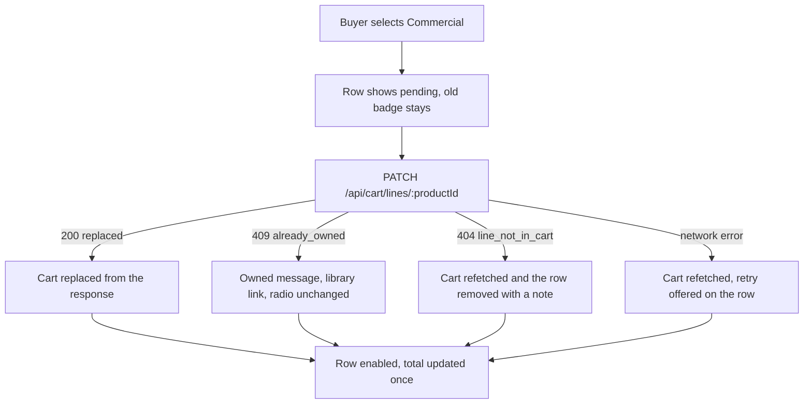

# Cart rows, licence badges and switches

The cart page has four jobs and a fifth that is not written on any ticket. It must show what each item costs, which rights the buyer is getting, what they already own, and how to change a license. The unwritten job is that all four survive a 360 pixel screen, one thumb, a slow connection and a buyer who has never heard the phrase "commercial license".

Start from the data, because every layout decision on this page is downstream of what a row actually contains.

## The row's data contract

A row renders one cart line plus two derived values: a formatted price and a statement of what the license allows. Nothing else on the page needs the option key, so the view model does not carry it into the component tree.

```js
// client/src/cart/cart-line-view.js (contract only)
/**
 * @typedef {Object} CartLineView
 * @property {string} productId
 * @property {string} title
 * @property {string} format        e.g. "OTF and WOFF2"
 * @property {'personal' | 'commercial'} licenseType
 * @property {number} priceMinor
 * @property {string} priceLabel    formatted for the active locale
 * @property {number} seats         from the license option
 * @property {number} downloads     from the license option
 * @property {boolean} ownedUnderSelected
 * @property {boolean} ownedUnderOther
 */
export function toCartLineView(line, money) {}
```

`priceLabel` is computed once from `priceMinor` and the cart currency. Do not format money in three places and hope they agree, and never sum formatted strings: `"$12.00" + "$18.00"` gives a cart total that no payment provider will recognise.

## The badge says what the license allows

A badge that reads "Commercial" tells a first-time buyer nothing. The label has to carry the two facts that separate the options: who may use the work, and how many people may hold a seat. Rendered as text, always, because colour alone fails in sunlight and fails for a screen reader.

```jsx
// client/src/cart/license-badge.jsx (partial)
export function LicenseBadge({ licenseType, seats }) {
  const label =
    licenseType === 'commercial'
      ? `Commercial license, up to ${seats} seats`
      : 'Personal license, 1 seat';
  return (
    <span className="badge" data-license={licenseType}>
      {label}
    </span>
  );
}
```

The badge is a sentence, not an icon with a tooltip. A tooltip is unreachable on a phone, and the sentence is what makes the switch below comprehensible: a buyer who reads "Personal license, 1 seat" and then sees a control offering "Commercial, up to 3 seats" is being told exactly what they are buying with the difference in price.

Keep the badge short enough to wrap to two lines at 360 pixels. "Personal license, 1 seat" is 25 characters and fits. A badge that quotes the whole terms paragraph is a link to the product page, not a badge.

The badge also has to work in both themes. Use the text colour on a surface that passes the contrast rule from the accessibility chapter, and pair the colour with the word itself, so a buyer who cannot distinguish the tint still reads "Commercial license". The `data-license` attribute is there for styling and for tests; the meaning lives in the sentence.

## The switch is a radio group, not a toggle

A toggle offers two states and hides what they mean. The buyer sees a switch labelled "Commercial" and cannot tell whether the switch is currently on, what it will do, or what the other position costs. A radio group with two labelled options announces the group, the count of options and which one is selected, and every option carries its own price.

```jsx
// client/src/cart/license-switch.jsx (partial)
<fieldset disabled={pending}>
  <legend>License for {title}</legend>
  {options.map((option) => (
    <label key={option.type}>
      <input
        type="radio"
        name={`license-${productId}`}
        value={option.type}
        checked={option.type === selected}
        onChange={() => onSwitch(option.type)}
      />
      {option.label} <span>{option.priceLabel}</span>
    </label>
  ))}
</fieldset>
```

The `fieldset` with a `legend` is what gives the radios their group name in a screen reader. `disabled` while a request is in flight prevents a second switch that would race the first one. Each radio is a tap target of at least 44 by 44 pixels, and the price sits inside the label so a tap on the number selects the option rather than doing nothing.

One detail is easy to miss. The radio is controlled by the cart the server returned, not by local state. When the response arrives, the selected radio moves because `selected` changed, not because the click was optimistic. That single rule prevents the whole class of bugs in the next section.

## Do not guess: send the patch and use the response

An optimistic update is tempting here. The buyer taps Commercial, the badge changes instantly, and on a fast connection nobody can tell the difference. On the connection many fellows actually have, the difference is the whole experience: the badge says Commercial while the request is still in flight, the buyer taps Checkout, and the server either refuses the line or charges a price the page never showed.

Two refusals are waiting for that optimism. The buyer may already hold the license they are switching to, which returns 409 `already_owned`. Or the line may be gone because another tab removed it, which returns 404 `line_not_in_cart`. Neither is rare, and both are answered correctly by a design that treats the server as the source of the truth.

```js
// client/src/cart/use-cart.js (partial, error handling abbreviated)
async function switchLicense(productId, licenseType) {
  setPending(productId);
  try {
    const cart = await api.patch(`/cart/lines/${productId}`, { licenseType });
    setCart(cart); // the server returns the whole cart in every outcome
  } catch (error) {
    if (error.code === 'already_owned') {
      setNotice({ productId, kind: 'owned', licenseType });
    } else {
      setCart(await api.get('/cart')); // resync after any other failure
    }
  } finally {
    setPending(null);
  }
}
```

Every branch ends with the cart the server last confirmed. The cost is one round trip of a few hundred milliseconds on a good link, so the row shows a pending state rather than the page showing a spinner: the rest of the cart stays readable and tappable while one row settles.

## The owned message, in words that stop a support thread

The API tells the page whether the buyer owns the selected license type, and whether they own the other one. Those two flags need two different sentences, because they describe two different situations.

- Owned under the selected type: "You already own this under the personal license. Open your library to download it." The add and the switch are both refused, so the row offers the library instead of a control.
- Owned under the other type only: "You own the personal license. The commercial license is a separate purchase and its price is not reduced." The switch stays available, because the buyer is allowed to buy the other license, and the sentence is there because the buyer will otherwise expect a discount.

The second sentence is the one that matters. Without it, a buyer who paid 1,200 for the personal license sees a commercial price of 1,800 and concludes that Midad double charged them. The stretch pricing module replaces the sentence with a real prorated price. Until then, the interface says the plain truth: the two purchases are separate, and the core path does not credit the first against the second.

## At 360 pixels

Test at 360 by 640, in the browser's device mode, with the longest product title in the seed and both license options visible. The layout rules below are enough; the point is that none of them depends on a hover, a wide screen or a mouse.

- One column. The group heading sits above its rows and spans the full width, so the creator name is never cut off.
- The row stacks: title on its own line, then the badge, then the price on its own line. A single row with title, badge and price side by side fits only with a short title, which is not the case in real data.
- No horizontal scrolling. If the cart scrolls sideways at 360, the badge text is too long or the price is inside a fixed width column.
- Tap targets of at least 44 pixels for the radios, the remove button and the library link.
- The group subtotal is right aligned with a label, not a bare number, because a number alone under a creator name reads as the item price.

Check the same layout with the browser text size increased one step. Badges wrap to a third line and the row grows, which is fine. A row with a fixed height is not.

The remove action belongs on the row for the same reason. It is the third tap target in a narrow column, so keep it as a text button with the label "Remove" and a spoken name that includes the product title, and put it after the price rather than beside the title. A buyer who removes a line sees the group disappear only when the server says the cart is empty, because the same response rule applies to every write on this page.

## Tests that fail before the page works

Two tests describe the risky half of this chapter. Both fail against the version with an optimistic badge, which is the version most people write.

```js
// client/test/cart/switch.test.jsx (partial, failing before the switch is wired)
it('keeps the personal badge when the server refuses the switch', async () => {
  server.patch('/cart/lines/:productId', 409, { code: 'already_owned' });
  render(<CartPage initialCart={ownspersonalCart} />);

  await user.click(screen.getByRole('radio', { name: /commercial/i }));

  expect(await screen.findByText(/you already own this under the personal license/i)).toBeVisible();
  expect(screen.getByRole('radio', { name: /personal/i })).toBeChecked();
});

it('replaces the price and keeps one row after a switch', async () => {
  server.patch('/cart/lines/:productId', 200, replacedCart);
  render(<CartPage initialCart={personalCart} />);

  await user.click(screen.getByRole('radio', { name: /commercial/i }));

  expect(await screen.findByText('Commercial license, up to 3 seats')).toBeVisible();
  const rows = screen.getAllByRole('listitem').filter((row) => row.textContent.includes('Template'));
  expect(rows).toHaveLength(1);
});
```

The first test is the one that catches optimism. If the component sets its own state before the response, the personal radio is no longer checked when the refusal arrives, and the test fails on the assertion rather than on a screenshot a mentor has to interpret.

Add a third case for the network. Point the client at a stopped API, tap Commercial, and confirm the page shows the last server cart with a retry that works once the API is back. A buyer on a weak link will see this state more often than a refusal.

## One tap, four outcomes

The diagram is the switch as the buyer experiences it. Note that three of the four outcomes end in the same place, a cart the server confirmed, and only the wording differs.



The takeaway is that the page has exactly one writer: the cart response. The pending state is the only local state on the row, and it cannot change what the buyer is buying, only what they can tap while they wait.

## Bridge to the gate

The page is right when it can survive its own refusals. The gate asks for two creators on one screen, a badge and a price on every row, an owned item that offers the library instead of a switch, a switch that replaces rather than adds, and a screenshot at 360 pixels in both themes. The library link matters more than it looks: it is the path a buyer takes when Midad correctly refuses their money, and a refusal with no next step is the failure that reads as a broken marketplace.
