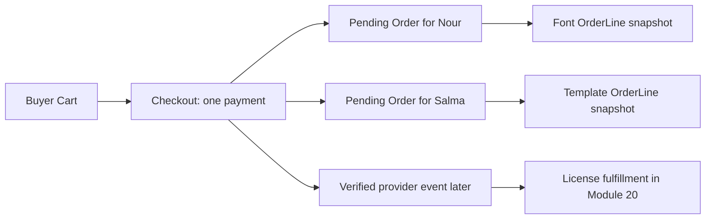

# Orders before payment

Amina buys a font from Nour Studio and a template from Salma Studio in one Cart. She expects to pay once, but each creator needs a separate record of what they sold. Midad creates one Checkout as the payment coordinator and one pending Order per Studio. Before a verified payment event, those Orders say `pending_payment`; they are not receipts of a completed sale and they do not grant Licenses. This ordering gives a later webhook stable OrderLine IDs to fulfill, even if Amina closes her browser before returning from Stripe.

The pending state is a promise about what the server intends to charge, not a claim that money arrived. A success page may show "Preparing your library" while a webhook is delayed. It should query Checkout and Order state; it must not create Licenses. If the buyer abandons payment, pending Orders can expire or be cancelled under a rule, but they should not appear in creator earnings as completed sales. Record the state names and transitions before adding an API route.

<TraceRequest title="Browser returns before the verified event">
  <TraceStep actor="Buyer" label="Confirm one Checkout" detail="Server freezes amount and pending OrderLines" />
  <TraceStep actor="Browser" label="Reach success route" detail="Reads pending state but grants no file access" />
  <TraceStep actor="Webhook" label="Verify payment later" detail="Finds Checkout and its stable pending Orders" />
  <TraceStep actor="Fulfillment" label="Create Licenses once" detail="One entitlement per paid OrderLine" />
</TraceRequest>

## Choose identities that survive retries

Checkout needs buyer ID, currency, total in minor units, status, provider PaymentIntent ID when created, and a stable request or idempotency key. Each Order needs Checkout ID, Studio ID, buyer ID and pending state. Each OrderLine needs a stable ID because Module 20 will grant one License per paid line. Put a unique key on `(checkoutId, studioId)` for Orders so a retry cannot create a second creator Order. A unique order-line identity or stable line key can help reconcile partial writes. A Cart ID alone is not enough: a buyer may start a new attempt after an old one expires.

The server should derive Studio ID from the Product, never from a client-supplied studio label. A two-Studio Cart must group lines by current Product ownership. If Amina sends Nour's Studio ID with Salma's Product, the route ignores or rejects the forged association. The Checkout total is the sum of frozen line amounts under one currency. Each Order total is the sum of its own lines. The sums of per-Studio Orders must equal the Checkout amount under the fee and tax policy chosen for this course. Write this reconciliation equation in the model notes.

## Keep pending Orders invisible as paid sales

A creator dashboard may show pending Orders in a separate state, but it must not count them as revenue or release private files to the buyer. A buyer order page can show pending and a safe next step. A refund, cancellation or expired payment later changes state but does not delete the original attempt. The OrderLine snapshot remains useful for explaining which price and license terms the buyer saw. Deleting all pending Orders on timeout would make support hard when a late provider event arrives.

A paid OrderLine and a License are different records. The line is the historical transaction fact; the License is current access. A line may be refunded after access was granted, so the License may become revoked while the OrderLine persists. If the app uses `order.status === paid` as the sole download check, it cannot enforce download limits or versioned terms. Module 20 will create Licenses from verified payment, and Module 21 will issue short-lived grants under current License policy. This chapter makes the earlier state ready for those effects.

## Predict two timelines

First, Amina confirms Checkout, loses connection, and never sees a success page. The webhook should still locate the pending Orders and fulfill after verified payment. Second, Amina reaches a success page before the webhook and refreshes it three times. The page remains read-only; the later event creates exactly one License per line. Write both timelines in your learning log with the authoritative record at each step. If a proposed design requires a browser callback to write paid state, it fails the first timeline. If it creates a License on every refresh, it fails the second.

The next chapter freezes the sale terms on those pending OrderLines. Without a snapshot, a creator's later Product edit could change what the webhook thinks Amina bought even though the provider charged a fixed amount.

## Compare an abandoned attempt with a paid one

Create Checkout A, where Amina confirms the two-Studio amount but closes the payment page without completing it. Pending Orders remain for a short, defined time and then move to an expired or cancelled state. No License is created. Create Checkout B for the same Cart after the first expires. It is a new attempt with a new stable identity and the current offer is recalculated; it does not reuse A's old provider reference. If A later reports a success event, the payment module needs a reconciliation rule rather than assuming an expired local status means the provider could not charge.

This comparison is why pending Orders should not be counted as creator revenue. Nour may see an incoming attempt in a separate dashboard view, but she cannot treat it as a sale until the provider event is verified. If the UI sends a "new order" email when the pending row is inserted, creators may start work or send support messages before payment. Delay those effects until the paid transition. A status field has product consequences, not only database organization.

## Simulate an interrupted local write

Suppose the server saves Checkout K and Nour's Order, then stops before Salma's Order is written. A transaction on a replica set would roll the local writes back together. If the system chooses an idempotent recovery approach instead, the retry needs to find K, inspect which Studio Orders exist, and create the missing one. It cannot mark K ready for payment while a required OrderLine is absent. Write a test that stops after the first child row and then runs the recovery function. The final counts and snapshot total should equal a clean one-pass run.

A transaction does not include the external payment provider. Even if the local records commit atomically, the provider call may time out after creating an intent. Use a stable provider idempotency key based on Checkout identity when Module 19 creates the PaymentIntent. Store the provider reference if received and reconcile ambiguous timeouts before creating another. Do not hold a MongoDB transaction open while waiting for Stripe; that would lengthen locks and still would not make the provider participate in the database commit.

## Draw the state path

Write Checkout states such as draft, pending_payment, paid, expired and cancelled with allowed transition actors. A browser can request a new attempt and read its state, but only verified server handling may move it to paid. A background expiry job may close an attempt under an explicit time rule, but a late provider success requires a defined policy. Per-Studio Orders follow the Checkout's payment outcome while keeping their own fulfillment details separate. A student should not need to decode multiple contradictory status badges after one payment.

Keep one test assertion per transition: pending Orders have no License; verified paid outcome leads to one License per line later; a duplicate event leaves counts unchanged; an expired attempt does not create a second charge on retry. This module builds only the pending foundation, but writing these expectations makes the next module's contract clear. Before continuing, show a peer the state diagram and ask them whether closing the browser can erase a payment that already happened. If the design says yes, the server has put authority in the wrong place.
