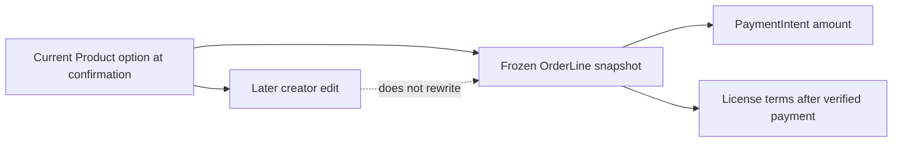

# The snapshot trap

Nour changes the personal font price after Amina confirms a Checkout but before Stripe reports payment. The provider will charge the amount Midad submitted for that attempt. If the webhook rereads the Product's current price to build an OrderLine, the recorded sale can disagree with the charge. The same problem occurs if Nour changes download limit, seat count or terms version. An OrderLine must capture what Amina accepted before payment begins, and the webhook must use that frozen evidence rather than current catalogue values.

The dotted non-edge is the key idea. A Product option is an offer for a new buyer now. An OrderLine is evidence of one buyer's accepted attempt at a specific time. A License is the current access created after verified payment under those accepted terms. A creator may improve the product, but they cannot rewrite the buyer's old price or silently change a purchased personal license into a commercial one by editing the catalogue.

<TraceRequest title="Price changes while payment is pending">
  <TraceStep actor="Amina" label="Accept personal option at 1,200 minor units" detail="Checkout stores frozen amount and terms version" />
  <TraceStep actor="Nour" label="Change current price to 1,500" detail="New buyers see the new offer" />
  <TraceStep actor="Webhook" label="Confirm old payment" detail="OrderLine remains 1,200; License uses accepted terms" />
</TraceRequest>

## Snapshot the fields that affect the promise

Capture Product ID and title, Studio ID and display name, selected license-option key and type, priceMinor, currency, quantity or seats chosen under the option, seat limit, download limit, accepted terms version and a stable way to retrieve those terms. Include a safe preview reference if the receipt displays it. Do not copy a private ProductFile storage ID or live signed URL into OrderLine. Delivery selects an eligible released version later according to the accepted update policy. The snapshot should explain the sale without becoming a permanent download capability.

The exact terms text needs a durable versioned source. A number such as `termsVersion: 3` is meaningful only if version 3 can still be read after the creator publishes version 4. Store the text in a versioned Terms record or immutable blob that the OrderLine references, under a retention policy. The course can keep the terms small, but it must not leave old buyers with a version number pointing to overwritten current text. Test that version 3 remains retrievable after version 4 is published.

## Recompute before freezing

A Cart may have stored the 1,200 display price from yesterday. At Checkout creation, load current Products and selected option keys from the database. Validate publication status, Studio ownership, option availability, seat and download limits, then calculate the total in minor units. If a price changed, return the new offer and require the buyer to confirm before creating the pending Checkout. Once confirmed, freeze it. Do not silently charge the new amount because a browser had an old tab open; the server owns the number, while the buyer owns the decision to accept it.

A client can submit an arbitrary `priceMinor`, `currency` or terms version. Treat those as untrusted hints or reject them. The server reads the Product option and applies its current values at confirmation. If the chosen option key no longer exists, return a stale-option conflict with a clear choice to reselect, not a substitute license chosen by alphabetical order. If the Product has been unpublished, stop before payment. These cases can be tested without contacting Stripe.

## Preserve after later edits

Create a pending OrderLine fixture for Nour's personal font at 1,200 units and terms version 3. Change the current Product price to 1,500 and terms version to 4. Read the line again and compare every snapshot field. The old amount and terms remain. Then create a new Checkout for a different buyer; it should use the new offer. This two-buyer comparison proves that the system preserves history while allowing a creator to update current sales.

Try a subtler change: Nour edits the Product title or Studio display name. A receipt should still identify what Amina saw at purchase, while the current catalogue shows the new name. If the app only stores Product ID and populates current fields on every order read, the receipt can change without any order write. The snapshot test should assert raw OrderLine values, not only the rendered page. The next chapter builds the route that creates these snapshots and groups them by Studio.

## Test a seat-count change

Amina selected a commercial template option that allowed five seats when she confirmed Checkout. Salma later reduces the current commercial offer to three seats. The pending OrderLine must retain five as the accepted limit for this attempt. A new buyer sees three. A License created after verified payment for Amina should use the frozen five-seat terms, unless the product explicitly refunds an offer it cannot honor. Silently reducing Amina's entitlement because the Product changed would break the sale promise even if the provider amount was correct.

Now change the download limit from ten to two. The same rule applies. A current catalogue option is not a retroactive edit to a paid License. If the product allows an upgrade or renewal, model that as a new accepted transaction or explicit amendment, not an overwrite of the original OrderLine. Keep the terms version stable and retrievable so support can explain what Amina bought when today's page shows a different offer.

## Define an immutable line in code

A Mongoose schema can mark fields immutable, but application code should still avoid broad updates to OrderLine snapshot fields. Expose narrow state transitions on Order, not a general PATCH accepting `priceMinor` or `licenseType`. Test a crafted request from a buyer and from the creator that tries to alter a frozen line. Both should fail. The verified payment handler may update payment status and provider references, but it should not recalculate the snapshot from Product. Separate state fields from sale facts in code and tests.

A receipt may include both historical and current links. The Product ID can take Amina to Nour's current font page, but the receipt title, option and amount come from the OrderLine. If the Product is unpublished later, the receipt still works. If a preview is removed, a safe snapshot or fallback remains. None of this requires storing the private original file in the order. Keep that boundary visible in the serializer's expected-key test.

## Reconcile one Checkout amount

For a two-Studio Cart, calculate the frozen total once and compare it with the sum of all OrderLine amounts. Use integer arithmetic and one currency. If a discount or fee is added later, represent it as an explicit line or field under a documented rule so the equation remains explainable. A mismatch should stop provider creation; do not round it away. The payment webhook will compare the provider's amount and currency against this server-held total. A line snapshot that changes after confirmation would make that comparison unreliable.

Finish by writing a before-and-after table for Amina's old OrderLine and a new buyer's line after Nour's edit. Include price, terms version and download limit. The two rows should differ only because they represent different accepted times. The exercise proves the snapshot's purpose more directly than saying "orders are immutable" without a case.

A terms-version label should also be understandable in support. If Amina asks why her personal license has two downloads while today's page advertises five, the agent should find her OrderLine, read accepted version 3, and compare it with current version 4. The old terms text must still be available. Do not answer by editing her License to match today's offer unless the business deliberately grants an upgrade. The snapshot turns a potentially confusing difference into an explainable product history.

This record boundary is also useful when a Product disappears. Amina's OrderLine can still name the purchased file and terms after Nour unpublishes the current page. The library may need a safe fallback label, but it must not invent a replacement option. History remains legible even when current catalogue state changes.
