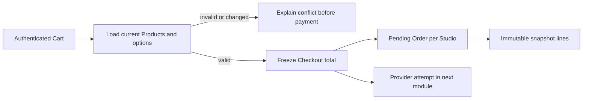

# Checkout route

Build `POST /checkouts` from a buyer's Cart. It should not accept a final amount or Studio owner from the browser as authority. Load each Product and selected license option by ID and key, verify the Product is published and purchasable, and derive its Studio. Reject stale or unavailable lines before creating any payment attempt. Calculate all prices in integer minor units and require one currency for the core cohort. Return a changed-offer response if a current option differs from what the buyer last confirmed in the Cart.

Start the route with authentication. `buyerId` comes from the session. The Cart belongs to that buyer. For each line, load Product by ID and its active license option by stable key. Validate seat count against the option's limit; do not trust a line that says Studio A if the Product belongs to Studio B. Build a normalized in-memory plan that contains Studio ID, option snapshot and integer line amount. If any line fails, return a field-level conflict and create no Checkout or Order. This makes the failure understandable before money is involved.

## Group and freeze in one operation

Group normalized lines by Studio ID. Create one Checkout with total and currency, then one Order for each Studio with its own snapshot lines. The route should not mark anything paid or create Licenses. Use stable request identity so a retry after a dropped response returns the existing Checkout rather than creating a second attempt. A unique key scoped to buyer and request ID can protect this at the database. Verify the actual index exists in the local database; an in-memory map cannot protect retries after a restart.

MongoDB transactions can make creation of one Checkout and several Orders atomic when the database runs as a replica set. The course's local setup should provide that capability if this path relies on it. If a transaction is not available, a deliberate recovery state and idempotent retry can reconcile a partial write, but do not call multiple independent inserts all-or-nothing. For the core path, prefer a transaction for these local records, then create the provider attempt only after the committed plan exists. Keep provider calls outside the database transaction; a provider cannot participate in MongoDB's commit.

A provider call can fail after the local pending records commit. Keep Checkout in a state that permits retrying the provider attempt with the same idempotency identity. The next module will own that integration. Do not delete pending Orders merely because one network call timed out: a provider may have created a PaymentIntent even if the response was lost. Store the provider reference when known and reconcile by Checkout ID before starting another attempt.

## Return a useful response

Return Checkout ID, frozen total and currency, pending Order summaries grouped by Studio, and a status the buyer can read. Do not return another Studio's private creator dashboard fields to a seller; this is a buyer response for the buyer's own Cart. Do not include ProductFile storage IDs, license keys or signed URLs. A buyer has not paid yet, and even a paid buyer will obtain files through a later authenticated grant route rather than the Checkout response.

The client can use a changed-offer response to show which line price or option changed and ask for renewed confirmation. Do not silently drop an invalid line from the total while leaving the rest of the Cart looking complete. A buyer may choose to remove it and retry. The response should help them make that choice without exposing internal database errors. A 409 for a stale option is more useful than a generic 500 or a successful Checkout with a different product.

## Verify the route before Stripe

Seed two Studios and one Buyer with a two-line Cart. Submit a valid request and inspect one Checkout plus two pending Orders. Sum the OrderLine amounts and compare to Checkout total. Submit a client total of one minor unit and a forged Studio ID; the server must still use current Product and Studio data. Change one Product option price, submit a stale Cart and expect a conflict before any pending rows are written. Retry a successful request with the same idempotency key and compare IDs and counts. Use a disposable replica-set database for the transaction test.

Stop the API between local commit and provider attempt in a test fixture, then restart the route or reconciliation function. It should find the same pending Checkout, not a second one. This failure path matters on weak connections and prepares the payment module. Commit the route, indexes, transaction test, changed-offer test and raw response examples. The next chapter checks that frozen lines remain frozen even while creators update their products.

## Write the stale-choice response

Amina's Cart has the personal font option, but Nour unpublishes it before checkout. A broad route might skip that line, charge for Salma's template only, and return success. That is a bad surprise: Amina intended to buy both. Return a conflict that names the changed line and says it is unavailable. Do not create a Checkout or provider attempt. Amina can remove or reselect the line and confirm the new total. Test this with two lines so the route cannot accidentally pass by treating the whole Cart as a single Product.

A price change is slightly different. Nour raises the personal font from 1,200 to 1,500 minor units. The route can return the revised offer and ask for explicit confirmation. If the client immediately retries with a new acknowledged offer version or expected total, the server must still re-read current price to protect against another change. A client-submitted acknowledgment is evidence of choice, not price authority. Store the version or hash of the offer the buyer saw if the UI needs a precise stale-change check.

## Check concurrency at the request key

Amina double-clicks Pay and sends two `POST /checkouts` requests with the same idempotency key. If both hit different server processes, an in-memory cache will not protect them. A database unique index on buyer and request key lets one create win and the other return the existing Checkout. If the first process stops after local commit but before HTTP response, the retry should still find the same row and its Orders. Test this with two concurrent calls and compare Checkout and Order IDs, not only their counts.

A different idempotency key after a genuine expiry may begin a new attempt. The route should not let an old Cart's stale amount or option bypass current validation. Write a test that changes Product price between the first expired attempt and the new one. The second Checkout uses current price. The first remains as historical pending or expired evidence and should not be mutated into the second sale. This keeps retries of one attempt distinct from a new buyer decision.

## Build the transaction boundary deliberately

Use a replica-set development MongoDB if the implementation uses transactions for Checkout and Order creation. In a transaction, create Checkout and all per-Studio Orders, then commit only when the snapshot sums match. A failure in any line aborts all local records. If the course environment cannot run a replica set, use a documented recovery state and idempotent completion instead, and test a forced stop after one Order. Do not claim both approaches simultaneously without choosing one for the learner build.

After local records are durable, the provider attempt can be requested. The payment module must reuse a stable provider idempotency key so a timeout does not become two intents. Record this as a boundary in code comments and the ERD. Run one test with the provider adapter failing before returning a reference; the Checkout remains pending with a retryable reason, not paid or silently deleted.
