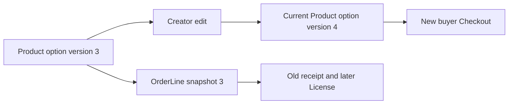

# Snapshot lines and the immutability test

An OrderLine snapshot is useful only if the rest of the app reads it as history. Build a test around one confirmed Checkout for a personal font license at 1,200 minor units and terms version 3. After the pending Order exists, let Nour change her current Product price, display title, seat limit, download limit and terms version. The Checkout amount and old OrderLine should remain exactly what Amina accepted. A new buyer's Checkout should use the new option. This comparison proves both current offer updates and historical stability.

Write assertions against stored fields, not only rendered text. A frontend receipt component might accidentally show cached old text while the database line has changed, or it might populate current Product values while the database snapshot is intact. Inspect raw OrderLine JSON and the database document. Assert Product ID, option key, license type, priceMinor, currency, seat limit, download limit, terms version and Studio identity. If the receipt uses a preview image, assert a safe historical reference as well. Private ProductFile storage IDs must remain absent.

## Test the route that reads an old order

Add or adjust the buyer's Order detail serializer to prefer snapshot fields. It may include Product ID for navigation to the current catalogue, but the paid agreement shown on the receipt comes from OrderLine. If a Product is unpublished later, the buyer should still understand the old purchase. If Nour changes a license option name, the old line should still show the option Amina chose. A `populate(Product).licenseOptions.find(...)` path would turn a historical receipt into current marketing copy and can fail if the option was removed.

The License created after verified payment must inherit accepted terms from the frozen line, not current Product. Build a unit-level expectation in the fulfillment fixture: OrderLine version 3 yields a License under version 3 even if Product has version 4. Do not create the License in this module's Checkout route; the test can call a later pure mapping function or state the contract for Module 20. This separation avoids using a pending Order as payment proof.

## Work through a removed option

Nour deletes the personal option after Amina has a pending Checkout. If Amina's payment attempt later succeeds, the server still has the frozen line and must follow a documented honor-or-refund policy; it cannot silently change the license to a commercial option. If the Checkout had not yet been confirmed, the route rejects the stale Cart and asks Amina to choose again. These are different time boundaries. Write a state table with Cart intent, frozen pending Checkout and verified paid Order, and state which record supplies terms at each point.

A second edge is an updated file version. The OrderLine need not store a private URL, but it should record the accepted terms version and any file release entitlement policy. A future library service can select an eligible released ProductFile according to those terms. "Always latest" is not necessarily correct for every option. Test the old buyer under version 3 and a new buyer under version 4 so the delivery decision is deliberate.

## Keep price arithmetic exact

Use integer minor units for line price and Checkout total. If the quantity represents seats, validate it against the chosen option and multiply as a server rule. Do not format to decimal display currency and parse it back for the provider. A total with mismatched currency cannot be reconciled; reject mixed-currency Carts in the core path. After a Product price edit, compare the old Checkout total with the provider attempt's amount and the new buyer's total. The old two values match each other, while the new total reflects the current catalogue.

Save the test output and a short explanation of which values are mutable and which are snapshots. Ask a peer to change another field, such as Studio display name, and predict what the old receipt shows. If your design cannot answer because the OrderLine stores only Product ID, add the needed snapshot field before payment and refund logic rely on it. The final chapter adds scoped Order routes and checks the whole pending Checkout path.

## Freeze a removed Product without losing history

After Amina confirms a Checkout, Nour decides to unpublish the font. Amina's old OrderLine still describes the pending sale. The payment policy must decide whether to honor the frozen offer if payment succeeds or issue a refund. That decision cannot be made by simply querying `Product.isPublished` when the webhook arrives, because the new value says nothing about what Amina accepted earlier. Include a freeze timestamp and accepted option snapshot so the later handler can follow a deliberate rule.

A new buyer should not be able to start checkout for the unpublished Product. This gives you two tests with the same Product state: old frozen attempt is reconciled under its historical terms, new attempt is rejected under current availability. If both tests share one generic "isPublished" check, one of them will likely be wrong. The snapshot is a temporal boundary, not merely a convenience for receipts.

## Prove the serializer uses the snapshot

Call the buyer Order endpoint before and after a Product edit. The JSON title, option type, price and terms version for the old Order remain identical. Then call the public Product endpoint and confirm it reflects the current title and offer. If both endpoints change together, the Order serializer is probably populating current Product fields. Fix it by selecting stored snapshot fields. Do not rely on a React component that caches the old value; inspect raw server output to catch the underlying contract.

A creator Order endpoint should also show the agreed line, scoped to that Studio. Nour may see Amina's font line, but not Salma's template line from the same Checkout. If the creator dashboard displays the Checkout total, make clear that it spans other Studios and do not leak their private line details. The simpler core design shows each creator only its own Order total and status. Test the raw response with two creator sessions after a title and price edit.

## Review the test's failure mode

A test that changes only Product.description may pass even if the app fails to snapshot terms. Change the fields that matter: priceMinor, currency if the product permits currency changes, license type, seat limit, download limit, terms version and title. Check each old field. For currency, the core path should reject mixed-currency Carts and preserve the frozen currency. A later currency change to the current option creates a new offer; it does not convert an old amount by guesswork.

Run the test twice with fresh fixtures. A second run should not be affected by stale global seed data or an old provider event. Use stable test IDs and reset only the disposable database collections it owns. Save the before-and-after diff in the learning log. The final gate will ask another reviewer to identify which field proves what the buyer accepted and which current field a new buyer sees.

Check that no API accepts `snapshot.priceMinor` from the browser after the Checkout is frozen. A buyer may inspect the request body and attempt to lower it; a creator may try to raise it to increase a reported sale. Neither actor has authority to mutate the historical line. Payment state changes through verified server handling, while sale facts remain fixed. Add a negative route test for each actor with a valid OrderLine ID and assert the database document has not changed.

A second Buyer makes the contrast clearer: Kareem confirms the changed offer after Nour's edit. His new line may have a different amount and terms, while Amina's old line stays fixed. Compare them by Checkout ID and confirmation time in the test output.
