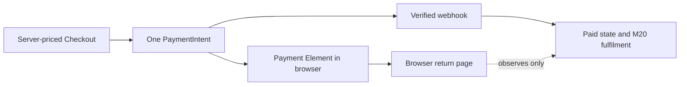

# Test mode and Payment Intents

Amina has a pending Midad Checkout with a font license from Nour's Studio and a template license from Salma's Studio. M18 already froze the selected license options, accepted terms versions, seat limits, download limits and integer minor-unit prices on one Checkout and two Studio Orders. M19 collects one payment for that aggregate Checkout. A browser may display a success state before the server receives durable proof of payment, so the private files and license grants must remain unavailable until a verified provider event is processed in M20.

Stripe's current documentation recommends Checkout Sessions with the Payment Element for many ordinary integrations. This course's approved roadmap uses Payment Intents because the learner already owns a server-priced, multi-Studio Checkout and needs to control its exact lifecycle and later per-line licence fulfilment. The choice means the learner must implement amount, currency, retry, webhook and state reconciliation correctly. Record the reason in the architecture note; do not blend Checkout Session and PaymentIntent client-secret APIs in one page.

## Keep keys and modes clear

Use Stripe test mode or an isolated sandbox. A publishable key may be sent to the browser; the secret API key and webhook signing secret stay on the server in environment variables. Test and live objects are separate. A test PaymentIntent cannot pay a live Checkout, and a live secret must never appear in a course screenshot, commit or client bundle. The local webhook signing secret from a CLI listener can differ from a deployed endpoint's secret, so configure the correct one for each environment rather than copying a value into code.

A test card can simulate success or decline without moving real money. Use the official Stripe test-card table for the current values and expected outcomes instead of memorizing an old number. Do not ask learners to enter a real card on a course deployment. The observable outcome of a success test is not merely that the Payment Element closes; it is that the server records a verified event, matches it to the stored Checkout and makes the next module's fulfilment function eligible to run. A decline keeps the Checkout unpaid and produces no license.

## One PaymentIntent for the basket

The buyer's one Checkout total covers the font and template, even though M18 created one pending Order per Studio. Store one PaymentIntent ID on the Checkout and associate it with both Studio Orders through the Checkout ID. The provider amount and currency come from that frozen server record. The browser can send a Checkout ID and request identity, but it cannot supply the amount, Studio IDs, license options or terms versions for payment creation. If the current product price changes after M18, the already accepted Checkout amount stays fixed for that attempt; a new attempt needs a new offer confirmation.

The PaymentIntent tracks a payment attempt through states that can include additional authentication or failure. Do not equate intent creation with money received. Do not mark Orders paid from a `client_secret` response, a `confirmPayment` promise, a return URL or a query parameter. The browser is a presentation surface and can be closed or forged. The server's webhook handler verifies the event and reconciles the PaymentIntent ID, amount, currency and Checkout before M20 grants access.

## Split the decision across three owners

Every payment system has to decide who is allowed to say that money arrived, and Midad answers that question in three places over the next two modules. The browser is allowed to say only that it finished a payment flow, because a client secret is all it ever holds. The server is allowed to say only what the Checkout agreed to, because the frozen record is the one place where the amount, the currency and both Studio lines were ever consistent with each other. The provider is the only party that can say money moved, and it says so in a signed event delivered to a route that nothing else can reach. None of those three statements is a receipt by itself: the browser statement cannot be verified, the server statement is an intention rather than a fact, and the provider statement stays unbound to any Checkout until the handler matches it against stored records.

Read the lifecycle as a sequence of reversible and irreversible steps instead of as a status ladder. Creating a PaymentIntent is reversible, because an intent that is never confirmed simply expires. Confirming in the Payment Element is still reversible, because a declined attempt can be retried on the same intent. Marking the Checkout paid is irreversible in practice, because Licenses, download grants and creator earnings all hang off it, so it has to happen exactly once and only behind a verified event. Sorting each step into reversible or irreversible tells you where to spend your care. The route in this module can be retried freely, while the decision in 19.2 and the grants in Module 20 need unique records and matching in both directions.

## Observe an asynchronous timeline

At 10:00 Amina confirms the server-priced Checkout. At 10:01 the server creates or retrieves its PaymentIntent and returns the client secret. At 10:02 the browser confirms through the Payment Element and redirects to a return page. The webhook might arrive before that redirect, after it, or more than once. The return page should query an authenticated Checkout status endpoint and say `processing` or `preparing your files` until the verified event and M20 fulfilment complete. It should not run a privileged `markPaid` route to make the page look immediate.

A failure timeline is equally important. Amina's card is declined. The Payment Element shows a provider error, and the Checkout remains `pending_payment` or an explicit retryable failure state. No Studio Order becomes paid and no License or DownloadGrant appears. A different test card may be tried on the same appropriate payment attempt, subject to the provider lifecycle; do not create a new Checkout and new PaymentIntent on every UI click without checking the existing state. Otherwise the buyer can receive confusing duplicate attempts.

## Decide what the learner can inspect

On a successful test, inspect Checkout ID, PaymentIntent ID, amount and currency on the server. Inspect the two Studio Orders and verify both still point to the same Checkout. Inspect the webhook event log and its verified type. Then inspect M20's grant count only after fulfilment runs. On a decline, check that the same stored Checkout is unpaid and grant count is zero. This sequence helps distinguish a Payment Element UI problem, a provider event delivery problem and a fulfilment problem.

Do not print the full client secret or secret API key in test logs. A client secret is intended for the buyer's payment session, but it is still sensitive and should not be copied into public issue text. Log stable IDs and status transitions. An operations note can explain how to find the PaymentIntent in the Stripe test dashboard by ID when a Checkout appears stuck.

## Connect the terms snapshot to the payment amount

M18 froze each line's license option, seat and download limits, terms version and price. Sum the line amounts across the two Studio Orders and compare to the Checkout total before creating the PaymentIntent. If the sums differ, stop and investigate; do not choose the largest or latest value. A browser's displayed total can be stale, but the frozen Checkout is the authority for this attempt. The same amount and currency must be checked again when the verified provider event arrives, because metadata alone is not proof that the expected money was paid.

Nour can raise a font price after Amina starts checkout. That changes future offers, not this pending Checkout's agreed line. Salma can withdraw a template before payment; the product needs a policy for honoring or canceling a pending offer, but it must not silently replace the OrderLine with a new item. The payment route should refuse an expired or canceled Checkout rather than charging for an invalid attempt. This module keeps the terms stable and makes the state decision explicit; later modules decide the delivery and refund paths.

## Practice the trust boundary

Write three statements in the learning log: the browser may request payment for a Checkout it owns; the server chooses amount and currency from its frozen record; the verified webhook is the only signal this course uses to authorize fulfilment. Then identify two tempting shortcuts and why they fail. One is setting `paid` after the browser promise resolves. Another is trusting `metadata.checkoutId` without checking that the provider PaymentIntent ID, amount and currency match the stored Checkout. The next chapter traces webhook delivery and shows why a valid signature is necessary but replay-safe effects are also necessary.

<TraceRequest title="One digital basket, two Studio Orders">
  <TraceStep actor="Amina" label="Confirm font and template" detail="M18 Checkout freezes both Studio lines" />
  <TraceStep actor="Server" label="Create one PaymentIntent" detail="Amount and currency come from the Checkout" />
  <TraceStep actor="Browser" label="Return from payment" detail="Shows processing; does not grant files" />
  <TraceStep actor="Webhook" label="Verify success" detail="M20 can then create grants" />
</TraceRequest>
