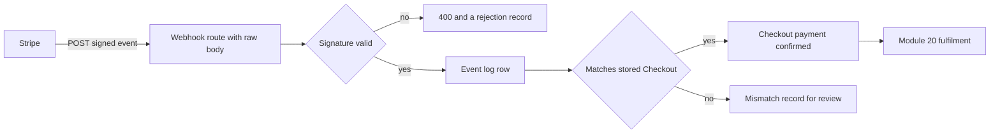

# Webhooks and verified events

Amina confirms her card at 10:02. Her browser lands on a Midad return page that says the payment was accepted. At almost the same moment Stripe sends a `payment_intent.succeeded` event to the API. That event may arrive before the redirect, after it, or twice. Both signals describe one payment, but only one of them is something the server can act on. The redirect comes from the buyer's browser. The event comes from Stripe and is signed with a secret that only Stripe and the Midad API hold.

The rest of Module 19 exists to serve one rule. Nothing in Midad becomes paid because a page loaded. A Checkout moves forward when a verified event has been matched against the stored Checkout. This chapter is about the words verified and matched, and about what the handler does when deliveries arrive twice, late, or in an unexpected order.



## A redirect is a report, not a receipt

The return page is honest but powerless. It is honest because `confirmPayment` really did resolve in the browser and the Payment Element really did close. It is powerless because the browser is not a witness the server can question. Amina can close the tab the instant the card is authorised and never load the return URL at all. She can also paste a return URL into a fresh tab hours later, with whatever query string she likes. A page cannot tell Midad that money moved, and it cannot tell Midad how much moved.

There is a second reason to keep the browser out of the decision. The redirect and the event race. On a fast connection the redirect often wins, and Midad would then have to show a paid Checkout before Stripe has confirmed anything. On a weak connection the redirect may lose by several seconds, and a design that waits for it would make a correctly paid order look broken. Tying access to whichever signal arrives first makes the system's behaviour depend on network timing instead of on facts.

So the return page gets one job: it reads. It calls an authenticated status endpoint, sees `pending_payment`, `paid` or `preparing your files`, and displays the honest state. It links to the library only after Module 20 has created licenses. It never calls a route that marks anything paid, and it never creates a download link. If someone opens the return URL without having paid, they see an unpaid Checkout and the option to start again, which is exactly what should happen.

That page is also where a decline is explained. Stripe reports the failure on the Payment Element and in the intent's state. Amina sees a readable message, keeps her pending Checkout, and can try another card. No Studio Order changes to paid and no License appears, because no verified success event will ever exist for that attempt.

## What a signature proves

Stripe signs each delivery with an HMAC-SHA256 digest over a timestamp and the request body, using the signing secret for that endpoint. The library exposes `stripe.webhooks.constructEvent(rawBody, signatureHeader, secret)`, which recomputes the digest and returns the parsed event only when the values agree. A successful check proves three things and only three. Someone holding the endpoint secret signed this body. The body was not altered after it was signed. The timestamp is recent enough that the usual replay window has not closed.

The signature says nothing about whether the Checkout exists, whether the amount is right, or whether this delivery is the first copy. A valid signature on a stale event is still a valid signature. A valid signature on an event whose amount disagrees with the frozen Checkout is still a valid signature. Treating the signature as the whole decision is the mistake that lets a duplicate delivery create a second license, and it is the mistake this chapter is written to prevent.

| Signal | What it establishes | What the handler does with it |
|---|---|---|
| Valid signature | Stripe sent this body, unaltered | Continue to matching |
| Matching amount and currency | The charge agrees with the frozen Checkout | Confirm the payment |
| Unseen event id | This delivery is new to the log | Record it, then guard the effect separately |
| Browser redirect | A page loaded | Display state only |

Read the table from the bottom up when you debug. The two weakest rows are the ones a beginner trusts first, and the two strongest rows are the ones that require the most work to build.

## The body must be the bytes Stripe signed

`express.json()` parses JSON and hands the handler a JavaScript object. It does not keep the original bytes. If the handler signs `JSON.stringify(req.body)`, it signs a new string with its own key order, spacing and unicode escaping, and the digest will not match the one Stripe computed. The error message says the signature is invalid, which sends most people looking for a wrong secret instead of an altered body.

The fix is local, not global. Mount `express.raw({ type: 'application/json' })` on the webhook path only, before the JSON parser, and let every other route keep the parsed body.

```js
// server/src/app.js (partial, payment module only)
const express = require('express');
const webhookRouter = require('./modules/payments/webhook.route');

// The webhook needs the exact bytes Stripe sent, so this mount comes first.
// express.raw leaves a Buffer on req.body and does not parse it.
app.use(
  '/api/payments/webhook',
  express.raw({ type: 'application/json' }),
  webhookRouter
);

// Every other route keeps the normal parsed body.
app.use(express.json());
```

Order matters more than anything else in that file. If a global `express.json()` runs first, the Buffer is consumed, `constructEvent` receives an object or a string that is not the original, and every signature check fails for the same unhelpful reason. Put a comment above the mounts so a later refactor does not move them.

The raw body rule is also the reason not to add a body size or logging middleware to this path. A payload logger that reads the stream and then forwards a re-serialised copy breaks verification in a way that is hard to see, because the request still looks normal in the access log.

## Retries are the design assumption

Stripe retries any delivery that does not receive a 2xx response. Retries use backoff and continue for a period measured in days; check the current webhook documentation for the exact schedule attached to your account and API version rather than memorising a number. Two consequences follow. A handler that returns an error because an email failed will be called again, and every database write it already completed will run a second time. A handler that returns 200 while dropping a real failure will never be called again, and a paid buyer waits indefinitely.

The shape that survives both cases is short: verify, record, decide, answer. Do the small durable writes first, return 200, and put anything slow behind a queue in Module 23. This chapter records the event and confirms the payment. Module 20 turns a confirmed payment into licenses, and its work is idempotent per OrderLine, so a repeated delivery costs one cheap read and creates no new grant.

The steps below are worth walking through once by hand, because the same four words appear in every webhook handler you will read later, and the order is the part that is easy to get wrong. Start at the provider, end at a log row that says what the server actually did, and notice that nothing in the sequence trusts a page.

<TraceRequest title="One delivery from Stripe to a stored decision">
  <TraceStep actor="Stripe" label="Send payment_intent.succeeded" detail="Signed POST to the public webhook path" />
  <TraceStep actor="Route" label="Verify on the raw body" detail="Signature check runs before any parse of the payload" />
  <TraceStep actor="Handler" label="Decide against the Checkout" detail="Locator, amount, currency and both directions checked" />
  <TraceStep actor="Database" label="Record the outcome" detail="Event log row keeps eventId, decision and delivery count" />
</TraceRequest>

Speed matters for a practical reason. Stripe gives the endpoint a limited time to answer, and a handler that waits on an email provider, a file copy or a slow third party will time out and be retried while its first attempt is still running. Two concurrent attempts then race, which is a harder problem than a duplicate that arrives a minute later.

## Duplicate deliveries and out of order events

The same event id can arrive twice, and the same payment can be described by several events in either order. A `payment_intent.processing` event can reach the endpoint after `payment_intent.succeeded`. A refund event can arrive before the original success if deliveries are delayed and retried across a long window. Arrival time is not information. The event body and Midad's stored records are.

Two guards are needed and they have different jobs. A unique index on `eventId` in the webhook log makes a second copy visible, cheap to detect, and countable: the handler adds one to a delivery counter on the existing row instead of inserting a twin. A unique index on the effect, which in Module 20 is the OrderLine to License mapping, makes a second copy harmless even when it carries a different event id. That happens when Stripe sends a fresh event about the same payment after an API version change or a manual dashboard action. The log answers "did we see this before". The effect guard answers "is the work done". Students who rely on only the first guard ship a system that fails the second case.

The order of writes inside the handler matters as much as the order of deliveries. If the handler writes a row saying the event is processed and then dies before the work is done, the retry will see processed and skip the work, and Amina's template line never gets a license. Record the event, attempt the effect, then record the outcome. The log becomes a description of what happened rather than a claim about what was intended.

A practical timeline makes the abstract rule concrete. Delivery one arrives at 10:02:14, the handler records it and starts the confirmation write, and the process is restarted at 10:02:15. Delivery two arrives at 10:03:40 with the same event id. The handler finds the log row, sees that the confirmation is absent, and finishes it. Delivery three arrives at 10:04:02 with a new event id for the same intent. The log has no row for it, the effect guard finds the confirmation already present, and the handler answers 200 without writing anything else. That sequence is the acceptance test for this chapter.

## Locate with metadata, verify with the database

`metadata.checkoutId` is how the handler finds the right Checkout. It is a locator, not proof. In Module 19.3 the route stores the PaymentIntent id on the Checkout, so verification runs in both directions: the metadata points at a Checkout, and that Checkout points back at this PaymentIntent. If either direction fails, the event does not belong to a Midad attempt and must not be accepted.

The amount check comes next. Compare the event's `amount_received` and currency against `checkout.totalMinor` and `checkout.currency`, both of which were frozen in Module 18 from the accepted OrderLine snapshots. Integer minor units, one currency, no rounding. If the numbers disagree, stop. Do not take the larger value, do not trust the metadata over the stored row, and do not adjust an OrderLine to make the event fit. The event is real money and the row is the agreement, so a disagreement is an investigation, not a correction.

```js
// server/src/modules/payments/decide-event.js (partial, imports omitted)
// The caller has already verified the signature and will write the log row.
// This function only decides, so it can be tested without Stripe.
async function decideEvent(event, checkout) {
  // Returns one of:
  //   { outcome: 'accepted' }
  //   { outcome: 'ignored', reason: 'unhandled_type' | 'unknown_checkout' }
  //   { outcome: 'mismatch', field: 'amount' | 'currency' | 'paymentIntent' }
}
```

Keep that function free of database writes. A pure decision function can be tested against a fabricated event and a fabricated Checkout in milliseconds, and the tests become the place where the failure cases are written down.

## The event log you will read at 03:00

The log is not a nice-to-have. It is the answer to the support question that arrives when a buyer has paid and sees no files. Without it, the only evidence is a dashboard and a guess. With it, the sequence is mechanical: was there a delivery, did the signature pass, which Checkout did it resolve, what decision was recorded, and did Module 20 write any licenses for that Checkout.

```js
// server/src/modules/payments/event.model.js (partial schema)
const webhookEventSchema = new mongoose.Schema(
  {
    eventId: { type: String, required: true }, // evt_... as sent
    type: { type: String, required: true }, // payment_intent.succeeded
    paymentIntentId: { type: String, default: null },
    checkoutId: { type: ObjectId, default: null, ref: 'Checkout' },
    signatureValid: { type: Boolean, required: true },
    decision: { type: String, required: true }, // accepted, ignored, mismatch
    reason: { type: String, default: null },
    deliveryCount: { type: Number, default: 1 }, // same event id, sent again
    receivedAt: { type: Date, default: Date.now },
  },
  { versionKey: false }
);

webhookEventSchema.index({ eventId: 1 }, { unique: true });
webhookEventSchema.index({ checkoutId: 1, receivedAt: -1 });
```

A failed signature check goes to a separate `WebhookRejection` collection, with the reason, a hash of the body and the time, and never the body itself. It cannot share this schema, because an unverified request has no parsed event id or type, and inventing one would put untrusted text into the field the log matches on. The body of an unverified request is attacker-controlled input, and storing it as though it were a provider event is how a rejected request becomes someone's evidence later. Keep the payload out, keep the size bounded, and keep the fact that the request happened.

Read the two indexes as the two questions the log must answer quickly. The unique `eventId` answers "have we seen this exact delivery". The compound `checkoutId` and `receivedAt` answers "show me the whole story for Amina's Checkout in order". A third index on `decision` is unnecessary at this scale and only slows inserts.

## Checkpoint

You now have enough to answer the question that decides how the next two builds are written. If an event is authentic, matches the stored Checkout and describes money that was really collected, then it is allowed to move the Checkout. If any of those three conditions fails, the handler records what it saw and changes nothing about access.

```quiz
type: mcq
id: digital-goods-19-02-q1
question: A correctly signed payment_intent.succeeded event arrives for a known Checkout, but the event reports 1,500 minor units while the stored Checkout total is 1,200. What should the handler do?
options:
  - Mark the payment confirmed and rewrite the OrderLine to 1,500
  - Retry the delivery until the two amounts agree
  - Record a mismatch and refuse to confirm the payment
  - Accept it, because the signature was already valid
correct: 2
explanations:
  - The stored line is the accepted agreement, so changing it to match the charge invents a sale Amina never approved.
  - A retry sends the same numbers, so the disagreement never resolves and the log fills with the same failure.
  - The signature proves the sender, not the amount, so a disagreement stops confirmation and goes to review.
  - A valid signature proves the body is authentic, and authenticity does not make the money match the Checkout.
```

The next chapter builds the route that creates the PaymentIntent. Its amount comes from the same frozen Checkout this handler will compare against, which is why the two chapters share one number and not two.
