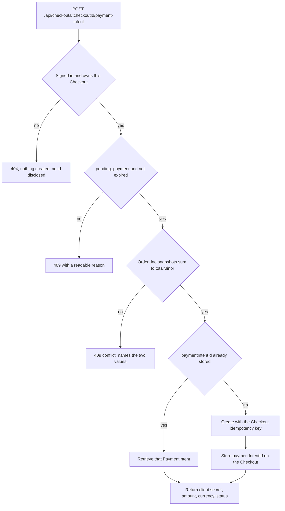

# Price and create the PaymentIntent

Amina has a pending Midad Checkout for 3,000 minor units: Nour's font under the personal license at 1,200 and Salma's template under the commercial license at 1,800. Her browser now needs something it can hand to the Payment Element. The route that answers this request decides two things that must never be decided twice: how much money to ask for, and which single payment attempt belongs to this Checkout.

The temptation is to accept a total from the client, because the client already displays one. A shopping cart page has a number on it, and sending that number to the server feels symmetrical with the rest of the interface. It is a trap. Anyone can edit a request body, and a browser tab can be stale for hours. The amount comes from the frozen Checkout that Module 18 committed, and the browser's only job is to say which Checkout it is paying for.

## The route and what it is allowed to read

The route is `POST /api/checkouts/:checkoutId/payment-intent`, mounted after `requireAuth`. The buyer identity comes from the session. The path carries the Checkout id. The body is empty in the design this course uses, and anything in it that looks like a price, a currency, a Studio or a terms version is refused rather than ignored.

```js
// server/src/modules/payments/payment.route.js (partial, imports omitted)
// buyerId comes from the session. The path carries the only id the client may choose.
router.post('/checkouts/:checkoutId/payment-intent', requireAuth, createPaymentIntent);
```

The handler then works through five checks in order, and stops at the first failure.

1. Load the Checkout by id and `buyerId`. A Checkout that belongs to another buyer returns 404, not 403, so the route does not confirm that an id exists.
2. Require status `pending_payment` and an `expiresAt` in the future. An expired or cancelled Checkout cannot be paid.
3. Recompute the frozen sum: add the OrderLine amounts across both Studio Orders and compare with `checkout.totalMinor`. Both must be integer minor units in one currency, and every line must still carry its snapshot from Module 18.
4. If `checkout.paymentIntentId` is already set, retrieve that PaymentIntent instead of creating one.
5. Otherwise create one PaymentIntent, store its id on the Checkout, and return its client secret.

The order is the design, so read it as a sequence of cheap refusals rather than as a checklist. Every check before the create call costs one database read and protects the expensive, side-effecting step at the end.



The takeaway is that only two of those branches ever talk to Stripe, and both of them run after ownership, state and the frozen sum have already agreed.

Step three is the one that keeps the promise from Module 18. Amina's browser may show 3,000 from an old tab while Nour has raised her price since. The server does not care what the tab says. It reads the two OrderLine snapshots, adds 1,200 and 1,800, and compares the result with the Checkout total that was committed when Amina confirmed. If those two numbers disagree, something has already gone wrong inside Midad, and the route refuses to charge anything.

## Refuse a client supplied total on purpose

There are two ways to handle a request body that contains `amountMinor`. You can ignore it and use the server value, or you can reject it. This course rejects it with a 400 and a named error, because a client that believes it is sending the price is a bug that should be visible during development rather than silently corrected in production.

```js
// server/test/payments/intent.test.js (partial, one case from a failing suite)
it('refuses a client supplied total and keeps the frozen amount', async () => {
  const res = await request(app)
    .post(`/api/checkouts/${checkout._id}/payment-intent`)
    .set('Cookie', aminaSession)
    .send({ amountMinor: 1, currency: 'usd' });

  assert.equal(res.status, 400);
  assert.equal(res.body.error, 'client_supplied_amount');

  const stored = await Checkout.findById(checkout._id);
  assert.equal(stored.totalMinor, 3000);
  assert.equal(stored.paymentIntentId, null);
});
```

Write this test before the route. It fails with a 404 first, then with a 201 and a PaymentIntent of one unit, and only then passes. The sequence is worth watching, because the middle failure is the one that ships when nobody writes the test: a valid charge for the wrong amount is much harder to notice than an error.

The same refusal covers `currency`, `studioId`, `licenseType` and `termsVersion`. A buyer who sends a currency other than the Checkout's frozen currency is either confused or probing, and either way the answer is the same. Midad holds one currency for the core path, and mixed-currency carts are rejected in Module 18.

## One PaymentIntent per Checkout

A Checkout can be opened on two devices, refreshed, or submitted twice by a double click. Each of those sends a POST to this route, and all of them describe one payment attempt. The unique link between them is the idempotency key sent to Stripe, and the local guard is the `paymentIntentId` field on the Checkout.

```js
// server/src/modules/payments/idempotency.js (partial)
// One key per Checkout. A retry of the same Checkout reuses this exact string.
function keyForCheckout(checkoutId) {
  return `midad:checkout:${checkoutId}:intent`;
}
```

Stripe stores an idempotency key with the parameters of the first request. A replay with the same key and the same parameters returns the original response instead of creating a new object. A replay with the same key and different parameters returns an error. That behaviour is exactly what Midad wants: the frozen total cannot quietly change between two attempts, because a different amount under the same key is refused by Stripe itself.

Two guards, again with different jobs. The local `paymentIntentId` check saves a network call and works when the Checkout already has an intent. The idempotency key covers the ambiguous case where the request reached Stripe and the response was lost on the way back.

That ambiguous case is common on a weak connection, so plan for it. The provider call times out. Midad does not know whether an intent exists. The correct next action is not to create a fresh attempt with a new key: it is to retry the same key. Stripe answers with the intent it created the first time, and the Checkout stores that id. If a retry with the same key is impossible for some reason, search Stripe by `metadata.checkoutId` before creating anything new, and treat two intents for one Checkout as an incident rather than a normal path.

```js
// server/src/modules/payments/create-intent.js (partial, error handling abbreviated)
// The route passes the Checkout it has already checked, not an id from the request.
async function createPaymentIntent(checkout) {
  const intent = await stripe.paymentIntents.create(
    {
      amount: checkout.totalMinor, // frozen in Module 18, never from the request
      currency: checkout.currency,
      metadata: { checkoutId: String(checkout._id), buyerId: String(checkout.buyerId) },
      automatic_payment_methods: { enabled: true },
    },
    { idempotencyKey: keyForCheckout(checkout._id) }
  );
  return intent;
}
```

Note what the metadata is for. `metadata.checkoutId` lets the webhook find the Checkout without trusting anything else in the event. It is a locator, and Module 19.2 already established that the handler checks the link in both directions before accepting the event. `metadata.buyerId` helps during an incident, when someone needs to answer a support question quickly. Neither field is allowed to carry a price, because metadata is echoed back unchanged and is easy to confuse with truth.

## Store the intent, not the secret

The route returns the client secret so the Payment Element can load, and it stores only the PaymentIntent id on the Checkout. A client secret is designed to be held by the buyer's browser for one payment session, but it is still a credential. It does not belong in a database field that gets logged, serialised into an admin response or copied into an issue thread. If the code needs a secret again, it retrieves the PaymentIntent and reads the fresh value.

The response should tell the client what it is paying for, in the terms a buyer can check.

```js
// Response body of POST /api/checkouts/:checkoutId/payment-intent (success)
{
  "checkoutId": "66f1c0a41b9e4a0b7c8d2e10",
  "paymentIntentId": "pi_3Q2example",
  "clientSecret": "pi_3Q2example_secret_...",
  "amountMinor": 3000,
  "currency": "usd",
  "status": "requires_payment_method"
}
```

Nothing else belongs in that object. No license keys, no Studio Order totals for another Studio, no private file ids, no signed download links. Amina has not paid yet, and even after she pays, files arrive through the library in Module 21 rather than through a payment response.

## The states this route can be in

Creating a PaymentIntent is not a payment. The intent starts at `requires_payment_method` and moves through `requires_confirmation`, possibly `requires_action` for a step-up check, then `processing`, then `succeeded` or back to a retryable failure. The route's job ends once the client has a secret; the rest of the lifecycle belongs to the browser's confirmation and to the webhook.

That separation explains why the route has no decline branch. A decline happens at confirmation, in the browser, and it leaves the intent payable with another card. Amina can retry on the same intent without creating a second Checkout, a second set of Studio Orders or a second charge attempt. If the client reloads the checkout page, the route returns the existing intent and the Payment Element starts again from the same payment attempt.

A declined attempt that is never completed should not hold the Checkout open forever. Module 18 gave the Checkout an `expiresAt`, and the expiry path is the same whether the buyer walked away before paying or after a decline. Do not extend an expiry because a card failed: extending it changes what the buyer can still pay for, and Module 18 already decided how long the frozen offer stays valid.

## Build order and verification

Build the route in this order and verify each step before adding the next: ownership and state checks, then the total reconciliation, then the create call with its idempotency key, then the response shape. Each of those is a small, testable unit, and failures are easier to read when only one new thing has been added.

Four tests cover the route well.

- A request from a buyer who does not own the Checkout returns 404 and creates no intent.
- An expired Checkout returns 409 with a reason, and the frozen totals are untouched.
- A body containing `amountMinor` returns 400 and leaves `paymentIntentId` null.
- Two calls with the same Checkout return the same PaymentIntent id and the same amount, and Stripe shows one object.

Add a fifth for the internal reconciliation: modify a copy of one OrderLine amount in a disposable database so it no longer sums to the Checkout total, then call the route. It must return a conflict, create nothing, and write a record showing which two values disagreed. That record is what a mentor will ask for when they read the gate.

You can run the first four without a browser. Use curl with the buyer's session cookie, then check the Stripe test dashboard for the created intent and the amount. The amount in the dashboard must read 3,000, and the metadata must show the Checkout id. If the dashboard shows a different number, the route is reading something other than the frozen record, and the webhook in the next chapter will rightly refuse the event.

## Bridge to the webhook

The PaymentIntent id created here is the same id the next chapter looks for in an incoming event. The amount stored on the Checkout is the same number the webhook compares against `amount_received`. That is the point of doing pricing and intent creation in one chapter: the two sides of verification must be built from one source, or the comparison becomes a coin toss.

The next chapter mounts the public webhook route, verifies the signature on the raw body, and writes the event log that this route's tests will eventually depend on.
