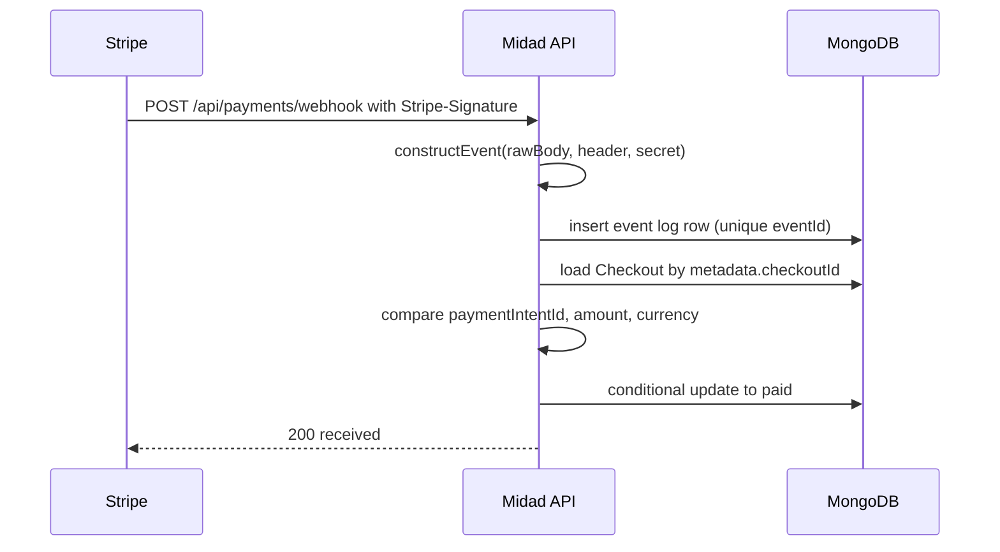

# Verify and record the event

Most routes Midad has built ask who the caller is, and the public catalogue ones read data that needs no permission. This route cannot ask. Stripe will not carry Amina's session cookie, and it will not read a login form. The webhook route is public, accepts POST, and must assume that anyone on the internet can call it, including a scanner that found the path and a script that sends random JSON. Its authentication is the signature on the body, and its authority is limited to what a matched event can prove.

That makes this route the most sensitive one in the course. A mistake here either blocks a buyer who paid or grants a file to someone who did not. The design in this chapter is deliberately narrow. Verify, record, match, confirm, answer. Nothing else happens on this path.



## Mount a route that has no session

The route lives at `POST /api/payments/webhook`. It is registered with the raw body parser before the JSON parser, as Module 19.2 described, and it is not wrapped in `requireAuth`. Putting session middleware in front of it would reject every genuine delivery with a 401, and Stripe would retry a request that can never succeed.

```js
// server/src/modules/payments/webhook.route.js (partial, imports omitted)
// Public route. Authentication is the Stripe signature checked inside the handler.
router.post('/webhook', handleWebhook);
```

Two operational details matter here. First, keep the body limit small. A webhook payload is a few kilobytes, and a large limit invites memory pressure from unauthenticated callers. Second, exclude this path from any per-user rate limiter, because there is no user, and from a strict per-IP limiter, because Stripe's retries come from a small set of addresses and would exhaust the budget during an incident. A generous limit on this path is fine; a tight one turns a busy hour into an outage.

Do not add a CSRF token, a custom shared header or an IP allowlist as the primary control. A custom header is a second secret to rotate and does not replace the signature. An IP allowlist breaks the moment the provider's egress changes and is hard to verify from a laptop in Gaza. Verify the signature, and treat every other control as optional hardening.

## Verify before you read

The handler's first statement is the verification. Nothing from `req.body` is parsed, logged, trusted or passed to a database query until `constructEvent` has returned an event. This ordering is the whole security story of the route, and it is easy to break later when someone adds an early `JSON.parse(req.body)` to read a header-like field.

```js
// server/src/modules/payments/webhook.handler.js (partial, imports and helpers omitted)
async function handleWebhook(req, res) {
  const signature = req.get('stripe-signature');
  let event;

  try {
    // req.body is a Buffer here because express.raw ran on this path.
    event = stripe.webhooks.constructEvent(
      req.body,
      signature,
      process.env.STRIPE_WEBHOOK_SECRET
    );
  } catch (err) {
    await recordRejectedDelivery({ reason: err.message, bodyHash: sha256(req.body) });
    return res.status(400).json({ error: 'invalid_signature' });
  }

  // Only now may the event fields be read.
  const checkout = await checkoutForEvent(event); // both directions, then amount and currency
  const decision = await decideEvent(event, checkout);
  await recordDelivery({ event, checkout, decision });
  return res.status(200).json({ received: true, decision: decision.outcome });
}
```

The rejection record stores a reason and a hash of the body in the separate rejection collection, never the body itself. An unverified request is untrusted input, and a stored copy of it becomes tomorrow's evidence that the provider sent something it never sent. The hash is enough to prove two rejected requests were identical, which is usually the only question anyone asks about them.

A missing signature header is not an exception to catch and swallow. Treat it as a rejection with its own reason, so a monitoring query can distinguish a misconfigured client from a forged body.

## Decide one event at a time

A switch on `event.type` keeps the intent visible. In Module 19 there are three meaningful branches and one default.

`payment_intent.succeeded` is the branch that can confirm a Checkout. It runs the matching checks and the conditional state write described below.

`payment_intent.payment_failed` is recorded and nothing more. A failed attempt does not cancel the Checkout, because Amina can retry with another card on the same intent, and Module 18 already set an expiry that closes an abandoned attempt. Recording the failure is useful: the support story for a buyer who says the payment did not work starts with the count of failures on that intent.

`charge.refunded` belongs to Module 26. Record it as ignored with an explicit reason so the log does not look like a delivery that failed, and so a later module can add a branch without wondering whether the events ever arrived.

The default branch records `ignored: unhandled_type` and returns 200. Every other event type Stripe sends to this endpoint is noise for now, and answering with an error would ask Stripe to redeliver the noise for days. Logging it with a clear reason costs one small row and answers the question "did the endpoint receive anything unusual this week".

## Match against the stored Checkout

`metadata.checkoutId` from the event locates a candidate, and the Checkout that comes back must agree with the event on three values. The stored `paymentIntentId` must equal the event object's id. The event's `amount_received` must equal `checkout.totalMinor`. The event's currency must equal `checkout.currency`. All comparisons use integer minor units and exact string equality, and there is no tolerance.

The buyer identity is not part of the match because it is not in the event. The Checkout already recorded which buyer owns the attempt, and the intent was created from that row. Trusting `metadata.buyerId` over `checkout.buyerId` would let a metadata edit move a payment to another account, which is a strange attack but a cheap one to close: read the buyer from the Checkout, never from the event.

A mismatch writes a stored record with the two values that disagree and a decision of `mismatch`. It does not write a confirmation, a license or an Order change. Do not repair the difference by writing the event's amount onto the OrderLine, and do not pick the larger of the two. The event describes money that really moved, and the Checkout describes what was agreed. A gap between them is an incident with a support question attached, not a rounding problem.

## Confirm with one conditional write

The confirmation is a single conditional update. The condition repeats the state the handler expects, so a late or parallel write cannot overwrite a decision made by someone else.

```js
// server/src/modules/payments/confirm-checkout.js (partial)
const result = await Checkout.updateOne(
  {
    _id: checkout._id,
    paymentIntentId: intentId,
    status: 'pending_payment',
  },
  {
    $set: {
      status: 'paid',
      paidAt: new Date(),
      paidEventId: event.id,
    },
  }
);
// result.matchedCount === 0 means another writer got there first, or the
// Checkout was cancelled or expired between the read and this update.
```

When `matchedCount` is zero, read the Checkout again before deciding what happened. If it is already `paid` with the same intent, this delivery is a duplicate confirmation and the handler returns 200 without a write. If it is `expired` or `cancelled`, the payment succeeded after Midad closed the attempt. That case needs its own record, `paid_after_expiry`, and a review path in Module 20, because a buyer who is charged for an expired offer must either receive the goods under the frozen terms or receive a refund. Silently flipping an expired row to paid would hide a decision that a human should make.

This module stops at confirmation. It does not create licenses, OrderLine grants or download links. Module 20 reads the confirmed Checkout and does that work once per line, guarded by a unique index. Keeping the two steps separate is what lets this chapter be tested without fulfilment being finished, and it is why the gate can ask for a payment event without asking for a library.

## Answer with the right status

The response code is a message to Stripe about whether to send the delivery again, so it must reflect whether another attempt could change the outcome.

| Situation | Status | Log decision | Why |
|---|---|---|---|
| Signature rejected | 400 | rejection record | A retry sends the same invalid body |
| Event recorded, Checkout confirmed | 200 | accepted | Work is done |
| Duplicate event id | 200 | existing row, counter incremented | The first delivery already succeeded |
| Amount or currency mismatch | 200 | mismatch | A retry cannot change arithmetic |
| Unknown Checkout or unhandled type | 200 | ignored | Nothing will change on a retry |
| Database unavailable during the write | 500 | none written | A retry can succeed |

The mismatch row deserves a comment because it surprises people. Returning 500 feels more honest: something is wrong. But a 500 asks Stripe to redeliver for days, and every one of those deliveries will reach the same permanent disagreement. The right place for the alarm is the stored record and whatever alerting reads it, not the provider's retry queue.

## Test it with the Stripe CLI before the browser

The CLI is how you exercise this route on a laptop without a public URL. Run the listener, copy the signing secret it prints into `STRIPE_WEBHOOK_SECRET`, and keep it separate from the dashboard endpoint's secret. The two values are different, and the local one changes when you restart the listener, which is the usual cause of a string of sudden signature failures.

```bash
# Terminal 1: forward provider deliveries to the local API and print a local secret
stripe listen --forward-to localhost:4000/api/payments/webhook

# Terminal 2: create a synthetic success event
stripe trigger payment_intent.succeeded
```

The triggered event is not a Midad payment. It has no `metadata.checkoutId` that matches a row, so the handler records it as `unknown_checkout` and returns 200. That is the correct outcome and it is worth keeping in the evidence: it shows the matching rule refuses an otherwise perfectly signed event.

For a real delivery, open Amina's checkout page in the browser, pay with a test card, and watch terminal one. The forwarded event should appear within a couple of seconds, and the event log should show an `accepted` row with her Checkout id. Compare the `amount_received` in the log with `checkout.totalMinor` by eye once, then rely on the assertion in the test suite.

## The failure tests this chapter owes

Five tests belong in `server/test/payments/webhook.test.js`, and each one maps to a decision the handler makes.

The first sends a body with a forged signature and asserts a 400 and no event row with an accepted decision. Build the body by taking a valid payload and changing one character after signing, which is closer to a real forgery than sending random text.

The second delivers the same event twice and asserts one accepted row, no second row, a delivery counter of two and a single confirmation timestamp. The duplicate arrives as a duplicate-key error on insert; the handler catches it, reads the winning row, increments the counter and returns 200. This test is the reason the unique index on `eventId` exists, and it fails loudly if someone removes the index to make a local migration pass.

The third changes the event's `amount_received` to 1,500 while the Checkout total is 3,000, and asserts a `mismatch` decision with no status change. The fourth omits `metadata.checkoutId` and asserts `ignored: unknown_checkout`. The fifth sends a success event whose Checkout was cancelled in the fixture and asserts a `paid_after_expiry` record with the status left alone.

A sixth test is worth writing even though it is not about failure. Deliver a success event, then confirm the Checkout row has a `paidEventId` equal to the event id, so a support person can connect a database row to a delivery in the provider dashboard. That link is what makes the log useful at 03:00 rather than merely present.

## What this route still does not prove

A confirmed Checkout is not a library. The buyer sees no files until Module 20 creates one license per paid OrderLine, and that work must survive the same duplicate and replay conditions this route now handles. The gate for this module asks for a verified event and a paid Checkout, not for a download.

If you find yourself adding a license insert to this handler to make the success page look faster, stop. The next module owns that effect, and it owns it with a unique index that this route does not have. Splitting the two keeps each failure traceable: a missing license after a paid Checkout points at fulfilment, and a Checkout that never becomes paid points here.
