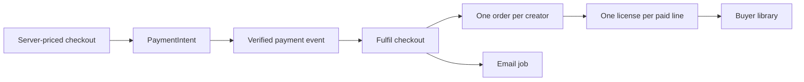

# Fulfil a paid checkout exactly once

The buyer presses Pay and the browser shows a success page. A private file must not appear in the library merely because that page loaded. The buyer can close the tab, lose power, or navigate to the success URL without paying. Fulfillment starts when the server accepts a verified payment event and confirms it belongs to the server-priced checkout. Even then, “one event” is the wrong unit for a license: providers retry deliveries, workers restart, and two events can describe the same paid object. The stable unit is the paid order line.

The email branch is deliberately outside the access path. A mail provider failure should not make a paid buyer wait for a license. The database writes that establish access happen first. Notification work can be queued and retried. Your test must prove that retrying the webhook or the email job never creates a second grant.

## Define the records before writing the handler

The checkout record stores buyer ID, selected product and license-option IDs, server-calculated prices in minor units, currency, expiration and the PaymentIntent ID. Its line snapshots include the license terms version offered at checkout. A paid order belongs to one creator, so a two-creator checkout produces two orders. Each order line has its own stable ID. A `License` belongs to one paid line and buyer and records product, option, accepted terms version, granted time and `active` state. Put a unique index on `orderLineId`. That index is the final guard against duplicate grants, even if two handlers start at once.

Do not make the license key itself the authorization decision. It is a reference the holder can view after login, not a password that proves identity. Generate it with `crypto.randomBytes` and encode it in a readable alphabet that avoids easily confused characters. Store a unique index on the key and retry generation if a collision occurs. The normal buyer library endpoint still checks the authenticated buyer ID and active grant before returning the key. A pasted key belonging to another buyer must not open that buyer's files.

In `server/src/modules/licenses/license.model.js`, define the indexes and fields. In `server/src/modules/checkout/fulfil-checkout.js`, write a function that accepts a checkout ID, not a browser payload. Load the checkout and its PaymentIntent link. Confirm the paid status from the already verified event or provider retrieval path. If the amount or currency differs from the server's stored checkout, stop and record an investigation event; do not guess a correction. Group lines by creator, upsert or find the per-creator orders by a unique checkout-and-creator key, and then create or read the grant for each line. Mark an order fulfilled only after all its lines have grants.

The placement of the “processed” marker matters. If you mark the webhook event processed before writing the grants and the process dies, a retry may be skipped and a buyer loses access. Instead, make the effects idempotent and record success after they exist. You may use a database transaction when your MongoDB deployment supports it, but the unique order and license keys remain necessary because the provider can deliver the same event in another transaction later. The handler can safely run again and discover the rows it already created.

Walk through a concrete failure. A checkout has line A for a font and line B for a template. The webhook handler creates the font grant, then the API process stops before it creates the template grant. Stripe retries the event. If your handler simply sees “event ID already stored” and returns, the template buyer never receives the file. If your handler iterates the paid lines, finds the existing font grant by `orderLineId` and creates the missing template grant, the retry repairs the checkout. The order can move to fulfilled only after both grants exist. Write this sequence as an integration test before optimizing it.

Another failure occurs when two webhook requests arrive close together. Each may query and find no grant for line A. Both attempt insertion. The unique index allows one. The losing request should recognize the duplicate-key result, fetch the winning grant by line ID, and continue. A pre-insert `findOne()` is useful for an ordinary retry but cannot replace the index, because two requests can read the same empty state. The key belongs on the effect, not only on the webhook event log. This distinction matters when Stripe sends different events for the same PaymentIntent.

Think about state names as evidence, not decoration. `pending_payment` means no confirmed payment. `paid` means the provider has confirmed money but some grants may still be missing. `fulfilled` means every paid line has an active grant. A failed email does not move it backward. A failed grant insert does not make a paid checkout unpaid; it leaves a retriable work item and an alert for the operator. Define the transitions in one service, and assert the previous state in the database update. Do not let the success page set state through a generic PATCH route.

## Connect the verified webhook

In the payment module's webhook route, keep the raw request body needed for signature verification. Reject an invalid signature before reading any metadata as trusted. For a payment success event, read the PaymentIntent ID, find its checkout, and call `fulfilCheckout(checkout.id)`. Do not accept `buyerId`, `creatorId`, amount or license option from event metadata as a replacement for the stored checkout. Metadata can help locate a row, but the server record is the source of what was sold. A webhook event ID can be logged to aid debugging; it is not enough by itself to enforce one license per line.

The success page should say “Preparing your files” while the API reports a paid checkout whose grants have not appeared yet. Poll an authenticated endpoint with a small backoff. When all grants exist, link to the library. After a timeout, show a support path and keep polling or offer a retry; do not instruct the buyer to pay again. A paid checkout might wait briefly because the webhook arrived after the browser redirect. The page displays the state but never calls a privileged fulfillment endpoint directly.

## Test the crash and replay paths

Use one checkout containing two creators and three paid lines. Deliver a valid test event and assert two creator orders and three grants. Deliver the same event again and assert the counts, keys and accepted terms versions are unchanged. Run two fulfillment calls concurrently and assert the same result; if one insert reports a duplicate key, read the winner and complete the remaining work. Simulate a crash after the first grant and rerun: the other two grants appear, the first retains its ID, and no order is marked fulfilled before all its grants exist. A failed email job should not change library access.

Test one rejected event with an invalid signature and another with a mismatched amount. Neither may create a grant. Inspect the library response as Buyer B, who did not pay: it must not contain Buyer A's license or private file metadata. Watch the database indexes while testing. If duplicate grants appear, check whether the unique index exists in the actual test database, not merely in a schema file. If a paid checkout remains pending, trace the verified event, checkout lookup, order keys and per-line grant loop in that order. This is the failure path you will defend in the capstone.

Keep a small operations note at `docs/FULFILMENT.md`. Record which dashboard value or database query reveals paid-but-unfulfilled checkouts, how to rerun fulfillment safely for one checkout, and what evidence must be preserved when a payment amount mismatches. Never resolve a mismatch by manually inserting a license. Repair the mapping or refund through a controlled path, then rerun the idempotent service. This note turns a rare fault into a repeatable procedure the future maintainer can use without guessing which browser button to click.
