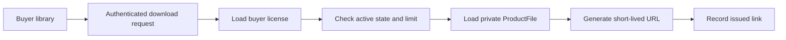

# Build the library and private download route

Module 20 gave a paid buyer one license grant per order line. The library makes that grant useful, but it must not turn the public catalogue into a file server. A visitor may read a product description and load preview images. Only the holder of an active license may ask the API for a link to the private deliverable. A link already issued can be copied during its short lifetime; this is why the server checks entitlement before issuing each one and why the URL expires.

The diagram has no arrow from the public catalogue to the private file. Product metadata can describe the format and size, but must not include the storage public ID, an unsigned delivery URL, or a cached signed link. The API creates a fresh link only after it has tied the request to the authenticated buyer and the exact file version included in that buyer's grant.

## Separate the two serializers

In `server/src/modules/catalog/product.serializer.js`, return public title, creator, description, preview image URLs, license-option summaries and formats. Do not return the `ProductFile` row. In `server/src/modules/library/library.serializer.js`, return the buyer's purchased product, accepted license terms version, seat allowance, grant state, issued-link count and whether a new link can be requested. Even this private response should not contain the storage provider's asset ID. The library is a view of rights, not a dump of the storage record.

Build `GET /me/library` with a database filter on the authenticated user ID. Join or batch-load product and creator display data so ten purchases do not make ten sequential queries. Sort by newest grant first. A refunded product stays visible with a revoked state and the receipt, but the Download action is unavailable. This distinction matters: hiding the library row might make the buyer think the purchase disappeared, while leaving the action active would violate the refund policy.

In the client, show each library item with a product name, creator, license name and current access state. Show a short explanation for `preparing`, `active` and `revoked`, including where to get help if a paid item is still preparing. Use an actual button for Download. It should show a pending state, handle a 403 with a clear access message and avoid logging the returned URL. A buyer on a slow connection may press twice; the server must define whether those are two issued links and show the count consistently.

Consider a creator who uploads version two of a font after Buyer A purchased version one. Do not decide file access by reading only `product.latestFileId`. That would silently give an old grant a different deliverable, perhaps under different terms. Store the file version or an explicit update policy with the grant. For the core path, tie the grant to the version sold. If you later add free updates, make the entitlement rule explicit and test it as a separate feature. The library can display a newer version as available without changing the purchase record until the policy says it may. This version boundary is also useful when a creator removes a broken file and uploads a corrected one.

## Guard the download endpoint

Create `POST /me/licenses/:licenseId/downloads`. Load the grant with `buyerId` equal to the authenticated user ID. A guessed grant ID belonging to someone else must get the same denial as an unknown one. Confirm that the grant is active, the order line is paid, and no refund request has blocked new access. Load the `ProductFile` version associated with that license. Do not silently switch an old license to a newly uploaded file unless the terms explicitly permit updates and the grant records that rule.

Use a server-side policy for link limits, such as a fixed number per rolling day for the course build. Store each issued-link event with license ID and time, and enforce the limit with a database-backed count or atomic counter rather than process memory. If a learner's local development server restarts, the limit should still hold. Return 429 with a useful retry time when the limit is reached. Rate limiting is not a replacement for license checking; apply both.

Ask Cloudinary for a time-limited private download URL using the authenticated asset's stored public ID and resource type. Set an `expires_at` around five minutes after issuance. Cloudinary distinguishes ordinary signed delivery URLs from its time-limited private download URL mechanism; do not assume that a signature alone expires. Keep the Cloudinary API secret on the server. Return the resulting URL to the authenticated caller only after all checks pass. The URL itself is a bearer capability: while valid, possession of it may be enough to fetch the file. Never place it in a public page, email, analytics event or server log.

There is a limit to revocation. When a refund is requested, block new link issuance immediately in the database. When the provider confirms the refund, set the grant to revoked. A URL issued just before the request may remain usable until it expires, and a downloaded copy cannot be pulled back. State this in the UI and final defense. A short expiry reduces that window; it does not erase past access. For sensitive files, protect the storage asset itself as authenticated and test that an unsigned URL fails. Public preview assets use the normal public delivery path and should still load after a refund.

## Verify access with three identities

Seed one active buyer grant, one revoked buyer grant and a creator account. Buyer A can request a link for the active grant, and the returned URL expires on schedule. Buyer A cannot request a new link for the revoked grant. Buyer B cannot use Buyer A's license ID through the API. The creator cannot call the buyer endpoint merely because they own the product. An anonymous catalogue request includes previews but no private fields. These tests inspect raw JSON and response status, not just hidden buttons.

Then issue links until the configured limit is reached. Restart the API and confirm the next request is still denied. Simulate a refund request racing with a download request and check the database predicate: whichever operation commits first determines whether one last link is issued, but after the refund block commits every new request must fail. If the UI says revoked while the API still issues links, put the refund check in the API query, not in React. If an unsigned private URL works, inspect the Cloudinary delivery type and account configuration before making the course available.

Finally, document the boundary in `docs/PRIVATE-FILES.md`: public preview route, authenticated storage type, license authorization, link lifetime, rate limit, refund block and what cannot be revoked. The document becomes part of the capstone evidence. A reviewer should be able to trace one buyer click to the exact grant and file version without needing a private asset ID in the browser's catalogue response.

Make the endpoint's failure responses useful without leaking another buyer's data. An unknown grant ID and someone else's grant ID can use the same 404 shape, so the caller cannot enumerate purchases. A grant owned by the caller but revoked may return 403 with a plain explanation, because that caller is already allowed to know its state from the library. A rate limit may return 429 and a retry time. Do not return a raw Cloudinary error to the browser; log a request ID on the server and show a retriable failure. Test this by making the storage provider temporarily unavailable. The library remains visible, the license stays active, and the buyer can try again without paying again.

Keep time comparisons on the server. A browser's clock can be wrong or changed. The link-expiry value sent to Cloudinary is computed from the server's current time, and the UI may show a human-friendly countdown as guidance only. The storage provider ultimately enforces its URL expiry. In your tests, use an injectable clock or a short test lifetime so you can verify both sides of expiry without waiting five real minutes. Do not write a test that passes only because it checked the countdown text; fetch the URL before and after expiry in the test environment.
