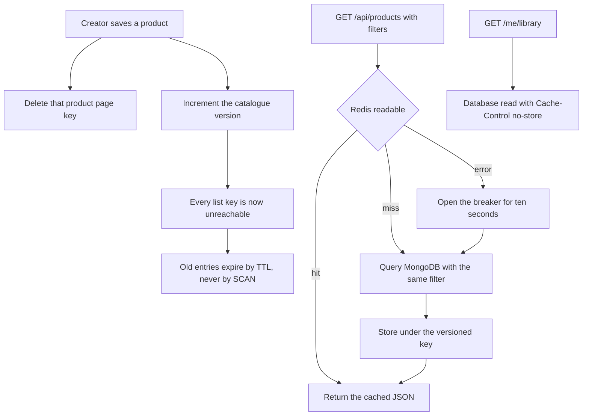

# Cache the catalogue, never the library

Two lists shape this build. The first is the set of routes that may use a cache: the public catalogue, a public product page, a Studio profile, and the filter lists that render the sidebar. The second is the set of routes that must never touch one: the library, any download response, license records, the cart, and every counter behind a limit. The code for the first list is about forty lines. Most of this chapter is about keeping the second list out.

Search comes along because it is the other half of a public read. A buyer who cannot name the product will type a creator's name instead, and a route that searches only titles cannot answer that.

## Mount the cache on the public router only

The cache is a wrapper around a loader, not a middleware on the application. A middleware mounted with `app.use` runs before routing, so it cannot know whether the request will end at a public catalogue route or at `/me/library`. By the time that is known, the response is already being cached.

```js
// server/src/modules/cache/cache.js (partial)
const TTL_SECONDS = 60;
const BREAKER_MS = 10_000;
let breakerOpenUntil = 0;

export async function remember(key, load) {
  if (Date.now() < breakerOpenUntil) return load();

  try {
    const hit = await redis.get(key);
    if (hit) return JSON.parse(hit);
  } catch (error) {
    breakerOpenUntil = Date.now() + BREAKER_MS;
    log.warn({ err: error.message }, 'cache read failed, serving from the database');
    return load();
  }

  const value = await load();
  try {
    await redis.set(key, JSON.stringify(value), { EX: TTL_SECONDS });
  } catch (error) {
    breakerOpenUntil = Date.now() + BREAKER_MS;
  }
  return value;
}
```

`remember` takes the loader as a function, which makes the rule visible at every call site: whatever `load` returns becomes shared with every visitor. Reading a function called `loadPublicCatalogue()` is a reminder that a per-buyer loader does not belong in this call.

The breaker is not decoration. A Redis host that accepts connections and then times out adds a second of latency to every request, which is slower than no cache at all. After one failure the wrapper skips Redis entirely for ten seconds and goes straight to the database, so a dead cache degrades the site to its pre-cache speed instead of taking it down.

## Keys carry the filters and a version

A key is a promise that two requests asking for the same thing find the same entry, and that two requests asking for different things never do. Every input that changes the body belongs in the key.

```js
// server/src/modules/cache/keys.js (partial)
import { createHash } from 'node:crypto';

export function catalogueKey({ version, filters, page, pageSize }) {
  const filterHash = createHash('sha1')
    .update(JSON.stringify(filters ?? {}))
    .digest('hex')
    .slice(0, 12);
  return `midad:v1:catalogue:${version}:${filterHash}:p${page}:s${pageSize}`;
}

export const productKey = (slug) => `midad:v1:product:${slug}`;
export const catalogueVersionKey = () => 'midad:v1:catalogue:version';
```

Sort the filter object before hashing it, or `{format: 'otf', category: 'font'}` and `{category: 'font', format: 'otf'}` become two keys for one body and halve the hit rate. Include the page size: a client asking for fifty items must not receive the cached twenty. Leave the buyer out, because the body does not depend on the buyer, which is the condition from the previous chapter.

The version number is the part that makes invalidation cheap. It is a counter in Redis, and every list key contains its current value. Incrementing the counter makes every existing list key unreachable in one write, without scanning the keyspace and without deleting anything.

## Invalidate what you can name, bump what you cannot

Two kinds of write need different treatment. A product page has a name you know, so you can delete its key. A catalogue list is the result of a filter you cannot enumerate, so you cannot name the keys to delete.

```js
// server/src/modules/products/product.events.js (partial)
export async function onProductSaved(product) {
  await redis.incr(catalogueVersionKey());      // every list is now stale by construction
  await redis.del(productKey(product.slug));    // the one page we can name
}

export async function onStudioRenamed(studioId, studioName) {
  await Product.updateMany({ studioId }, { $set: { studioName } });
  await redis.incr(catalogueVersionKey());
}
```

The rename case is why `studioName` is copied onto the Product at publish time. Search needs the creator's name in the same document as the title, and a text index cannot span two collections. The copy has a cost: a rename is a multi-document write, and until it finishes the old name is still searchable. Module 23 can move that write to a job. For the core path, run it inline and accept the short window.

The old keys are not deleted. They stay in Redis until their sixty second expiry and are never read again, because no request will build that key once the version has moved. That is a deliberate trade: you spend a little memory to avoid a `KEYS` or `SCAN` loop on the write path. Never call `KEYS` outside a test; it walks the entire keyspace and blocks the server while it does.

The alternative is per-filter reverse indexes: store the set of list keys touched by each product, then delete exactly those. It saves the re-read after every edit and costs a second index that can itself drift. With sixty second entries and a catalogue of a few hundred products, the coarse bump is the better trade. If creators edited products every minute and the catalogue were large, the reverse index would start to pay.

## Keep the private routes out, and prove it

Entitlement responses get a header and no cache wrapper. The header is short.

```js
// server/src/modules/library/library.route.js (partial)
router.get('/me/library', requireAuth, noStore, getLibrary);

export function noStore(req, res, next) {
  res.set('Cache-Control', 'no-store');
  next();
}
```

The test is what actually holds the boundary. It flushes the cache, calls every private route once, and asserts that Redis is still empty.

```js
// server/test/cache/mounting.test.js (partial)
it('never writes a /me response into the cache', async () => {
  await redis.flushAll();

  await request(app).get('/api/me/library').set('Cookie', aminaSession).expect(200);
  await request(app).get('/api/cart').set('Cookie', aminaSession).expect(200);

  assert.deepEqual(await redis.keys('*'), []);
});
```

`redis.keys('*')` is acceptable in a test against a disposable database and unacceptable anywhere else. Adding one more assertion to the same file catches the header: fetch the library, assert `cache-control` is `no-store`, and assert the body contains no `url` field, because a library response that carries a link has already failed before any cache is involved.

## Search across titles, tags and creator names

Search is a route, an index and one denormalised field. The index first.

```js
// server/src/modules/products/product.model.js (partial)
productSchema.index(
  { title: 'text', tags: 'text', studioName: 'text' },
  {
    name: 'product_search',
    weights: { title: 6, tags: 3, studioName: 2 },
  }
);
```

The weights decide the order when a query matches in more than one field. A title match outranks a tag match, and a tag match outranks the creator's name, because a buyer who types "grotesk" wants the font before they want everything Nour has ever made. Then the route.

```js
// server/src/modules/products/search.route.js (partial)
router.get('/products/search', async (req, res) => {
  const q = String(req.query.q ?? '').trim();
  if (q.length < 2) return res.json({ items: [] });

  const items = await Product.find(
    { status: 'published', $text: { $search: q } },
    { score: { $meta: 'textScore' } }
  )
    .sort({ score: { $meta: 'textScore' } })
    .limit(20)
    .lean();

  return res.json({ items: items.map(toPublicProduct) });
});
```

The `status: 'published'` filter is not optional. Without it, search is a way to read the titles of products a creator has not published, and the serializer's care in Module 13 becomes irrelevant because the title leaked.

Be honest with the learner about what this search does not do. MongoDB's text search matches whole words from its own tokeniser, so "grot" does not find "Grotesk", a typo finds nothing, and an Arabic title is split on whitespace, which means a prefix without its suffix will not match. Those limits are acceptable for a catalogue this size and unacceptable for a search box people rely on. Atlas Search would fix them and is out of scope here for cost.

Prove the index is used rather than assuming it.

```js
// server/test/search/plan.test.js (partial)
const plan = await Product.find({ status: 'published', $text: { $search: 'template' } })
  .explain('executionStats');

const stage = JSON.stringify(plan.queryPlanner.winningPlan);
assert.match(stage, /IXSCAN/);
assert.match(stage, /product_search/);
```

Read `totalKeysExamined` against `nReturned` as well. An index scan that examines a thousand keys to return two is an index whose field order or selectivity is wrong, and the plan alone will not tell you that.

## The read path and the write path

The diagram holds both paths and the route that is absent from both. Follow the arrows on the left for a read, and the ones on the right for a creator saving a product.



The takeaway is that a cache has a read path, a write path and an exclusion list, and that the third one is not enforced by the first two. It is enforced by what the wrapper is mounted on and by a test that asserts the keyspace after private calls.

## Build order and the failures to expect

Wire the wrapper first with the public product page, then the catalogue list, then the filter lists. Run the invalidation test after each one: fetch, edit, fetch again, and assert the second response already shows the edit. Then add search, then break Redis on purpose.

Four tests cover the chapter, and three of them fail before the code is finished.

- A search for a creator's name returns that creator's published products. It fails until `studioName` is denormalised and indexed.
- A product page shows an edited title on the next request. It fails until the write path deletes the key.
- The catalogue answers 200 with items while Redis is stopped. It fails until the wrapper catches the connection error.
- No `/me` response writes a key. It fails if any private route is ever mounted under the cached public router.

The debugging path follows the same order as the request. If a stale page survives an edit, check the key was deleted and the version was incremented, in that order, then check that the writer and the reader use the same key builder. If the site is slow and Redis is healthy, look for a key that changes on every request, usually an unsorted filter hash or a timestamp in the key. If search returns nothing, query the same terms in the shell with `$text` and check whether the failure is in the index or in the route.

## Bridge to the gate

The gate asks for logs rather than claims: a cache hit and a miss for the same catalogue URL, an edit that is visible on the next request, an empty keyspace after private calls, a catalogue that still answers with Redis stopped, and an explain plan that names the text index. Module 23 puts the queue on the same Redis, so a cache that fails open is also the foundation the worker will need.
