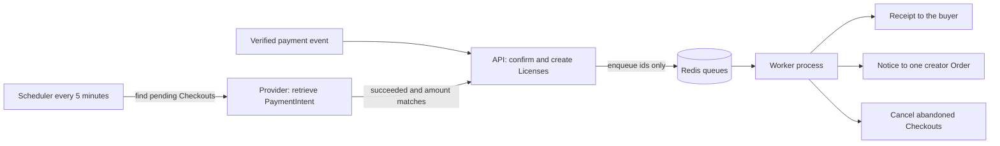

# Worker, receipts and payment reconciliation

The webhook is now short by design. It confirms a Checkout and creates the Licenses, and it answers the provider without waiting for a mailbox. This chapter builds the half that left: a second Node process that owns the queues, a receipt that points at the library instead of at a file, a sale notice scoped to one creator's Order, and a sweep that repairs a payment whose webhook never arrived. Four pieces of work, one process, and three separate guards against doing any of it twice.

The order matters. Build the worker first, so you can watch a job run before you depend on it. Then the receipt, because it is the job you can test without any other job existing. Then the creator notice, which is the same shape with a stricter query. Then the sweep, which is the only one that talks to the provider and the only one whose absence costs a buyer access. If you build the sweep first, you will debug it against a worker you do not yet trust.



Two arrows enter the same confirmation step, one from the provider's event and one from the scheduler, and that is the whole argument of this diagram. The repair path is not a second implementation. It reaches the same function, which already knows how to run twice without creating a second License.

## Run the worker as its own process

Create `server/src/worker.js` and a script entry `"worker": "node src/worker.js"` in `package.json`. The worker connects to the same MongoDB and the same Redis as the API and does nothing else: it registers one processor per queue and then waits. Running it as a separate process is not a style choice. A deploy of the API restarts the API without cutting off a job that is halfway through a mail call, a queue backlog cannot consume the event loop that answers buyer requests, and a crash loop in the worker leaves the payment endpoint reachable.

BullMQ needs a connection that is allowed to block, which means `maxRetriesPerRequest: null` on the connection options you pass to `new Worker`. The default ioredis setting retries a blocking command a fixed number of times and then fails it, which turns an idle worker into a stream of connection errors. The same connection options are safe for `Queue` instances, and the course keeps one options object in `server/src/queues/connection.js` so the API and the worker cannot drift.

```js
// server/src/queues/connection.js (partial)
// Workers issue blocking commands, so retries must be unlimited here.
const connection = { url: process.env.REDIS_URL, maxRetriesPerRequest: null };
module.exports = { connection };
```

Log one line when the worker starts, with the queue names and the process id, and one line per job with the job name, the job id and the elapsed time. Those three fields answer the question the gate asks: did a job run, and did it run once. Do not log the payload of a receipt job beyond its Order id, and never log a license key.

```js
// server/src/worker.js (partial, imports omitted)
const { Worker } = require('bullmq');
const { connection } = require('./queues/connection');
const { processReceipt } = require('./jobs/receipt');
const { processSaleNotice } = require('./jobs/sale-notice');
const { processReconcile } = require('./jobs/reconcile');
const { processCleanup } = require('./jobs/cleanup');

new Worker('receipts', processReceipt, { connection, concurrency: 2 });
new Worker('creator-notices', processSaleNotice, { connection, concurrency: 2 });
new Worker('maintenance', async (job) => {
  if (job.name === 'reconcile') return processReconcile(job);
  if (job.name === 'cleanup') return processCleanup(job);
  throw new Error(`unknown maintenance job: ${job.name}`);
}, { connection, concurrency: 1 });

console.log('worker started: receipts, creator-notices, maintenance');
```

The maintenance queue is deliberately serial. A reconciliation sweep that runs twice at the same time is harmless, because the work it triggers is idempotent, but two sweeps multiply the provider calls for no benefit. Concurrency one keeps the sweep cheap and keeps its window arithmetic simple.

## Define each queue once

Put the queue names and the default job options in one module, `server/src/queues/index.js`, and import them from both sides. The API adds jobs; the worker processes them; neither should be constructing settings of its own.

```js
// server/src/queues/index.js (partial)
const { Queue } = require('bullmq');
const { connection } = require('./connection');

const defaults = {
  attempts: 5,
  backoff: { type: 'exponential', delay: 30_000 }, // 30s, 60s, 120s, 240s
  removeOnComplete: { count: 1_000 },
  removeOnFail: { count: 5_000 },
};

const receipts = new Queue('receipts', { connection, defaultJobOptions: defaults });
const creatorNotices = new Queue('creator-notices', { connection, defaultJobOptions: defaults });
const maintenance = new Queue('maintenance', { connection, defaultJobOptions: { attempts: 1, removeOnFail: { count: 500 } } });

module.exports = { receipts, creatorNotices, maintenance };
```

The maintenance queue gets one attempt on purpose. A sweep that fails has failed for a reason that the next scheduled run will meet again in five minutes, and five retries of the same failing provider query only add noise to the failed set. Keep completed job records for a thousand jobs so the gate can show one, and keep failed records longer, because a failed receipt is a support case.

## The receipt processor

A receipt is a written promise that a purchase exists, so it deserves a record of its own. Add a `Receipt` collection with `orderId`, `buyerId`, `status` (`sending`, `sent`, `failed`), `attempt`, `sentAt` and `messageId`. Put a unique index on `orderId`. The processor then follows five steps in a fixed order, and the order is what makes a retry safe.

1. Load the Order and its lines by `orderId` from the payload.
2. Stop without sending if a `Receipt` for this Order is already `sent`.
3. Create the `Receipt` row if it does not exist, or reuse it if a previous attempt left it in `sending` or `failed`.
4. Build the message from stored data and send it through the mailer interface.
5. Mark the row `sent` with `sentAt` and the provider's `messageId`.

Step two is a fast path and step three is the guard underneath it, which is the same double guard you built for Licenses: a read that saves work, and a unique index that saves you when two runs read the same empty state. If two workers reach step three at the same moment, one `create` throws a duplicate key error, and the right response is to let BullMQ retry: the retry finds the row and takes the fast path. Do not swallow that error, because a swallowed one turns a retry into a silent skip. If step four throws, the processor lets the error escape so BullMQ retries, and the row stays in `sending`. The retry finds the row, sends again, and marks it sent. That is the honest behaviour described in 23.1: one narrow window where a duplicate message is possible, and a recorded attempt either way.

```js
// server/src/jobs/receipt.js (partial, error handling abbreviated)
async function processReceipt(job) {
  const order = await Order.findOne({ _id: job.data.orderId }).populate('lines.product');
  if (!order) return; // the Order was deleted; nothing to promise

  const existing = await Receipt.findOne({ orderId: order._id });
  if (existing && existing.status === 'sent') return; // at least once, sent once

  const receipt = existing ?? await Receipt.create({ orderId: order._id, buyerId: order.buyerId, status: 'sending' });
  const message = buildReceiptMessage(order, await License.find({ orderId: order._id }));
  const sent = await mailer.send(message); // console mock in the course build
  await Receipt.updateOne({ _id: receipt._id }, { $set: { status: 'sent', sentAt: new Date(), messageId: sent.id } });
}
```

`buildReceiptMessage` is where the rules from 23.1 become text. It renders the library URL from config, one line per License with its key and license type, and a plain sentence explaining that the keys can be read again in the library. It refuses to accept a file URL, because it has no parameter for one. That is a code comment worth leaving in place: the safest way to keep a signed link out of an email is to build the message from fields that cannot contain one.

```js
// server/test/jobs/receipt.test.js (partial, one case from the suite)
it('sends one receipt when the same job is retried after the send', async () => {
  const job = { data: { orderId: String(order._id) } };
  await processReceipt(job);
  await Receipt.updateOne({ orderId: order._id }, { $set: { status: 'sending', sentAt: null } }); // crash after send
  await processReceipt(job);
  assert.equal(mailer.outbox.filter((m) => m.to === buyer.email).length, 1);
});
```

That test failed the first time it was written, with two messages in the outbox, because the processor only checked for a `sent` row before sending and the crash had left the row in `sending`. The fix was not a better check. The fix was to mark the row `sent` in the same update that records the provider's message id, and to treat a `sending` row from a previous attempt as an attempt to finish rather than as a fresh decision. A test you never saw fail is a test you cannot describe.

Add the second receipt test while you are there, the one about the queue rather than the processor. Adding the same `jobId` twice must leave one waiting job.

```js
// server/test/jobs/dedup.test.js (partial)
await receipts.add('receipt', { orderId: String(order._id) }, { jobId: `receipt:${order._id}` });
await receipts.add('receipt', { orderId: String(order._id) }, { jobId: `receipt:${order._id}` });
assert.equal(await receipts.getJobCountByTypes('waiting', 'delayed'), 1);
```

## The creator notice processor

The notice is the same shape with one extra rule: the query carries the scope. The payload is a Studio id and an Order id, the processor loads the Order with both in the filter, and a payload whose Order belongs to a different Studio finds nothing and sends nothing. That last behaviour is the point. A wrong or forged scope results in silence rather than in a leak.

```js
// server/src/jobs/sale-notice.js (partial)
async function processSaleNotice(job) {
  const { studioId, orderId } = job.data;
  const order = await Order.findOne({ _id: orderId, studioId }); // scope in the query
  if (!order) return;
  if (await Notice.exists({ orderId })) return; // same record guard as a receipt
  const studio = await Studio.findById(studioId);
  await mailer.send(buildSaleNotice({ studio, order })); // order.lines and order.totalMinor only
  await Notice.create({ orderId, studioId, sentAt: new Date() });
}
```

`buildSaleNotice` receives the Order and the Studio, and it has no access to the Checkout at all, so it cannot report a total that spans two creators. That is a stronger guarantee than a comment asking the next developer to be careful. When the email is built from a record that does not contain the other creator's money, the other creator's money cannot leak.

Test it with the two creator Orders from one Checkout. Run the notice job for Nour's Order and assert that the outbox contains exactly one message, that it names the font, and that the template and the Checkout total appear nowhere in the message body. Then run the same job with Salma's Studio id and Nour's Order id, and assert that no message is sent at all. Those two assertions cover the scoping bug and the cross creator bug separately, which matters when one of them fails.

## The reconciliation sweep

The sweep is a repeatable job on the maintenance queue. With BullMQ 5 and later you register it with `upsertJobScheduler`, which creates the schedule once and updates it on later deploys instead of adding a duplicate schedule per restart. Older releases used the repeatable jobs API, so check the version in `package.json` before copying this call.

```js
// server/src/jobs/reconcile.js (partial)
await maintenance.upsertJobScheduler('reconcile-payments', { every: 5 * 60 * 1000 }, {
  name: 'reconcile',
  data: { windowMinutes: 120 },
});

async function processReconcile(job) {
  const since = new Date(Date.now() - job.data.windowMinutes * 60 * 1000);
  const candidates = await Checkout.find({
    status: 'pending_payment',
    paymentIntentId: { $ne: null },
    createdAt: { $gte: since },
  }).limit(100);

  for (const checkout of candidates) {
    const intent = await stripe.paymentIntents.retrieve(checkout.paymentIntentId);
    if (intent.status !== 'succeeded') continue;
    if (intent.amount_received !== checkout.totalMinor || intent.currency !== checkout.currency) {
      await recordMismatch({ checkout, intent, source: 'reconcile' });
      continue;
    }
    await fulfilCheckout(checkout._id, { trigger: 'reconcile' }); // same function as the webhook
  }
}
```

Read the filter and notice what it excludes. A Checkout with no `paymentIntentId` is skipped, because there is nothing to retrieve and the expiry rule will close it. A Checkout older than the window is skipped too, so the sweep stays cheap on a long running database. Both exclusions are policies you should be able to defend, and both belong in `docs/FULFILMENT.md` next to the manual repair steps.

The mismatch branch is not decoration. The sweep is the second place where a provider amount meets a stored Checkout, so it must apply the same rule the webhook applies: record the disagreement and change nothing. A repair job that "fixes" a mismatch by trusting the provider amount would undo the snapshot discipline from Module 18 in one line of code.

```js
// server/test/jobs/reconcile.test.js (partial)
it('fulfils a Checkout whose webhook was never delivered, exactly once', async () => {
  await paidIntentInProviderOnly(checkout); // provider says succeeded, local rows untouched
  await processReconcile({ data: { windowMinutes: 120 } });
  const first = await License.countDocuments({ orderId: nourOrder._id });
  await processReconcile({ data: { windowMinutes: 120 } });
  const second = await License.countDocuments({ orderId: nourOrder._id });
  assert.equal(first, 1);
  assert.equal(second, 1); // the unique index on orderLineId holds
});
```

The first assertion is the repair. The second is the proof that the repair did not become a second fulfilment path. If you only test the first, a sweep with its own license insert passes and creates a duplicate the moment the webhook also arrives late. We test both because the interesting failure is the one where two triggers meet.

## The cleanup job

The last maintenance job cancels abandoned Checkouts. It finds rows still in `pending_payment` whose `expiresAt` has passed, and it moves them to `expired` with a conditional update that repeats `status: 'pending_payment'` in the filter. That filter is what stops a slow cleanup from overwriting a Checkout that was confirmed a millisecond earlier. If the update matches nothing, the Checkout changed while the job was deciding, and the job should count it and move on rather than reading it and forcing a write.

The job also clears the buyer's cart reference if the cart still points at the expired attempt, so the next visit starts cleanly. It does not delete the pending Orders, the OrderLine snapshots or anything a License points at. History is evidence, and an expired attempt is the explanation for a support question about a payment that was started and abandoned.

Schedule it less often than the sweep, every fifteen minutes is enough for a course build, and keep its page size small. A cleanup job that touches every old row in one pass is the kind of job that works in testing and then competes with the sweep for the same database at the wrong moment.

## What the gate will ask for

The gate expects three runs you can show rather than describe. Stop the CLI listener, pay with a test card, and watch the Checkout stay pending; then start the sweep and watch the License appear once. Kill the worker in the middle of a receipt and restart it, then show one message in the outbox and a `Receipt` row that says `sent`. Add the same receipt job twice and show one job in the queue.

The fourth thing it asks for is a reading rather than a run. Open the mailer output and search it for the strings `expires`, `signature` and the storage host. None of them should appear in any message this module sends. That search is crude and it works, because it looks for the two properties that make a link dangerous rather than for the exact field name a serializer happens to use today.
