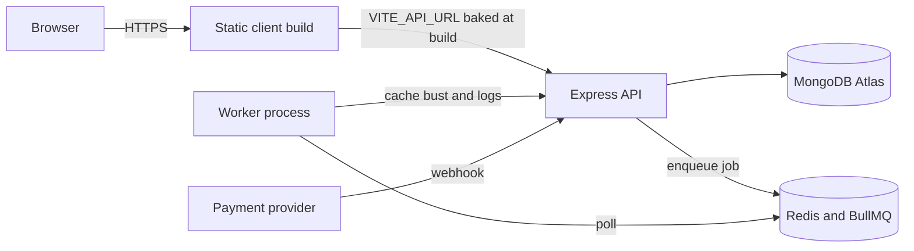

# 23.15 ,  Recap and what's next

> **[Wrap]** · Chapter 23, Deploy · *Recap: what you built, and what comes next*

Chapter 23 moved Midad from **localhost to HTTPS**: production environment variables, a client build, the API deploy, the **worker deploy**, smoke tests, and restart survival.

The interesting part is not that a URL exists. Plenty of projects reach a URL and still fail a review, because a deployed Midad is three processes pretending to be one product. The client is a folder of static files, the API is a process that answers HTTP, and the worker is a process nobody can call directly. Each of them has its own configuration, its own logs, and its own way of failing, and the milestone only counts when all three are alive in the same release and a buyer can complete a purchase without a developer watching the terminal.

## The problem a deploy exposes

Development hides ordering bugs. On a laptop the API, the worker and the browser all start within seconds of each other, the database is warm, and every request comes from the same machine. On a host, the API can boot before the database accepts connections, the worker can boot without the API, and the browser can load a client bundle that was built when the API URL was still `http://localhost:5000`. None of those is a code change, and all of them are real production failures.

The worker is the process that catches people out, because nothing calls it. It has no port to open and no URL to paste, so a host that only reports HTTP health will happily report the API as green while the worker crashes against a missing Redis URL. Inventory the three processes separately: the API needs the database, the queue and the signing secret, the worker needs the database and the queue but never the HTTP origin, and the client needs only the public values frozen at build time. A checklist that puts every key in one panel guarantees at least one process runs with the wrong environment.

The second thing a deploy exposes is that configuration is now a distributed artefact. Every key in `.env.example` has to exist in at least one host dashboard, and the three processes do not share it. The client build takes `VITE_API_URL` at build time, which means a variable that looks like the others behaves completely differently: it is frozen into the JavaScript the browser downloads, so changing it later requires a rebuild and a redeploy, not a restart.

## What you achieved

**Production URLs.** Client and API on HTTPS, ready to paste into your portfolio and your Chapter 23 learning log.

**Secrets discipline.** Host environment only, with `.env.example` documenting every key a teammate needs.

**Three deployed components.** API, long running worker, and static client. The API and worker are separately supervised processes, and the client is a versioned static artefact.

**CORS and TLS.** The browser talks to the API over HTTPS, and `VITE_API_URL` points at that HTTPS API at build time.

**Smoke tests.** Health, login, browse and checkout on the **live** URL, not a localhost replay.

**Operational evidence.** Correlated smoke results, a known rollback target, a measured API recovery time, and a queued job that survived worker downtime.

## The shape of what is running

The arrows tell you where to look when something is wrong. A page that loads and shows no Products is a client to API problem, which is either the baked URL or CORS. A page that loads and shows stale Products is a cache problem, which is the API to Redis edge. A paid order that stays `pending_payment` while the buyer's library stays empty is a webhook or worker problem, and those are two different logs on two different hosts.

## A worked example: one smoke test, four processes

Trace a single live checkout, in the order the evidence arrives.

<TraceRequest title="A live checkout across every deployed part">
  <TraceStep actor="Client" label="loads the shop from HTTPS" detail="Static files come from the client host, and the bundle calls the HTTPS API URL baked in at build time" />
  <TraceStep actor="API" label="verifies the buyer and returns Products" detail="JWT verified, CORS allowed for the client origin, catalogue read from MongoDB" />
  <TraceStep actor="API" label="creates the Checkout and the payment intent" detail="The Order records the price snapshot, so a later Product edit cannot change what the buyer owes" />
  <TraceStep actor="Worker" label="receives the verified payment event" detail="A queued job fires the receipt and busts the catalogue cache, which is why the buyer sees the new License" />
  <TraceStep actor="DB" label="stores the License and the DownloadGrant" detail="The buyer's library now answers with a real entitlement, not a promise" />
</TraceRequest>

Steps three and four are the ones that separate a deploy from a demo. If the payment intent succeeds and the worker is down, the money moves and the library stays empty, which is the exact failure Chapter 25 and Chapter 26 exist to reason about from the other side. A deploy that never stops its worker cannot tell you whether queued work survives, which is why the restart test in 23.14 asks you to stop it on purpose and watch the job arrive afterwards.

## Deployment milestone, complete

| Target | Status |
|---|---|
| Cached catalogue and search | Complete, Ch 21 |
| Async jobs after checkout | Complete, Ch 22 |
| Live HTTPS | Complete, this chapter |
| API and worker survive restart | Complete |

This completes the deployment milestone, not the full Week 4 core. Finish Chapters 25 and 26 to prove the live marketplace enforces license limits and revokes access on a refund.

## What this deploy does not prove

An honest recap lists the assumptions that a single instance hides. Midad runs one API process and one worker process, so nothing has exercised a second instance, a shared queue with competing consumers, or a lock that only matters under concurrency. Logs are what the host shows you, not a searchable store with retention. There is no alert when the worker dies, only a person noticing that a receipt never arrived. The rollback target is a previous release you recorded by hand, not an automated blue and green switch.

None of that is a defect for this stage. Each item is a named limitation you can defend in a viva, and each one has a clear next step if the product needed it. What would be a defect is claiming the deploy is production ready without naming them, because the first person to find a limitation will be a buyer under load rather than a reviewer of your README.

## Failure modes worth recognising on a live host

The client answers but every request fails with a CORS error, which means the API does not include the deployed client origin in its allow list. The health route returns JSON and the shop page is blank, which usually means the bundle was built with a stale `VITE_API_URL` and is calling a host that no longer exists. The API answers but nothing is ever written, which is an API booted with a read only or wrong database URI. And the whole checkout journey works while the receipt never appears, which is a worker that failed to deploy, crashed on boot, or lost its Redis connection while the API kept accepting jobs.

## Debugging path on a deployed Midad

Work from the outside in, because each layer answers a different question. Load the API health URL directly: a failure there is DNS, TLS or the API process, and nothing about the client can fix it. If health is green, open the browser console on the client and read the failing request, which distinguishes a CORS rejection from a 404 from a 500. If the API returns 200 and the page still looks wrong, check the cache before the code, since a stale catalogue looks exactly like a broken query. Then read the worker log for the job id, because a job that never appears in the queue is an API problem and a job that appears and stays queued is a worker problem. Write down what each layer said, in order, in the learning log.

## What carries forward

Two habits from this chapter outlive the deploy. The first is the separation of runtime configuration by process: the API needs the database and the signing secret, the worker needs the database and the queue, and the client needs only public values that were true at build time. The second is evidence. Every claim in the learning log now has a URL, a log line or a measurement behind it, which is the difference between saying the marketplace works and showing that it does.

## Continue Week 4: limits and refunds

Your first HTTPS deploy is the midpoint of the final course week. A production ready Midad also needs the two modules that come next.

- **Chapter 25, Download limits and seats:** an atomic download counter, seat assignment, and a parallel test that proves the limits hold when twenty requests arrive at once.
- **Chapter 26, Refunds and revocation:** a partial refund scoped to one creator's Order, License revocation, and a verify endpoint that answers status only.

After the required Week 4 gates, continue to **Chapter 99: Closing**, ship it, document it, and prepare the demo video, the case study, and the viva.

Complete **23.16**, then continue to **Download limits and seats** (Chapter 25). Chapters 25 and 26 are required Week 4 work.

## Continue to the gate

**Sub-chapter 23.16:** Checklist and learning log with your **live URL**.

Your app is on the internet. Next, harden the license so concurrent download requests cannot exceed its limit and the server remains the source of truth for every grant.
