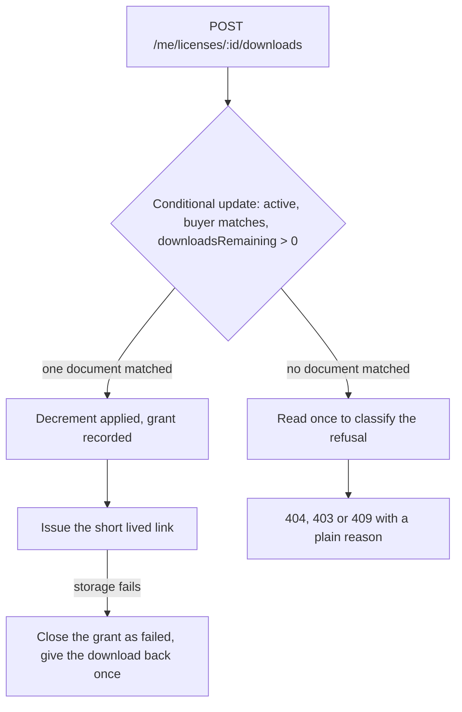

# Atomic download limits and seat assignment

Chapter 25.1 described the gap between a read and a later write. This chapter removes it in three places, and the three fixes share one idea: move the decision into the operation that changes the data. The download route puts the remaining count in the update filter. Seat assignment puts the array length and the duplicate address in the update filter. The fulfilment path lets a unique index decide which of two simultaneous deliveries wins, and teaches the loser to read the winner's row.

The work is small and the tests are the hard part. A conditional update that nobody fires twenty requests at is a conditional update you hope works. So build the code first, then build the parallel script that writes the evidence file, then run it against the naive handler once to see what a leak looks like with your own column headings on it.



The two branches after the update are the whole shape of the fix. The successful branch is one atomic step and a delivery. The unsuccessful branch cannot issue anything, and its extra read exists only to choose a message, never to make a decision.

## The decision belongs in the filter

Replace the read, check and save with a single conditional update. The filter carries the identity of the caller, the state of the license, and the limit. The update carries the change. If the predicate still holds when the database applies the update, exactly one document matches and the counter moves. If another request already spent the last download, nothing matches and this request learns that it lost.

```js
// server/src/modules/licenses/limits.js (partial)
async function spendDownload({ licenseId, buyerId }) {
  const license = await License.findOneAndUpdate(
    {
      _id: licenseId,
      buyerId,                        // identity in the filter, not only in a middleware
      status: 'active',               // a revoked license matches nothing
      downloadsRemaining: { $gt: 0 }, // the limit, in the filter
    },
    { $inc: { downloadsRemaining: -1 }, $set: { lastDownloadAt: new Date() } },
    { new: true }
  );
  return license;
}
```

Read the filter as a sentence: find the active license that belongs to this buyer and still has at least one download left, subtract one, and hand back the result. The database applies that sentence as one operation. There is no interval in which two callers can both be right, because there is no interval at all.

A null result is deliberately ambiguous, and the route disambiguates it with one follow up read. That read cannot issue a link and cannot spend a download; it only asks which of the three refusals happened. A license that does not exist for this buyer is a 404, a license that is revoked is a 403, and a license with nothing left is a 409 with a retry hint that says plainly that the allowance is spent. Using one status for all three would be simpler and would tell a buyer nothing.

The schema needs the fields that filter reads. `status` is required with an `active` default, `downloadsRemaining` is required with a minimum of zero, and `seatLimit` is required on every License because the personal option grants one seat as well. Validate them at the schema level rather than trusting the seed file, and add a test that a License cannot be created without a limit. A missing `seatLimit` on a commercial license is the kind of defect that shows up as a broken assignment six weeks later.

## One grant, one decrement, one link

The decrement is the decision and the `DownloadGrant` is the audit record, and the two need an order. Decrement first, because the decision has to happen before work is spent on a link. Then create the grant with the request id, then call storage, then mark the grant issued. If storage fails, close the grant and give the download back exactly once.

```js
// server/src/modules/licenses/download.route.js (partial, happy path and repair)
const license = await spendDownload({ licenseId, buyerId });
if (!license) return sendRefusal(licenseId, buyerId); // one read, then 404, 403 or 409

const grant = await DownloadGrant.create({
  licenseId: license._id,
  buyerId,
  productFileId: license.productFileId, // the version named on the license
  requestId,                            // from the client, unique per attempt
  status: 'requested',
});

try {
  const { url, expiresAt } = await storage.issueLink(license.productFileId);
  await DownloadGrant.updateOne({ _id: grant._id, status: 'requested' }, { $set: { status: 'issued', expiresAt } });
  return res.json({ url, expiresAt, downloadsRemaining: license.downloadsRemaining });
} catch (err) {
  const closed = await DownloadGrant.updateOne({ _id: grant._id, status: 'requested' }, { $set: { status: 'failed', failedAt: new Date() } });
  if (closed.modifiedCount === 1) await License.updateOne({ _id: license._id }, { $inc: { downloadsRemaining: 1 } });
  return res.status(502).json({ error: 'storage_unavailable', requestId });
}
```

The `modifiedCount` check in the repair branch is the part people leave out. Two retries of the same failed request would each try to close the grant, and without the status transition both would succeed, and both would add a download back. The conditional close makes the first attempt the one that compensates, and any later attempt finds the grant already `failed` and does nothing. Giving back a download twice is how a three download license becomes a five download license.

The grant also carries the client's `requestId`, with a unique index on the pair of license and request id. A buyer whose connection drops after the response was built can retry with the same id and receive the same grant state instead of spending a second download. That is the difference between a retry and a second intentional download, and it is worth a test of its own.

The response returns `downloadsRemaining` from the decremented document. That is a small thing with a visible effect: the library shows the true remaining count straight after a download instead of waiting for a refresh, and a buyer who has spent the last one sees the exhausted state immediately rather than after a second request.

## Seats: the length and the address in one filter

A commercial license has a `seatLimit` and an embedded `seats` array of `{ email, name, assignedAt, assignedBy }`. Assigning a seat must satisfy three facts at once: the license is active and belongs to the buyer, the array is shorter than the limit, and the address is not already in the array. All three fit in a filter because all three live in one document.

```js
// server/src/modules/licenses/seats.js (partial)
async function assignSeat({ licenseId, buyerId, email, name }) {
  return License.findOneAndUpdate(
    {
      _id: licenseId,
      buyerId,
      status: 'active',
      'seats.email': { $ne: email },                                  // no duplicate address
      $expr: { $lt: [{ $size: '$seats' }, '$seatLimit'] },            // length against the limit
    },
    { $push: { seats: { email, name, assignedAt: new Date(), assignedBy: buyerId } } },
    { new: true }
  );
}
```

`$expr` is what lets the filter compare two fields of the same document, which is the only way to say "the array is shorter than its own limit" without reading the document first. Note what it does not do: a comparison on `$size` cannot use an index. That is fine here, and it is worth understanding why. The filter is anchored on `_id`, so the database fetches one document and evaluates the predicate on it. There is no scan to optimise.

The same classification pattern applies to a null result. Read the license once and answer precisely: a license outside this buyer's account is a 404, a revoked license is a 403, an address already present is a 409 with `seat_already_assigned`, and a full array is a 409 with `seat_limit_reached`. A buyer assigning seats for a team needs to know which of the two happened, because one means "pick a different person" and the other means "buy another seat".

Releasing a seat is a `$pull` with the address in the filter, and it needs no limit check because removing can only shorten the array. Keep the release route scoped to the buyer as well. A creator can see that five seats exist without being allowed to fill them, and that check belongs in the same filter as everything else.

```js
// server/test/concurrency/seats.test.js (partial, one case from a failing suite)
it('assigns exactly one seat when two requests race for the last one', async () => {
  await License.updateOne({ _id: license._id }, { $set: { seatLimit: 1, seats: [] } });
  const results = await Promise.allSettled([
    assignSeat({ licenseId: license._id, buyerId, email: 'sara@example.com', name: 'Sara' }),
    assignSeat({ licenseId: license._id, buyerId, email: 'omar@example.com', name: 'Omar' }),
  ]);
  const assigned = results.filter((r) => r.status === 'fulfilled' && r.value).length;
  assert.equal(assigned, 1); // with a read then push this reports 2
  assert.equal((await License.findById(license._id)).seats.length, 1);
});
```

Run that test against a handler that reads the array, checks `seats.length < seatLimit` in JavaScript and then pushes, and it fails with two assigned and two seats. The failure is the same failure as the download counter, in a different shape, which is why this chapter puts both in one place.

Add the duplicate race while you are in the file. Two requests for the same address, fired together, must leave one seat, not two. The `$ne` predicate is what makes that true, and a test that only fires them one after another would pass against a handler that checks for duplicates in application code.

## Duplicate webhooks arriving together

The third race does not involve a buyer at all. Two deliveries of the same payment event can land on two API processes in the same second, and both call `fulfilCheckout`. Both read the paid OrderLines, both find no License for a line, and both try to create one. The unique index on `orderLineId` allows exactly one insert, and the loser must recognise the duplicate key error rather than crash the whole checkout.

```js
// server/src/modules/checkout/fulfil-checkout.js (partial)
async function grantFor(line) {
  try {
    return await License.create({ orderLineId: line._id, orderId: line.orderId, buyerId: line.buyerId, ...termsFrom(line) });
  } catch (err) {
    if (err.code === 11000) return License.findOne({ orderLineId: line._id }); // the winner's row
    throw err;
  }
}
```

The key generator sits on the same pattern. A license key comes from `crypto.randomBytes` and carries a unique index, so a collision arrives as the same error code and the generator retries with a fresh key. Three lines of handling, and a class of bug that never reaches a buyer.

```js
// server/test/concurrency/fulfil.test.js (partial)
it('creates one license per paid line when two deliveries arrive together', async () => {
  await Promise.allSettled([
    fulfilCheckout(checkout._id, { trigger: 'webhook' }),
    fulfilCheckout(checkout._id, { trigger: 'webhook' }),
  ]);
  assert.equal(await License.countDocuments({ orderId: nourOrder._id }), 1);
  assert.equal(await License.countDocuments({ orderId: salmaOrder._id }), 1);
});
```

Count both creators' Orders in that assertion. A handler that guards the first line and throws on the second leaves one creator fulfilled and one not, and a test that counts only Nour's font passes while Salma's template is missing. The whole checkout has to finish, which is the rule Module 20 stated and this test enforces under real concurrency.

## The parallel script that writes the evidence

Put the three scenarios in one script and let it print a table you can commit. Each scenario resets only the documents it owns, states its starting condition in a header line, fires the requests with `Promise.all`, and asserts the exact counts. A script that prints a number without asserting it is a screenshot with extra steps.

```js
// server/scripts/parallel-limits.js (partial, one scenario)
const responses = await Promise.all(
  Array.from({ length: 20 }, (_, i) =>
    fetch(`${base}/api/me/licenses/${licenseId}/downloads`, {
      method: 'POST',
      headers: { cookie: aminaSession, 'content-type': 'application/json' },
      body: JSON.stringify({ requestId: `bulk-${i}` }), // one attempt per request
    })
  )
);
console.log('downloads: remaining 3, fired 20', countByStatus(responses));
```

Three things about that script decide whether it proves anything. The requests must be started before any of them is awaited, which `Promise.all` over an array of already created promises does and a `for await` loop does not. Each request needs its own `requestId`, or the idempotency rule will collapse them into one grant and the test will report a pass for the wrong reason. And the session must be a real login, because a mocked buyer object in the route bypasses the filter the test is trying to exercise.

Run it against the naive handler first and keep the output. On the course machine it reported 11 issued and 9 limit errors with a counter of 0, and the exact split changes with the machine and the connection. The number is not the evidence; the gap between issued and allowed is. Then run it against the conditional update and record 3 and 17 with a counter of 0, repeated three times.

A single API process is enough to expose the bug, because the gap is an `await` and the event loop runs other requests inside it. It is not enough to prove that Midad behaves with two API processes, which is how it will run after Module 24. Run the same script against two server processes behind the same MongoDB at least once and save that output too. If the two process run reports a different number from the one process run, you have found a place where state lives in memory, and that is a finding worth writing down before the refund module builds on top of it.

## Acceptance before the gate

Four tests, one script and one committed output file are the deliverables of this chapter. The decrement test proves exactly three of twenty requests succeed and the counter ends at zero. The seat tests prove one winner for the last seat, one seat for a duplicated address, and a clear refusal at the limit. The fulfilment test proves one License per paid line when two deliveries arrive together, with the second handler reading the winner's row instead of failing. The storage failure test proves the download is given back once, not twice.

Run the suite twice in a row without reseeding the whole database and confirm it still passes. A concurrency test that depends on leftover state from a previous run will pass on your machine and fail in review, which is the worst possible evidence. Reset the three documents each scenario touches, print their starting values, and let the assertions do the rest.
