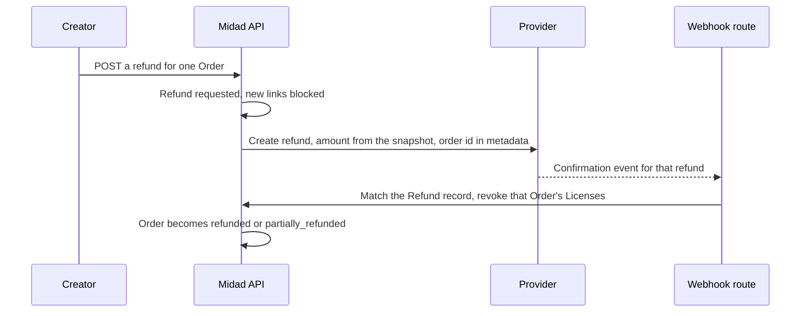

# Refund webhook, revocation and licence verify

The refund route starts with a creator and ends with a revocation, and the two halves are minutes apart with a payment provider in between. Build them as two units. The route decides how much money goes back to which Order, records that decision, and blocks fresh downloads while the money moves. The webhook branch reads the provider's confirmation, finds the Refund record it belongs to, and changes access for that Order only. Then a third, smaller unit: a verify endpoint that answers one word about a license key and nothing else.



Notice that the diagram has no arrow from the confirmation back to the buyer's browser. The buyer finds out from the library and from the creator, not from a page that the server never needed. Notice also where the scope lives: the creator names an Order, the metadata carries the Order id, and the revocation runs on a query filtered by that id. Every step in the sequence is about one Order, and that is what keeps the other creator out of it.

## The creator route

The route is `POST /api/studios/:studioId/orders/:orderId/refunds`, mounted after `requireAuth` and `requireRole('creator')`. The ownership check comes first: the Studio must belong to the caller and the Order must belong to that Studio. A creator who sends another Studio's Order id gets the same 404 that a missing Order gets, so the route does not confirm what it cannot show. Then the state check: only a paid or fulfilled Order can be refunded, and an Order already refunded returns its existing Refund record instead of creating a second one.

The amount is computed, not accepted. Load the Order with its snapshot lines, sum the integers in minor units, and use that sum. If the request names a line, use that line's frozen amount and check that it belongs to the Order. A body containing `amountMinor` is refused with a 400 and a named error, the same discipline the PaymentIntent route applied in Module 19, and for the same reason: a client that believes it is choosing a refund amount is a defect worth seeing during development.

```js
// server/src/modules/refunds/refund.route.js (partial, imports omitted)
router.post('/studios/:studioId/orders/:orderId/refunds', requireAuth, requireRole('creator'), createRefund);

async function createRefund(req, res) {
  if ('amountMinor' in req.body) return res.status(400).json({ error: 'client_supplied_amount' });

  const order = await Order.findOne({ _id: req.params.orderId, studioId: req.params.studioId });
  if (!order) return res.status(404).json({ error: 'not_found' });
  if (!['paid', 'fulfilled'].includes(order.status)) return res.status(409).json({ error: 'not_refundable', status: order.status });

  const existing = await Refund.findOne({ orderId: order._id });
  if (existing) return res.status(200).json({ refund: existing }); // one refund per Order

  const amountMinor = order.lines.reduce((sum, line) => sum + line.priceMinor, 0);
  const checkout = await Checkout.findById(order.checkoutId, { paymentIntentId: 1 }).lean(); // the intent lives on the Checkout
  const refund = await Refund.create({ orderId: order._id, studioId: order.studioId, requestedBy: req.user._id, amountMinor, currency: order.currency, status: 'requested', reason: req.body.reason });

  await Order.updateOne({ _id: order._id, refundRequestedAt: null }, { $set: { refundRequestedAt: new Date() } });

  try {
    const provider = await stripe.refunds.create(
      { payment_intent: checkout.paymentIntentId, amount: amountMinor, metadata: { orderId: String(order._id), studioId: String(order.studioId) } },
      { idempotencyKey: `refund:${order._id}` }
    );
    await Refund.updateOne({ _id: refund._id }, { $set: { providerRefundId: provider.id } });
    return res.status(201).json({ refund: { ...refund.toObject(), providerRefundId: provider.id } });
  } catch (err) {
    // The refund did not start, so the buyer must not lose access for it.
    await Refund.updateOne({ _id: refund._id, status: 'requested' }, { $set: { status: 'failed', failedAt: new Date() } });
    await Order.updateOne({ _id: order._id }, { $set: { refundRequestedAt: null } });
    return res.status(502).json({ error: 'refund_not_started', requestId: req.id });
  }
}
```

Three details in that block are worth more than the rest. The `providerRefundId` is stored as soon as the provider answers, because that id is how the confirmation finds the record. The idempotency key is derived from the Order, so a double click cannot create two refunds. And the failure branch clears `refundRequestedAt`, because the reason for blocking new downloads has gone away. A route that blocks access and then fails to move any money has taken something from the buyer for nothing.

## Revoking on the confirmation

The webhook route already exists from Module 19, with the raw body, the signature check and the event log. Add a branch for the refund confirmation and leave the rest alone. The branch does three things in order: find the Refund record, transition it from `requested` to `succeeded` if this is the first confirmation, then revoke the Licenses of that Order.

```js
// server/src/modules/payments/webhook.handler.js (partial, new branch)
case 'charge.refunded': {
  const providerRefund = refundObjectsFrom(event)[0]; // read the payload for your pinned version
  const detail = providerRefund.metadata?.orderId ? providerRefund : await stripe.refunds.retrieve(providerRefund.id);

  const refund = await Refund.findOneAndUpdate(
    { $or: [{ providerRefundId: detail.id }, { orderId: detail.metadata?.orderId, status: 'requested' }] },
    { $set: { status: 'succeeded', providerRefundId: detail.id, confirmedAt: new Date() } },
    { new: true }
  );
  if (!refund) return recordIgnored(event, 'unknown_refund'); // an event from another life, or a duplicate

  await License.updateMany(
    { orderId: refund.orderId, status: 'active' },
    { $set: { status: 'revoked', revokedAt: new Date(), revokedByRefundId: refund._id } }
  );
  await settleOrderState(refund.orderId);
  break;
}
```

A charge can carry more than one refund, so taking the first entry of that list is a simplification you should replace. Iterate the refunds in the event and take the one whose id matches a stored `providerRefundId`, or whose metadata names an Order that has a Refund in `requested`. The first-entry version works in a demo with a single refund and picks the wrong one the first time a buyer returns two lines on different days.

The `findOneAndUpdate` is doing the duplicate guard, and it is doing it in the same style as every other guard in this course: the transition is conditional, so the second delivery of the same event matches nothing and returns. Then the revocation runs `updateMany` on a query filtered by `orderId`. That word is the whole lesson. A query filtered by `paymentIntentId` would revoke Salma's template at the same moment.

`settleOrderState` applies the arithmetic from 26.1. It sums the succeeded refunds for the Order, compares the total with the Order's snapshot total, and writes `refunded` when they are equal, `partially_refunded` when the sum is smaller but greater than zero, and nothing when no money has moved. Make the update conditional on the state it expects to leave, so two refunds confirmed at the same moment cannot both write a state that disagrees with the sum.

```js
// server/test/refunds/revoke.test.js (partial, the first test to write)
it('revokes only the refunded Order when one payment covered two creators', async () => {
  await handleChargeRefunded(chargeRefundedEventFor(nourRefund, nourOrder));
  const nour = await License.findOne({ orderId: nourOrder._id });
  const salma = await License.findOne({ orderId: salmaOrder._id });
  assert.equal(nour.status, 'revoked');
  assert.equal(salma.status, 'active'); // fails when revocation matches on paymentIntentId
});
```

Write that test before the handler exists and watch it fail with both licenses revoked, which is what the shortest implementation does. Keeping the failing version in your notes is worth more than the passing one, because the next person to touch this query will be tempted by the same shortcut. Then keep the test, and add a second one for the reverse mistake: no license revoked at all, which is what happens when the handler matches the event against a record it never stored.

## The refund that beats the payment

Both confirmations come from the same provider, and their arrival order is not something Midad controls. A refund can be confirmed before the success event for the payment has been handled, especially when the refund is requested within a second of the payment in a test run with the CLI listener. If fulfilment runs afterwards, it must not create a license that is already obsolete.

```js
// server/src/modules/checkout/fulfil-checkout.js (partial, the guard)
if (order.refundRequestedAt || order.status === 'refunded') {
  await markSkipped(order._id, 'refund_before_fulfilment');
  return; // no License, no grant, no receipt
}
```

The guard reads the Order as part of the same load that fetches its lines, and it runs before the grant loop. A checkout with two creators has two Orders, so the guard is per Order, and a refund of Nour's Order does not stop Salma's Order from being fulfilled. That is the same scoping rule again, and it needs its own test, because a guard placed one level too high would pass a single creator test and fail a real checkout.

Add the test for the ordering directly. Fixture: a paid Checkout whose success event is delivered after a refund confirmation for one of its Orders. Assert zero Licenses for the refunded Order, one for the other, and the refunded Order in `refunded` state with a `skipped_due_to_refund` record. Then deliver the payment event again after the refund and assert the counts do not change, because the duplicate guard runs before the state guard, not instead of it.

## The verify endpoint

A buyer sometimes needs to check a key before handing it to a client, and a design tool sometimes needs to know whether a license is still valid without holding a session. Both use cases want one word. The endpoint is `POST /api/licenses/verify` with a body of `{ key }`, and its entire response is a status.

```js
// server/src/modules/licenses/verify.route.js (partial)
router.post('/licenses/verify', verifyLimiter, async (req, res) => {
  const key = typeof req.body?.key === 'string' ? req.body.key.trim() : '';
  if (!key) return res.status(400).json({ error: 'key_required' });

  const license = await License.findOne({ key }, { status: 1 }).lean(); // projection: status only
  const status = license ? license.status : 'unknown';
  return res.json({ status: status === 'active' ? 'active' : status === 'revoked' ? 'revoked' : 'unknown' });
});
```

The projection in the query is the security control, not a formatting choice. Selecting `status: 1` means the handler never holds the buyer id, the order id, the download counter or the seat list, so it cannot leak them by accident through a serializer later. A response with three possible keys and no data is easy to review and hard to abuse.

Keep the refusals indistinguishable. An unknown key and a key that belongs to another product both answer `unknown`, with the same body and the same status code. Do not return a 404 for an unknown key, because a status code that differs from the success case is itself an oracle. And do not return `downloadsRemaining`: the count changes the answer from "is this license live" to "here is a profile of this buyer's purchase", which is more than a public route should ever say.

```js
// server/test/refunds/verify.test.js (partial)
it('answers with a status and nothing else', async () => {
  const res = await request(app).post('/api/licenses/verify').send({ key: nourLicense.key });
  assert.equal(res.status, 200);
  assert.deepEqual(Object.keys(res.body), ['status']); // any extra field fails here
  assert.equal(res.body.status, 'revoked');
});
```

That assertion on `Object.keys` is the test that survives a refactor. A future change that adds `buyerEmail` to the response passes every status check and fails this one line, and the line explains itself.

## The rate limit on verify

An endpoint that answers whether a key exists is an endpoint somebody will point at a list of guesses. Keys come from `crypto.randomBytes` in a readable alphabet, so the guess space is large and enumeration is impractical, which is why the course allows a public route at all. The limit is there to keep the endpoint cheap, to make a script visible, and to protect the database from a page of traffic that has no session behind it.

Two counters, because neither alone is enough. Limit by client address, ten requests per minute, which stops one host from looping. Limit by key hash, thirty per hour, which stops a distributed script from hammering one key. Rotating keys defeats the second limit and rotating addresses defeats the first, so keep both and treat a spike on either as a signal rather than as a solved problem.

```js
// server/src/modules/licenses/verify.limiter.js (partial)
async function verifyLimiter(req, res, next) {
  const ipBucket = `verify:ip:${req.ip}`;
  const keyBucket = `verify:key:${sha256(String(req.body?.key ?? '')).slice(0, 16)}`;
  const [ipCount, keyCount] = await Promise.all([hit(ipBucket, 60), hit(keyBucket, 3600)]);
  if (ipCount > 10 || keyCount > 30) {
    res.set('Retry-After', '60');
    return res.status(429).json({ error: 'rate_limited' });
  }
  next();
}
```

Hash the key before it becomes part of a Redis key name. A raw license key in a counter name is a license key in a place that gets inspected during an incident, and it would sit there for an hour after the request. The hash is enough to bucket the requests and says nothing about the key itself.

Test the limit with eleven requests in a row and assert the eleventh returns 429 with a retry header, then assert the counter resets after the window. Use a short window in the test configuration so the reset can be observed without waiting a minute. A rate limit nobody has seen reject is a rate limit that is probably misconfigured, and the failure mode of a misconfigured one is a buyer who cannot check their own key.

## Acceptance

Five behaviours are deliverable here and each has a test. A creator can refund their own Order and cannot refund another Studio's. A refund request blocks new download links immediately, and a failed refund request clears the block. A confirmation revokes that Order's Licenses and leaves the other creator's License active. A refund confirmed before fulfilment leaves no License for the refunded Order. The verify endpoint answers one status, refuses an unknown key with the same shape, and is rate limited.

Run the cross creator test twice, once with the two Orders from one Checkout and once with two lines from the same Studio refunded separately. The second run is where the `partially_refunded` state appears, and it is the only way to know that the state arithmetic and the revocation query agree with each other about what a partial refund means.
