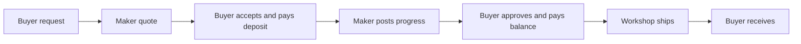

# Build Ghurza, a marketplace for handmade work

A buyer finds a ceramic bowl made by a local workshop. It is the only one of that exact piece. Another buyer asks the same workshop to make a bowl in a different size. Those are two different promises. The ready-made bowl can be sold once; the requested bowl needs a conversation, a quote, a deposit, production, approval, a balance payment, and shipping. Your marketplace must tell the truth about both.

Ghurza is the working name of the reference product. You may name your own project, but its behaviour must still solve this problem. A buyer browses work from several workshops, buys ready-made pieces from two workshops in one checkout, and receives one order per workshop. A workshop owner manages a roster of artisans, publishes pieces with their credit, and responds to custom requests. An artisan receives credit for a piece; credit does not give that artisan authority to change the workshop's prices or accept a buyer's money.

## Two paths through the product

The ready-made path is short. A piece starts as available. A buyer adds it to a cart. At checkout, the server makes a short hold that prevents another checkout from claiming the same piece. Only a verified payment makes the piece sold. If the hold expires, the piece becomes available again. The cart can contain pieces from two workshops, but the platform creates separate workshop orders with immutable title, material, maker-credit and price snapshots. Editing a listing tomorrow must not rewrite yesterday's receipt.

The custom path lasts longer. A buyer sends a request with a description and optional reference photos. A workshop accepts the request for review, sends a versioned quote with a scope, estimated date range, deposit and balance, and waits for the buyer to accept. The buyer pays the deposit through Stripe test mode. The workshop posts progress updates and photos. The buyer approves the completed piece, pays the balance, and receives shipping details. Each transition has an actor, a permitted prior state and evidence. Clicking an old browser tab must not put a paid commission back into negotiation.

Read this diagram as a chain of promises, not merely a set of screens. At the request stage, no price or date is fixed. At the quote stage, the workshop proposes the work, material, dates and money. Acceptance and verified deposit create an obligation to make the agreed piece. Progress photos are evidence of work, but they do not authorize a balance charge. The buyer's approval and on-session balance payment move the commission to shipping. A test for each arrow will ask which actor may take it and which earlier state it needs. If a test can skip an arrow, the workflow is not finished.

These paths share authentication, ownership checks, vendor isolation, payment verification, background work and deployment. They differ in the inventory model and in how long a promise lasts. A piece has a status such as `available`, `held` or `sold`, not a stock count of twelve. A commission has a sequence of decisions and two payment milestones; it is not an ordinary cart line with a longer description.

## Who uses Ghurza

| Person | Needs to do | Must not be able to do |
|---|---|---|
| Buyer | Browse, buy, request, accept a quote, approve work, pay and track | Read another buyer's private request or change a maker's quote |
| Workshop owner | Manage pieces, credit artisans, quote work, update production and shipping | Edit another workshop's order or see its buyer messages |
| Credited artisan | Be named accurately on public work | Gain workshop ownership merely by appearing in a credit field |

Use fictional workshops and makers in your seed data. Use your own photographs, openly licensed images or images used with written permission. Do not invent a maker's history, the meaning of a motif or an assured delivery date. In product copy, state what you know: material, technique, dimensions, maker credit when consented to, and the workshop's estimate. Shipping and customs can change; promise a range that the workshop can edit before the buyer accepts the quote.

## The four demos

At the end of Week 1, both apps run and seeded workshops, artisans, pieces and one custom request appear in the database. At the end of Week 2, a workshop lists a piece with its artisan credit and images; a second workshop receives 403 when it tries to edit that piece. At the end of Week 3, a buyer checks out pieces from two workshops. Two competing checkouts for the same piece produce one sale, never two. At the end of Week 4, the live HTTPS app demonstrates the whole commission: request, quote revision, deposit, progress evidence, approval, balance, shipment and receipt.

The final evidence is more than a polished screen. You will show a concurrent checkout test, a duplicate-webhook test, an authorization matrix, an ERD, worker logs and a live URL. A mentor should be able to stop your demo and ask why a transition is safe. Your answer should point to a check in the code and an observed result, not only to a diagram.

## A worked request before any code

Imagine a buyer asks Workshop A for a carved olive-wood tray. The buyer provides dimensions and a reference image, says they would like it next month, and gives a budget range. The workshop cannot treat that date as a commitment: it must first check materials, workshop capacity and shipping. Its first quote names a material, finish, size tolerance, estimated production range, shipping zone, deposit and balance. The buyer asks for a smaller size. The workshop sends a second quote rather than editing the first one in place. The buyer accepts version two. The accepted quote is the evidence both parties can refer to weeks later.

Now picture three failures. First, a browser tab still displays version one. A click in that tab must be rejected because the quote version is no longer current. Second, the payment provider delivers the deposit success webhook twice. The commission should record one deposit, not two, and it should enter production once. Third, Workshop B guesses the request ID. The API must return 403 or 404 without showing the buyer's image or message. These are not unusual edge cases. They are ways that old tabs, retries and shared URLs behave in a real web application.

When you model the request, keep the buyer's description separate from the workshop's quote. The description is an invitation to discuss work, not an instruction for the workshop to charge money. Store a quote as an immutable version with its terms. A later quote may supersede it, but it must not erase the earlier conversation. Once a quote is accepted, copy its money and scope into the commission record. The order view can then show the buyer the same promise even if the workshop changes its default deposit policy next week.

For a ready-made piece, use a different flow. A single `Piece` record can have a status, a short hold owner and hold expiry. It must never pretend that a sold one-off bowl has a remaining stock count. The checkout writes an order snapshot that records which specific piece was purchased. A new custom request may link to a sold piece as inspiration, but it cannot put that sold piece back into the available catalogue. This is why “request something similar” leads to a new request, not to a second unit of the old listing.

## How the modules build on each other

The early modules give you both apps, a MongoDB connection, accounts, workshop ownership and piece listings. Authorization comes before private requests: you cannot safely build a maker inbox until the server knows which workshop owns it and which buyer sent each message. The cart, hold and Stripe modules finish the ready-made path. Only then do the custom-request, quote and production modules extend the system with a long-running commission. The same worker that clears abandoned holds can later expire unanswered quotes and send balance reminders. The deploy module proves that the API and worker both survive a restart.

You will frequently compare the two paths. Ask what can be shared because the same rule holds, such as “a second workshop cannot edit this record.” Then ask what must differ, such as a stock reservation versus a quote awaiting acceptance. When a screen or API route cannot explain which path it belongs to, pause and revise the model before adding another conditional branch. That habit makes the final system easier to defend.

## First decision

Write two sentences in your learning log. In the first, explain what happens when two buyers try to purchase the same ready-made piece. In the second, explain why a deposit for a custom piece cannot be treated as final payment for a ready-made order. Keep those sentences. You will revisit them after the checkout and commission modules, when your answers can name the exact database writes and webhook events.
