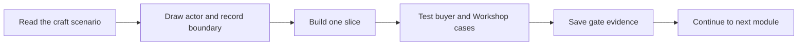

# How to use this course

Ghurza grows from a small catalogue of one-off pieces into a marketplace that can handle custom commissions. Follow the chapters in order. Early data choices decide whether a sold piece can be bought twice, whether a buyer's private request is exposed, and whether a quote can change after acceptance. A chapter may seem to ask for only one model or page, but its gate checks the promise that later modules will rely on. Keep the working project in your own repository and record each decision as you go.

Read chapters introduce a product problem and vocabulary. Learn chapters ask you to step through a decision and explain the result. Build chapters produce code, tests or a working screen. Check chapters test your understanding before another dependency is added. Gate chapters require a small set of evidence, such as an ERD, raw API denial and state transition result. Do not substitute a polished screenshot for a failed data rule. A beautiful sold-piece page can still accept a stale checkout request directly through the API.

## Keep a product thread in the learning log

Create `docs/learning-log.md`. After each lesson, write what changed in the buyer or Workshop journey, which record holds the new fact, and what request or test proves it. For a Piece model, record why its status is held rather than `stockQty: 0`. For an Artisan credit, record which account can edit the Piece and which public name is allowed to appear. For a CustomRequest, record the two parties allowed to read its brief. These notes will become capstone defense evidence and a recovery map after interruptions.

A useful entry includes a concrete example. "Workshop B gets 403 when it tries to change Workshop A's Piece price" is stronger than "ownership works." Include the route, actor and database state after the denial. A test that checks only the status code may miss a write that happened before the handler returned an error. When a module introduces payment, record the provider event, Order or Commission ID and whether a replay changed the count. Remove personal data and secrets before committing evidence.

## Use the gates in order

Module 5 asks you to show Workshop ownership, Artisan credit, single-piece state, a repeatable seed and a private request. Module 19 will claim one Piece under two simultaneous checkout attempts. Module 23 will reject stale quote versions and verify a deposit. Module 24 will show production progress, approval, balance and a stage-based cancellation outcome. These later gates depend on earlier relationships. If Module 5 cannot explain who owns the Piece, a Module 23 deposit test cannot make the Commission trustworthy.

At a gate, read the pass condition before implementing the last feature. Make a test for a valid actor and a denied actor. Add a stale or concurrent case when the module promises one. Save raw text output when possible. A screenshot may show the interface but cannot prove an index exists or that a second buyer lost the hold race. Ask a peer to challenge your explanation using a different Workshop, Buyer or Piece ID.

## Work from examples, then vary them

The course may show a worked request for an olive wood tray. Use it to learn how buyer, Workshop, inspiration Piece and private photos relate. Then try a tatreez request with a different Workshop and a declined status. If both cases only pass because the client hides a button, inspect the server query. The purpose of the example is to reveal a reusable decision method, not to provide a complete commission implementation to copy.

When a term is unfamiliar, write a one-sentence definition tied to Ghurza. A hold is a temporary claim on one exact Piece for a Checkout. A Quote is a versioned offer for work that does not yet exist. A maker credit names an Artisan publicly with consent; it is not seller authorization. These distinctions matter more than memorizing a generic commerce glossary. Return to them whenever a later route seems to need a new status or ownership check.

## Ask for review with evidence

If stuck, show a mentor a small failing case: the Piece or request ID, actor, expected response, actual response, and relevant model fields. Do not share a real buyer's reference photo or budget in a support screenshot. A fictional seed should give you enough material to reproduce the defect. A mentor can quickly challenge a specific claim, while "the marketplace is broken" hides which promise failed.

At the end of each week, compare your working demo to the roadmap. The first week needs fictional Workshops, Artisans, Pieces and an ERD; later weeks add browse, ready-made checkout, custom requests, deposits and production. A missing earlier gate is not erased by a later screen. The next chapter introduces the people whose work and trust those gates protect.

## Compare two gates before coding them

A Module 5 gate may show that Piece.status has allowed values and that a wrong Workshop cannot edit it. A Module 19 gate must show something stronger: two simultaneous checkout attempts for the same Piece produce one hold winner. The second result cannot be inferred from the first. A data model that can store held status is necessary, but only the conditional write and race test prove sold-once behavior. Write this distinction in your learning log so the first week's seed is not described as a completed checkout.

Module 23 has a similar distinction. A Quote schema with version numbers does not prove stale acceptance is rejected. The gate needs a buyer holding version 1 while the Workshop issues version 2, then a 409 or equivalent conflict on old acceptance. A deposit PaymentIntent must use the current server-held quote amount and a verified provider event. A pretty quote card that displays version 2 is not enough if the API still accepts a crafted version 1 request. This is why the course revisits the same records with stronger tests later.

## Read a failed test as product feedback

Suppose a wrong Buyer gets a CustomRequest brief through a direct GET. The failure says the private conversation boundary is broken. Check whether the query includes buyer ID or owned Workshop ID. Do not patch the page by hiding the thread tab for that Buyer; the raw API would still leak the budget and reference photos. After fixing the query, run both allowed views, Buyer and Workshop, so the denial does not accidentally block the intended parties.

Suppose the wrong Workshop can attach its Artisan ID to another Workshop's Piece. The data may render a plausible maker name, so a screenshot can miss the mismatch. Inspect both stored Workshop IDs. Add a service check and a test with a valid foreign Artisan ID. This example shows how a learning-log entry should preserve the reason for a rule: credit belongs to the seller's Workshop, but credit does not grant seller authority.

## Review in small packets

At the end of a module, share the pass condition and one focused artifact with a peer. For the data model, share the ERD, seed counts and two raw denial responses. For one-off checkout, share the two concurrent request results and final Piece document. For a commission, share a short state timeline and replay log with private values redacted. A ten-minute packet is easier to review on weak internet than a long video whose interesting frame is hard to find.

A peer should ask a question you can answer from evidence, such as "What stops a second buyer holding the bowl?" or "Which field tells the API that this Artisan belongs to this Workshop?" If you can only answer by pointing to a button that is hidden, the server rule needs work. Use that challenge before calling a gate complete. The following chapter identifies the people who make these rules meaningful, so keep the buyer and maker visible behind each test.
