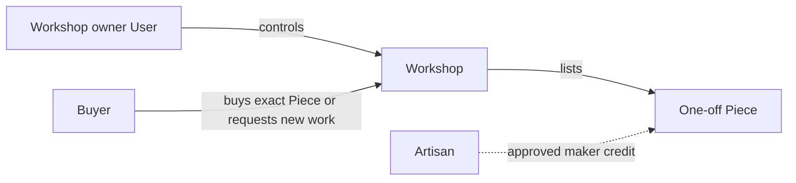

# The crafts and the people who make them

Ghurza lets Workshops sell finished tatreez, olive wood and ceramic pieces, and lets buyers ask for made-to-order work. The Workshop owner operates the seller account, sets listing prices, answers requests and fulfils orders. An Artisan is the person credited for making a Piece, sometimes using a chosen public name and sometimes choosing no name. The buyer chooses an exact finished Piece or starts a private request for future work. These are three different relationships; an attractive product page should not blur them.

The dotted credit link does not grant edit permission. A Workshop may credit two makers across its catalogue. One maker may not have an account at all. A buyer may know the maker's display name, but the contract and support path remain with the Workshop. Use "maker" or "Artisan" in product copy when describing the person who created the work. "Supplier" suggests an interchangeable source of units, which does not describe a one-off bowl or stitched cushion fairly.

## Learn from one Piece, not a category label

Imagine a stitched cushion with a visible motif. A useful listing says who made it if they chose public credit, names fabric and thread materials, describes the stitching technique as the Workshop confirms it, gives approximate dimensions and care instructions, and shows ordered photos of the exact object. A vague "authentic heritage design" label does not tell the buyer what will arrive and may invent a cultural claim the maker did not make. The course asks you to describe the object and its maker accurately rather than manufacture a story for marketing.

Now imagine an olive wood bowl by a different Workshop. It may have natural grain variation, specific dimensions and care needs. The buyer must know that a photograph shows the exact Piece being sold, not a generic product representing unlimited stock. If it sells, the page can remain to show the maker's work and invite a request for something similar. The new request cannot guarantee the same grain, measurements or price. Write this distinction into UI copy before the data model. Honest language helps the schema stay honest.

## Separate public credit from private details

A maker may choose a pseudonym or decline public naming. The public Piece response should show only approved credit text, not a legal name hidden in unused JSON. A Workshop dashboard may need a stable internal Artisan record, but that does not mean every field should be sent to anonymous visitors. The choice can change later. Treat the current public display and a historical OrderLine's maker credit as different concerns with a documented privacy policy.

The buyer's side also has private information. A custom request may include a budget, desired date and reference photos from a home or family. Only the buyer and addressed Workshop should read it under the course's two-party rule. The credited maker of an inspiration Piece does not automatically get access to the request. If the Workshop later invites staff into a real product, that needs explicit membership and permissions, not an inference from a public credit field.

## Map one valid and one denied action per person

The Workshop owner may edit its own Piece price and answer an addressed CustomRequest. Another Workshop owner may not. A Buyer may read their own request and choose a current Quote, but cannot publish a Piece or mark production delivered. An Artisan may be credited on a Piece without any account or dashboard permission. An admin may review platform disputes under a documented route, but the course does not make them a substitute seller. Write this matrix in the learning log and test the boundaries as the API is built.

Consider a maker who is also a buyer. Their buyer account still does not own the Workshop that credited them. Names and email addresses are not authorization links. The server uses stored User-to-Workshop ownership for edits and buyer-to-request or buyer-to-order links for private reads. This is a common source of confusion in marketplaces because the same human can have several relationships to one object. A diagram with labelled arrows helps keep them separate.

## Keep the story fictional and respectful

Use invented Workshop and buyer identities in the seed. Do not copy a real Artisan's portrait, pattern explanation or biography without permission. If a technique name is uncertain, ask a domain instructor rather than inventing a tradition. If a maker describes a motif's meaning, attribute that explanation to them and preserve their chosen wording. The technical course can model credit and consent even when it cannot teach every craft history accurately.

The next chapter turns this respect into practical writing rules for product pages and requests. It will ask you to revise a misleading description, not merely memorize a list of banned words. Keep the three actor relationships visible as you work: the person making the work, the seller making the promise, and the buyer relying on both.

## Let a maker choose the public story

Ask a fictional Workshop to decide whether a maker's name appears, what technique description they approve and whether a motif has a meaning they want published. The platform should not infer these from an image or from another seller's listing. A maker might prefer to be named for one Piece but use the Workshop name for another. The course's simple Artisan record has a display choice, and the Piece may carry the approved credit text shown at sale. A production service would need a clear consent and correction process if those preferences vary over time.

This choice affects data paths. A public catalogue response can include approved maker text; an owner dashboard can show internal credit IDs; an OrderLine can preserve what the buyer saw at purchase; and a private CustomRequest may refer to an inspiring Piece without exposing the buyer's brief back through that public Piece. Draw four boxes and list the fields allowed in each. If the same full Artisan or request document is populated everywhere, a hidden name or private budget may leak despite careful UI wording.

## Follow a request to the right Workshop

Sami sees a sold bowl by Bayt al Zayt and wants a larger tray. The request form may prefill the Workshop and an inspiration Piece ID. The server must confirm the Piece belongs to that Workshop, because a client can alter both IDs. If a request for Workshop B carries an inspiration Piece from Workshop A, reject it or make the mismatch explicit; do not silently send another maker's work into B's inbox as if B created it. The request may still describe a desired style in words, but the stored relationship must be honest.

The Workshop can ask follow-up questions or decline. A credited Artisan does not automatically see the conversation. A buyer might include a family photograph or budget; those are not public browsing facts. Keep the two-party privacy rule in the chapter's actor matrix. Later API tests must cover a second Buyer, second Workshop and a credited maker with no owner role. This is a stronger test than checking only that an anonymous visitor is blocked.

## Treat fulfilled orders as promises by the seller

For a ready-made Piece, the Workshop is responsible for the listed object and shipping profile. For a commission, the Workshop is responsible for the accepted Quote, production updates and balance request. The Artisan credit matters to attribution but does not change who owns the seller account. If a maker and Workshop have their own private agreement, it is outside this app's buyer flow and outside the course's payout scope. Do not place a maker's personal payment account on the buyer checkout screen without an explicit product decision.

Finish with a one-minute explanation of each actor: Buyer chooses or requests, Workshop sells and responds, Artisan receives approved credit. Then give a denied action for each relationship. A buyer cannot publish a Piece, another Workshop cannot read the request, and a credited maker cannot change the Workshop price by virtue of credit. The next chapter turns those relationships into precise words on the page.
